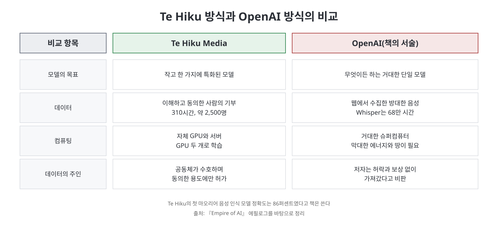
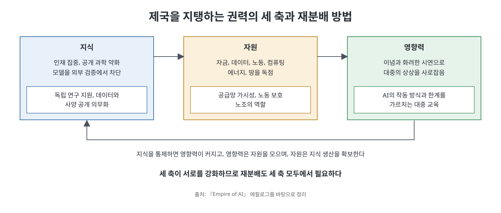

# 에필로그 - 제국은 어떻게 무너지는가

에필로그는 비판으로 끝나지 않고 대안을 제시한다. 캐런 하오는 뉴질랜드 마오리 공동체의 작은 음성 인식 프로젝트에서 이야기를 시작해, 거대 AI 기업에 맞서는 여러 조직과 활동가를 소개하고, 마지막으로 '제국을 해체하는 공식'을 세 가지 권력 축으로 정리한다. 책 제목의 '제국'이 어떻게 무너질 수 있는지에 대한 저자의 답이다.

> **이 장을 한 문장으로**
> AI가 인류에게 좋은가를 묻기보다 AI가 권력을 한곳으로 모으는가 흩는가를 물어야 하며, 지식, 자원, 영향력 세 축에서 권력을 되돌려 놓는 일이 제국을 허무는 길이다.

---

## 이 장의 흐름

1. 마오리어 소멸 위기와 Te Hiku Media의 도전
2. 합의, 호혜, 주권에 기반한 AI 개발
3. 제국에 저항하는 사람들: DAIR, 데이터 노동자, 지역 활동가
4. 질문을 바꾸기: AI는 권력을 어떻게 옮기는가
5. 세 가지 축에서의 권력 재분배

---

## 0. 먼저 알아 둘 것

| 용어 | 쉬운 설명 |
|------|-----------|
| te reo Māori(테 레오 마오리) | 뉴질랜드 원주민 마오리족의 언어. 책에 따르면 식민 통치 아래 학교에서 쓰지 못하게 되어 사용자가 크게 줄었다. |
| 음성 인식 모델 | 사람의 말소리를 글자로 바꿔 주는 AI. 녹음을 자동으로 받아 적는 데 쓴다. |
| 데이터 라벨링(주석) | AI가 학습할 자료에 사람이 일일이 설명을 달아 주는 일. 주로 저임금 노동자가 맡는다. |
| 카이티아키탕가(kaitiakitanga) | 책에서 소개한 마오리 원칙으로 '수호, 관리'를 뜻한다. 데이터를 공동체가 책임지고 지킨다는 생각의 바탕이다. |
| 추출주의(extractivism) | 자원과 데이터를 대가 없이 퍼 가는 방식. |

---

## 1. 마오리어를 되살리는 AI

저자는 2021년 뉴질랜드 원주민 공동체가 AI로 마오리어(te reo)를 되살리려 한다는 이야기를 접했다. 마오리어는 1867년 학교 수업을 영어로만 하게 한 법과 20세기 초 도시화로 사용자가 마오리 인구의 90퍼센트에서 12퍼센트로 줄었고, 정책이 바뀌었을 때는 가르칠 사람마저 거의 없었다고 책은 쓴다.

저자는 언어를 잃는 일이 단지 의사소통 수단의 상실이 아니라고 말한다. 언어는 역사와 문화와 지식을 담고 있기 때문이다. 대형 언어 모델은 이런 소멸을 가속한다는 것이 저자의 주장이다. 모델을 학습시킬 만큼 온라인에 기록이 충분한 언어는 극소수라서, 책이 인용하는 수치로는 7천 개가 넘는 언어 가운데 Google 번역이 지원하는 것은 2퍼센트 미만, OpenAI 자체 시험에서 GPT-4가 80퍼센트 넘는 정확도를 내는 언어는 15개(0.2퍼센트)뿐이다.

## 2. Te Hiku Media: 합의, 호혜, 주권

마오리 출신 Peter-Lucas Jones와 하와이 원주민 Keoni Mahelona는 뉴질랜드 북부 Kaitāia에 있는 마오리어 라디오 방송국 Te Hiku Media를 운영했다. 이 방송국에는 20년 넘게 쌓인 마오리어 음성 기록이 있었고, 이를 학습 자료로 쓰려면 받아 적을 사람이 필요했다. 그래서 Mahelona가 음성 인식 모델을 만들자고 제안했다.

이 프로젝트가 OpenAI 방식과 갈라지는 지점은 세 가지 원칙이었다. 책의 서술에 따르면 이 두 사람은 모든 단계에서 이 세 가지를 보장할 수 있을 때만 프로젝트를 진행하기로 했다.

| 원칙 | 실제 의미 |
|------|-----------|
| 합의(consent) | 시작 전에 공동체와 원로에게 이 일을 원하는지 먼저 묻고, 데이터 기여자는 용도를 충분히 이해한 사람만 받는다. |
| 호혜(reciprocity) | 공동체가 가장 필요로 하는 학습 자료가 무엇인지 듣고 그에 맞춰 모델의 쓸모를 정한다. |
| 주권(sovereignty) | 자체 GPU와 서버로 학습해 대형 기술 기업의 클라우드에 의존하지 않고, 데이터는 공동체가 수호한다. |

데이터는 인터넷에 공개되지 않고 Te Hiku의 관리 아래 두며, 마오리의 가치를 존중하고 공동체가 동의한 프로젝트에만 사용을 허가한다. Mahelona는 "데이터는 식민화의 마지막 개척지"라고 말했다. 옛 제국이 원주민의 땅을 빼앗고 새 약관으로 되팔게 했던 것처럼, 빅테크가 데이터를 거의 공짜로 모아 서비스로 다시 판다는 비판이다.

결과도 책이 구체적으로 적는다. 교육 캠페인과 데이터 기부 대회를 열자 열흘 만에 약 2,500명이 낸 20만 건가량의 녹음에서 310시간의 고품질 전사 음성이 모였다. OpenAI가 음성 인식 모델 Whisper를 위해 웹에서 긁어모은 68만 시간에 비하면 작지만, 이것으로 정확도 86퍼센트의 첫 마오리어 음성 인식 모델을 만들었다. 출발점은 Mozilla의 무료 모델 DeepSpeech였고, 사용한 GPU는 단 두 개였다. 저자는 이를 통해 작고 특정 일에 특화된 모델도 충분히 유용할 수 있다는 교훈을 끌어낸다.

## 3. 제국에 저항하는 사람들

저자는 Te Hiku가 유일한 사례가 아니라고 말하며 여러 활동을 소개한다.

- **DAIR(분산 AI 연구소)**: Timnit Gebru가 Google에서 쫓겨난 뒤 2021년 12월 설립한 비영리 연구소다. 이름의 '분산'은 중앙 집중에 맞선다는 뜻이다. 연구자가 각자의 공동체에 머물며 연구하고, 그 결과가 공동체에 돌아가게 한다는 철학을 세웠다. Alex Hanna와 Milagros Miceli가 초기에 합류했다.
- **Data Workers' Inquiry**: Miceli가 만든 프로젝트로, 데이터 노동자가 직접 연구 질문을 정하게 하고 독일 연구자 표준 시급인 25유로를 지급했다. Miceli는 왜 시간당 2달러를 주느냐고 되묻고, 이런 논리가 식민주의적이라고 비판한다. 참여자 Oskarina Veronica Fuentes Anaya(베네수엘라 출신)는 여러 플랫폼에서 일해도 월 335달러가량을 번다고 증언했다.
- **Mophat 오키니(케냐)**: OpenAI 계약이 끝난 뒤인 2023년 5월 아프리카 콘텐츠 검수자 노조 조직가가 되었고, 동료와 Techworker Community Africa(TCA)를 세웠다. 근로자 교육과 정책 입안자 연결에 힘쓴다. 그는 케냐 법만으로는 미국 기업을 규율할 수 없어 국제적 노력이 필요하다고 말한다.
- **Daniel Pena(우루과이)**: Google 데이터센터에 대한 영향 조사를 요구한 청원(서명 400명 이상)이 무시당했고, 칠레의 MOSACAT 등 다른 공동체와 연대를 넓히고 있다. 산업의 공급망이 에너지, 데이터, 광물, 노동에 걸쳐 있으므로 저항도 국경을 넘어야 한다는 것이 그의 결론이다.

## 4. 질문을 바꾸기

저자는 OpenAI의 사명이 제국을 세우는 공식이라면 그것을 해체하는 공식은 무엇인지 묻는다. 세부 전개는 알 수 없고 경쟁사가 선두를 차지할 수도 있지만, 어느 경우에도 변하지 않을 일이 있다고 말한다.

여기서 Stanford 연구자 Ria Kalluri의 제안이 등장한다. 'AI가 인류에게 좋은가'는 보는 사람마다 다르니, 대신 AI가 권력을 집중시키는가 분산시키는가를 물으라는 것이다. 이 책의 틀로 번역하면, 제국을 강화하는가 민주주의 쪽으로 되돌리는가가 된다.

## 5. 세 가지 축의 권력 재분배

저자는 책에서 다룬 권력의 세 축이 서로를 강화한다고 정리한다. 지식을 통제하면 영향력이 커지고, 영향력은 자원을 모으며, 자원은 다시 지식 생산을 확보하게 한다.

| 축 | 제국의 현재 상태 | 저자가 제시한 재분배 방향(예시) |
|----|----------------|------------------------------|
| 지식 | 인재 집중, 공개 과학의 약화, 모델을 외부 검증에서 차단 | 제국 밖의 연구 자금 확대, 독립 평가자 지원, 학습 데이터와 기술 사양 공개 의무화, 언론과 시민단체의 현장 취재 |
| 자원 | 자금, 데이터, 노동, 컴퓨팅, 에너지, 땅의 독점 | 학습 데이터와 공급망(노동 계약, 데이터센터 부지)의 가시성 확보, 모든 노동자를 위한 노동 보호, 노조의 역할 |
| 영향력 | 이념과 대중을 사로잡는 시연으로 형성한 서사 | AI의 작동 방식과 한계, 개발자의 세계관과 오류 가능성에 대한 대중 교육 |

지식 축에서 UC Berkeley의 Deborah Raji는 금융과 의료기기에는 감독 기관이 있는데 AI 제품에는 없다고 지적한다. 그는 AI가 입력 데이터에 따라 움직이는 시스템이라 일반 제품보다 더 많은 투명성이 필요하다고 말한다. Hugging Face의 Sasha Luccioni는 가전에는 에너지 효율 등급이 있지만 AI에는 지속 가능성 정보가 없다고 말한다. 자원 축에서는 할리우드 파업이 작가와 배우를 AI 사용으로부터 일정 부분 보호했던 사례가 노조의 역할을 보여 준다고 저자는 쓴다.

영향력 축의 처방은 교육이다. 저자는 1960년대 ELIZA 챗봇을 만든 MIT 교수 Joseph Weizenbaum의 말을 인용한다. 프로그램의 속이 쉬운 말로 설명되면 "그 마법은 무너진다"는 것이다. 저자는 이 책이 그 이해에 보탬이 되기를 바란다는 말로 책을 맺는다.

> **쉽게 말하면**
> 제국을 무너뜨리는 일은 거대한 한 방이 아니라, 지식, 자원, 영향력을 쥔 힘을 조금씩 되돌려 놓는 여러 일의 합이다. Te Hiku, DAIR, 노동자 조직이 그 작은 예시들이다.

---

## 핵심 정리

- Te Hiku Media는 합의, 호혜, 주권을 지키며 작은 특화 모델로 성과를 냈다. 이는 OpenAI식 '모든 것을 하는 거대 모델'과 다른 길이 가능하다는 증거로 제시된다.
- 저자는 거대 AI 기업이 지식, 자원, 영향력 세 축의 권력을 장악하고 있으며 이 세 축이 서로를 강화한다고 본다.
- 제국에 대한 대안은 DAIR, 데이터 노동자 조직, 지역 환경 활동가들처럼 이미 세계 곳곳에서 시도되고 있다.
- 질문을 'AI가 좋은가'에서 'AI가 권력을 집중시키는가 분산시키는가'로 바꾸라는 것이 저자의 핵심 제안이다.
- 투명성 의무, 독립 연구 지원, 노동 보호, 대중 교육이 권력을 되돌리는 구체적 수단으로 제시된다.

 

이전: [구간 개요](Readme.md) | 다음: [핵심 정리](%ED%95%B5%EC%8B%AC%20%EC%A0%95%EB%A6%AC.md)
