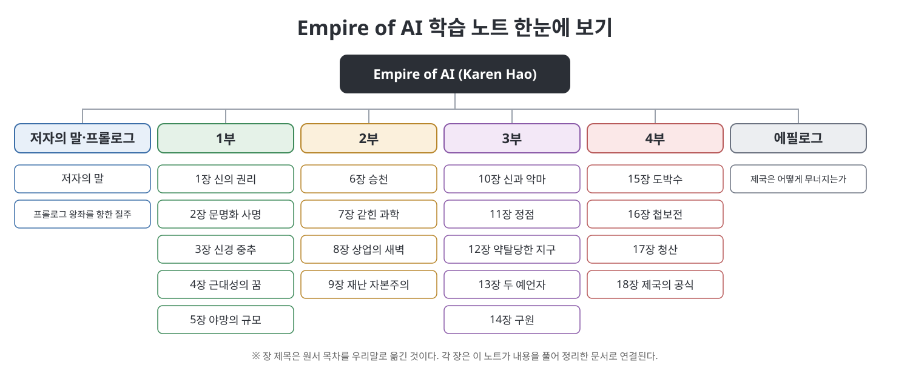

# **Empire of AI 학습 노트**
(Empire of AI: Dreams and Nightmares in Sam Altman's OpenAI, 장별 정리 노트)
 

이 문서는 Karen Hao의 『Empire of AI: Dreams and Nightmares in Sam Altman's OpenAI』(Penguin Press, 2025)를 부와 장별로 정리한 한국어 학습 노트입니다. 원문을 번역한 것이 아니라 내용을 우리말로 풀어서 다시 설명했고, 처음 나오는 용어와 인물에는 쉬운 풀이를 붙였습니다. 책은 OpenAI와 Sam Altman을 중심으로 생성형 AI 산업이 어떻게 만들어졌고 누구에게 어떤 대가를 치르게 했는지를 취재한 논픽션입니다. 프롤로그, 4부 18장, 에필로그로 구성되어 있으며 이 노트도 같은 순서를 따릅니다. 장마다 사건 흐름도, 관계도, 연표 같은 그림과 표를 직접 만들어 넣었습니다.

> **이 노트를 읽을 때 유의할 점**
> - 이 노트는 원서의 **요약·해설본**이며 원서를 대신하지 않습니다. 수치, 날짜, 인용, 인물에 대한 서술처럼 근거가 필요한 내용은 반드시 원서에서 확인하세요.
> - 책 속 인물의 행동과 평가는 **저자의 취재와 서술**입니다. 노트는 "저자에 따르면", "책은 ...라고 묘사한다"처럼 출처를 밝히고, 당사자가 부인하거나 책이 단정하지 않은 내용은 그렇게 적었습니다.
> - 인명과 고유명사의 한글 표기는 노트 작성 과정에서 정한 것이며 공식 표기가 아닙니다.
> - 장 제목 풀이처럼 노트 작성자의 해석이 들어간 부분은 본문에 해석임을 표시했습니다.
 

---

## 목차

- [저자의 말과 프롤로그](00.%20%EC%A0%80%EC%9E%90%EC%9D%98%20%EB%A7%90%EA%B3%BC%20%ED%94%84%EB%A1%A4%EB%A1%9C%EA%B7%B8/Readme.md)
  - [저자의 말](00.%20%EC%A0%80%EC%9E%90%EC%9D%98%20%EB%A7%90%EA%B3%BC%20%ED%94%84%EB%A1%A4%EB%A1%9C%EA%B7%B8/%EC%A0%80%EC%9E%90%EC%9D%98%20%EB%A7%90.md)
  - [프롤로그 - 왕좌를 향한 질주](00.%20%EC%A0%80%EC%9E%90%EC%9D%98%20%EB%A7%90%EA%B3%BC%20%ED%94%84%EB%A1%A4%EB%A1%9C%EA%B7%B8/%ED%94%84%EB%A1%A4%EB%A1%9C%EA%B7%B8%20-%20%EC%99%95%EC%A2%8C%EB%A5%BC%20%ED%96%A5%ED%95%9C%20%EC%A7%88%EC%A3%BC.md)
  - [핵심 정리](00.%20%EC%A0%80%EC%9E%90%EC%9D%98%20%EB%A7%90%EA%B3%BC%20%ED%94%84%EB%A1%A4%EB%A1%9C%EA%B7%B8/%ED%95%B5%EC%8B%AC%20%EC%A0%95%EB%A6%AC.md)
- [1부 (1~5장)](01.%201%EB%B6%80/Readme.md)
  - [1장 신의 권리](01.%201%EB%B6%80/01%EC%9E%A5%20%EC%8B%A0%EC%9D%98%20%EA%B6%8C%EB%A6%AC.md)
  - [2장 문명화 사명](01.%201%EB%B6%80/02%EC%9E%A5%20%EB%AC%B8%EB%AA%85%ED%99%94%20%EC%82%AC%EB%AA%85.md)
  - [3장 신경 중추](01.%201%EB%B6%80/03%EC%9E%A5%20%EC%8B%A0%EA%B2%BD%20%EC%A4%91%EC%B6%94.md)
  - [4장 근대성의 꿈](01.%201%EB%B6%80/04%EC%9E%A5%20%EA%B7%BC%EB%8C%80%EC%84%B1%EC%9D%98%20%EA%BF%88.md)
  - [5장 야망의 규모](01.%201%EB%B6%80/05%EC%9E%A5%20%EC%95%BC%EB%A7%9D%EC%9D%98%20%EA%B7%9C%EB%AA%A8.md)
  - [핵심 정리](01.%201%EB%B6%80/%ED%95%B5%EC%8B%AC%20%EC%A0%95%EB%A6%AC.md)
- [2부 (6~9장)](02.%202%EB%B6%80/Readme.md)
  - [6장 승천](02.%202%EB%B6%80/06%EC%9E%A5%20%EC%8A%B9%EC%B2%9C.md)
  - [7장 갇힌 과학](02.%202%EB%B6%80/07%EC%9E%A5%20%EA%B0%87%ED%9E%8C%20%EA%B3%BC%ED%95%99.md)
  - [8장 상업의 새벽](02.%202%EB%B6%80/08%EC%9E%A5%20%EC%83%81%EC%97%85%EC%9D%98%20%EC%83%88%EB%B2%BD.md)
  - [9장 재난 자본주의](02.%202%EB%B6%80/09%EC%9E%A5%20%EC%9E%AC%EB%82%9C%20%EC%9E%90%EB%B3%B8%EC%A3%BC%EC%9D%98.md)
  - [핵심 정리](02.%202%EB%B6%80/%ED%95%B5%EC%8B%AC%20%EC%A0%95%EB%A6%AC.md)
- [3부 (10~14장)](03.%203%EB%B6%80/Readme.md)
  - [10장 신과 악마](03.%203%EB%B6%80/10%EC%9E%A5%20%EC%8B%A0%EA%B3%BC%20%EC%95%85%EB%A7%88.md)
  - [11장 정점](03.%203%EB%B6%80/11%EC%9E%A5%20%EC%A0%95%EC%A0%90.md)
  - [12장 약탈당한 지구](03.%203%EB%B6%80/12%EC%9E%A5%20%EC%95%BD%ED%83%88%EB%8B%B9%ED%95%9C%20%EC%A7%80%EA%B5%AC.md)
  - [13장 두 예언자](03.%203%EB%B6%80/13%EC%9E%A5%20%EB%91%90%20%EC%98%88%EC%96%B8%EC%9E%90.md)
  - [14장 구원](03.%203%EB%B6%80/14%EC%9E%A5%20%EA%B5%AC%EC%9B%90.md)
  - [핵심 정리](03.%203%EB%B6%80/%ED%95%B5%EC%8B%AC%20%EC%A0%95%EB%A6%AC.md)
- [4부 (15~18장)](04.%204%EB%B6%80/Readme.md)
  - [15장 도박수](04.%204%EB%B6%80/15%EC%9E%A5%20%EB%8F%84%EB%B0%95%EC%88%98.md)
  - [16장 첩보전](04.%204%EB%B6%80/16%EC%9E%A5%20%EC%B2%A9%EB%B3%B4%EC%A0%84.md)
  - [17장 청산](04.%204%EB%B6%80/17%EC%9E%A5%20%EC%B2%AD%EC%82%B0.md)
  - [18장 제국의 공식](04.%204%EB%B6%80/18%EC%9E%A5%20%EC%A0%9C%EA%B5%AD%EC%9D%98%20%EA%B3%B5%EC%8B%9D.md)
  - [핵심 정리](04.%204%EB%B6%80/%ED%95%B5%EC%8B%AC%20%EC%A0%95%EB%A6%AC.md)
- [에필로그](05.%20%EC%97%90%ED%95%84%EB%A1%9C%EA%B7%B8/Readme.md)
  - [에필로그 - 제국은 어떻게 무너지는가](05.%20%EC%97%90%ED%95%84%EB%A1%9C%EA%B7%B8/%EC%97%90%ED%95%84%EB%A1%9C%EA%B7%B8%20-%20%EC%A0%9C%EA%B5%AD%EC%9D%80%20%EC%96%B4%EB%96%BB%EA%B2%8C%20%EB%AC%B4%EB%84%88%EC%A7%80%EB%8A%94%EA%B0%80.md)
  - [핵심 정리](05.%20%EC%97%90%ED%95%84%EB%A1%9C%EA%B7%B8/%ED%95%B5%EC%8B%AC%20%EC%A0%95%EB%A6%AC.md)

---

## 읽는 순서 제안

| 목적 | 추천 경로 |
|------|-----------|
| 책의 줄거리를 빠르게 잡고 싶다 | 프롤로그, 각 부의 Readme와 핵심 정리 |
| OpenAI가 만들어진 과정을 알고 싶다 | 1부 (1~5장) |
| 상업화와 노동·환경 문제를 보고 싶다 | 2부 (6~9장), 3부의 12장 |
| 2023년 이사회 사태를 이해하고 싶다 | 프롤로그, 4부 (15~17장) |
| 책의 결론과 대안을 보고 싶다 | 4부 18장, 에필로그 |

## 용어 몇 가지

| 용어 | 쉬운 설명 |
|------|-----------|
| OpenAI | ChatGPT를 만든 미국의 AI 회사. 비영리 연구소로 시작해 영리 구조를 더한 것으로 책이 그린다. |
| AGI | 인공 일반 지능. 사람이 하는 대부분의 일을 해내는 AI를 가리키는 말로, 책은 이 개념이 쓰이는 방식을 비판적으로 다룬다. |
| 스케일링 | 데이터, 모델 크기, 컴퓨팅 자원을 키울수록 성능이 오른다고 보고 규모를 키우는 접근. |
| 이사회 | 회사의 큰 결정을 감독하는 기구. 이 책에서는 CEO 해임 사태의 무대다. |

---

## 이 노트에 대하여

- 각 장 문서는 개요, 흐름, 본문 정리, 표, 그림, 핵심 정리, 이전·다음 링크 순서로 구성됩니다.
- 그림은 모두 이 노트용으로 새로 그린 SVG이며 책의 삽화나 표지를 쓰지 않았습니다.
- 같은 저장소의 다른 학습 노트와 같은 형식을 따릅니다.

