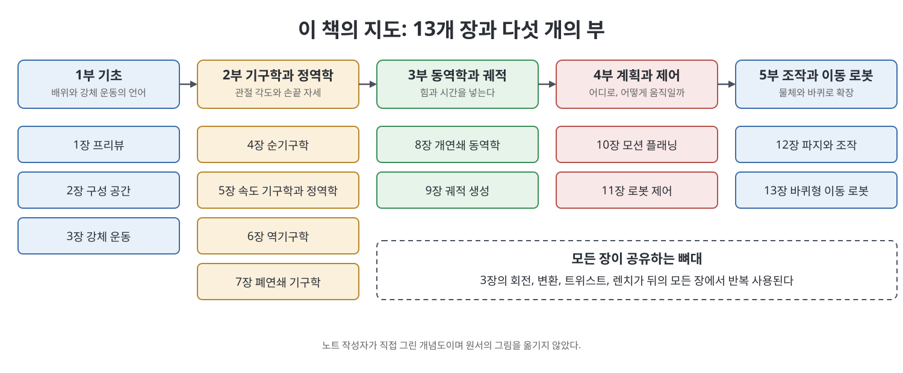

# 1장 프리뷰 (Preview)

이 장은 『Modern Robotics』가 무엇을 다루는 책인지 먼저 그려 보여 주는 안내 장이다. 책은 로봇을 링크(link)라 부르는 강체들이 관절(joint)로 이어진 기구로 보고, 그 기구가 어떻게 움직이고(기구학), 힘을 받으며(동역학), 어디로 갈지 정하고(계획), 원하는 대로 가게 만드는지(제어)를 차례로 다룬다. 1장은 수식을 거의 쓰지 않고, 뒤따를 13개 장이 어떤 질문에 답하는지를 한 장씩 소개한다. 이 노트에서는 그 지도를 읽는 법을 정리한다.

> **쉽게 말하면**
> 이 책은 "로봇 팔 같은 기계의 몸을 수학으로 적고, 그 몸을 움직이는 방법을 만드는" 책이다. 1장은 그 전체 여정의 목차를 이야기로 풀어 준 것이다.

> **참고(노트 작성자)** 1장에는 수식이 거의 없어 복원할 식도 많지 않다. 책이 소개하는 웹사이트와 소프트웨어 정보는 책이 쓰인 시점 기준이며, 현재 상태는 따로 확인해야 한다.

## 이 장의 흐름

1. 로봇 기구의 구성: 링크, 관절, 구동기, 센서
2. 열린 사슬과 닫힌 사슬
3. 2장부터 7장: 몸을 기술하는 기하학과 기구학
4. 8장과 9장: 힘과 시간을 넣는 동역학과 궤적
5. 10장부터 13장: 계획, 제어, 조작, 이동 로봇

## 1. 로봇 기구는 무엇으로 이루어지는가

책은 로봇공학이 아직 젊은 분야이며, 궁극적 목표가 사람처럼 행동하고 생각하는 기계라는 말로 시작한다. 그러나 이 책이 집중하는 대상은 지능 전체가 아니라 로봇이 물리 세계에서 움직인다는 사실, 곧 기구의 역학과 계획과 제어이다.

기구(mechanism)는 링크를 관절로 이어 이웃한 링크끼리 상대 운동이 가능하게 만든 구조이다. 관절을 구동기(actuator)가 움직여서 로봇이 움직이고 힘을 낸다. 책이 소개하는 요소를 표로 묶으면 다음과 같다.

| 구성 요소 | 하는 일 | 책이 드는 예 |
|----------|---------|-------------|
| 구동기 | 관절을 움직이는 동력원 | 전기 모터, 공압·유압 실린더 |
| 감속기 | 모터의 고속 저토크를 저속 고토크로 바꿈 | 기어, 케이블, 벨트와 풀리, 체인 |
| 관절 센서 | 관절 변위와 속도 측정 | 엔코더, 포텐셔미터, 리졸버, 타코미터 |
| 힘·토크 센서 | 관절 또는 손끝의 힘 측정 | 힘-토크 센서 |
| 환경 센서 | 물체와 로봇 자신의 위치 파악 | 카메라, RGB-D 카메라, 레이저 거리계 |

모터는 보통 빠르게 돌면서 토크가 작기 때문에 감속기가 필요하다. 이때 바람직한 감속기는 미끄러짐이나 백래시(backlash, 입력을 돌려도 출력이 움직이지 않는 유격)가 작은 것이라고 책은 말한다.

## 2. 열린 사슬과 닫힌 사슬

링크가 한 줄로 이어진 구조가 열린 사슬(open chain)이다. 우리가 흔히 떠올리는 산업용 로봇 팔이 그 예이다. 반대로 링크들이 고리를 이루면 닫힌 사슬(closed chain)이며, 책은 스튜어트-고프 플랫폼(Stewart-Gough platform)을 예로 든다. 열린 사슬은 모든 관절이 구동되는 반면 닫힌 사슬은 관절 중 일부만 구동하는 것이 보통이다. 이 차이 때문에 닫힌 사슬은 해석이 더 까다롭고, 책은 7장에서 따로 다룬다.

## 3. 2장부터 7장: 몸을 기술하다

책은 2장부터 7장까지를 로봇의 기하학과 기구학에 쓴다.

- **2장 구성 공간**: 로봇의 배위(configuration)를 어떻게 표현할지 다룬다. 강체는 평면에서 3개, 공간에서 6개의 값이 필요하며, 이 값의 수가 자유도(degrees of freedom, DoF)이다. 자유도를 세는 Grübler 공식, 구성 공간의 모양(위상), 작업 공간(task space)과 가동 영역(workspace)의 구분이 나온다.
- **3장 강체 운동**: 강체에 프레임을 붙여 위치와 방향을 3×3 회전행렬과 4×4 변환행렬로 적는다. 회전을 축과 각도의 지수 좌표로 보는 관점이 핵심이며, 이것이 고전 스크류 이론(screw theory)의 현대적 해석으로 이어져 6차원 트위스트(twist)와 렌치(wrench)가 정의된다. 책은 오일러 각 등 다른 표현을 부록 B에서 다룬다고 밝힌다.
- **4장 순기구학**: 관절 값이 주어졌을 때 손끝 프레임의 자세를 구한다. 3장의 지수 좌표에서 곧바로 나오는 지수 곱 공식(Product of Exponentials, PoE)을 쓰며, 링크마다 프레임을 붙일 필요가 없다는 것이 장점이다. 데나빗-하텐버그(D-H) 표현은 부록 C에서 비교한다.
- **5장 속도 기구학과 정역학**: 자코비안(Jacobian)이 관절 속도를 손끝 트위스트로 바꾼다. 자코비안의 랭크가 줄어드는 특이점(singularity), 움직이기 쉬운 방향을 보여 주는 조작도 타원체(manipulability ellipsoid), 손끝 힘과 관절 토크의 관계가 나온다.
- **6장 역기구학**: 원하는 손끝 자세를 만드는 관절 값을 구한다. 해가 여러 개이거나 없을 수 있다. 닫힌 해가 있는 6자유도 구조, 자코비안 기반 반복 수치해법, 여유(redundant) 로봇을 위한 유사역행렬이 소개된다.
- **7장 폐연쇄 기구학**: 닫힌 사슬은 순기구학 해가 여러 개일 수 있으며, 5절 링크와 스튜어트-고프 플랫폼 사례에서 일반 방법론으로 확장한다.

## 4. 8장과 9장: 힘과 시간을 넣다

8장은 동역학(dynamics)이다. 순동역학은 관절 힘과 토크가 주어졌을 때 가속도를, 역동역학은 원하는 가속도를 위한 힘과 토크를 구한다. 책은 두 방법을 소개한다. 라그랑주 방법은 에너지를 일반화 좌표로 적어 오일러-라그랑주 방정식에 넣고, 뉴턴-오일러 방법은 $f = ma$를 강체로 일반화해 속도와 가속도를 바깥 링크로 전파한 뒤 힘을 안쪽으로 되돌아오며 계산한다. 열린 사슬 구조 덕분에 이 계산은 재귀적으로 짤 수 있다.

9장은 궤적(trajectory)이다. 궤적은 기하학적 경로(path)에 시간 스케일링(time scaling)을 더한 것이다. 사용자가 모든 관절의 시간 이력을 적을 수 없으므로, 몇 개의 제어점에서 중간을 자동으로 채우는 방법을 다룬다. 책이 꼽는 세 경우는 직선 점대점 궤적, 여러 경유점을 매끄럽게 지나는 궤적, 구동기 한계 아래의 시간 최적 궤적이다.

## 5. 10장부터 13장: 계획, 제어, 조작, 이동

- **10장 모션 플래닝**: 장애물이 있는 작업 공간에서 충돌 없는 움직임을 찾는다. 격자 기반, 샘플링 기반, 가상 포텐셜 장 기반의 세 접근법을 소개하며 모든 문제에 맞는 단일 플래너는 없다고 말한다.
- **11장 로봇 제어**: 원하는 거동에 따라 모션 제어, 힘 제어, 혼합 모션-힘 제어, 임피던스 제어가 쓰인다. 한 방향에서 모션과 힘을 동시에 독립적으로 제어할 수 없다는 근본 제약이 있다. 동역학 모델이 불완전하므로 피드백을 쓰고, 계산 토크 제어처럼 근사 모델과 피드백을 합치는 방법을 배운다.
- **12장 파지와 조작**: 로봇과 물체의 접촉을 모델링하고, 형상 폐쇄와 힘 폐쇄 파지로 물체를 고정하는 조건을 다룬다. 밀기 등 파지 아닌 조작도 포함한다.
- **13장 바퀴형 이동 로봇**: 전방향 바퀴 로봇과 일반 바퀴 로봇(차동 구동, 자동차)을 나누어 다룬다. 후자의 미끄러짐 없음 제약은 속도 제약인데 적분해도 배위 제약이 되지 않는 비홀로노믹(nonholonomic) 제약이다. 이동 로봇 위에 팔을 올린 이동 조작기도 다룬다.

## 6. 책을 읽는 도구

책은 각 장 끝에 요약과 연습문제를 두고, 부록 A에 자주 쓰는 공식을 모아 둔다. 책의 웹사이트에는 보조 영상과 장별 소프트웨어가 있다. 책은 이 코드가 가장 견고하거나 빠른 구현이 아니라 읽기 쉽고 개념을 굳히기 위한 것이라 하며, 사용만 하지 말고 읽으라고 권한다. 이 노트는 코드를 옮기지 않는다.

## 핵심 정리

- 책은 로봇을 링크와 관절로 이루어진 기구로 보고, 그 기구의 역학, 계획, 제어를 다룬다.
- 열린 사슬은 모든 관절이 구동되고, 닫힌 사슬은 일부만 구동되어 해석이 더 까다롭다.
- 2장과 3장은 이후 모든 장이 쓰는 언어(자유도, 구성 공간, 회전과 변환, 트위스트와 렌치)를 만든다.
- 4장부터 7장은 관절 값과 손끝 자세의 관계(순기구학, 속도, 역기구학, 폐연쇄)를 푼다.
- 8장과 9장은 힘과 시간을, 10장부터 13장은 계획, 제어, 조작, 이동 로봇을 더한다.

 
 
 

이전: [Modern Robotics](../Readme.md) | 다음: [2장 구성 공간](02%EC%9E%A5%20%EA%B5%AC%EC%84%B1%20%EA%B3%B5%EA%B0%84.md)

 

[Modern Robotics](../)
