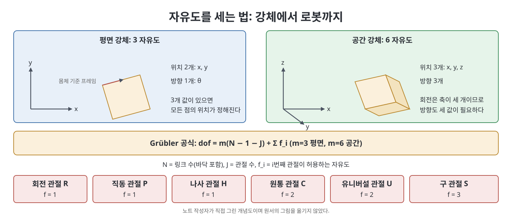
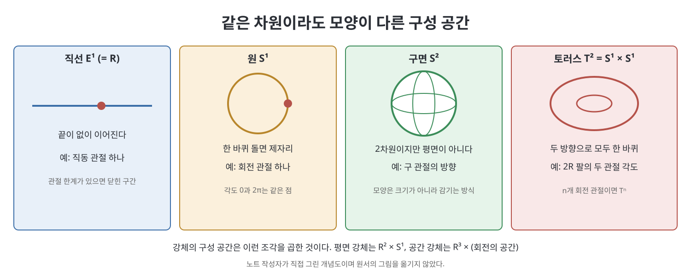

# 2장 구성 공간 (Configuration Space)

이 장은 "로봇이 지금 어떤 상태인가"를 숫자로 적는 방법을 다룬다. 로봇의 배위(configuration, 형상)란 로봇의 모든 점의 위치를 정하는 정보이다. 로봇은 강체가 관절로 이어진 것이므로, 책은 강체 하나의 배위를 세는 일에서 시작해 로봇 전체의 자유도, 가능한 배위들이 이루는 공간의 모양, 그 공간에 걸리는 제약, 그리고 손끝이 가는 공간까지 차례로 넓혀 간다. 이 장의 어휘는 이후 모든 장에서 계속 쓰인다.

> **쉽게 말하면**
> 로봇의 자세를 정하는 데 필요한 독립된 숫자의 개수가 자유도이고, 그 숫자들이 움직일 수 있는 범위가 구성 공간이다. 2R 팔이라면 두 관절 각도가 곧 로봇의 전부이다.

> **참고(노트 작성자)** 이 장의 수식은 OCR 텍스트와 표준 지식으로 복원했으므로 중요한 식은 원서와 대조하길 권한다. 일부 예제 수치와 그림 번호는 노트가 옮기지 않았다.

## 이 장의 흐름

1. 강체의 자유도
2. 로봇의 자유도와 Grübler 공식
3. 구성 공간의 위상과 표현
4. 배위 제약과 속도 제약
5. 작업 공간과 가동 영역

## 1. 강체의 자유도

책은 자유도를 이렇게 센다. 평면에서 점 하나는 두 값 $(x, y)$로 정해진다. 강체 위에서 일직선에 있지 않은 점 세 개를 고르면 좌표는 6개이지만, 세 점 사이 거리가 변하지 않으므로 거리 제약 3개가 걸려서 자유도는 $6 - 3 = 3$이다. 직관적으로는 위치 2개와 방향 1개이다.

공간에서도 같은 방식이다. 점 세 개의 좌표는 9개이고 거리 제약이 3개이므로 $9 - 3 = 6$이다. 위치 3개와 방향 3개이다. 이렇게 필요한 값의 개수가 곧 구성 공간의 차원이다.

| 구분 | 위치 | 방향 | 자유도 |
|------|-----:|-----:|------:|
| 평면 강체 | 2 | 1 | 3 |
| 공간 강체 | 3 | 3 | 6 |

## 2. 로봇의 자유도

로봇의 자유도는 "각 강체가 가진 자유도의 합에서 관절이 막는 운동의 수를 뺀 값"이다. 책은 관절을 자유도 $f$로 분류한다. 한 관절이 이웃 링크 사이에서 허용하는 운동이 $f$개이면, 그 관절이 막는 운동은 $m - f$개이다($m$은 평면 3, 공간 6).

| 관절 | 허용 자유도 $f$ | 공간에서 막는 수 |
|------|---------------:|--------------:|
| 회전(R) | 1 | 5 |
| 직동(P) | 1 | 5 |
| 나사(H) | 1 | 5 |
| 원통(C) | 2 | 4 |
| 유니버설(U) | 2 | 4 |
| 구(S) | 3 | 3 |

링크가 바닥을 포함해 $N$개, 관절이 $J$개일 때 다음 Grübler 공식이 성립한다.

$$\text{dof} = m(N - 1 - J) + \sum_{i=1}^{J} f_i$$

$N-1$은 바닥을 제외한 움직이는 링크의 수이다. 움직이는 링크 각각이 $m$자유도를 가지고 시작하며, 관절 $J$개가 각각 $m$만큼의 제약을 걸었다가 $f_i$만큼을 되돌려 주는 계산이다.

책의 예는 다음과 같다. 관절 $k$개짜리 평면 직렬 사슬은 $N = k+1$, $J = k$이므로 $3(k+1-1-k) + k = k$이다. 평면 5절 링크(five-bar)는 $N = 5$, $J = 5$이므로 $3(5-1-5)+5 = 2$이다. 스티븐슨과 와트의 6절 링크는 $N = 6$, $J = 7$이어서 $3(6-1-7)+7 = 1$이다. 스튜어트-고프 플랫폼은 다리 6개가 U-P-S 관절로 이어져 있다고 보면 $N = 14$, $J = 18$, $\sum f_i = 36$이므로 $6(14-1-18)+36 = 6$이다.

책은 열린 사슬에서는 모든 관절이 구동되므로 자유도가 관절 자유도의 합과 같다고 말한다. 닫힌 사슬에서는 이 공식이 제약들이 서로 독립이라는 일반적 경우를 가정하며, 특수한 기하에서는 실제 자유도가 더 클 수 있다.

## 3. 구성 공간의 위상과 표현

구성 공간(configuration space, C-space)은 모든 가능한 배위의 집합이다. 차원이 같아도 모양이 다를 수 있다. 평면과 구면은 둘 다 2차원이지만, 평면은 끝없이 펼쳐지고 구면은 감겨 돌아온다. 책은 한 공간을 자르거나 붙이지 않고 연속적으로 변형해 다른 공간이 되면 두 공간이 위상적으로 같다(topologically equivalent)고 부른다. 구와 럭비공은 같고, 구와 평면은 다르다.

| 공간 | 기호 | 예 |
|------|------|----|
| 직선 | $\mathbb{R}^1$ (또는 $E^1$) | 직동 관절 하나 |
| 원 | $S^1$ | 회전 관절 하나, 평면 방향 |
| 구면 | $S^2$ | 구 관절의 방향 |
| 토러스 | $T^2 = S^1 \times S^1$ | 2R 팔의 두 관절 각도 |
| 유클리드 공간 | $\mathbb{R}^n$ | 평면 위 점이면 $\mathbb{R}^2$ |

공간들의 곱도 자주 쓴다. 평면 강체의 C-space는 $\mathbb{R}^2 \times S^1$이고, $n$개 회전 관절 로봇은 $T^n$이다. 관절 한계가 있으면 원이 아니라 닫힌 구간이 된다.

표현은 두 종류이다. 명시적(explicit) 표현은 최소 개수의 좌표로 공간을 나타낸다. 구면의 위도와 경도가 그 예이다. 반대로 암시적(implicit) 표현은 더 큰 공간에 넣고 제약식을 붙인다. 구면을 $(x, y, z)$ 세 값과 $x^2 + y^2 + z^2 = 1$로 쓰는 식이다. 책은 강체의 배위에 암시적 표현을 쓴다. 이 선택이 3장에서 회전을 3×3 행렬(9개 수에 제약 6개)로 다루는 이유이다.

## 4. 배위 제약과 속도 제약

로봇의 배위가 제약식 $g(\theta) = 0$을 만족해야 하는 경우를 홀로노믹(holonomic) 제약이라 한다. 닫힌 사슬의 고리 닫힘 조건이 대표적이며, 제약이 하나 걸릴 때마다 구성 공간의 차원이 줄어든다.

속도에 대한 제약이 $A(\theta)\dot\theta = 0$ 꼴이면 파피안(Pfaffian) 제약이다. 홀로노믹 제약을 시간으로 미분하면 $\frac{\partial g}{\partial \theta}\dot\theta = 0$이 되므로 홀로노믹 제약은 적분 가능한 파피안 제약이다. 그러나 어떤 파피안 제약은 적분해도 배위 제약이 되지 않으며, 이를 비홀로노믹(nonholonomic) 제약이라 한다.

책의 예는 평면 위를 미끄러지지 않고 구르는 동전이다. 동전의 배위는 접촉점 $(x, y)$, 진행 방향 각 $\phi$, 구름 각 $\theta$이며 C-space는 $\mathbb{R}^2 \times T^2$로 4차원이다. 미끄러짐이 없다는 조건은 접촉점이 동전이 향한 방향으로 $r\dot\theta$ 속도로 나아간다는 뜻이므로 다음과 같다.

$$\begin{bmatrix} 1 & 0 & 0 & -r\cos\phi \\ 0 & 1 & 0 & -r\sin\phi \end{bmatrix} \begin{bmatrix} \dot x \\ \dot y \\ \dot\phi \\ \dot\theta \end{bmatrix} = 0$$

이 제약은 가능한 속도 방향을 줄이지만 도달 가능한 배위의 범위는 줄이지 못한다. 동전은 구르고 돌면서 결국 어떤 위치와 방향에도 갈 수 있기 때문이다. 자동차가 옆으로 미끄러질 수 없어도 주차를 할 수 있는 것과 같다. 13장의 바퀴 로봇에서 다시 만난다.

## 5. 작업 공간과 가동 영역

로봇이 하는 일은 대개 손끝(end-effector)이 물체와 만나는 것이므로, 전체 로봇의 배위보다 손끝에 붙인 프레임의 위치와 방향이 중요하다. 이 값들의 공간이 작업 공간(task space)이고, 그중 손끝이 실제로 닿을 수 있는 부분집합이 가동 영역(workspace)이다. 책은 두 가지 예를 든다. SCARA 로봇은 위치 3개와 수직축 둘레 회전 1개를 쓰므로 $\mathbb{R}^3 \times S^1$이다. 페인트 분사 로봇은 노즐의 위치와 가리키는 방향이 중요하므로 $\mathbb{R}^3 \times S^2$이다. 사용자는 가동 영역을 시각화하기 쉽게 위치만으로 정의해도 된다.

작업 공간과 구성 공간 사이에는 일대일 대응이 없다. 같은 손끝 자세에 여러 관절 해가 있을 수 있고, 6장 역기구학의 어려움이 여기서 출발한다.

## 연습문제와 요약

연습문제는 자유도 계산, C-space 설명(차원과 위상), 제약 분류 같은 유형이다. 책의 장 요약은 이 노트의 핵심 정리와 같은 내용이다.

## 핵심 정리

- 자유도는 배위를 정하는 데 필요한 독립된 값의 수이며, 평면 강체는 3, 공간 강체는 6이다.
- Grübler 공식 $\text{dof} = m(N-1-J) + \sum f_i$로 일반적인 기구의 자유도를 센다. 특수한 기하에는 예외가 있다.
- 구성 공간은 모양(위상)을 가지며 $\mathbb{R}^n$, $S^n$, $T^n$ 등의 곱으로 표현된다. 같은 차원이어도 모양이 다르다.
- 책은 강체 배위를 최소 좌표가 아니라 제약식을 붙인 암시적 표현으로 다룬다.
- 홀로노믹 제약은 C-space의 차원을 줄이고, 비홀로노믹 제약은 속도만 제한한다.
- 작업 공간은 손끝 프레임의 공간이고 가동 영역은 그중 닿을 수 있는 부분이다.

 
 
 

이전: [1장 프리뷰](01%EC%9E%A5%20%ED%94%84%EB%A6%AC%EB%B7%B0.md) | 다음: [3장 강체 운동](03%EC%9E%A5%20%EA%B0%95%EC%B2%B4%20%EC%9A%B4%EB%8F%99.md)

 

[Modern Robotics](../)
