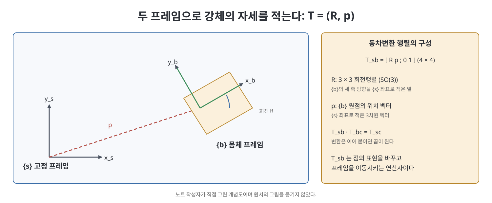
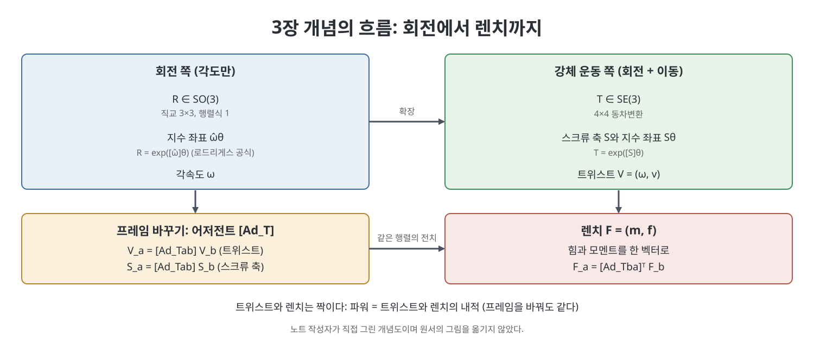

# 3장 강체 운동 (Rigid-Body Motions)

이 장은 책 전체의 수학 기반이다. 강체의 위치와 방향을 어떻게 숫자로 적고, 그 숫자가 시간에 따라 변하는 것(속도)과 강체에 작용하는 힘을 어떻게 한 벡터로 묶는지를 다룬다. 책은 강체에 프레임(frame)을 붙여 그 프레임의 움직임으로 강체를 기술한다. 회전은 3×3 행렬, 회전과 이동은 4×4 행렬, 속도는 6차원 트위스트, 힘은 6차원 렌치로 적는다. 4장 순기구학부터 12장 파지까지 이 장의 도구를 되풀이해서 쓴다.

> **쉽게 말하면**
> 강체의 자세는 "축 하나와 그 둘레의 회전 각도, 그리고 축을 따라 미는 이동"이라는 나사 같은 운동으로 늘 표현할 수 있다. 3장은 그 사실을 행렬로 옮긴 장이다.

> **참고(노트 작성자)** 이 장의 수식은 OCR이 많이 깨져서 표준 지식(Modern Robotics의 지수 좌표 표기)으로 복원했다. 특히 지수 공식과 어저전트 행렬은 원서와 꼭 대조하길 권한다. 책은 평면 운동(3.1절)을 먼저 다루지만 이 노트는 3차원 중심으로 요약한다.

## 이 장의 흐름

1. 회전행렬과 SO(3)
2. 각속도와 지수 좌표
3. 동차변환과 SE(3)
4. 트위스트와 스크류 축
5. 변환의 지수와 어저전트
6. 렌치

## 1. 회전행렬

강체에 붙인 몸체 프레임 $\{b\}$의 세 축 방향을 고정 프레임 $\{s\}$의 좌표로 적어 열로 세운 행렬이 회전행렬 $R$이다. 이런 행렬은 다음 조건을 만족하며 모임을 $SO(3)$(특수 직교군)이라 한다.

$$R^T R = I, \qquad \det R = 1$$

이 조건은 $R^{-1} = R^T$라는 뜻이다. 역행렬을 따로 구할 필요가 없다. 숫자 9개에 6개의 제약이 걸려 독립 변수는 3개이다. 2장에서 말한 암시적 표현의 예이다.

회전행렬은 세 가지 일을 한다. 자세를 나타내고, 점의 좌표를 프레임 사이에서 바꾸고($p_a = R_{ab}\,p_b$), 벡터나 프레임을 회전시킨다. 연속된 회전은 곱으로 이어진다($R_{ab}R_{bc} = R_{ac}$). 곱하는 순서는 매우 중요하다. 현재 몸체 프레임 기준으로 돌리면 오른쪽에, 고정 프레임 기준으로 돌리면 왼쪽에 곱한다. 그래서 $R_{sb}' = R_{sb}\,R$은 몸체 기준 회전이고 $R_{sb}' = R\,R_{sb}$는 고정 기준 회전이다.

## 2. 각속도와 지수 좌표

시간에 따라 변하는 $R(t)$에서 $\dot R R^{-1}$과 $R^{-1}\dot R$는 모두 반대칭 행렬이다. 벡터 $\omega = (\omega_1, \omega_2, \omega_3)$에 대응하는 반대칭 행렬은 다음이다.

$$[\omega] = \begin{bmatrix} 0 & -\omega_3 & \omega_2 \\ \omega_3 & 0 & -\omega_1 \\ -\omega_2 & \omega_1 & 0 \end{bmatrix}, \quad [\omega]x = \omega \times x$$

따라서 $[\omega_s] = \dot R R^{-1}$이 고정 프레임에서 본 각속도이고, $[\omega_b] = R^{-1}\dot R$이 몸체 프레임에서 본 각속도이다. 둘은 $\omega_s = R\,\omega_b$로 연결된다. 한 각속도를 어느 프레임에서 적든 같은 물리량이며 표현만 바뀐다.

이 미분방정식을 풀면 지수 좌표가 나온다. 단위 축 $\hat\omega$ 둘레로 각 $\theta$만큼 돌리는 회전은 $\hat\omega\theta \in \mathbb{R}^3$ 세 숫자로 정해지며 다음 로드리게스 공식으로 행렬이 된다.

$$R = \text{Rot}(\hat\omega,\theta) = e^{[\hat\omega]\theta} = I + \sin\theta\,[\hat\omega] + (1-\cos\theta)\,[\hat\omega]^2$$

반대로 행렬에서 축과 각을 구하는 것이 행렬 로그이다. 책이 소개하는 알고리즘은 $\text{tr}R$로 각을 찾고 반대칭 부분에서 축을 읽는 방식이며, $\theta = \pi$나 $R = I$ 같은 특수한 경우를 따로 처리한다. 책은 오일러 각, 단위 사원수 등 다른 표현을 부록 B에서 소개한다.

## 3. 동차변환 행렬

위치와 방향을 함께 쓰려면 $R \in SO(3)$과 위치 벡터 $p \in \mathbb{R}^3$을 한 행렬로 묶는다. 이것이 동차변환 행렬(homogeneous transformation)이며 $SE(3)$(특수 유클리드군)에 속한다.

$$T = \begin{bmatrix} R & p \\ 0 & 1 \end{bmatrix}, \qquad T^{-1} = \begin{bmatrix} R^T & -R^T p \\ 0 & 1 \end{bmatrix}$$

점에는 끝에 1을 붙인 4차원 벡터로 곱한다. 이렇게 하면 회전과 이동이 곱 한 번으로 합쳐지고 변환의 연쇄가 행렬 곱이 된다($T_{ab}T_{bc} = T_{ac}$). 같은 행렬이 프레임의 표현, 점의 좌표 변환, 프레임 이동의 세 역할을 한다.

| 구분 | 회전 | 강체 운동 |
|------|------|-----------|
| 집합 | $R \in SO(3)$, 3×3 | $T \in SE(3)$, 4×4 |
| 독립 변수 | 3 | 6 |
| 역 | $R^T$ | $T^{-1}$ (위 식) |
| 프레임 이어 붙이기 | $R_{ab}R_{bc} = R_{ac}$ | $T_{ab}T_{bc} = T_{ac}$ |
| 지수 표현 | $\hat\omega\theta$ | $\mathcal{S}\theta$ |
| 속도 | 각속도 $\omega$ | 트위스트 $\mathcal{V}$ |

이 표는 책이 요약표에서 강조한 대응, 곧 회전의 모든 개념이 강체 운동으로 평행하게 확장된다는 점을 보여 준다.

## 4. 트위스트와 스크류 축

강체의 속도를 각속도와 선속도를 합쳐 6차원 벡터로 쓴 것이 트위스트이다.

$$\mathcal{V} = \begin{bmatrix} \omega \\ v \end{bmatrix} \in \mathbb{R}^6$$

시간에 따른 $T(t)$에서 $T^{-1}\dot T$가 몸체 트위스트 $[\mathcal{V}_b]$, $\dot T T^{-1}$가 공간 트위스트 $[\mathcal{V}_s]$이다. 여기서 $[\mathcal{V}]$는 $\begin{bmatrix} [\omega] & v \\ 0 & 0 \end{bmatrix}$ 꼴의 4×4 행렬이다. 주의할 점은 공간 트위스트의 $v$가 강체의 실제 선속도가 아니라, "프레임 원점에 마치 강체가 붙어 있다고 상상할 때의 점의 속도"라는 것이다. 책의 자동차 예에서처럼 순수 각속도로 도는 물체에서도 이 $v$는 0이 아닐 수 있다.

샤슬(Chasles)의 정리에 따르면 강체의 모든 운동은 어떤 축을 따라 이동하면서 그 축 둘레로 회전하는 나사 운동이다. 이 축이 스크류 축(screw axis)이다. 축 위의 한 점 $q$, 단위 방향 $\hat s$, 피치(pitch) $h$(회전 한 번당 이동 거리)로 정해지며 6차원 벡터로 적는다.

$$\mathcal{S} = \begin{bmatrix} \omega \\ v \end{bmatrix} = \begin{bmatrix} \hat s \\ -\hat s \times q + h\hat s \end{bmatrix}$$

스크류 축은 $\|\omega\| = 1$이거나, 순수 이동일 때 $\omega = 0$이고 $\|v\| = 1$이다. 트위스트는 스크류 축에 속도 $\dot\theta$를 곱한 것($\mathcal{V} = \mathcal{S}\dot\theta$)으로 이해하면 된다. 회전 관절의 스크류 축은 피치 0이고, 직동 관절은 순수 이동이다. 4장에서 관절마다 이 $\mathcal{S}$를 하나씩 정하는 것이 PoE 공식의 출발이다.

## 5. 변환의 지수와 어저전트

지수 좌표는 강체 운동으로 확장된다. 스크류 축 $\mathcal{S}$를 따라 $\theta$만큼 움직이는 변환은 다음이다.

$$T = e^{[\mathcal{S}]\theta}, \qquad [\mathcal{S}] = \begin{bmatrix} [\omega] & v \\ 0 & 0 \end{bmatrix}$$

$\omega \ne 0$이면 결과는 $\begin{bmatrix} e^{[\omega]\theta} & G(\theta)\,v \\ 0 & 1 \end{bmatrix}$이고 $G(\theta) = I\theta + (1-\cos\theta)[\omega] + (\theta - \sin\theta)[\omega]^2$이다. $\omega = 0$이면 $\begin{bmatrix} I & v\theta \\ 0 & 1 \end{bmatrix}$이다. 역으로 $T$에서 $\mathcal{S}\theta$를 구하는 행렬 로그도 있으며, 책은 이 알고리즘을 따로 정리한다.

트위스트나 스크류 축을 다른 프레임으로 옮길 때는 6×6 어저전트(adjoint) 행렬을 곱한다.

$$[\text{Ad}_T] = \begin{bmatrix} R & 0 \\ [p]R & R \end{bmatrix}, \qquad \mathcal{V}_a = [\text{Ad}_{T_{ab}}]\,\mathcal{V}_b$$

어저전트는 $R$을 6×6으로 확장한 것이라고 보면 쉽다. 각속도 부분은 $R$만 곱하지만 선속도 부분은 원점이 달라진 효과($[p]R$)가 더해진다. $[\text{Ad}_{T_1}][\text{Ad}_{T_2}] = [\text{Ad}_{T_1 T_2}]$와 $[\text{Ad}_T]^{-1} = [\text{Ad}_{T^{-1}}]$이 성립한다.

## 6. 렌치

힘과 모멘트도 한 벡터로 묶는다. 렌치는 모멘트 $m$과 힘 $f$로 이루어진다.

$$\mathcal{F} = \begin{bmatrix} m \\ f \end{bmatrix} \in \mathbb{R}^6$$

트위스트와 렌치는 짝이어서 둘의 내적 $\mathcal{V}^T\mathcal{F}$가 일률(파워)이고, 프레임을 바꿔도 값이 변하지 않는다. 이 조건에서 렌치의 변환 규칙이 나온다. 어저전트 행렬의 전치를 쓴다.

$$\mathcal{F}_a = [\text{Ad}_{T_{ba}}]^T\,\mathcal{F}_b$$

책은 로봇 손이 사과를 쥔 예제로 이를 설명한다. 손과 사과 각각의 중력 렌치를 센서 프레임으로 옮겨 더하면 센서가 재는 합 렌치가 된다. 이 방식은 5장의 정역학에서 손끝 렌치와 관절 토크를 잇는 데 다시 쓰인다.

## 소프트웨어와 연습문제

책의 소프트웨어는 이 장의 연산을 함수로 제공한다. 회전행렬의 역, 벡터와 반대칭 행렬 사이의 변환, $SO(3)$과 $SE(3)$의 지수와 로그, $R$과 $p$로 $T$를 만드는 함수, 어저전트 계산 등이다. 이 노트는 코드를 옮기지 않았다. 연습문제는 회전의 합성과 축-각 구하기, 트위스트 변환, 렌치 합성 같은 유형이다.

## 핵심 정리

- 회전행렬은 $R^TR = I$, $\det R = 1$을 만족하는 $SO(3)$ 원소이며 독립 변수는 3개이다.
- 모든 회전은 축과 각의 지수 좌표 $\hat\omega\theta$로 적을 수 있고 로드리게스 공식으로 행렬이 된다.
- 동차변환 $T = (R, p) \in SE(3)$는 회전과 이동을 한 행렬로 묶고 연쇄를 곱으로 만든다.
- 강체 운동은 항상 스크류 축 $\mathcal{S}$ 둘레의 나사 운동이며, 트위스트 $\mathcal{V} = \mathcal{S}\dot\theta$, 변환 $T = e^{[\mathcal{S}]\theta}$이다.
- 어저전트 $[\text{Ad}_T]$가 트위스트와 스크류 축의 프레임을 바꾸고, 그 전치가 렌치의 프레임을 바꾼다.
- 렌치와 트위스트는 쌍대이며 내적이 일률이다. 이 도구가 4장 이후 순기구학, 자코비안, 동역학의 공통 어휘가 된다.

 
 
 

이전: [2장 구성 공간](02%EC%9E%A5%20%EA%B5%AC%EC%84%B1%20%EA%B3%B5%EA%B0%84.md) | 다음: [4장 순기구학](../02.%202%EB%B6%80%20%EA%B8%B0%EA%B5%AC%ED%95%99%EA%B3%BC%20%EC%A0%95%EC%97%AD%ED%95%99/04%EC%9E%A5%20%EC%88%9C%EA%B8%B0%EA%B5%AC%ED%95%99.md)

 

[Modern Robotics](../)
