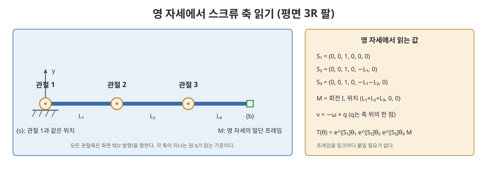
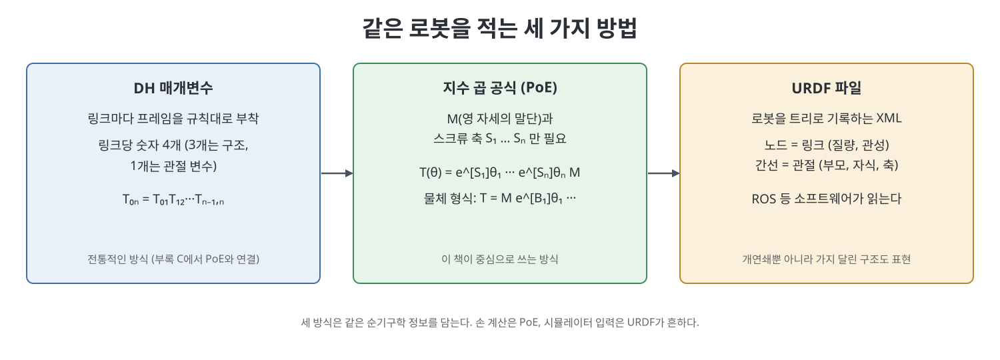

# 4장 순기구학 (Forward Kinematics)

이 장은 관절 각도를 알 때 로봇 손끝(말단 장치, end-effector)이 공간 어디에 어떤 자세로 놓이는지를 계산하는 방법을 다룬다. 이것이 순기구학(forward kinematics)이다. 로봇을 제어하려면 먼저 "관절을 이렇게 돌리면 손끝은 어디로 가는가"를 정확히 알아야 하고, 이후 속도, 역기구학, 동역학이 모두 이 계산 위에 쌓인다. 책은 3장에서 배운 스크류 운동과 행렬 지수를 그대로 가져와, 링크마다 좌표계를 붙이는 전통적 방법 대신 훨씬 간결한 지수 곱 공식(Product of Exponentials, PoE)을 중심으로 설명한다.

> **쉽게 말하면**
> 로봇이 가장 곧게 펴진 기준 자세(영 자세)를 한 번 정해 두고, 관절을 하나씩 "스크류 운동"으로 돌려 가며 손끝 위치를 따라가는 계산이다. 관절마다 좌표계를 붙이는 수고를 덜 수 있다.

> **참고(노트 작성자)** 이 장의 수식은 OCR 텍스트와 표준 지식으로 복원했으니 원서 식과 대조하기 바란다. URDF 예시와 소프트웨어 함수 이름은 책이 서술한 시점 기준이다.

## 이 장의 흐름

1. 지수 곱 공식: 영 자세 M, 스크류 축 S, 물체 형식
2. 평면 예제로 보는 첫 단계 감각
3. 로봇을 파일로 적는 URDF
4. 다른 표현과의 관계, 소프트웨어, 연습문제

## 1. 지수 곱 공식 (PoE)

### 1.1 아이디어

책은 먼저 평면 3R 팔로 감을 잡게 한다. 링크마다 좌표계 {1}, {2}, {3}를 붙이면 순기구학은 $T_{04}=T_{01}T_{12}T_{23}T_{34}$처럼 변환 행렬의 곱이다. 이 방식도 맞지만 평면이 아닌 일반 공간 로봇에서는 좌표계를 붙이는 규칙이 복잡해진다.

대안은 이렇다. 모든 관절 각도가 0인 영 자세(home, zero position)에서 말단 프레임 {b}의 위치와 방향을 $M \in SE(3)$로 정한다. 그다음 각 관절을 영 자세에서 본 스크류 축 $\mathcal{S}_i$로 취급한다. 회전 관절은 피치가 0인 스크류 축이고, 직선 관절은 피치가 무한대인 축이다. 마지막 관절부터 거꾸로 생각하면 이해가 쉽다. 마지막 관절만 $\theta_n$만큼 돌리면 말단이 $e^{[\mathcal{S}_n]\theta_n}M$으로 옮겨 가고, 그 앞 관절을 돌리면 이미 움직인 나머지 전체가 다시 한 번 스크류 운동을 한다. 이 과정을 끝까지 쌓으면 아래 공식이 된다.

$$T(\theta)=e^{[\mathcal{S}_1]\theta_1}e^{[\mathcal{S}_2]\theta_2}\cdots e^{[\mathcal{S}_n]\theta_n}M$$

뜻을 풀면, 고정 좌표계 {s}에서 본 각 스크류 축을 순서대로 지수 변환한 뒤 영 자세 M에 곱한 것이 현재 손끝 자세 $T(\theta)$라는 이야기다. 곱하는 순서가 중요하다. 변환이 왼쪽에서 곱해지므로 바깥 관절의 움직임이 안쪽 관절의 영향을 받는다.

### 1.2 스크류 축 구하기

스크류 축은 6차원 벡터 $\mathcal{S}=(\omega,v)$이고, 회전 관절이면 $\omega$는 회전축의 단위 방향, $v=-\omega\times q$이다. 여기서 $q$는 축 위의 임의의 한 점이다. 직선 관절이면 $\omega=0$이고 $v$는 이동 방향의 단위 벡터이다. 책은 이 값을 영 자세 그림을 보며 눈으로 읽어 내는 연습을 권한다. 예를 들어 첫 관절이 고정 좌표계 원점에 있고 z축을 중심으로 회전한다면 $\mathcal{S}_1=(0,0,1,0,0,0)$이고, 둘째 관절이 x축 방향으로 $L_1$만큼 떨어져 있으면 $\mathcal{S}_2=(0,0,1,0,-L_1,0)$이다.

### 1.3 물체 형식

같은 로봇을 말단 프레임 기준으로도 적을 수 있다. 영 자세에서 {b}로 표현한 스크류 축을 $\mathcal{B}_i$라 하면 아래와 같다.

$$T(\theta)=Me^{[\mathcal{B}_1]\theta_1}\cdots e^{[\mathcal{B}_n]\theta_n},\qquad \mathcal{B}_i=[\mathrm{Ad}_{M^{-1}}]\mathcal{S}_i$$

공간 형식(space form)과 물체 형식(body form)은 같은 자세를 주는 두 서술이다. 고정 좌표계가 편하면 앞의 식, 손끝에서 본 속도와 힘이 편하면 뒤의 식을 쓴다. 어저전트(adjoint) $[\mathrm{Ad}_{M^{-1}}]$가 좌표계를 바꿔 주는 다리 역할을 한다.

| 구분 | 공간 형식 | 물체 형식 |
|------|-----------|-----------|
| 식 | $T=e^{[\mathcal{S}_1]\theta_1}\cdots e^{[\mathcal{S}_n]\theta_n}M$ | $T=Me^{[\mathcal{B}_1]\theta_1}\cdots e^{[\mathcal{B}_n]\theta_n}$ |
| 축의 기준 | 고정 프레임 {s} | 말단 프레임 {b} |
| 변환 | $\mathcal{B}_i=[\mathrm{Ad}_{M^{-1}}]\mathcal{S}_i$ | $\mathcal{S}_i=[\mathrm{Ad}_M]\mathcal{B}_i$ |
| 편한 경우 | 베이스에서 본 위치 | 손끝에서 본 속도, 힘 |

### 1.4 공간 로봇 예제

책은 평면 팔 외에 공간 로봇(예: 회전 관절 여럿에 직선 관절이 섞인 팔, 6R 팔)에 같은 절차를 적용한다. 순서는 항상 같다. 영 자세에서 M을 적고, 각 축이 지나는 점과 방향을 읽어 $\mathcal{S}_i$를 만든 뒤 식에 넣는다. 프레임을 일일이 붙이지 않는 것이 실수를 줄여 준다고 책은 강조한다.

## 2. 로봇 기술 형식: URDF

실제 소프트웨어는 로봇 정보를 파일로 받는다. 책이 소개하는 URDF(Universal Robot Description Format)는 ROS 등에서 쓰는 XML 형식으로, 로봇을 트리(tree)로 본다. 노드는 링크이고 간선은 관절이다. 파일의 관절 항목에는 부모 링크, 자식 링크, 관절이 0일 때 자식 프레임의 위치와 자세, 회전축 방향이 들어가고, 링크 항목에는 질량, 질량 중심 프레임, 관성 행렬의 여섯 독립 성분이 들어간다. 책은 UR5 팔의 예를 보여 주는데, 한계값과 관성 수치는 단순화한 값이라고 밝힌다.

참고(노트 작성자): URDF는 순기구학 정보를 PoE처럼 직접 주지 않는다. 관절 프레임들의 상대 변환이 주어지므로 이를 곱해 $M$과 $\mathcal{S}_i$를 만들 수 있다. 개연쇄뿐 아니라 가지가 있는 로봇도 적을 수 있다는 점이 장점이다.

## 3. 요약과 소프트웨어

책은 이 장의 요점을 다음처럼 모은다. DH 매개변수는 링크 프레임을 엄격한 규칙으로 붙여 링크당 네 개 숫자(구조 세 개, 관절 변수 한 개)로 표현하고, 자세한 대응은 부록 C에서 PoE와 연결한다. PoE는 M과 스크류 축만 있으면 된다. URDF는 트리 구조 로봇의 기구학과 관성 정보를 파일로 적는다.

소프트웨어 절에서 책은 코드 라이브러리 함수를 소개한다. 순기구학 함수는 영 자세 M, 스크류 축 목록, 관절 각도 목록을 받아 말단 프레임을 돌려주며, 공간 형식과 물체 형식 두 버전이 있다. 이 노트는 코드를 옮기지 않는다.

연습문제는 스크류 축과 M을 읽어 PoE를 세우는 문제, DH 매개변수와 PoE를 서로 변환하는 문제, URDF를 작성하거나 해석하는 문제가 주를 이룬다.

## 핵심 정리

- 순기구학은 관절 각도 $\theta$에서 손끝 자세 $T(\theta)\in SE(3)$를 구하는 계산이다.
- PoE 공간 형식은 $T(\theta)=e^{[\mathcal{S}_1]\theta_1}\cdots e^{[\mathcal{S}_n]\theta_n}M$이며, 필요한 정보는 영 자세 M과 스크류 축뿐이다.
- 회전 관절의 스크류 축은 $(\omega,\,-\omega\times q)$, 직선 관절은 $(0,\hat v)$로 영 자세 그림에서 눈으로 읽는다.
- 물체 형식 $T=Me^{[\mathcal{B}_1]\theta_1}\cdots$는 같은 자세를 말단 프레임 축으로 적은 것이고 $\mathcal{B}_i=[\mathrm{Ad}_{M^{-1}}]\mathcal{S}_i$로 연결된다.
- URDF는 링크와 관절을 트리로 기록하는 파일 형식이며 기구학과 관성 정보를 함께 담는다.

 
 
 

이전: [3장 강체 운동](../01.%201%EB%B6%80%20%EA%B8%B0%EC%B4%88/03%EC%9E%A5%20%EA%B0%95%EC%B2%B4%20%EC%9A%B4%EB%8F%99.md) | 다음: [5장 속도 기구학과 정역학](05%EC%9E%A5%20%EC%86%8D%EB%8F%84%20%EA%B8%B0%EA%B5%AC%ED%95%99%EA%B3%BC%20%EC%A0%95%EC%97%AD%ED%95%99.md)

 

[Modern Robotics](../)
