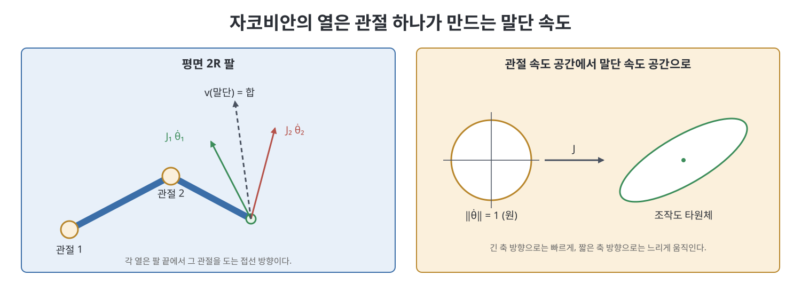
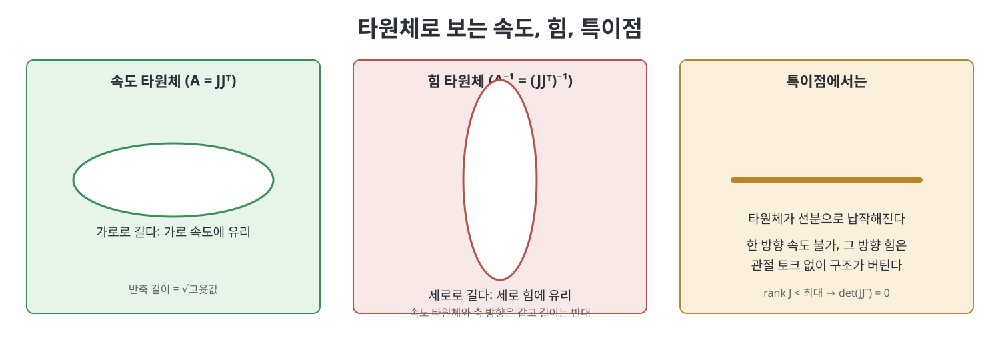

# 5장 속도 기구학과 정역학 (Velocity Kinematics and Statics)

4장이 "관절 각도가 주어지면 손끝은 어디인가"를 답했다면, 이 장은 "관절이 움직이는 속도가 주어지면 손끝은 얼마나 빠르게 어느 쪽으로 움직이는가"를 답한다. 이 관계를 담는 행렬이 자코비안(Jacobian)이다. 책은 같은 자코비안이 힘의 전달(정역학)과 특이점, 조작도(manipulability) 분석까지 한꺼번에 설명한다는 점을 보여 준다. 로봇 제어와 궤적 추종의 기초가 되는 장이다.

> **쉽게 말하면**
> 자코비안은 "관절 속도를 넣으면 손끝 속도가 나오는 변환표"이고, 그 전치 행렬은 반대로 "손끝에 가해지는 힘을 관절 토크로 바꾸는 표"이다. 이 표가 납작해지는 자세가 특이점이다.

> **참고(노트 작성자)** 이 장의 수식은 OCR 텍스트와 표준 지식으로 복원했으니 원서 식과 대조하기 바란다. 해석적 자코비안의 행렬 $A(r)$ 구체식은 확신이 낮아 본문에서 말로만 설명했다.

## 이 장의 흐름

1. 조작기 자코비안: 개념, 공간 자코비안, 물체 자코비안
2. 개연쇄의 정역학
3. 특이점 분석
4. 조작도와 타원체
5. 요약, 소프트웨어, 연습문제

## 1. 조작기 자코비안

### 1.1 기본 아이디어

관절 변수 $\theta\in\mathbb{R}^n$과 말단 위치 $x$ 사이에 $x=f(\theta)$가 있다면 양변을 시간으로 미분하여 $\dot x=J(\theta)\dot\theta$를 얻는다. 책은 평면 2R 팔로 이 감각을 만든다. 팔 끝 속도는 각 관절이 혼자 돌 때 끝에 만드는 속도 벡터에 관절 속도를 곱해 더한 것이다. 이 벡터들이 곧 자코비안의 열이다. 두 열이 평행이 되는 자세, 곧 팔이 완전히 펴지거나 접힌 자세에서는 끝이 어떤 방향으로도 움직일 수 없는 방향이 생기며 이것이 특이점(singularity)이다.

관절 속도에 한계가 있을 때는 그 상자 모양 범위가 자코비안을 거쳐 말단 속도의 다각형 범위로 옮겨 간다. 관절 속도의 노름이 1 이하인 원을 옮기면 타원이 되고, 이것이 조작도 타원체(manipulability ellipsoid)다.

### 1.2 공간 자코비안

일반 SE(3) 팔에서는 말단의 트위스트(twist)를 사용한다. 책이 정의하는 공간 자코비안 $J_s(\theta)\in\mathbb{R}^{6\times n}$은 다음 관계를 만족한다.

$$\mathcal{V}_s=J_s(\theta)\dot\theta,\qquad J_{s,i}(\theta)=\mathrm{Ad}_{e^{[\mathcal{S}_1]\theta_1}\cdots e^{[\mathcal{S}_{i-1}]\theta_{i-1}}}\,\mathcal{S}_i$$

$\mathcal{V}_s$는 고정 좌표계에서 본 말단 트위스트(각속도와 선속도 한 쌍)이다. 첫 열은 첫 스크류 축 $\mathcal{S}_1$ 그대로이고, 뒤쪽 열은 앞쪽 관절이 이미 돌아간 만큼 축이 움직였으므로 어저전트로 변환해 준 스크류 축이다. 즉 "i번째 관절이 지금 자세에서 어디에 어떤 축으로 놓여 있는가"를 열로 늘어놓은 것이다.

### 1.3 물체 자코비안

말단 프레임에서 본 트위스트는 $\mathcal{V}_b=J_b(\theta)\dot\theta$이다.

$$J_{b,i}(\theta)=\mathrm{Ad}_{e^{-[\mathcal{B}_n]\theta_n}\cdots e^{-[\mathcal{B}_{i+1}]\theta_{i+1}}}\,\mathcal{B}_i,\qquad J_b(\theta)=\mathrm{Ad}_{T_{bs}}J_s(\theta)$$

물체 자코비안은 바깥쪽 관절들의 영향을 반영하여 열을 만들고, 두 자코비안은 어저전트 한 번으로 서로 바뀐다. 책은 둘의 용도를 이렇게 나눈다. 공간 자코비안은 베이스 기준의 계산에, 물체 자코비안은 손끝 기준의 계산에 편하다.

| 구분 | 공간 자코비안 $J_s$ | 물체 자코비안 $J_b$ |
|------|---------------------|---------------------|
| 트위스트 기준 | 고정 프레임 {s} | 말단 프레임 {b} |
| 열을 만드는 순서 | 앞쪽(베이스 쪽) 관절 영향 | 뒤쪽(말단 쪽) 관절 영향 |
| 첫(마지막) 열 | $J_{s,1}=\mathcal{S}_1$ | $J_{b,n}=\mathcal{B}_n$ |
| 변환 | $J_s=\mathrm{Ad}_{T_{sb}}J_b$ | $J_b=\mathrm{Ad}_{T_{bs}}J_s$ |

### 1.4 해석적 자코비안과 기타

책은 말단 자세를 좌표 $q=(x,r)$로 두고 미분하는 해석적 자코비안(analytic Jacobian)도 설명한다. 여기서 $r$은 지수 좌표이다. 좌표의 시간 미분과 각속도는 위치에 따라 달라지는 행렬 $A(r)$로 이어지며, 해석적 자코비안은 물체 자코비안에 $A^{-1}$과 회전 행렬을 곱해 얻는다는 이야기다. 이 행렬이 가역일 때만 성립한다. 책은 절 끝에서 지금까지와 반대로 "원하는 트위스트를 내려면 관절 속도를 얼마로 해야 하는가"라는 역속도 문제가 6.3절에서 다뤄진다고 예고한다.

## 2. 개연쇄의 정역학

로봇이 정지한 채로 손끝에 힘과 모멘트(렌치, wrench)가 가해질 때 관절 토크는 얼마여야 버틸까. 책은 가상 일의 원리로 간단히 답한다. 관절이 하는 일과 손끝이 하는 일이 같아야 하므로 아래가 성립한다.

$$\tau=J_b^{T}(\theta)\,\mathcal{F}_b=J_s^{T}(\theta)\,\mathcal{F}_s$$

$\tau$는 관절 토크(또는 힘) 벡터이고 $\mathcal{F}$는 렌치이다. 속도에서 쓰는 자코비안의 전치가 힘에서 쓰이는 것이므로, 속도 변환표와 힘 변환표는 같은 행렬의 앞뒷면이다. 특이점 자세에서 손끝이 낼 수 없는 방향의 힘은 관절 토크가 전혀 필요 없고 링크 구조 자체가 받아낸다. 반대로 말하면 그 방향으로는 액추에이터로 힘을 조절할 수 없다.

참고(노트 작성자): 이 식은 중력, 관성 효과를 뺀 순수 정적 평형만을 다룬다. 동역학은 8장에서 이어진다.

## 3. 특이점 분석

자코비안 $J(\theta)$의 랭크가 그 로봇이 낼 수 있는 최대값보다 작아지는 자세가 특이점이다. 이때 손끝이 낼 수 없는 속도 방향이 생긴다. 공간 자코비안과 물체 자코비안은 어저전트로 연결되므로 특이점 여부는 어느 프레임에서 봐도 같다. 책은 특이점을 기하적으로 읽는 법을 몇 가지 소개한다.

- 회전 관절 축 여러 개가 한 점에서 만나거나 서로 평행이 되는 것 같은 축 배치
- 말단이 도달 가능 영역의 경계에 닿은 자세(팔이 완전히 펴짐)
- 손목의 두 축이 나란해지는 자세(손목 특이점)

특이점은 단지 도달 불가 방향을 만드는 것이 아니다. 그 근처에서는 같은 손끝 속도를 내기 위해 관절 속도가 아주 커져야 하므로 실제 제어에서 문제가 된다.

## 4. 조작도

책은 자코비안이 얼마나 "고르게" 움직일 수 있게 하는가를 조작도라 부르고, 관절 속도 단위 구가 옮겨지는 타원체로 측정한다. $A=JJ^{T}$로 두면 타원체의 주축 방향은 $A$의 고유벡터이고, 반축 길이는 고윳값의 제곱근이다. 회전과 병진은 단위가 달라 한 타원체에 섞으면 의미가 흐려지므로, 책은 자코비안을 각속도 부분 $J_\omega$와 선속도 부분 $J_v$로 나누어 두 개의 3차원 타원체를 따로 그리라고 권한다. 선속도는 베이스가 아닌 손끝 기준이 자연스러우므로 물체 자코비안을 쓴다.

타원체의 모양을 숫자 하나로 요약하는 지표도 있다.

| 지표 | 식 | 의미 |
|------|----|------|
| 이방성 지표 1 | $\mu_1=\sqrt{\lambda_{\max}/\lambda_{\min}}$ | 가장 긴 축과 짧은 축의 비. 1에 가까울수록 고름 |
| 이방성 지표 2 | $\mu_2=\lambda_{\max}/\lambda_{\min}$ | 위의 제곱. 조건수와 관련 |
| 부피 지표 | $\mu_3=\sqrt{\det(JJ^{T})}$ | 타원체 부피에 비례. 특이점에서 0 |

힘 쪽에는 $A^{-1}=(JJ^{T})^{-1}$로 정의되는 힘 타원체(force ellipsoid)가 있다. 주축 방향은 속도 타원체와 같지만 길이는 반대다. 손끝이 빨리 움직일 수 있는 방향에서는 큰 힘을 내기 어렵고, 느리게만 움직이는 방향에서는 오히려 큰 힘을 낼 수 있다. 책은 이 점을 조작 작업에 관련짓는다. 빠른 이동에는 속도 타원체가, 정밀한 힘 작업에는 힘 타원체가 유리한 자세를 고르면 된다.

## 5. 요약, 소프트웨어, 연습문제

책은 요약에서 공간 자코비안, 물체 자코비안, 해석적 자코비안의 정의와 정역학 식, 특이점, 조작도 지표를 다시 정리한다. 소프트웨어는 공간 자코비안과 물체 자코비안을 계산하는 함수를 제공한다. 이 노트는 코드를 옮기지 않는다. 연습문제는 평면 및 공간 팔의 자코비안 계산, 특이점 자세 찾기, 조작도 타원체 그리기, 정적 토크 계산, 해석적 자코비안 유도 등으로 구성된다.

## 핵심 정리

- 자코비안은 관절 속도를 말단 트위스트로 옮기는 행렬이며 $\mathcal{V}=J(\theta)\dot\theta$이다.
- 공간 자코비안의 열은 앞쪽 관절이 움직인 뒤의 스크류 축이고, 물체 자코비안은 어저전트로 $J_b=\mathrm{Ad}_{T_{bs}}J_s$를 만족한다.
- 정적 평형에서 관절 토크는 $\tau=J^{T}\mathcal{F}$로 주어진다.
- 자코비안의 랭크가 줄어드는 자세가 특이점이며 그 방향 속도는 낼 수 없다.
- 조작도 타원체는 $JJ^{T}$로, 힘 타원체는 $(JJ^{T})^{-1}$로 그리며 두 타원체의 장축과 단축은 서로 반대다.

 
 
 

이전: [4장 순기구학](04%EC%9E%A5%20%EC%88%9C%EA%B8%B0%EA%B5%AC%ED%95%99.md) | 다음: [6장 역기구학](06%EC%9E%A5%20%EC%97%AD%EA%B8%B0%EA%B5%AC%ED%95%99.md)

 

[Modern Robotics](../)
