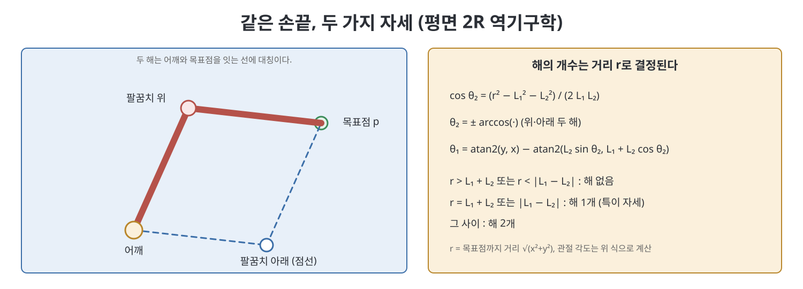
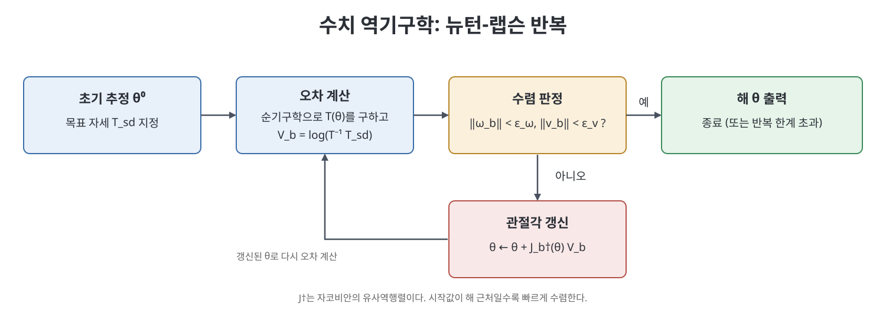

# 6장 역기구학 (Inverse Kinematics)

역기구학(inverse kinematics)은 순기구학을 거꾸로 푸는 문제다. 손끝을 원하는 위치와 자세에 놓으려면 관절 각도를 얼마로 해야 하는가를 묻는다. 말은 간단하지만 순기구학과 달리 해가 없을 수도 있고, 하나일 수도, 여러 개일 수도, 무한히 많을 수도 있다. 이 장은 손으로 풀리는 해석적(analytic) 방법과 컴퓨터로 반복해 푸는 수치적(numerical) 방법, 그리고 관절 속도 수준에서 푸는 역속도 기구학을 차례로 소개한다.

> **쉽게 말하면**
> "손을 저기 두려면 관절을 어떻게 맞출까"를 푸는 일이다. 간단한 로봇은 삼각함수로 정답을 바로 구하고, 복잡한 로봇은 정답 근처에서 조금씩 고쳐 나가는 반복법을 쓴다.

> **참고(노트 작성자)** 이 장의 수식은 OCR 텍스트와 표준 지식으로 복원했으니 원서 식과 대조하기 바란다. 6축 PUMA형 팔의 풀이 과정 세부는 확신이 낮아 말로만 정리했다.

## 이 장의 흐름

1. 해석적 역기구학: 2R, 3R, PUMA형, 스탠퍼드형
2. 수치 역기구학: 뉴턴-랩슨, 알고리즘
3. 역속도 기구학과 중복 자유도
4. 폐루프 제어와 연결, 요약과 소프트웨어

## 1. 해석적 역기구학

### 1.1 해가 몇 개인가

먼저 해의 존재와 개수를 생각해야 한다. 목표 자세가 로봇의 작업 공간(workspace) 밖이면 해가 없다. 6자유도 팔이 SE(3)의 목표를 맞추려면 이론상 유한 개의 해를 갖는 것이 일반적이다. 관절이 6개를 넘는 중복 자유도(redundant) 팔이면 해가 무한히 많고, 특이 자세에서는 해가 합쳐진다.

### 1.2 평면 2R 팔

가장 단순한 예는 팔 길이가 $L_1$, $L_2$인 평면 2R 팔이다. 목표점 $(x,y)$까지의 거리를 $r=\sqrt{x^2+y^2}$라 하면 코사인 법칙으로 아래를 얻는다.

$$\cos\theta_2=\frac{r^2-L_1^2-L_2^2}{2L_1L_2},\qquad \theta_1=\mathrm{atan2}(y,x)-\mathrm{atan2}(L_2\sin\theta_2,\;L_1+L_2\cos\theta_2)$$

뜻은 이렇다. 팔꿈치 각도 $\theta_2$는 세 변의 길이가 정해진 삼각형의 각이므로 코사인으로 구한다. 이어서 어깨 각도 $\theta_1$은 어깨에서 목표를 향하는 방향에서 삼각형 안의 보정각을 뺀 것이다. $\theta_2$의 부호가 $\pm$ 두 가지이므로 "팔꿈치 위"와 "팔꿈치 아래" 두 해가 생긴다. $r>L_1+L_2$이거나 $r<|L_1-L_2|$이면 해가 없고 경계에서는 해가 하나다.

### 1.3 3R 평면 팔과 PUMA형 팔

관절이 셋인 평면 팔은 목표 위치 $(x,y)$와 손끝 방향 $\phi$까지 맞춘다. 손목 위치를 먼저 구하고(손끝 방향과 마지막 링크 길이로 역산), 그 점에 대해 2R 풀이를 적용하는 식으로 줄여 푼다. 책은 이 "손목 위치에 대한 문제와 손끝 방향에 대한 문제를 나누는" 사고방식을 6축 팔에 확장한다.

세 개의 손목 축이 한 점에서 만나는 PUMA형 6R 팔이 대표적이다. 손목 중심점(wrist center)의 위치는 앞쪽 세 관절만으로 결정되고, 손끝의 방향은 그 뒤 세 관절이 결정한다는 성질을 이용한다. 앞 세 관절로 손목 위치를 맞추면 대개 최대 4개의 해(어깨 좌우, 팔꿈치 위아래)가 나오고, 각각에 대해 손목 세 관절의 방향 문제에서 2개의 해가 더해져 최대 8개 해가 된다. 책은 오프셋이 있는 팔에서는 "왼손형, 오른손형"이라는 해의 갈래가 있다고 소개한다.

스탠퍼드형처럼 직선 관절이 섞인 RRP 팔도 같은 방식으로 푼다. 직선 관절의 길이는 피타고라스 관계에서 구하며, 음의 제곱근 해는 버린다고 책은 설명한다.

| 로봇 | 푸는 요령 | 해의 수 |
|------|-----------|---------|
| 평면 2R | 코사인 법칙 | 최대 2 |
| PUMA형 6R | 손목 위치와 방향 분리 | 최대 8 |
| RRP (스탠퍼드형) | 손목 위치에서 각과 길이 | 오프셋에 따라 2 |
| 일반 구조 | 해석 불가능, 수치법 | 알 수 없음 |

## 2. 수치 역기구학

### 2.1 언제 쓰는가

해석해가 없거나 구하기 어려울 때, 또는 해석해가 있더라도 제작 오차 때문에 완벽한 해석 구조가 아닐 때 반복법을 쓴다. 책은 해석해가 있어도 이를 초기 추정값으로 삼아 수치법으로 정밀도를 올리는 방법을 권한다. 반복법의 바탕은 비선형 방정식의 뿌리를 찾는 뉴턴-랩슨(Newton-Raphson)이다.

### 2.2 뉴턴-랩슨 방법

스칼라 함수 $f(\theta)=x_d$를 푼다고 하자. 현재 추정 $\theta^k$에서 접선으로 근사하면 다음 추정은 아래처럼 된다.

$$\theta^{k+1}=\theta^{k}+J^{\dagger}(\theta^{k})\bigl(x_d-f(\theta^{k})\bigr)$$

$J^{\dagger}$는 자코비안 $J=\partial f/\partial\theta$의 유사역행렬(pseudoinverse)이다. 현재 위치와 목표의 오차에 자코비안의 역 같은 것을 곱해 관절을 고친다. 정답에 가까운 곳에서 시작하면 오차가 빠르게 줄어든다. 그러나 시작값이 멀거나 특이점 근처이면 수렴하지 않거나 엉뚱한 해로 갈 수 있다. 책은 최적화의 1차 필요조건도 짧게 소개하여, 정확한 해가 없을 때 가장 가까운 근사해를 찾는 문제와 연결한다.

### 2.3 SE(3) 목표를 위한 알고리즘

목표가 자세 $T_{sd}$이면 오차를 "현재 프레임에서 목표 프레임까지의 상대 변환"의 로그, 곧 트위스트로 만든다.

$$\mathcal{V}_b=\bigl[\log\bigl(T_{sb}^{-1}(\theta)\,T_{sd}\bigr)\bigr]^{\vee},\qquad \theta^{k+1}=\theta^{k}+J_b^{\dagger}(\theta^{k})\,\mathcal{V}_b$$

물체 프레임에서 본 오차 트위스트 $\mathcal{V}_b$를 물체 자코비안의 유사역행렬에 통과시켜 관절 보정량을 얻는다는 이야기다. 각속도 오차 $\|\omega_b\|$와 선속도 오차 $\|v_b\|$가 각각 허용치 $\epsilon_\omega$, $\epsilon_v$보다 작아지면 멈춘다. 반복 횟수 한도도 둔다.

참고(노트 작성자): 수렴해가 관절 한계를 넘을 수도 있고, 시작값에 따라 서로 다른 해로 가므로 현실에서는 한계 조건과 여러 시작점을 함께 쓴다.

## 3. 역속도 기구학

손끝이 원하는 궤적 $T_{sd}(t)$를 따르게 하려면 매 시각 역기구학을 풀어 각도 차이를 시간 간격으로 나눠 관절 속도로 줄 수 있다. 책은 이것이 일종의 피드백 제어라고 본다. 다른 방법은 역기구학을 건너뛰고 속도 관계 $J\dot\theta=\mathcal{V}_d$를 바로 푸는 것이다.

$$\dot\theta=J^{\dagger}(\theta)\,\mathcal{V}_d$$

$J$가 정방이고 가역이면 $J^{\dagger}=J^{-1}$이다. 관절이 6개보다 많은 중복 자유도 팔에서는 식을 만족하는 관절 속도가 무한히 많고, 유사역행렬은 그중 노름 $\|\dot\theta\|$가 가장 작은 하나를 준다. 관절이 부족한 경우에는 $\|J\dot\theta-\mathcal{V}_d\|$를 최소로 하는 최소제곱해를 준다. 책은 가중치를 바꾸는 확장도 언급한다. 예를 들어 질량이 큰 첫 관절의 속도를 더 크게 벌점하거나, 운동에너지(질량 행렬 $M(\theta)$)를 최소화하거나, 중력 위치에너지나 장애물과의 거리를 반영한 인공 위치에너지 $h(\theta)$를 낮추는 방향으로 중복 자유도를 쓸 수 있다.

주의할 점이 있다. 속도만 맞추고 위치 오차를 보지 않으면 작은 오차가 누적되어 손끝이 점점 궤적에서 벗어난다. 그래서 위치 피드백으로 $\mathcal{V}_d$를 보정해 주어야 하며, 이는 11장 제어에서 이어진다.

| 상황 | $J$의 모양 | 유사역행렬이 주는 해 |
|------|-----------|----------------------|
| 관절 6, 작업 6, 특이점 아님 | 정방, 가역 | 유일한 해 |
| 관절이 작업 차원보다 많음 | 가로로 넓음 | 노름이 최소인 해 |
| 관절이 작업 차원보다 적음 | 세로로 긺 | 최소제곱 근사해 |
| 특이점 근처 | 랭크 부족 | 속도가 폭주하거나 해가 없음 |

## 4. 요약, 소프트웨어, 연습문제

책의 요약은 해석적 방법이 단순한 구조(손목 분리형 등)에서 유한 개 해를 주며, 일반적인 경우 뉴턴-랩슨 기반 반복법이 표준이고, 속도 수준의 역문제는 유사역행렬로 푼다는 것이다. 소프트웨어는 6.2절의 반복 역기구학 함수를 제공하며, 초기 추정과 허용 오차를 받아 성공 여부와 함께 관절 각도를 돌려준다. 연습문제는 평면 및 공간 팔의 해석적 역기구학, 뉴턴-랩슨 수렴 실험, 유사역행렬 성질 증명, 중복 자유도 최적화 유형이다.

## 핵심 정리

- 역기구학의 해는 없을 수도, 유한할 수도, 무한할 수도 있다. 2R 팔은 코사인 법칙으로 최대 2개, PUMA형 6R 팔은 최대 8개 해를 갖는다.
- 손목이 한 점에서 만나는 구조는 위치와 방향 문제를 분리해 풀 수 있다.
- 일반 로봇은 뉴턴-랩슨 반복 $\theta^{k+1}=\theta^k+J^{\dagger}\mathcal{V}_b$로 푼다. 시작값이 좋아야 수렴한다.
- 역속도 기구학 $\dot\theta=J^{\dagger}\mathcal{V}_d$에서 유사역행렬은 최소 노름 해(중복 자유도) 또는 최소제곱 해를 준다.
- 속도 제어만으로는 오차가 쌓이므로 위치 피드백이 필요하다.

 
 
 

이전: [5장 속도 기구학과 정역학](05%EC%9E%A5%20%EC%86%8D%EB%8F%84%20%EA%B8%B0%EA%B5%AC%ED%95%99%EA%B3%BC%20%EC%A0%95%EC%97%AD%ED%95%99.md) | 다음: [7장 폐연쇄 기구학](07%EC%9E%A5%20%ED%8F%90%EC%97%B0%EC%87%84%20%EA%B8%B0%EA%B5%AC%ED%95%99.md)

 

[Modern Robotics](../)
