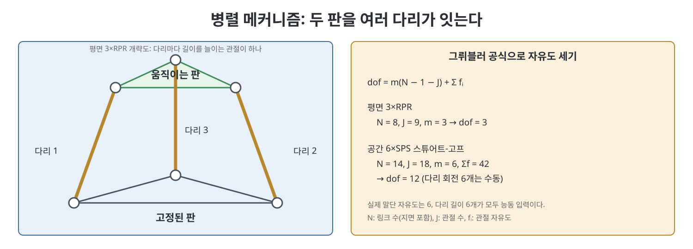

# 7장 폐연쇄 기구학 (Kinematics of Closed Chains)

지금까지 다룬 로봇은 팔처럼 베이스에서 손끝까지 한 줄로 이어진 개연쇄(open chain)였다. 이 장은 링크들이 고리를 이루는 폐연쇄(closed chain) 메커니즘을 다룬다. 대표적인 예가 지면과 움직이는 판을 여러 다리가 이어 주는 병렬 메커니즘, 곧 스튜어트-고프 플랫폼(Stewart-Gough platform)이다. 폐연쇄는 강하고 정밀하지만 기구학 계산이 개연쇄와 거의 반대로 흘러간다. 개연쇄는 순기구학이 쉽고 역기구학이 어렵지만, 폐연쇄(특히 병렬)는 역기구학이 쉽고 순기구학이 어렵다.

> **쉽게 말하면**
> 팔이 한 줄로 이어진 사슬이라면 폐연쇄는 여러 줄이 두 판 사이에 팽팽히 걸린 구조다. 고리마다 "끝점이 서로 같아야 한다"는 구속 조건이 붙기 때문에 자유도 계산과 특이점 분석이 한층 까다롭다.

> **참고(노트 작성자)** 이 장의 수식은 OCR 텍스트와 표준 지식으로 복원했으니 원서 식과 대조하기 바란다. 자코비안 역행렬의 행 구성의 부호와 일반 병렬 메커니즘의 행렬 블록 표기는 확신이 낮아 말과 간단한 식으로만 서술했다.

## 이 장의 흐름

1. 폐연쇄 메커니즘의 예와 자유도 세기
2. 역기구학과 순기구학: 평면 3×RPR, 스튜어트-고프
3. 미분 기구학과 정역학
4. 특이점의 세 종류
5. 요약과 연습문제

## 1. 폐연쇄의 예와 자유도

책은 폐연쇄를 몇 가지 그림으로 소개한다. 평면 4절 링크 같은 단순한 고리, 지면과 판을 세 다리로 연결한 3×RPR 평면 메커니즘, 여섯 다리의 스튜어트-고프 플랫폼, 그리고 다리마다 관절 여러 개가 있는 일반 병렬 메커니즘이다. 병렬 메커니즘의 장점은 여러 다리가 부하를 나눠 지기 때문에 강성이 높고 정밀하다는 점이고, 단점은 작업 공간이 좁고 해석이 어렵다는 점이다.

관절이 고리를 이루면 자유도 계산도 다시 해야 한다. 책은 그뤼블러 공식(Grübler's formula)을 쓴다.

$$\mathrm{dof}=m(N-1-J)+\sum_{i=1}^{J}f_i$$

$m$은 링크 하나의 자유도(평면 3, 공간 6), $N$은 지면을 포함한 링크 수, $J$는 관절 수, $f_i$는 관절 $i$의 자유도이다. 각 링크가 $m$씩 자유도를 가지는데 관절이 이를 구속하고 남은 자유도를 센다는 뜻이다. 평면 3×RPR은 $N=8$, $J=9$, $\sum f_i=9$이므로 $\mathrm{dof}=3$이다. 6×SPS 스튜어트-고프는 $N=14$, $J=18$, $\sum f_i=42$이므로 12로 나온다. 이 수치에는 다리를 자기 축으로 돌리는 수동 회전 6개가 포함되어 있으므로 말단 판의 자유도는 6이다.

| 메커니즘 | $N$ | $J$ | 그뤼블러 결과 | 실제 말단 자유도 |
|----------|-----|-----|---------------|------------------|
| 평면 3×RPR | 8 | 9 | 3 | 3 |
| 공간 6×SPS | 14 | 18 | 12 | 6 (수동 회전 6개 제외) |

참고(노트 작성자): 그뤼블러 공식은 구속이 특이한 배치(평행 축 등)에서는 틀릴 수 있다. 공식이 주는 값은 일반적인 배치에서의 자유도이다.

## 2. 역기구학과 순기구학

### 2.1 평면 3×RPR

고정 판과 움직이는 판에 각각 세 점이 있고, 각 다리는 길이를 늘이는 직선 관절 하나가 능동이다. 고정 프레임 {s}와 판에 붙은 프레임 {b}를 두고, 판의 위치 $p$와 방향 $R$로 다리 벡터를 쓴다. 책은 다리 $i$에 대해 아래 형태의 식을 세운다.

$$d_i=p+Rb_i-a_i,\qquad \ell_i=\|d_i\|$$

$a_i$는 고정 판의 다리 시작점, $b_i$는 움직이는 판의 다리 끝점(판 좌표계 기준)이고, $d_i$는 다리 벡터이다. 판의 자세 $(p,R)$가 주어지면 각 다리 길이는 그냥 벡터 크기이므로 역기구학은 닫힌 식으로 풀린다. 반대로 세 다리 길이를 주고 판의 자세를 구하는 순기구학은 연립 비선형 방정식을 푸는 일이며 해가 여럿이다. 책은 3×RPR에 대해 최대 6개의 수학적 해가 있고, 모두 물리적으로 만들어지는지는 추가 확인이 필요하다고 서술한다. 세 다리 길이가 같은 경우에도 대칭인 해가 두 개 이상 나타난다. 이런 대칭 자세에서는 다리를 늘릴 때 판이 시계 방향으로 돌지 반시계 방향으로 돌지 알 수 없는 특이점이 생긴다.

### 2.2 스튜어트-고프 플랫폼

여섯 개의 SPS 다리(구형 관절-직선 관절-구형 관절)에서 구형 관절은 수동이고 직선 관절만 능동이다. 구조는 3×RPR과 같고 벡터가 3차원이 된 것이다. 판의 자세에서 여섯 다리 길이를 구하는 역기구학은 쉽고, 다리 길이에서 판의 자세를 구하는 순기구학은 어렵다. 순기구학의 해가 여러 개라는 점은 같고, 일반적으로 알려진 최대 개수(40개)는 노트 작성자의 배경지식이며 원서 서술과 대조하지 않았다. 실제 장치에서는 해 근처의 이전 자세를 시작값으로 삼아 수치 반복법으로 푼다.

### 2.3 일반 병렬 메커니즘

다리마다 관절이 여러 개인 일반 병렬 메커니즘은 각 다리를 개연쇄로 보고 PoE로 순기구학을 쓴다. 각 다리의 말단 자세를 $T_1(\theta)$, $T_2(\cdot)$, $T_3(\cdot)$처럼 쓰고, 이들이 같은 판의 자세여야 한다는 고리 구속 $T_1=T_2=T_3$로 연결한다. 다리가 세 개이고 각 다리 관절이 다섯 개인 예에서는 $d=n+m+p-12=3$ 같은 식으로 자유도가 나온다. 책은 이 절차가 다리의 종류와 개수를 바꿔도 그대로 적용된다고 말한다.

## 3. 미분 기구학과 정역학

고리 구속을 시간으로 미분하면 속도 수준의 관계가 나온다. 각 다리의 공간 자코비안 $J_i$로 판의 공간 트위스트를 $\mathcal{V}_s=J_i(\theta_i)\dot\theta_i$로 쓰고, 세 다리에 대한 식이 모두 같은 $\mathcal{V}_s$를 가리킨다는 조건을 세운다. 그러면 능동 관절 속도와 수동 관절 속도, 판 트위스트 사이의 선형 방정식 묶음이 만들어진다.

스튜어트-고프에는 훨씬 간단한 식이 있다. 다리 $i$의 단위 방향을 $n_i$라 하고, 판이 트위스트 $\mathcal{V}_s=(\omega,v)$로 움직일 때 다리 길이의 변화율은 다음과 같다.

$$\dot\ell_i=\begin{pmatrix}a_i\times n_i\\ n_i\end{pmatrix}^{T}\mathcal{V}_s$$

다리 길이 변화율은 판 끝점의 속도 가운데 다리 방향 성분과 같다는 뜻이고, 이 식의 계수 행렬이 역자코비안이다. 행마다 다리를 따라 놓인 직선의 플뤼커 좌표(방향과 모멘트)가 들어 있다. 정역학에서도 힘은 다리 방향으로만 작용하므로, 판이 받는 렌치는 각 다리 힘 $f_i$와 그 직선 축의 곱의 합 $\mathcal{F}=\sum f_i\,(a_i\times n_i,\;n_i)$이다. 개연쇄에서는 순방향 자코비안이 자연스러웠지만, 병렬에서는 역방향 자코비안이 더 자연스럽다.

## 4. 특이점

폐연쇄의 특이점은 개연쇄처럼 한 가지가 아니라 세 종류로 나뉜다.

| 종류 | 의미 | 결과 |
|------|------|------|
| 구성 공간 특이점 | 모든 관절 변수에 대한 고리 구속이 랭크를 잃어 구성 공간이 매끈하지 않음 | 가지가 갈라지거나 교차하여 갑자기 운동 방향이 늘어남 |
| 액추에이터 특이점 | 능동 관절을 모두 고정해도 말단이 움직일 수 있음 | 그 방향 힘을 액추에이터가 제어하지 못함 |
| 말단 특이점 | 능동 관절이 어떻게 움직여도 말단이 못 가는 방향이 있음 | 자유도가 줄어든 것처럼 보임 |

책은 이를 자코비안의 성질로 설명한다. 순방향과 역방향 자코비안 중 어느 쪽이 랭크를 잃는지에 따라 위 구분이 나온다. 개연쇄에서는 모든 관절이 능동이고 구속이 없으므로 액추에이터 특이점과 말단 특이점이 같은 현상으로 보이지만, 병렬에서는 따로 일어난다. 앞의 3×RPR에서 모든 다리가 가장 짧고 길이가 같은 대칭 자세는 다리를 늘릴 때 판의 회전 방향을 정할 수 없는 특이 자세의 예로 책이 보여 준 것이다.

## 5. 요약과 연습문제

책의 요약은 폐연쇄가 순기구학과 역기구학의 난이도가 개연쇄와 뒤바뀌고, 그뤼블러 공식으로 자유도를 세며, 고리 구속을 미분하여 속도 관계를 얻고, 특이점이 세 종류로 나뉜다는 것이다. 연습문제는 여러 메커니즘의 자유도 세기, 평면 병렬 메커니즘의 순기구학 해 구하기, 스튜어트-고프의 자코비안 계산, 특이점 분류 유형이다.

## 핵심 정리

- 폐연쇄는 링크가 고리를 이루며, 자유도는 그뤼블러 공식 $\mathrm{dof}=m(N-1-J)+\sum f_i$로 센다.
- 병렬 메커니즘은 역기구학이 쉽고(다리 벡터의 크기) 순기구학이 어렵다(해가 여러 개).
- 일반 병렬 메커니즘은 다리별 PoE에 고리 구속 $T_1=T_2=\cdots$를 걸어 푼다.
- 스튜어트-고프의 속도 관계 $\dot\ell_i=(a_i\times n_i,\,n_i)^T\mathcal{V}_s$ 는 다리 직선의 플뤼커 좌표로 이루어진 역자코비안을 준다.
- 폐연쇄의 특이점은 구성 공간, 액추에이터, 말단의 세 종류로 나뉜다.

 
 
 

이전: [6장 역기구학](06%EC%9E%A5%20%EC%97%AD%EA%B8%B0%EA%B5%AC%ED%95%99.md) | 다음: [8장 개연쇄 동역학](../03.%203%EB%B6%80%20%EB%8F%99%EC%97%AD%ED%95%99%EA%B3%BC%20%EA%B6%A4%EC%A0%81/08%EC%9E%A5%20%EA%B0%9C%EC%97%B0%EC%87%84%20%EB%8F%99%EC%97%AD%ED%95%99.md)

 

[Modern Robotics](../)
