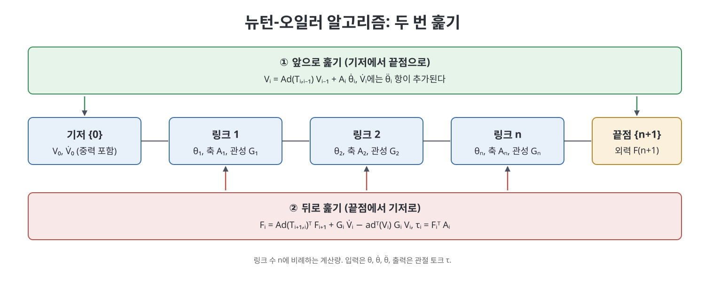
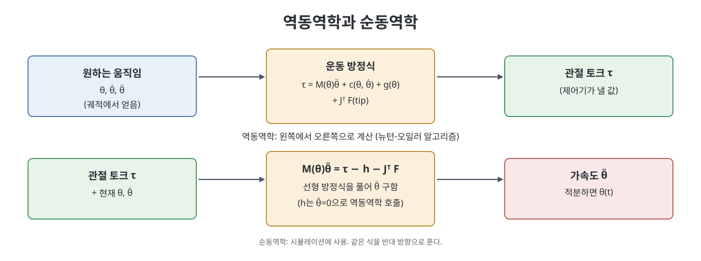

# 8장 개연쇄 동역학 (Dynamics of Open Chains)

지금까지의 기구학은 로봇이 "어떻게 움직이는가"만 다뤘고 힘은 등장하지 않았다. 이 장은 관절에 어떤 토크를 주면 로봇이 어떻게 가속하는지, 반대로 원하는 가속을 내려면 어떤 토크가 필요한지를 다룬다. 책은 먼저 라그랑주 방법으로 운동 방정식의 모양을 잡고, 단일 강체의 동역학을 트위스트와 렌치로 정리한 뒤, 이를 로봇 전체로 확장하는 뉴턴-오일러 재귀 알고리즘을 소개한다. 이어 순동역학과 시뮬레이션, 작업 공간 동역학, 구속 동역학, 로봇 기술 파일(URDF), 모터와 기어와 마찰까지 이어진다.

> **쉽게 말하면**
> 로봇 팔의 동역학은 "토크 = (관성 x 가속도) + (속도에 따른 힘) + 중력"이라는 한 줄 식이다. 이 식을 한 방향으로 풀면 필요한 토크가 나오고, 반대 방향으로 풀면 로봇의 다음 움직임이 나온다.

> **참고(노트 작성자)** 이 장의 수식은 OCR 텍스트가 많이 깨져 있어 표준 지식(Modern Robotics의 POE 표기)으로 복원했다. 첨자와 부호는 원서의 식과 대조하기를 권한다. 확신이 낮은 세부(알고리즘 각 줄의 첨자)는 말로 풀었다.

## 이 장의 흐름

1. 라그랑주 공식: 운동 방정식의 기본 꼴
2. 단일 강체의 동역학: 공간 관성 행렬과 렌치
3. 뉴턴-오일러 역동역학 알고리즘
4. 폐형 동역학 방정식과 순동역학, 시뮬레이션
5. 작업 공간 동역학과 구속 동역학
6. URDF와 모터, 기어, 마찰

## 1. 라그랑주 공식

개연쇄(open chain) 로봇의 관절 변수를 $\theta\in\mathbb{R}^n$, 관절에 가하는 힘 또는 토크를 $\tau$라 하자. 라그랑주 방법은 운동 에너지 $K$에서 위치 에너지 $P$를 뺀 라그랑지안 $L=K-P$를 만들고 다음 식을 적용한다.

$$\frac{d}{dt}\frac{\partial L}{\partial \dot\theta_i}-\frac{\partial L}{\partial \theta_i}=\tau_i$$

책은 평면 2R 팔 같은 작은 예로 이 식을 손으로 전개해 보인 뒤, 일반 로봇의 결과를 아래 꼴로 정리한다.

$$\tau = M(\theta)\ddot\theta + c(\theta,\dot\theta) + g(\theta)$$

- $M(\theta)$는 질량 행렬(mass matrix)이다. 대칭이고 양의 정부호이며 자세 $\theta$에 따라 변한다. 운동 에너지는 $K=\tfrac12\dot\theta^T M(\theta)\dot\theta$로 쓰인다.
- $c(\theta,\dot\theta)$는 속도의 제곱이나 곱으로 나타나는 항으로 원심력과 코리올리 힘을 합친 것이다. $\dot\theta$에 대해 이차 형식이며 $c=\Gamma(\theta)(\dot\theta,\dot\theta)$처럼 크리스토펠 기호로 표현할 수 있다.
- $g(\theta)$는 중력 토크이다.

관절 토크가 이 식의 좌변에 있다는 점이 핵심이다. 끝점이 환경에 렌치를 가하는 경우에는 정역학에서 배운 자코비안 전치가 더해져 $\tau = M\ddot\theta + h(\theta,\dot\theta) + J^T(\theta)\mathcal{F}_{tip}$ 꼴이 된다. 여기서 $h$는 $c$와 $g$를 합친 항이다. 책은 질량 행렬을 이해하는 감각도 알려 준다. 팔을 펼칠수록 어깨 관절이 느끼는 관성이 커지고, 같은 토크를 줘도 가속이 느려진다.

| 항 | 의미 | 속도 의존성 |
|----|------|-------------|
| $M(\theta)\ddot\theta$ | 관성 항 | 가속도에 비례 |
| $c(\theta,\dot\theta)$ | 원심력, 코리올리 | 속도의 이차 형식 |
| $g(\theta)$ | 중력 | 속도와 무관 |
| $J^T\mathcal{F}_{tip}$ | 끝점이 받는 외력 | 외력에 비례 |

## 2. 단일 강체의 동역학

로봇 전체를 다루기 전에 책은 강체 하나의 운동 방정식을 트위스트와 렌치로 쓴다. 질량 $m$과 질량 중심 기준 회전 관성 행렬 $\mathcal{I}_b$를 모아 6x6 공간 관성 행렬(spatial inertia matrix)을 정의한다.

$$\mathcal{G}_b=\begin{bmatrix}\mathcal{I}_b & 0\\ 0 & m I\end{bmatrix}$$

질량 중심에 붙은 물체 프레임 $\{b\}$에서 강체의 운동 에너지는 $\tfrac12\mathcal{V}_b^T\mathcal{G}_b\mathcal{V}_b$이고, 강체에 작용하는 렌치와 트위스트의 관계는 다음과 같다.

$$\mathcal{F}_b=\mathcal{G}_b\dot{\mathcal{V}}_b-\mathrm{ad}_{\mathcal{V}_b}^T\mathcal{G}_b\mathcal{V}_b$$

회전 부분만 보면 익숙한 오일러 방정식 $\mathcal{I}\dot\omega+\omega\times\mathcal{I}\omega=m$이 되고, 병진 부분은 뉴턴의 $f=m\dot v$이다. 즉 이 식은 뉴턴과 오일러 방정식을 하나의 6차원 식으로 묶은 것이다. 책은 질량 중심이 아닌 프레임으로 관성을 옮기는 법도 다룬다. 프레임이 바뀌면 $\mathcal{G}$는 어저전트(adjoint)로 변환되고, 회전 관성만 옮길 때는 평행축 정리(Steiner 정리) $\mathcal{I}_q=\mathcal{I}_b+m(q^Tq\,I-qq^T)$를 쓴다.

> **참고(노트 작성자)** 평행축 정리 식의 부호와 항은 표준 형태로 복원했다.
## 3. 뉴턴-오일러 역동역학

역동역학(inverse dynamics)은 $\theta,\dot\theta,\ddot\theta$가 주어졌을 때 필요한 토크 $\tau$를 구하는 문제이다. 책이 소개하는 알고리즘은 링크마다 질량 중심에 프레임 $\{i\}$를 붙이고, 팔 끝에 프레임 $\{n+1\}$을 두는 준비에서 시작한다. 각 관절의 스크류 축 $\mathcal{A}_i$는 링크 프레임에서 표현한다. 이 알고리즘은 두 번 훑는다.

**앞으로 훑기(base에서 끝으로)**: 인접 링크 사이의 변환 $T_{i,i-1}$을 구하고, 링크 속도와 가속도를 차례로 전파한다.

$$\mathcal{V}_i=\mathrm{Ad}_{T_{i,i-1}}\mathcal{V}_{i-1}+\mathcal{A}_i\dot\theta_i$$

$$\dot{\mathcal{V}}_i=\mathrm{Ad}_{T_{i,i-1}}\dot{\mathcal{V}}_{i-1}+\mathrm{ad}_{\mathcal{V}_i}(\mathcal{A}_i)\dot\theta_i+\mathcal{A}_i\ddot\theta_i$$

중력은 기저가 반대 방향 $g$로 가속한다고 보는 요령으로 처리한다. 즉 기저 가속도 $\dot{\mathcal{V}}_0$에 $(0,-g)$를 넣는다.

**뒤로 훑기(끝에서 base로)**: 각 링크가 받아야 하는 렌치를 구한다. 링크 $i$는 링크 $i+1$이 전달하는 렌치 더하기 자기 자신을 가속시키는 데 필요한 렌치를 감당한다.

$$\mathcal{F}_i=\mathrm{Ad}_{T_{i+1,i}}^T\mathcal{F}_{i+1}+\mathcal{G}_i\dot{\mathcal{V}}_i-\mathrm{ad}_{\mathcal{V}_i}^T\mathcal{G}_i\mathcal{V}_i,\qquad \tau_i=\mathcal{F}_i^T\mathcal{A}_i$$

마지막 식은 렌치 중 관절 축 방향 성분만 뽑는다는 뜻이다. 끝점 렌치 $\mathcal{F}_{n+1}$은 외력이 없으면 0이다. 이 알고리즘은 관절 수 $n$에 비례하는 계산량을 갖는 재귀 구조라서 효율적이다.

## 4. 폐형 방정식과 순동역학

뉴턴-오일러 알고리즘을 기호로 펼치면 질량 행렬의 성분을 닫힌 꼴로 쓸 수 있다.

$$M_{ij}(\theta)=\sum_{l=\max(i,j)}^{n}\mathcal{A}_i^T\,\mathrm{Ad}_{T_{li}}^T\,\mathcal{G}_l\,\mathrm{Ad}_{T_{lj}}\,\mathcal{A}_j$$

의미는 이렇다. 관절 $i$와 $j$의 상호 관성은 두 관절보다 말단 쪽에 있는 링크들의 공간 관성이 만든다. 코리올리 항과 중력 항도 비슷한 폐형 식이 있으나 책은 구현에는 재귀 알고리즘이 더 낫다고 한다.

순동역학(forward dynamics)은 $\theta,\dot\theta,\tau$로부터 $\ddot\theta$를 구하는 문제이다. 풀이는 간단하다. $\theta$와 $\dot\theta$가 정해져 있으니 $\dot\theta$를 0으로 둔 역동역학 호출로 $h(\theta,\dot\theta)$를 얻고, 질량 행렬은 $n$번의 역동역학 호출(단위 가속도 벡터 입력)로 열마다 만든 다음 선형 방정식을 푼다.

$$M(\theta)\ddot\theta=\tau-h(\theta,\dot\theta)-J^T(\theta)\mathcal{F}_{tip}$$

시뮬레이션은 이 $\ddot\theta$를 상태 방정식으로 적분해 얻는다. 상태를 $(q_1,q_2)=(\theta,\dot\theta)$로 놓고 가장 단순한 오일러 적분은 아래와 같다.

$$q_1(t+\delta t)=q_1+q_2\,\delta t,\qquad q_2(t+\delta t)=q_2+\ddot\theta\,\delta t$$

책은 이 방법이 단순하지만 시간 간격이 크면 오차가 쌓이므로, 실제로는 더 정교한 적분기가 쓰인다고 덧붙인다.

| 문제 | 입력 | 출력 | 용도 |
|------|------|------|------|
| 역동역학 | $\theta,\dot\theta,\ddot\theta$ | 토크 $\tau$ | 궤적 추종 제어, 토크 한계 검사 |
| 순동역학 | $\theta,\dot\theta,\tau$ | 가속도 $\ddot\theta$ | 시뮬레이션 |

## 5. 작업 공간 동역학과 구속 동역학

**작업 공간 동역학**은 관절 대신 끝점의 트위스트로 식을 다시 쓴다. 자코비안이 가역일 때 끝점 프레임에서의 식은 다음과 같다.

$$\mathcal{F}_b=\Lambda(\theta)\dot{\mathcal{V}}_b+\eta(\theta,\mathcal{V}_b),\qquad \Lambda=J_b^{-T}MJ_b^{-1}$$

$\Lambda$는 끝점이 느끼는 "겉보기 관성"이다. 책은 방향마다 이 관성이 다르다는 점을 강조한다. 이 식이 성립하려면 자코비안이 가역이어야 하고, 역기구학 해가 여럿이면 $\theta$ 자체에 의존하므로 $X$만으로 쓸 수 없다고 지적한다.

**구속 동역학**은 로봇이 문 손잡이를 잡거나 펜으로 글을 쓸 때처럼, 속도에 팔피안(Pfaffian) 구속 $A(\theta)\dot\theta=0$이 걸린 경우이다. 구속은 일을 하지 않는다고 가정하므로 구속 토크는 $A^T(\theta)\lambda$ 꼴이며, $\lambda$는 구속력의 크기(라그랑주 승수)이다.

$$M\ddot\theta+h=\tau+A^T\lambda,\qquad A\ddot\theta+\dot A\dot\theta=0$$

미지수 $\ddot\theta$와 $\lambda$를 합쳐 $n+k$개 방정식을 한꺼번에 풀면 순동역학이 되고, 반대로 $\ddot\theta$를 주고 $\tau,\lambda$를 구하면 역동역학이 된다. 펜 예에서는 마찰이 없을 때만 일을 하지 않는다는 가정이 성립한다.

## 6. URDF와 모터, 기어, 마찰

**URDF**(Unified Robot Description Format)는 링크 모양, 질량, 관성, 관절 종류와 한계를 XML로 적는 로봇 기술 형식이다. 책은 이 파일에서 링크 관성과 관절 정보를 읽어 위의 동역학에 필요한 $M_i$, $\mathcal{G}_i$, $\mathcal{A}_i$를 만들 수 있다고 설명한다. 형식 세부는 시점 기준이며 변할 수 있다.

**모터**: 직류 모터의 토크는 전류에 비례하고 $\tau=k_tI$, 전압 방정식은 인덕턴스를 무시하면 $V=IR+k_t\omega$이다. $k_t\omega$는 역기전력(back-emf)으로 모터가 단순한 저항과 다른 이유다. 책은 토크-속도 평면에서 전압과 전류 한계가 만드는 작동 영역을 설명한다. 한 끝은 무부하 속도 $\omega_0=V_{max}/k_t$, 다른 끝은 정지 토크 $\tau_{stall}=k_tV_{max}/R$이며 그 사이를 속도-토크 곡선이 잇는다. 토크와 속도의 부호가 반대인 영역에서는 모터가 일을 하는 대신 에너지를 소모하는 댐퍼처럼 행동한다.

**기어**: 기어비 $G$로 감속하면 관절 토크는 모터 토크의 $G$배로 늘고 속도는 $1/G$이 된다. 모터 회전자의 관성 $J_m$이 관절에서 느끼는 값은 $G^2J_m$으로 커진다(반영 관성). 그래서 높은 기어비에서는 로봇 본체의 관성보다 모터 쪽 관성이 지배적이 되기도 하며, 이는 관절 동역학이 서로 거의 독립이 되게 하는 장점으로 이어진다.

**마찰**: 책은 쿨롱 마찰, 점성 마찰, 정지 마찰(스트라이벡 효과)을 모델로 소개하고 $\tau_{fric}$를 동역학 식에 더하는 방식을 설명한다. 마찰은 특히 모터와 기어에서 크며 정확한 모델링이 어렵다.

연습문제는 평면 2R·3R 팔의 운동 방정식 유도, 알고리즘 구현 검증, 스크류 축 변환 같은 계산과 증명 유형이 있다. 책은 소프트웨어 라이브러리로 역동역학, 질량 행렬, 순동역학, 오일러 시뮬레이션을 수행하는 함수들을 제공한다.

## 핵심 정리

- 로봇 팔의 운동 방정식은 $\tau=M(\theta)\ddot\theta+c(\theta,\dot\theta)+g(\theta)$이며, 라그랑주 방법($L=K-P$)으로 유도할 수 있다.
- 강체 하나는 공간 관성 행렬 $\mathcal{G}$를 통해 렌치와 트위스트가 $\mathcal{F}=\mathcal{G}\dot{\mathcal{V}}-\mathrm{ad}_{\mathcal{V}}^T\mathcal{G}\mathcal{V}$로 연결된다.
- 뉴턴-오일러 알고리즘은 앞으로 속도와 가속도를 전파하고 뒤로 렌치를 전파해 관절 토크를 구하는 $O(n)$ 재귀이다.
- 순동역학은 질량 행렬과 편향 항을 구한 뒤 선형 방정식을 풀어 $\ddot\theta$를 얻는 문제이며, 시뮬레이션의 바탕이다.
- 작업 공간 동역학은 겉보기 관성 $\Lambda=J^{-T}MJ^{-1}$로, 구속 동역학은 라그랑주 승수 $\lambda$로 확장한다.
- 실제 로봇에서는 모터 특성, 기어비(반영 관성 $G^2J_m$), 마찰을 함께 고려해야 한다.

 
 
 

이전: [7장 폐연쇄 기구학](../02.%202%EB%B6%80%20%EA%B8%B0%EA%B5%AC%ED%95%99%EA%B3%BC%20%EC%A0%95%EC%97%AD%ED%95%99/07%EC%9E%A5%20%ED%8F%90%EC%97%B0%EC%87%84%20%EA%B8%B0%EA%B5%AC%ED%95%99.md) | 다음: [9장 궤적 생성](09%EC%9E%A5%20%EA%B6%A4%EC%A0%81%20%EC%83%9D%EC%84%B1.md)

 

[Modern Robotics](../)
