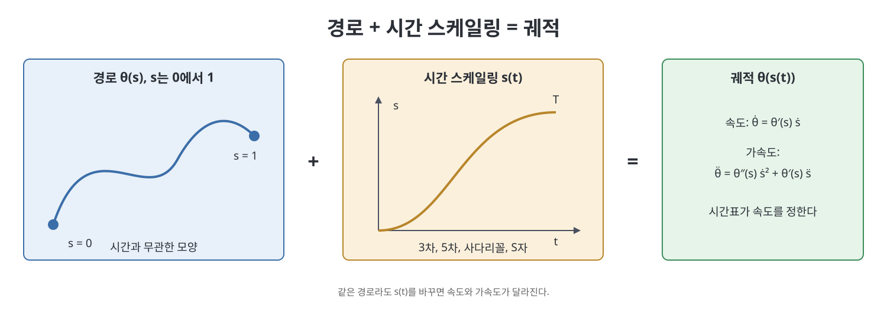
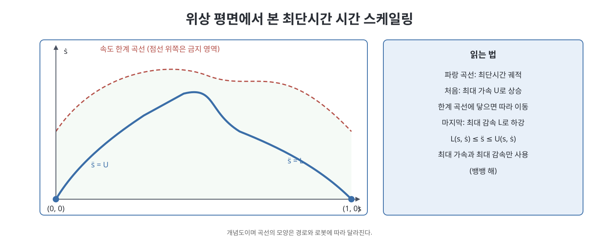

# 9장 궤적 생성 (Trajectory Generation)

모션 플래닝이 "어디를 지나갈 것인가"를 정한다면, 궤적 생성은 "그 길을 언제 얼마나 빠르게 지나갈 것인가"를 정한다. 이 장은 경로(path)와 궤적(trajectory)을 구분하는 데서 시작해, 두 점을 잇는 직선 경로와 여러 시간 스케일링 함수를 비교하고, 여러 경유점을 지나는 다항식 궤적을 만들고, 마지막으로 모터 토크 한계를 지키면서 가장 빨리 경로를 완주하는 최단시간 시간 스케일링을 다룬다.

> **쉽게 말하면**
> 경로는 지도 위의 선이고 궤적은 그 선 위에 시간표를 얹은 것이다. 같은 선이라도 시간표를 어떻게 짜느냐에 따라 부드럽게 갈 수도, 로봇이 덜컥거릴 수도 있다.

> **참고(노트 작성자)** 이 장의 수식은 OCR 텍스트와 표준 지식으로 복원했다. 사다리꼴 속도 곡선의 관계식과 다항식 계수는 직접 유도해 확인했지만 원서 식과 대조하기를 권한다.

## 이 장의 흐름

1. 정의: 경로, 시간 스케일링, 궤적
2. 점대점 궤적: 직선 경로와 시간 스케일링
3. 경유점을 지나는 다항식 궤적
4. 최단시간 시간 스케일링
5. 소프트웨어와 연습문제

## 1. 정의: 경로와 궤적

책은 경로를 시간과 무관한 기하학적 곡선 $\theta(s)$, $s\in[0,1]$로 정의한다. 궤적은 여기에 시간 스케일링 $s(t)$를 합성한 $\theta(s(t))$이다. $s(t)$는 시간 $t\in[0,T]$를 $[0,1]$로 보내는 단조 증가 함수이며, 보통 $s(0)=0$, $s(T)=1$이다. 합성함수의 미분 규칙으로 속도와 가속도는 다음과 같다.

$$\dot\theta=\theta'(s)\,\dot s,\qquad \ddot\theta=\theta''(s)\,\dot s^2+\theta'(s)\,\ddot s$$

여기서 $'$는 $s$에 대한 미분이다. 속도는 경로의 기울기에 $\dot s$를 곱한 것이고, 가속도에는 곡선이 휘어서 생기는 $\dot s^2$ 항이 붙는다. 같은 경로에서도 $\dot s$와 $\ddot s$만 바꾸면 속도와 가속도를 마음대로 조절할 수 있다는 점이 핵심이다.

## 2. 점대점 궤적

**직선 경로**: 두 배위 사이를 잇는 가장 단순한 경로는 직선이다. 관절 공간에서는 아래처럼 쓴다.

$$\theta(s)=\theta_{start}+s(\theta_{end}-\theta_{start})$$

이 경로는 모든 관절이 동시에 출발하고 도착하지만 끝점이 휘어서 이동할 수 있다. 작업 공간에서 끝점이 직선을 그리게 하려면 위치 성분은 직선으로, 방향 성분은 회전 보간으로 처리해야 한다. 책은 이를 하나로 묶어 SE(3)에서의 스크류 운동을 쓴다.

$$X(s)=X_{start}\exp\!\big(\log(X_{start}^{-1}X_{end})\,s\big)$$

의미는 시작점에서 끝점으로 가는 상대 변환의 로그를 구해 $s$만큼만 진행하는 것이다. 이 경로는 스크류 축 하나에 대한 운동이다. 책은 위치와 방향을 따로 보간하는 대안(직선 위치, 회전 스크류 분리)도 언급한다.

**시간 스케일링**: 아래 세 가지가 대표적이다. 책은 $T$를 정하면 필요한 계수를 구하는 방식으로 설명한다.

| 방식 | 식 | 특징 |
|------|----|------|
| 3차 다항식 | $s=3(t/T)^2-2(t/T)^3$ | 시작과 끝의 속도가 0, 가속도가 불연속(저크가 무한) |
| 5차 다항식 | $s=10(t/T)^3-15(t/T)^4+6(t/T)^5$ | 시작과 끝의 속도와 가속도가 0 |
| 사다리꼴 | 가속, 등속, 감속 구간 | 최대 속도 $v$와 가속도 $a$로 규정, 가속도가 구간 경계에서 불연속 |

3차 다항식은 $s(0)=0$, $s(T)=1$, $\dot s(0)=\dot s(T)=0$ 네 조건으로 계수가 정해진다. 이 경우 시작과 끝에서 가속도가 0이 아니므로 가속도가 갑자기 뛰고, 그 변화율인 저크(jerk)가 무한대가 되어 진동을 일으킬 수 있다. 5차 다항식은 가속도 조건 두 개가 더해져 이를 완화한다.

사다리꼴은 최대 속도 $v$와 가속도 $a$를 정하면 $T=\dfrac{1}{v}+\dfrac{v}{a}$ 가 되고, 가속과 감속 구간이 서로 겹치지 않으려면 $v^2\le a$가 필요하다. 반대로 총 시간 $T$를 정하면 $v=\dfrac{aT-\sqrt{a^2T^2-4a}}{2}$이며 $aT^2\ge4$여야 해가 존재한다. 가속 구간 길이는 $t_a=v/a$이다.

**S자 곡선(S-curve)**은 사다리꼴의 가속도 불연속을 없애려고 저크를 일정하게 제한한 7단계 프로파일이다. 일정 저크로 가속도를 올리고, 일정 가속도로 속도를 높이고, 음의 저크로 가속도를 줄이고, 등속으로 달린 뒤, 대칭으로 감속한다. 모터 제어에서 단차 가속도로 인한 진동을 피하는 데 많이 쓰인다.

## 3. 경유점을 지나는 다항식 궤적

경로의 모양에는 엄격한 제약이 없고 정해진 시각에 정해진 경유점들을 지나가기만 하면 될 때, 책은 경로와 스케일링을 따로 만들지 않고 관절 변수의 시간 함수를 다항식으로 직접 보간하는 방법을 제안한다. 관절마다 독립적으로 보간한다. 경유점 $k$개의 시각을 $T_1<\dots<T_k$라 하고 구간 $j$의 길이를 $\Delta T_j$라 하자.

각 구간에서 3차 다항식 $\theta(t)=a_0+a_1t+a_2t^2+a_3t^3$을 쓰고 구간 양 끝의 위치와 속도를 정하면 계수가 결정된다. 구간 시작을 $t=0$으로 옮기면 다음과 같다.

$$a_0=\theta_j,\quad a_1=\dot\theta_j$$

$$a_2=\frac{3(\theta_{j+1}-\theta_j)-(2\dot\theta_j+\dot\theta_{j+1})\Delta T}{\Delta T^2}$$

$$a_3=\frac{-2(\theta_{j+1}-\theta_j)+(\dot\theta_j+\dot\theta_{j+1})\Delta T}{\Delta T^3}$$

경유점에서의 속도 $\dot\theta_j$는 연속이 되도록 구간 사이에서 같은 값을 쓴다. 이 값을 사용자가 지정하면 되고, 지정하지 않으면 이웃 점들의 평균 기울기로 정하는 등의 방법이 있다. 더 높은 차수의 다항식을 쓰면 가속도까지 연속인 궤적을 얻을 수 있다.

| 방식 | 연속성 | 비고 |
|------|--------|------|
| 구간별 3차 | 위치, 속도 연속 | 경유점 속도를 정해야 함 |
| 구간별 5차 | 위치, 속도, 가속도 연속 | 경유점 가속도도 정해야 함 |
| 속도를 자유 변수로 두는 스플라인 | 가속도까지 연속 | 연립 방정식을 풀어 속도 결정 |

책은 위 방법이 경로 형태를 보장하지 않으므로 경유점 사이에서 장애물을 피할지는 별도로 확인해야 한다고 지적한다.

## 4. 최단시간 시간 스케일링

이제 경로 $\theta(s)$는 이미 주어져 있고 모터 토크 한계 $\tau_{min}\le\tau\le\tau_{max}$가 있다고 하자. 목표는 이 한계를 지키면서 시작 정지 상태에서 출발해 끝 정지 상태에 도착하는 가장 빠른 $s(t)$를 찾는 것이다.

동역학 식에 $\dot\theta=\theta'\dot s$, $\ddot\theta=\theta''\dot s^2+\theta'\ddot s$를 넣으면 토크가 $s$, $\dot s$, $\ddot s$만의 식이 된다.

$$\tau=m(s)\ddot s+c(s)\dot s^2+g(s)$$

$m(s)$는 경로를 따라 움직일 때의 유효 관성, $c(s)\dot s^2$은 속도 제곱 항, $g(s)$는 중력 토크이다. 각 관절 $i$의 토크 한계를 $\ddot s$에 관한 부등식으로 풀면, 상태 $(s,\dot s)$에서 허용되는 가속도의 하한과 상한이 나온다.

$$L(s,\dot s)\le \ddot s\le U(s,\dot s)$$

$m_i(s)$의 부호에 따라 부등식 방향이 바뀌므로 관절마다 하한과 상한을 구하고, 모든 관절을 만족하도록 하한은 최댓값, 상한은 최솟값을 취한다. 만약 어떤 점에서 $m_i(s)=0$이면 영 관성 점(zero-inertia point)이라 부르며 별도 처리가 필요하다고 책은 설명한다.

**위상 평면 해석**: $s$를 가로축, $\dot s$를 세로축으로 하는 평면에서 궤적은 $(0,0)$에서 $(1,0)$으로 가는 곡선이다. 어떤 점에서 $L>U$이면 그 속도로는 한계를 지킬 수 없는 금지 영역이다. 이 영역의 경계를 속도 한계 곡선이라 한다. 최단시간 해는 곡선 위에서 항상 가능한 최대 가속($\ddot s=U$) 또는 최대 감속($\ddot s=L$)을 쓰는 뱅뱅(bang-bang) 형태이다. 알고리즘은 대략 다음과 같다.

1. $(0,0)$에서 $\ddot s=U$로 앞으로 적분하고 $(1,0)$에서 $\ddot s=L$로 뒤로 적분한 두 곡선을 만든다.
2. 앞으로 적분하다 속도 한계 곡선에 닿으면, 곡선을 따라 움직이다가 곡선을 벗어날 수 있는 접점을 찾아 거기서부터 다시 최대 가속을 쓴다.
3. 뒤쪽 곡선과 만나는 점에서 가속에서 감속으로 전환한다.

결과는 가능한 한 빠르게 가속하다가 마지막 순간에 최대 감속으로 멈추는 시간표다. 최단시간이기에 토크가 늘 한계에 닿아 있으므로, 실제 로봇에서는 여유를 두고 한계를 낮춰서 쓰는 것이 안전하다.

연습문제는 사다리꼴과 S자 곡선의 시간 계산, 3차 다항식 계수 유도, 1자유도 최단시간 문제 같은 계산 유형이다. 책이 제공하는 소프트웨어는 3차·5차 시간 스케일링, 관절 경로와 스크류 경로 생성, 그리고 토크 한계 하의 최단시간 스케일링 궤적을 만드는 함수들이다.

## 핵심 정리

- 경로는 시간과 무관한 곡선 $\theta(s)$이고, 궤적은 시간 스케일링 $s(t)$를 곱한 $\theta(s(t))$이다.
- 시간 스케일링은 3차, 5차 다항식, 사다리꼴, S자 곡선 등이 있으며, 연속성(속도, 가속도, 저크)과 계산 단순성 사이에서 고른다.
- 작업 공간 직선 경로는 $X(s)=X_{start}\exp(\log(X_{start}^{-1}X_{end})s)$로 쓸 수 있다.
- 경유점을 지나는 궤적은 구간별 3차 다항식으로 만들 수 있으며, 경유점 속도를 맞추면 위치와 속도가 연속이다.
- 최단시간 시간 스케일링은 토크 한계에서 $L(s,\dot s)\le\ddot s\le U(s,\dot s)$를 얻고 위상 평면에서 최대 가속과 최대 감속을 번갈아 쓰는 뱅뱅 해로 구한다.

 
 
 

이전: [8장 개연쇄 동역학](08%EC%9E%A5%20%EA%B0%9C%EC%97%B0%EC%87%84%20%EB%8F%99%EC%97%AD%ED%95%99.md) | 다음: [10장 모션 플래닝](../04.%204%EB%B6%80%20%EA%B3%84%ED%9A%8D%EA%B3%BC%20%EC%A0%9C%EC%96%B4/10%EC%9E%A5%20%EB%AA%A8%EC%85%98%20%ED%94%8C%EB%9E%98%EB%8B%9D.md)

 

[Modern Robotics](../)
