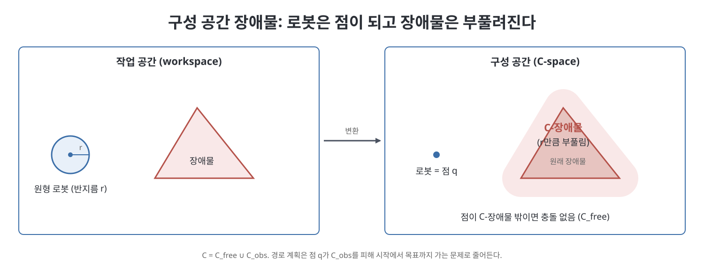
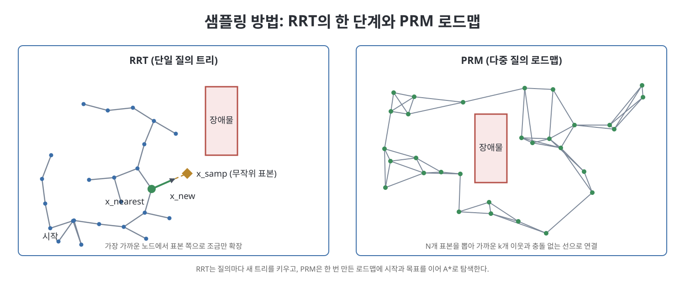

# 10장 모션 플래닝 (Motion Planning)

이 장은 로봇이 출발 상태에서 목표 상태까지 장애물을 피하고 관절 한계나 토크 한계 같은 제약을 지키며 움직이는 방법을 찾는 문제, 곧 모션 플래닝(motion planning)을 다룬다. 책은 이 분야가 책 한 권으로도 모자랄 만큼 방대하다고 인정하고, 로봇 팔과 이동 로봇을 예로 들어 대표적인 기법만 실용적으로 훑는다. 흐름은 문제의 분류, 구성 공간 장애물과 그래프 탐색이라는 기초, 그리고 격자, 샘플링, 포텐셜 장, 최적화, 스무딩 같은 여러 계획 방식의 순서다.

> **쉽게 말하면**
> 로봇의 모든 자세를 지도 위의 한 점으로 바꾸면, 장애물 피하기는 "금지 구역을 피해 점을 이동시키는 길 찾기"가 된다. 이 장은 그 길을 찾는 여러 방법과 각각의 장단점을 비교한다.

> **참고(노트 작성자)** 이 장의 수식과 알고리즘은 OCR 텍스트가 많이 깨져 있어 표준 지식으로 복원했다. 원서의 식과 대조해 읽기를 권한다. 책이 언급하는 소프트웨어(MoveIt!, ROS 등)와 참고 문헌은 책이 쓰인 시점 기준이다.

## 이 장의 흐름

1. 모션 플래닝의 개요: 문제 종류, 플래너의 성질, 방법 분류
2. 기초: 구성 공간 장애물, 충돌 검사, 그래프와 A* 탐색
3. 완전 경로 계획기(로드맵)
4. 격자 방법과 운동 제약이 있는 격자 탐색
5. 샘플링 방법: RRT와 PRM
6. 가상 포텐셜 장과 내비게이션 함수
7. 비선형 최적화와 스무딩

## 1. 모션 플래닝의 개요

배위(configuration) $q$가 구성 공간(configuration space, C-space) $\mathcal{C}$의 한 점이라는 것이 출발점이다. 관절이 $n$개인 로봇 팔이면 $q$는 $n$개의 관절 위치를 모은 벡터다. 책은 관절 한계를 넘거나 장애물을 파고드는 배위를 뺀 나머지를 자유 구성 공간 $\mathcal{C}_{free}$라고 부른다. 로봇이 가속도 수준의 동역학을 가지면 상태는 배위와 속도를 합친 $x=(q,\dot q)$이고, 운동 방정식은 다음과 같다.

$$\dot x = f(x,u)$$

제어 입력 $u$로 상태가 어떻게 변하는지를 적은 식이다. 문제의 일반형은 시작 상태 $x_{start}$에서 목표 상태 $x_{goal}$에 닿는 시간 $T$와 제어 $u(t)$를 찾되, 모든 시각에서 $q(x(t))\in\mathcal{C}_{free}$를 지키는 것이다. 책은 계획된 운동을 따라가게 하는 피드백 제어기(11장)가 있고, 환경의 기하 모델이 정확하다고 가정한다.

문제는 여러 축으로 나뉜다.

| 구분 | 내용 |
|------|------|
| 경로 계획 대 모션 계획 | 경로(path)는 시간과 동역학을 빼고 기하만 푼다. 이후 9장의 시간 스케일링으로 궤적(trajectory)을 만든다. 피아노 옮기기 문제라고도 부른다 |
| 제어 입력 수 | 입력 $m$이 자유도 $n$보다 적으면(예: 자동차 $n=3$, $m=2$) 충돌 없는 경로라도 따라갈 수 없는 것이 생긴다 |
| 온라인 대 오프라인 | 장애물이 갑자기 나타나면 빠른 온라인 계획이 필요하다 |
| 최적 대 만족 | 비용(예: 시간, 에너지)을 줄일 것인가, 일단 가능한 해면 되는가 |
| 정확 대 근사 | 목표에 충분히 가까우면 허용할 것인가 |

플래너 자체의 성질도 구분한다. 같은 환경에서 여러 번 질의하면 자료 구조를 미리 만드는 다중 질의(multiple-query) 방식이 이득이고, 매번 처음부터 푸는 것은 단일 질의다. 처음 해를 찾은 뒤에도 더 나은 해를 찾는 것은 애니타임(anytime) 계획이다. 해가 있으면 유한 시간에 찾고 없으면 없다고 보고하는 것이 완전성(complete)이다. 격자 해상도 수준에서만 보장하면 해상도 완전, 계획 시간이 무한대로 갈 때 해를 찾을 확률이 1로 수렴하면 확률적 완전이다.

책이 소개하는 방법 계열은 완전 방법, 격자 방법, 샘플링 방법, 가상 포텐셜 장, 비선형 최적화, 스무딩이다. 책은 최근 흐름이 구현이 쉽고 고차원에 강한 샘플링 쪽이라고 말한다.

## 2. 기초 개념

### 2.1 구성 공간 장애물

작업 공간의 장애물은 구성 공간을 둘로 나눈다. 로봇이 닿는 배위의 집합이 장애물 공간 $\mathcal{C}_{obs}$이고 나머지가 $\mathcal{C}_{free}$다. 이때 $\mathcal{C}=\mathcal{C}_{free}\cup\mathcal{C}_{obs}$이며 관절 한계도 장애물로 취급한다. 이렇게 하면 경로 계획은 점 하나가 $\mathcal{C}_{obs}$를 피해 가는 문제로 줄어든다. 장애물이 $\mathcal{C}_{free}$를 여러 연결 성분으로 쪼갰는데 시작과 목표가 다른 성분에 있으면 충돌 없는 경로는 없다.

책의 예를 정리하면 다음과 같다. 2R 평면 팔은 구성 공간이 사실 토러스지만 정사각형으로 펴서 그린다. 원형 이동 로봇은 장애물을 로봇 반지름만큼 부풀리면 되고, 두 장애물 사이가 로봇 지름보다 좁으면 부푼 영역이 겹쳐 통과할 수 없음을 한눈에 알 수 있다. 다각형 로봇이 평행 이동만 하면 로봇을 장애물 둘레로 미끄러뜨리며 기준점의 자취를 그린 것이 C-장애물이다. 회전까지 허용하면 구성 공간이 3차원이 되고, 각 각도별 2차원 단면을 쌓은 모양이 되어 정확히 표현하기 매우 복잡하다. 그래서 C-장애물은 거의 명시적으로 쓰지 않고 개념으로만 이해한다.

### 2.2 거리와 충돌 검사

로봇과 장애물 $\mathcal{B}$ 사이의 거리를 $d(q,\mathcal{B})$로 쓰면 접촉 없음은 $d>0$, 접촉은 $d=0$, 침투는 $d<0$이다. 충돌 검사는 이 값이 0 이하인지 참/거짓으로 답하는 루틴이다. 볼록한 두 물체의 거리는 GJK 알고리즘이 효율적으로 구한다. 간단한 대안은 물체를 겹치는 구의 집합으로 덮는 것인데, 근사는 반드시 보수적이어야 한다. 곧 실제 물체를 모두 덮어야 근사가 자유라고 답했을 때 실제로도 충돌이 없다. 구의 개수를 늘릴수록 실제 형상에 가까워진다.

경로의 한 구간이 충돌 없는지는, 경로를 촘촘히 샘플링하고 로봇을 살짝 부풀려 검사하면 연속한 두 배위 사이를 로봇이 쓸고 지나간 부피도 안전하다고 볼 수 있다.

### 2.3 그래프와 A* 탐색

많은 플래너는 구성 공간을 그래프로 본다. 노드는 배위나 상태, 간선은 장애물을 피한 이동 가능성이다. 간선에 방향이 있으면 유향 그래프, 비용이 있으면 가중 그래프이고, 사이클이 없고 각 노드의 부모가 많아야 하나인 유향 그래프가 트리다.

최소 비용 경로를 찾는 대표 알고리즘이 A*다. 핵심은 아직 탐색할 노드 중 총비용 추정치가 가장 작은 노드부터 꺼내는 것이다.

$$\text{est\_total\_cost}(n)=\text{past\_cost}(n)+\text{heuristic\_cost\_to\_go}(n)$$

앞 항은 출발점에서 지금까지 든 실제 비용, 뒤 항은 남은 비용의 낙관적(과소) 추정치다. 장애물을 무시한 직선거리가 흔한 선택이다. 추정이 낙관적이면 A*는 최적 경로를 보장한다. 추정치를 모두 0으로 두면 다익스트라 알고리즘이 되고, 간선 비용이 모두 같으면 너비 우선 탐색과 같다. 추정치에 1보다 큰 상수를 곱해 부풀리면 목표 쪽으로 탐색이 쏠려 빨라지지만 최적성은 잃는다.

> **참고(노트 작성자)** A*의 OPEN/CLOSED 목록은 "탐색 대기 후보"와 "이미 확장한 노드"로 이해하면 된다. 의사 코드의 흐름은 현재 노드를 꺼내고, 목표면 종료하고, 이웃의 비용이 더 낮게 갱신되면 부모를 바꿔 OPEN에 다시 넣는 것이다.

## 3. 완전 경로 계획기

정확한 $\mathcal{C}_{free}$ 표현에 기대는 방법이다. 책은 수학적으로 복잡해 실용성이 낮으므로 깊이 다루지 않는다. 대신 아이디어만 소개한다. 고차원의 $\mathcal{C}_{free}$를 1차원 로드맵 $R$로 대신하는데, 자유 공간의 어느 점에서든 로드맵으로 쉽게 접근할 수 있어야 하고(도달성), $\mathcal{C}_{free}$의 연결 성분마다 로드맵의 연결 성분이 하나씩 대응해야 한다(연결성). 다각형 로봇이 다각형 장애물 사이를 평행 이동하는 경우의 예가 가시성 그래프다. C-장애물의 꼭짓점을 노드로 하고 서로 보이는 꼭짓점끼리 잇는다. 시작점과 목표점을 보이는 꼭짓점에 연결한 뒤 A*를 돌리면 최단 경로가 나온다. 최단 경로는 장애물 모서리를 스치므로 $\mathcal{C}_{free}$는 경계를 포함한다고 본다.

## 4. 격자 방법

구성 공간을 격자로 나누고 A*를 적용한다. 차원 $n$에 차원당 $k$개의 점이면 격자점은 $k^n$개다. 인접의 정의가 필요하다. 2차원에서 4-연결은 상하좌우, 8-연결은 대각선을 포함하며 대각선 이동 비용은 $\sqrt2$ 정도로 벌점을 준다. 축 방향 이동만 허용하면 휴리스틱도 직선거리 대신 맨해튼 거리를 쓴다. 격자 A*는 해상도 완전하고 허용된 이동 범위에서 최단 경로를 준다. 같은 목표를 여러 번 질의할 때는 목표에서 너비 우선으로 점수를 매긴 웨이브프런트(wavefront) 플래너가 편리해, 이후엔 점수가 낮은 이웃으로 내려가기만 하면 된다.

문제는 차원이다. $k=100$일 때 $n=3$이면 $10^6$개, $n=5$면 $10^{10}$, $n=7$이면 $10^{14}$개로 폭발한다. 그래서 격자 방법은 저차원에 한정된다. 한 완화책이 다중 해상도 격자로, 장애물에 닿은 칸만 계속 반으로 쪼갠다. 2차원에서는 쿼드트리, 3차원에서는 옥트리라고 부른다. 장애물 근처는 촘촘하고 넓은 빈 공간은 큰 걸음으로 지나간다.

### 4.1 운동 제약이 있는 격자 탐색

자동차는 옆으로 한 칸 갈 수 없고, 빠르게 움직이는 팔은 속도까지 포함한 상태 공간에서 계획해야 한다. 이런 로봇은 제어 입력을 이산화해서 쓴다. 바퀴형 로봇의 단순 모델에서 제어는 $(v,\omega)$ 곧 직진 속도와 각속도이고, 각 제어를 짧은 시간 $\Delta t$ 동안 적분해 새 노드를 만든다. 적분 결과가 격자점에 정확히 떨어지지 않으므로, 이미 점유된 격자 칸에 들어오는 노드는 가지치기하는 방식으로 탐색 폭발을 막는다. 이는 다익스트라의 변형으로 구현하며, 후진에 벌점을 주는 등 비용 설계도 가능하다.

로봇 팔은 두 단계로 나눌 수 있다. 먼저 구성 공간에서 장애물 없는 경로를 찾고, 다음에 9장의 방법으로 시간 스케일링을 한다. 두 단계라서 시간 최적은 아니다. 대안은 상태 공간에서 직접 계획하는 것으로, 토크 한계에서 나오는 가능한 가속도 집합을 격자와 겹쳐 제어를 이산화한다. 이렇게 하면 도달 가능한 상태가 상태 공간 격자에 들어가 해상도 완전하고 시간 최적인 궤적을 얻는다. 단, 해상도를 높이면 계산량이 급격히 불어난다. 책의 예로, 관절 3개인 팔에서 제어 해상도를 2배로 올리고 시간 간격을 4분의 1로 줄이면 탐색이 약 4096배 오래 걸릴 수 있다. 그래서 몇 자유도를 넘기면 쓰기 어렵다.

## 5. 샘플링 방법

격자는 최적에 가깝지만 고차원에서 막힌다. 샘플링 방법은 최적성을 포기하는 대신 고차원에서도 빨리 쓸 만한 해를 찾는다. 구성 요소는 네 가지다. 공간에서 표본을 뽑는 함수, 표본이 자유 공간인지 보는 함수, 가장 가까운 기존 표본을 찾는 함수, 그쪽으로 연결을 시도하는 국소 계획기다. 대부분 확률적 완전하다. 대표가 RRT(rapidly exploring random tree)와 PRM(probabilistic roadmap)이다. RRT는 단일 질의용 트리이고, PRM은 구성 공간에 로드맵 그래프를 미리 만드는 다중 질의용이다.

### 5.1 RRT

기본 RRT는 시작 상태에서 트리 하나를 키운다. 한 반복은 이렇다.

1. 상태 공간에서 표본 $x_{samp}$를 뽑는다(목표 쪽으로 약간 편향).
2. 트리에서 $x_{samp}$에 가장 가까운 노드 $x_{nearest}$를 찾는다.
3. 국소 계획기로 $x_{nearest}$에서 $x_{samp}$ 방향으로 조금 간 상태 $x_{new}$를 만든다.
4. 경로가 충돌이 없으면 $x_{new}$를 트리에 추가한다. 목표 집합에 들면 성공이다.

거의 균일한 표본이 트리를 빈 곳으로 "끌어당겨" 빠르게 퍼지게 한다. 세부 선택이 성능을 크게 좌우한다. 표본은 꼭 무작위일 필요가 없고 결국 공간에 조밀해지기만 하면 되어서 RDT(rapidly exploring dense tree)라 부르기도 한다. 가까움의 정의도 까다롭다. 자동차에게는 제자리 회전과 옆 이동이 안 되므로 단위가 다른 요소(미터, 도)를 섞고 운동 제약을 반영한 거리가 필요하다. 가중합이 단순한 선택이고, 최근접 탐색은 kd 트리나 해싱으로 빠르게 한다. 국소 계획기로는 직선 계획기, 이산화한 제어 계획기, 바퀴형 로봇의 리즈-셰프(Reeds-Shepp) 곡선 같은 것을 쓴다.

변형 두 가지를 책이 소개한다. 양방향 RRT는 시작과 목표에서 각각 트리를 키우고 서로 이으려 시도하는데, 목표 한 점에 정확히 닿을 수 있고 대개 더 빨리 만난다. 다만 국소 계획기가 두 트리를 정확히 잇지 못할 수 있어 스무딩으로 불연속을 메운다. RRT*는 새 노드 주변의 가까운 노드들 중 총비용이 최소인 부모를 고르고, 반대로 새 노드를 거치면 더 싸게 갈 수 있는 이웃의 부모를 바꾸는 재배선(rewiring)을 한다. 그 결과 표본 수가 늘수록 해가 최적에 수렴한다는 점이 RRT와 다르다.

### 5.2 PRM

PRM은 질의 전에 로드맵을 만든다. $N$개의 자유 공간 표본을 뽑고, 각 표본을 가까운 $k$개 이웃과 충돌 없는 국소 경로로 연결한다. 로드맵은 무방향 그래프라서 어느 방향으로든 정확히 이동할 수 있는 국소 계획기(예: 직선)가 있는 운동 제약 없는 문제에 적합하다. 질의가 오면 시작점과 목표점을 로드맵에 잇고 A*로 탐색한다. 고해상도 격자보다 효율적인 까닭은 국소 계획기로 "보이는" 자유 공간의 부피 비율이 차원이 늘어도 지수적으로 줄지 않기 때문이다. 좁은 통로를 찾기 위해 장애물 근처에 표본을 더 뿌리는 전략도 효과가 있다고 한다.

## 6. 가상 포텐셜 장

중력장이나 자기장처럼 구성 공간에 포텐셜 $P(q)$를 정의하면 힘 $F=-\partial P/\partial q$가 물체를 높은 곳에서 낮은 곳으로 민다. 로봇에서는 목표에 낮은 포텐셜, 장애물에 높은 포텐셜을 주고 그 기울기의 반대 방향으로 힘을 준다. 계산이 빨라 반응형 제어로 실시간 처리하고, 센서가 있으면 움직이는 장애물도 다룬다. 단점은 지역 최소(local minimum)로, 인력과 척력이 상쇄되어 목표가 아닌 곳에 갇힐 수 있다.

점 로봇의 구성 요소는 다음과 같다. 목표의 이차 포텐셜 "그릇"과 장애물의 척력 포텐셜(거리 $d$에 반비례해 커지는 형태)을 더한다.

$$P_{goal}(q)=\tfrac12 (q-q_{goal})^{T}K(q-q_{goal}),\qquad F_{goal}=K(q_{goal}-q)$$

목표까지 거리에 비례하는 용수철 같은 인력이다. 장애물의 영향 범위를 제한해 먼 장애물을 무시하면 계산이 줄고, 포텐셜과 힘의 상한도 두는 것이 보통이다. 로봇을 구동하는 방법은 둘이다. 힘에 감쇠를 더해 $u=F(q)+B\dot q$로 쓰거나(구르는 공에 마찰이 있는 그림), 힘을 속도 명령 $\dot q=F(q)$로 쓰면 진동이 자동으로 없어진다.

지역 최소를 피하려는 시도가 두 가지 있다. 웨이브프런트는 지역 최소 없는 포텐셜을 격자에 만든다. 내비게이션 함수는 매끄럽고, 장애물 경계에서 상한이 있으며, 목표에만 유일한 최소가 있고, 임계점에서 헤시안이 정칙(모스 함수)인 포텐셜이다. 마지막 조건 덕에 안장점으로 끌려가는 초기 상태는 측도 0이어서 거의 모든 시작점이 목표로 수렴한다. 책은 림온과 코디셰크가 구 모양 장애물이 있는 구형 세계에서 이를 구성하고 별 모양 세계로 변형하는 방법을 보였다고 소개한다.

작업 공간 포텐셜은 거리 계산이 어렵다는 문제를 피하는 방법이다. 장애물 경계를 점들로, 로봇을 몇 개의 제어점으로 표현해 점 사이 척력을 구하고, 자코비안 전치로 관절 공간의 일반화 힘으로 바꾼다($F=J^{T}F_{lin}$). 바퀴형 로봇처럼 비홀로노믹 제약이 있으면 힘을 제약에 접하는 방향으로 사영해서 쓴다. 포텐셜 장을 A* 같은 탐색의 비용 추정에 쓰면 영구히 갇히는 일을 막을 수 있다.

## 7. 비선형 최적화와 스무딩

경로나 제어를 다항식 계수, 푸리에 급수 계수, 스플라인 계수 같은 유한한 매개변수로 나타내고, 비용을 최소화하며 제어 한계, 장애물, 시작과 목표 조건을 만족하는 값을 찾는 문제로 바꿀 수 있다. 궤적 $q(t)$만 매개변수화하거나, 제어 $u(t)$만, 혹은 둘 다 할 수 있다. 연속 제약은 구간 위의 일정 간격 점들에서 만족시킨다. 순차 이차 계획법(SQP) 같은 기울기 기반 방법은 초기 추측이 해에 가까울 때만 국소 최적해를 기대할 수 있고, 목적 함수와 실행 가능 영역이 볼록하지 않아 엉뚱한 곳에 멈출 수 있다.

격자와 샘플링 플래너가 내놓는 경로는 대개 덜컹거린다. 책은 후처리로 매끄럽게 하는 두 가지를 든다. 하나는 플래너의 결과를 초기값으로 삼는 비선형 최적화다. 예를 들어 제어의 변화율 제곱을 시간에 대해 적분한 비용을 두면 급하게 바뀌는 제어에 벌점이 붙는다. 책은 사람의 팔 운동이 매끄러운 것도 관절 토크의 변화율을 줄이는 방향이라는 해석과 닮았다고 덧붙인다. 다른 하나는 분할 후 재연결로, 경로 위 멀리 떨어진 두 점을 국소 계획기로 이어 보고 충돌이 없으면 원래 구간을 대체한다. 무작위 점으로 반복하거나 경로를 재귀적으로 쪼개며 적용한다.

## 8. 방법 비교와 연습문제 유형

| 방법 | 장점 | 한계 | 완전성 |
|------|------|------|--------|
| 완전(로드맵) | 정확한 해 | 구현이 어렵고 복잡 | 완전 |
| 격자 + A* | 구현이 쉽고 최적 가능 | 차원에 지수적 비용 | 해상도 완전 |
| RRT | 고차원에 강하고 단일 질의 | 해가 만족 수준, 덜컹임 | 확률적 완전 |
| RRT* | 시간이 갈수록 최적에 수렴 | 운동 제약에 확장이 어려움 | 확률적 완전 |
| PRM | 로드맵을 재사용 | 운동 제약에 부적합 | 확률적 완전 |
| 포텐셜 장 | 빠르고 반응형 | 지역 최소 | 없음 |
| 최적화 | 매끄럽고 준최적 | 좋은 초기 추측 필요 | 없음 |

연습문제는 호모토피와 연결 성분 그리기, C-장애물 작도, 가시성 로드맵, A*와 다익스트라 구현 및 휴리스틱 비교, RRT와 PRM 구현, 2R 팔의 포텐셜 장 실험 같은 유형이다.

## 핵심 정리

- 모션 플래닝은 구성 공간에서 $\mathcal{C}_{free}$를 지나는 경로나 궤적을 찾는 문제이며, 장애물은 $\mathcal{C}_{obs}$로 바뀌어 점 로봇 문제로 단순해진다.
- A*는 실제 비용과 낙관적 남은 비용의 합이 가장 작은 노드부터 확장해 최소 비용 경로를 보장한다.
- 격자 방법은 해상도 완전하지만 차원에 지수적이어서 저차원에 맞고, 제어 이산화로 운동 제약도 다룰 수 있다.
- 샘플링 방법(RRT, RRT*, PRM)은 확률적 완전하고 고차원에 강하며, RRT*는 점근적으로 최적이다.
- 가상 포텐셜 장은 빠른 반응형 방법이나 지역 최소가 문제이고, 내비게이션 함수는 이를 제거하려는 설계다.
- 샘플링 해는 덜컹거리므로 최적화나 분할 후 재연결로 매끄럽게 후처리한다.

 
 
 

이전: [9장 궤적 생성](../03.%203%EB%B6%80%20%EB%8F%99%EC%97%AD%ED%95%99%EA%B3%BC%20%EA%B6%A4%EC%A0%81/09%EC%9E%A5%20%EA%B6%A4%EC%A0%81%20%EC%83%9D%EC%84%B1.md) | 다음: [11장 로봇 제어](11%EC%9E%A5%20%EB%A1%9C%EB%B4%87%20%EC%A0%9C%EC%96%B4.md)

 

[Modern Robotics](../)
