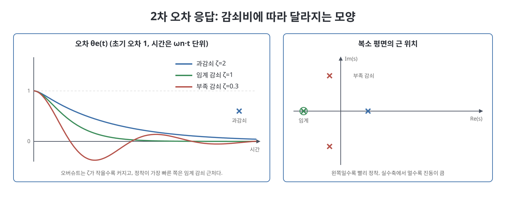
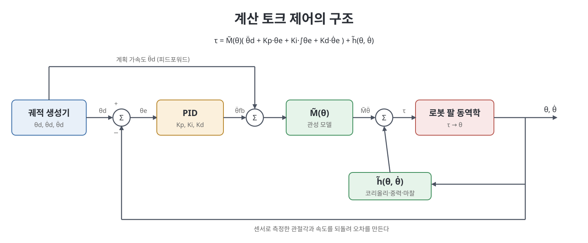

# 11장 로봇 제어 (Robot Control)

앞 장의 모션 플래닝이 "어떤 운동을 할 것인가"를 정했다면, 이 장은 그 운동을 실제로 따라가게 하는 방법, 곧 작업 사양을 액추에이터의 힘과 토크로 바꾸는 제어기를 다룬다. 로봇 팔은 정해진 궤적을 따르기도 하고, 연마 휠처럼 힘을 가하기도 하고, 칠판에 글씨를 쓸 때처럼 어떤 방향은 힘으로, 어떤 방향은 움직임으로 제어하기도 하며, 햅틱 장치처럼 용수철이나 댐퍼인 척하기도 한다. 책은 이를 모션 제어, 힘 제어, 하이브리드 모션-힘 제어, 임피던스 제어로 나눠 설명한다. 한 방향에서 움직임과 힘을 동시에 독립적으로 정할 수는 없다는 기계적 제약이 이 모든 논의의 바탕에 있다.

> **쉽게 말하면**
> 제어는 "원하는 값과 실제 값의 차이(오차)를 보고 힘을 조절해 그 차이를 0으로 만드는 일"이다. PID는 그 차이를 다루는 기본 도구이고, 로봇의 동역학 모델을 얹으면 계산 토크 제어가 된다.

> **참고(노트 작성자)** 이 장의 수식은 OCR이 심하게 깨져 있어 앞뒤 문맥과 표준 제어 이론으로 복원했다. 특히 과제 공간 제어식과 하이브리드 제어식은 원서와 대조하기를 권한다. 책이 소개하는 소프트웨어 함수와 NASA Robonaut 2 사례는 책이 쓰인 시점 기준이다.

## 이 장의 흐름

1. 제어 시스템 개요와 오차 동역학
2. 속도 입력을 가진 모션 제어(단일 관절, 다관절, 과제 공간)
3. 토크 입력을 가진 모션 제어(PID, 피드포워드, 계산 토크, 다관절)
4. 힘 제어
5. 하이브리드 모션-힘 제어
6. 임피던스 제어와 어드미턴스 제어
7. 관절 수준의 토크 제어와 기타 주제

## 1. 제어 시스템 개요

로봇 제어 시스템은 센서, 제어기, 증폭기, 액추에이터, 변속기로 이루어진다. 센서는 관절 위치(포텐셔미터, 엔코더, 리졸버), 속도(타코미터), 관절 토크, 손목의 다축 힘-토크 센서 등이다. 제어기는 이를 초당 수백에서 수천 번 읽어 명령을 갱신하며, 이보다 빨라도 로봇과 환경의 시간 상수 때문에 이득이 적다. 속도는 위치를 수치 미분하고 저역 통과 필터로 양자화 잡음을 줄여 얻는 경우가 많다. 책은 증폭기, 액추에이터, 변속기를 한 덩어리로 보고 "약한 제어 신호를 힘과 토크로 바꿔 주는 변환기"로 단순화하며, 이 장 내용이 모두 그 안의 제어기 상자에 들어간다고 말한다. 관절 유연성, 백래시, 포화, 센서 분해능 같은 현실 문제는 범위 밖이다.

## 2. 오차 동역학

한 관절을 놓고 생각하면 다관절로 쉽게 확장된다. 원하는 관절각 $\theta_d(t)$와 실제 $\theta(t)$의 차이가 오차 $\theta_e=\theta_d-\theta$이고, 이 오차가 시간에 따라 어떻게 변하는지를 정하는 미분 방정식을 오차 동역학(error dynamics)이라 한다. 제어의 목표는 오차가 0 또는 아주 작은 값으로 가게 하는 오차 동역학을 만드는 것이다.

제어기의 성능은 초기 오차를 주고 오차가 얼마나 빨리, 얼마나 완전히 줄어드는지로 시험한다. 이 오차 응답은 두 부분으로 설명한다. 정상 상태 응답은 시간이 충분히 지난 뒤 남는 정상 상태 오차 $e_{ss}$이고, 과도 응답은 오버슈트(overshoot)와 2% 정착 시간(settling time)으로 평가한다. 좋은 응답은 정상 상태 오차와 오버슈트가 거의 없고 정착이 빠르다.

선형 오차 동역학은 $p$차 선형 미분 방정식이고, 상태 벡터를 쓰면 $\dot x=Ax$로 쓸 수 있다. 해는 행렬 지수 $e^{At}x(0)$이며, 이것이 모든 초기값에서 0으로 수렴할 조건은 특성 방정식의 모든 근의 실수부가 음수인 것이다. 계수가 모두 양수여야 한다는 것은 필요 조건이고, 1차와 2차에서는 충분 조건이기도 하다. 3차에서는 추가 조건이 붙는다.

### 2.1 1차 오차 동역학

$$\dot\theta_e+\tfrac{1}{\tau}\theta_e=0\ \Rightarrow\ \theta_e(t)=e^{-t/\tau}\theta_e(0)$$

시상수 $\tau$는 오차가 처음의 약 37%로 줄어드는 시간이다. 오버슈트가 없고 2% 정착 시간은 약 $4\tau$다.

### 2.2 2차 오차 동역학

질량-용수철-댐퍼에 대응하는 표준형은 다음과 같다.

$$\ddot\theta_e+2\zeta\omega_n\dot\theta_e+\omega_n^{2}\theta_e=0$$

$\omega_n$은 고유 진동수, $\zeta$는 감쇠비다. 특성 방정식의 근은 $s=-\zeta\omega_n\pm\omega_n\sqrt{\zeta^2-1}$이고, $\zeta$의 크기로 세 경우가 갈린다.

| 감쇠 | 조건 | 근 | 응답의 모양 |
|------|------|-----|-------------|
| 과감쇠 | $\zeta>1$ | 서로 다른 두 실근 | 두 지수 감쇠의 합이며 느린 근이 정착을 좌우, 오버슈트 없음 |
| 임계 감쇠 | $\zeta=1$ | 겹친 실근 | 지수 감쇠에 일차식이 곱해진 형태, 오버슈트 없이 가장 빠름 |
| 부족 감쇠 | $\zeta<1$ | 켤레 복소근 | 지수 감쇠에 사인파가 곱해져 진동, 오버슈트 발생 |

복소 평면에서 근이 왼쪽으로 멀수록 정착이 빠르고, 실수축에서 멀수록 진동이 크다. 부족 감쇠의 오버슈트는 $e^{-\pi\zeta/\sqrt{1-\zeta^2}}\times100\%$로 계산되어 $\zeta=0.1$이면 약 73%, $0.5$면 약 16%, $0.8$이면 약 1.5%다.

## 3. 속도 입력을 가진 모션 제어

스테핑 모터나 속도 모드의 증폭기처럼 관절 속도를 직접 명령할 수 있다고 가정하는 단순한 경우부터 본다. 단일 관절의 제어법을 차례로 쌓아 간다.

| 제어 | 식 | 특징 |
|------|-----|------|
| 피드포워드 | $\dot\theta=\dot\theta_d$ | 센서가 필요 없지만 오차가 누적됨 |
| P 제어 | $\dot\theta=K_p\theta_e$ | 설정점 제어에서 1차 동역학, 시상수 $1/K_p$ |
| PI 제어 | $\dot\theta=K_p\theta_e+K_i\int\theta_e\,dt$ | 2차 동역학, 일정 속도 추종 시 정상 오차 제거 |
| 피드포워드 + PI | $\dot\theta=\dot\theta_d+K_p\theta_e+K_i\int\theta_e\,dt$ | 책이 선호하는 형태 |

P 제어는 가상의 용수철처럼 실제 위치를 목표로 당긴다. 목표가 일정한 속도 $c$로 움직이면 오차는 $c/K_p$에 머무른다. 이득을 키우면 줄지만 속도 한계와 이산 시간 구현 때문에 한계가 있다. PI 제어는 오차의 적분 항이 이 정상 오차를 없앤다. 오차 동역학은 $\ddot\theta_e+K_p\dot\theta_e+K_i\theta_e=0$로 표준형에서 $\omega_n=\sqrt{K_i}$, $\zeta=K_p/(2\sqrt{K_i})$다. $K_p$를 고정하고 $K_i$를 키우면 근이 실수축 위에서 서로 다가가 만나고(임계 감쇠, $K_i=K_p^2/4$) 이후 복소 평면으로 떠오른다(근궤적, root locus). 책은 현실적 한계 안에서 임계 감쇠가 되도록 이득을 정하라고 권한다. 피드포워드를 더하는 이유는 오차가 생기기 전에 움직임을 시작하기 위해서다.

다관절은 이득이 $K_p=k_pI$처럼 대각 행렬이면 각 관절이 같은 분석을 따른다. 과제 공간(task space)으로는 끝점 배위 $X\in SE(3)$와 몸체 트위스트 $\mathcal{V}_b$로 같은 구조를 쓴다.

$$\mathcal{V}_b=[\mathrm{Ad}_{X^{-1}X_d}]\mathcal{V}_d+K_pX_e+K_i\!\int X_e\,dt,\qquad [X_e]=\log(X^{-1}X_d)$$

$X_e$는 SE(3)의 두 원소를 뺄 수 없으므로 "현재 $X$에서 단위 시간 동안 따라가면 $X_d$에 닿는 트위스트"로 정의한 오차다. 첫 항은 목표 트위스트를 현재 끝점 프레임으로 옮긴 피드포워드다. 계산한 트위스트는 6장의 역속도 기구학 $\dot\theta=J_b^{\dagger}(\theta)\mathcal{V}_b$로 관절 속도로 바꾼다. 위치와 자세를 분리해 쓰면 끝점이 직선으로 움직이는 변형도 가능하다.

## 4. 토크 입력을 가진 모션 제어

실제 로봇 제어자는 증폭기를 토크 모드로 써서 동역학 모델을 제어에 넣는다. 책은 중력 아래 회전하는 단일 링크 $\tau=M\ddot\theta+mgr\cos\theta+b\dot\theta$를 예로 들며, 상태에만 의존하는 항을 모아 $\tau=M\ddot\theta+h(\theta,\dot\theta)$로 쓴다.

### 4.1 단일 관절

**PID 제어.** PI에 미분 항을 더한다.

$$\tau=K_p\theta_e+K_i\!\int\theta_e\,dt+K_d\dot\theta_e$$

$K_p$는 위치 오차에 대한 가상 용수철, $K_d$는 속도 오차에 대한 가상 댐퍼, $K_i$는 정상 오차를 줄이는 역할이다. 수평 운동(중력 없음)에서 PD 제어의 오차 동역학은 2차이고 $\zeta=(b+K_d)/(2\sqrt{K_pM})$, $\omega_n=\sqrt{K_p/M}$이다. 임계 감쇠가 되도록 $K_d$를 정하고 $K_p$는 포화, 떨림, 비모델 진동, 이산 시간 불안정 같은 현실적 한계 안에서 크게 잡는다.

수직 운동에서는 중력 때문에 PD만으로 정지하면 $K_p\theta_e=mgr\cos\theta$에서 멈춰 정상 오차가 남는다. 정지 상태에서 0이 아닌 토크를 내려면 $\theta_e\ne0$이어야 하기 때문이다. $K_i>0$이면 오차 적분값이 토크를 대신 공급해 오차가 사라진다. 이때 오차 동역학은 3차이고 안정 조건은 $K_p>0$, $K_i>0$ 그리고 $(b+K_d)K_p/M>K_i$ 이다. 곧 $K_i$에는 위아래 한계가 있다. 설계 요령은 먼저 $K_p,K_d$로 과도 응답을 맞추고 $K_i$는 안정성을 해치지 않을 만큼만 쓰는 것이다. 실무에서는 안정성이 우선이라 $K_i=0$으로 두는 경우가 많고, 적분값을 제한하는 안티 와인드업(anti-windup)을 쓰기도 한다.

**피드포워드 제어.** 동역학 모델 $\tilde M,\tilde h$로 계획된 궤적에 필요한 토크를 미리 계산한다: $\tau=\tilde M(\theta_d)\ddot\theta_d+\tilde h(\theta_d,\dot\theta_d)$. 모델이 완벽하고 초기 오차가 없으면 정확히 따라가지만, 책의 예에서 질량 중심 거리를 0.08 m로 잘못 모델링한 것(실제 0.1 m)만으로도 추종 오차가 커진다. 그래서 피드포워드는 항상 피드백과 함께 쓴다.

**계산 토크 제어.** 피드포워드와 피드백 선형화를 합친 것이다. 오차 가속도가 선형 오차 동역학을 따르도록 명령 가속도를 정하고 이를 모델에 넣는다.

$$\tau=\tilde M(\theta)\Big(\ddot\theta_d+K_p\theta_e+K_i\!\int\theta_e\,dt+K_d\dot\theta_e\Big)+\tilde h(\theta,\dot\theta)$$

괄호 안은 계획 가속도에 PID 피드백이 더해진 "명령 가속도"이고, $\tilde M$이 이를 토크로 바꾸며, $\tilde h$가 비선형 항(코리올리, 중력, 마찰)을 상쇄한다. 모델이 정확하면 어떤 궤적에서도 $\ddot\theta_e+K_d\dot\theta_e+K_p\theta_e+K_i\!\int\theta_e=0$이라는 선형 오차 동역학이 되어, 이득을 정해 근을 원하는 곳에 놓을 수 있다. 책의 예에서도 계산 토크가 피드포워드나 피드백만 쓸 때보다 추종이 좋고, 제어 노력은 피드백만 쓸 때보다 적었다. 이 제어를 역동역학(inverse dynamics) 제어라고도 부른다.

### 4.2 다관절과 과제 공간

다관절에서는 $\tau=M(\theta)\ddot\theta+h(\theta,\dot\theta)$이고 $M$이 배위에 따라 변하는 양의 정부호 행렬이라 관절끼리 서로 영향을 준다. 분산 제어(관절마다 독립 제어기)는 동역학이 거의 분리될 때, 예를 들어 직교 겐트리 로봇이나 기어비가 큰 로봇처럼 질량 행렬이 거의 대각일 때 적합하다. 중력이나 결합이 클 때는 계산 토크식을 행렬 이득 $K_p,K_i,K_d$(보통 스칼라 곱 단위행렬, $k_i=0$)로 확장한 중앙 집중 제어를 쓴다.

모델이 부정확하거나 서보 속도로 계산하기에 무겁다면, 느린 운동에서는 PID에 중력 보상만 더한 근사 $\tau=K_p\theta_e+K_i\!\int\theta_e+K_d\dot\theta_e+\tilde g(\theta)$를 쓴다. 마찰이 없고 중력 보상이 완벽하다면 PD 설정점 제어가 전역 수렴함을 오차 에너지 $V=\tfrac12\theta_e^{T}K_p\theta_e+\tfrac12\dot\theta_e^{T}M\dot\theta_e$로 보인다. $\dot V=-\dot\theta^{T}K_d\dot\theta\le0$이라 에너지가 감소하고, 크라소프스키-라살 불변 원리로 어느 초기 상태에서든 목표에서 정지함이 보장된다. 이는 $\dot M-2C$가 반대칭이라는 성질을 이용한다.

과제 공간 제어에는 두 선택이 있다. 하나는 궤적을 역기구학으로 관절 공간으로 바꿔 위 제어를 쓰는 것이고, 다른 하나는 동역학을 과제 공간 $\mathcal{F}=\Lambda(\theta)\dot{\mathcal V}+\eta(\theta,\mathcal V)$로 쓰고 같은 구조의 제어를 하는 것이다. 후자의 제어는 계산 토크와 닮았으며 관절 토크는 $\tau=J_b^{T}\mathcal{F}$로 얻는다. 이 방식은 역기구학 계산을 피하는 대신 과제 공간 동역학 모델이 필요하다.

## 5. 힘 제어

순수한 힘 제어는 환경이 모든 방향에서 저항해야 가능한 추상이다. 이상적인 힘 제어는 끝점의 외란 운동에 힘이 영향을 받지 않는 것으로, 이상적인 모션 제어(외란 힘에 운동이 영향을 받지 않음)의 쌍대다. 느리게 움직이는 힘 제어 과제에서는 가속도와 속도 항을 무시하면 $g(\theta)+J^{T}\mathcal{F}_{tip}=\tau$이므로 다음 제어법이 나온다.

$$\tau=\tilde g(\theta)+J^{T}(\theta)\mathcal{F}_d$$

원하는 렌치 $\mathcal{F}_d$에 해당하는 관절 토크에 중력 보상을 더한 것이다. 정확한 중력 모델과 정밀한 토크 제어가 필요하다. 고기어비 구동계는 마찰 때문에 전류 제어만으로는 토크가 부정확해서, 출력 쪽에 스트레인 게이지를 달아 관절 토크를 직접 재거나, 손목에 6축 힘-토크 센서를 달아 끝점 렌치를 직접 측정한다. 센서가 있으면 PI 힘 제어를 쓴다.

$$\tau=\tilde g(\theta)+J^{T}\Big(\mathcal{F}_d+K_{fp}\mathcal{F}_e+K_{fi}\!\int\mathcal{F}_e\,dt\Big)$$

완벽한 중력 모델에서는 $K_{fp}\mathcal{F}_e+K_{fi}\!\int\mathcal{F}_e=0$ 꼴이 되어 힘 오차가 0으로 간다. 힘 신호는 잡음이 커 미분 항은 의미가 없다. 위험한 점은 밀 대상이 없으면 로봇이 힘을 내려다 가속한다는 것이므로, 속도 감쇠 항 $-K_{damp}\mathcal{V}$를 더한 변형을 쓴다.

## 6. 하이브리드 모션-힘 제어

많은 과제는 힘과 운동을 함께 요구한다. 과제 공간이 $n$차원이면 $2n$개의 힘과 운동 중 임의의 $n$개를 정할 수 있고 나머지 $n$개는 환경이 정한다. 같은 방향의 힘과 운동을 동시에 정할 수는 없다. 환경이 $k$개 방향으로 완전히 단단하면 어떤 방향이 힘 자유도이고 어떤 방향이 운동 자유도인지를 접촉이 정한다. 캐비닛 문을 단단히 잡으면 6-1=5개 방향의 운동은 막히고(경첩 축 회전만 자유) 힘은 5개 방향으로 줄 수 있다. 칠판에 글씨 쓰기에서는 판에 수직인 힘 1개를 제어하고 나머지 5개 운동이 자유롭다. 마찰이 있거나 판에서 떼는 경우는 더 복잡하지만, 책은 단순화해서 모든 제약을 등식으로 본다.

칠판 지우개 예에서는 환경이 정하는 자연 제약(natural constraint)이 있다. 판에 닿아 있으므로 판 수직 속도와 회전 속도 일부가 0이고, 렌치의 일부 성분도 0이다. 사용자는 나머지를 자유롭게 정하는데, 이것이 인공 제약(artificial constraint)이다. 예컨대 판을 따라 일정 속도로 움직이며 일정한 힘으로 누르도록 정한다.

수학적으로 자연 제약은 파피안(Pfaffian) 제약 $A(\theta)\mathcal{V}=0$ ($A\in\mathbb{R}^{k\times6}$)으로 쓸 수 있고, 제약된 동역학에는 라그랑주 승수 $\lambda$가 들어간다. 제약에 대한 구속력이 $A^{T}\lambda$다. 모든 렌치를 두 부분으로 나누는 사영 행렬이 핵심이다.

$$P=I-A^{T}\big(A\Lambda^{-1}A^{T}\big)^{-1}A\Lambda^{-1}$$

$P$는 계수가 $6-k$이며, 어떤 렌치를 "끝점을 제약에 접하게 움직이는 성분"으로 사영한다. 나머지 $I-P$는 제약에 맞서는 성분(힘)으로 사영한다. 하이브리드 제어기는 과제 공간 모션 제어에 $P$를, 힘 제어에 $I-P$를 곱해 합하고 코리올리와 중력 보상을 더한 것이다. 두 부분 공간이 직교로 분리되어 각 제어기의 오차 동역학과 안정성 분석이 그대로 유지된다. 어려움은 제약의 형태를 아는 것인데, 힘 피드백으로 제약 방향을 실시간 추정하거나, 이득을 낮춰 부드럽게 하거나, 구조에 수동 컴플라이언스를 넣어 대비한다.

## 7. 임피던스 제어와 어드미턴스 제어

이상적인 하이브리드 제어는 극단적인 임피던스를 요구한다. 임피던스는 외란 힘에 대한 끝점 운동의 변화를 뜻한다. 모션 제어는 높은 임피던스(힘에 거의 안 밀림), 힘 제어는 낮은 임피던스(운동이 달라도 힘이 거의 안 변함)에 해당한다. 임피던스 제어의 목표는 끝점이 정해진 질량, 댐퍼, 용수철처럼 행동하게 하는 것이다.

$$M\ddot x+B\dot x+Kx=f_{ext}$$

1자유도에서 라플라스 변환하면 임피던스는 $Z(s)=F(s)/X(s)=ms^2+bs+k$로, 낮은 주파수에서는 용수철이, 높은 주파수에서는 질량이 지배한다. 어드미턴스는 그 역수 $Y(s)$이며 $\Delta X=Y\Delta F$다. 모션 제어는 어드미턴스가 작고, 힘 제어는 어드미턴스가 큰 쪽이다. 용수철만 흉내 내는 경우를 강성 제어 또는 컴플라이언스 제어라 부른다.

이 동작을 구현하는 방식은 두 가지다.

| 구분 | 임피던스 제어 | 어드미턴스 제어 |
|------|----------------|------------------|
| 측정 | 끝점 운동 | 사용자가 가하는 힘(손목 센서) |
| 출력 | 힘(토크) 명령 | 운동(가속도) 명령 |
| 결합될 환경 | 어드미턴스형 환경 | 임피던스형 환경 |
| 잘하는 일 | 가볍고 백드라이버블한 로봇으로 부드러운 환경 모사 | 기어비가 큰 로봇으로 단단한 환경 모사 |
| 어려운 일 | 단단한 환경 모사(고이득에 지연, 양자화가 겹치면 진동) | 가벼운 환경 모사(작은 힘에 큰 가속) |

임피던스 제어식은 대략 과제 공간의 동역학 보상에 $-f_{ext}$를 만드는 항을 더한 형태다. 가속도 측정은 잡음이 크므로 질량 보상을 빼고 $M=0$으로 두거나, 느린 운동에서는 중력 보상만 쓰는 일이 많다. 어드미턴스 제어는 힘을 측정해 원하는 끝점 가속도를 풀고, 자코비안으로 관절 가속도로 옮긴 뒤 역동역학으로 토크를 계산한다. 힘 측정은 저역 통과로 매끄럽게 한다.

## 8. 관절 수준의 토크 제어와 기타 주제

지금까지는 관절이 요청한 토크를 그대로 낸다고 가정했다. 현실의 근사 방법은 다음과 같다.

| 구성 | 장점 | 단점 |
|------|------|------|
| 직접 구동 모터 전류 제어 | 토크가 전류에 비례하고 단순 | 모터가 커야 해서 움직이는 관절에 부적합 |
| 기어드 모터 전류 제어 | 작은 모터로 큰 토크, 효율적 속도 | 백래시와 마찰로 토크 불확실 |
| 기어드 모터 + 스트레인 게이지 | 출력 토크를 직접 재서 마찰 보상 | 구조 복잡, 비틀림 유연성의 추가 동역학 |
| 직렬 탄성 액추에이터(SEA) | 관절이 자연히 부드럽고 충격에 강해 인간-로봇 상호작용에 적합 | 구조 복잡, 고속 운동 제어가 어려움 |

SEA는 모터와 기어 출력 사이에 약한 비틀림 용수철을 넣고 그 변형 $k\Delta\phi$로 토크를 구한다. 책은 NASA의 Robonaut 2가 SEA를 썼다고 소개한다. 바깥 제어 루프가 약 1 kHz일 때 안쪽 전류 루프는 약 10 kHz처럼 더 빠르게 돈다.

책은 마지막으로 강건 제어(불확실성 범위 안에서 성능 보장), 적응 제어(실행 중 관성 같은 매개변수를 추정), 반복 학습 제어(같은 작업의 이전 실행 오차로 피드포워드 보정), 수동 컴플라이언스와 유연 매니퓰레이터, 가변 임피던스 액추에이터를 한 줄씩 소개한다. 소프트웨어 절은 주어진 상태와 목표 궤적에서 계산 토크 제어의 관절 토크를 구하는 함수와, 모델 오차를 포함해 그 제어기로 궤적 추종을 시뮬레이션하는 함수를 제공한다고 한다. 연습문제는 과제를 모션/힘/하이브리드/임피던스 제어로 분류하기, 2차 시스템의 해 구하기, 진자 선형화와 감쇠비 계산, 크라소프스키-라살 원리 증명 같은 유형이다.

## 핵심 정리

- 제어는 오차 동역학을 설계하는 일이며, 안정성은 특성 방정식 근의 실수부가 음수인 것, 성능은 오버슈트와 정착 시간, 정상 상태 오차로 본다.
- 2차 계에서 임계 감쇠($\zeta=1$)가 오버슈트 없이 가장 빠르고, PID의 $K_p,K_d$는 이를 기준으로 잡는다.
- 적분 항은 중력 같은 상수 외란의 정상 오차를 없애지만 $K_i$에는 안정성 상한이 있어 신중히 쓴다.
- 계산 토크 제어는 모델로 비선형 항을 상쇄하고 PID로 선형 오차 동역학을 만들며, 모델이 부정확하면 PD와 중력 보상 같은 단순화로 대체할 수 있다.
- 힘과 운동은 같은 방향에서 동시에 제어할 수 없고, 하이브리드 제어는 사영 행렬로 두 제어를 직교 부분 공간에 나눈다.
- 임피던스 제어는 운동을 재고 힘을 내며, 어드미턴스 제어는 힘을 재고 운동을 낸다. 각각 부드러운 환경과 단단한 환경에 강하다.

 
 
 

이전: [10장 모션 플래닝](10%EC%9E%A5%20%EB%AA%A8%EC%85%98%20%ED%94%8C%EB%9E%98%EB%8B%9D.md) | 다음: [12장 파지와 조작](../05.%205%EB%B6%80%20%EC%A1%B0%EC%9E%91%EA%B3%BC%20%EC%9D%B4%EB%8F%99%20%EB%A1%9C%EB%B4%87/12%EC%9E%A5%20%ED%8C%8C%EC%A7%80%EC%99%80%20%EC%A1%B0%EC%9E%91.md)

 

[Modern Robotics](../)
