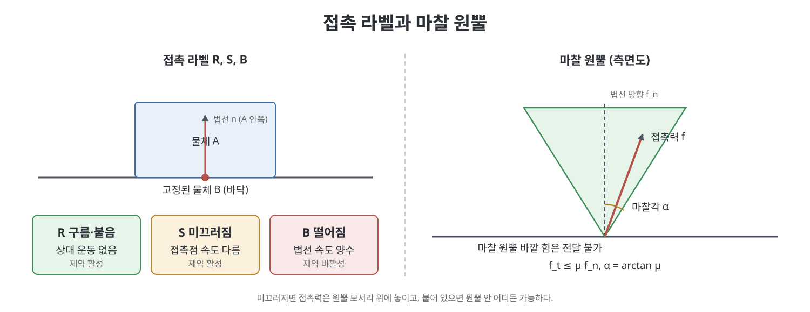
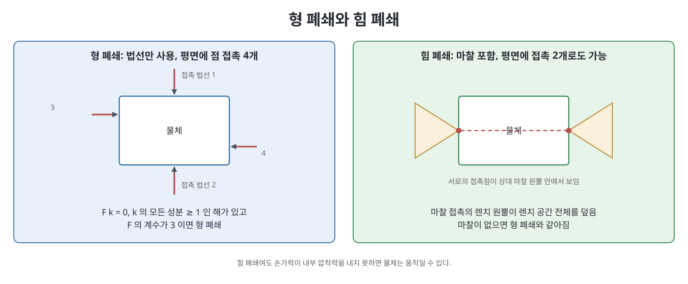

# 12장 파지와 조작 (Grasping and Manipulation)

지금까지의 장들은 로봇 자신의 기구학, 동역학, 계획, 제어를 다루었다. 이 장은 시선을 바깥으로 돌려 로봇이 물체와 만나는 접촉 면에서 무슨 일이 일어나는지를 다룬다. 로봇 손이 어떻게 움직여야 하는지는 이미 완벽히 해결되었다고 가정하고, 관심을 "조작하는 기계"가 아니라 "조작 그 자체"에 둔다. 책은 파지, 밀기, 굴리기, 던지기 같은 조작을 이해하려면 접촉 운동학, 접촉을 통해 전달되는 힘의 모델, 강체 동역학이라는 세 요소가 필요하다고 정리한다. 이 장은 그중 앞의 둘을 정리하고, 마지막에 세 가지를 합쳐 몇 가지 조작 예제를 푼다. 물체와 장애물은 모두 변형하지 않는 강체로 가정한다.

> **쉽게 말하면**
> 손가락이 물체를 어디에서 어느 방향으로 밀고 있는지만 알면, 물체가 어디로 움직일 수 있는지(운동학)와 어떤 힘을 버틸 수 있는지(마찰과 힘)를 도형으로 따져 볼 수 있다. 물체가 꼼짝 못 하게 되는 조건이 폐쇄(closure)다.

> **참고(노트 작성자)** 이 장의 수식은 OCR 텍스트가 많이 깨져 있어 표준 지식과 문맥으로 복원했다. 원서의 식 번호와 부호를 대조해 보기 바란다. 소프트웨어나 외부 자료 정보는 책이 쓰인 시점 기준이다.

## 이 장의 흐름

1. 접촉 운동학: 거리 함수, 불침투 조건, 접촉 라벨
2. 다중 접촉과 평면 도형법(회전 중심 CoR)
3. 형 폐쇄(form closure)와 파지 품질
4. 마찰, 마찰 원뿔, 렌치 원뿔, 모멘트 라벨링
5. 힘 폐쇄(force closure)
6. 조작: 접촉 모드 분석과 네 가지 예제

## 1. 접촉 운동학

두 강체의 위치를 합친 좌표를 $q$라 하고 두 물체 사이의 거리 함수를 $d(q)$로 둔다. 떨어져 있으면 양수, 닿아 있으면 0, 파고들면 음수다. 닿은 상태에서 접촉이 유지되는지는 $d$의 시간 미분으로 판단한다. 책은 접촉 법선 방향 정보인 $\partial d/\partial q$만 사용하고 곡률은 무시하는 1차 해석을 택한다. 그러면 모양이 달라도 접촉 법선이 같은 접촉은 같게 취급된다.

접촉점에서 물체 A 안쪽을 향하는 단위 법선을 $\hat n$, 접촉점을 $p$라 하자. 단위 힘이 법선 방향으로 작용할 때의 렌치를 $F$라 하면

$$F = \begin{bmatrix} [p]\hat n \\ \hat n \end{bmatrix}$$

이고, 두 물체의 공간 트위스트 $\mathcal V_A$, $\mathcal V_B$가 파고들지 않을 조건(불침투 조건)은

$$F^{T}(\mathcal V_A - \mathcal V_B) \ge 0$$

이다. 등호가 성립하면 그 접촉 제약이 활성(active)이어서 접촉이 유지되고, 부등호가 엄격하면 떨어지는 중이다. B가 고정되어 있으면 $F^T\mathcal V_A \ge 0$으로 간단해진다. 이 식은 "접촉 법선 렌치와 움직임이 같은 쪽을 본다"는 뜻이다.

접촉이 유지되는 움직임(roll-slide)은 다시 둘로 나뉜다. 접촉점에서 두 물체가 서로 상대 운동이 없으면 구름(rolling, 붙어 있는 경우 포함), 있으면 미끄러짐(sliding)이다. 책은 이 셋에 라벨을 붙인다.

| 라벨 | 의미 | 조건 |
|:---:|------|------|
| R | 구름 또는 붙음 | 불침투 제약 활성 + 접촉점 속도 동일 |
| S | 미끄러짐 | 불침투 제약 활성, 접촉점 속도는 다름 |
| B | 떨어지는 중 | 불침투 부등호가 엄격히 성립 |

접촉이 여러 개이면 각 접촉의 라벨을 이어 붙인 문자열이 접촉 모드(contact mode)다. 접촉이 $n$개이면 최대 $3^n$가지가 가능하지만, 운동학적으로 양립하지 않는 모드는 걸러진다. 마찰을 힘 없이 운동학만으로 흉내 내는 세 모델도 있다. 마찰 없는 점 접촉은 불침투 조건만, 마찰 있는 점 접촉은 구름 조건까지, 소프트 접촉은 거기에 접촉 법선 둘레의 회전 금지까지 강제한다. 평면 문제에서는 마찰 있는 점 접촉과 소프트 접촉이 같다.

## 2. 다중 접촉과 평면 도형법

고정된 접촉이 여러 개이면 각 접촉이 트위스트 공간에 반공간 제약 $F_i^T\mathcal V_A \ge 0$을 주고, 이들의 교집합은 원점을 꼭짓점으로 하는 다면체 볼록 원뿔(polyhedral convex cone)이다. 손가락이 움직이면 제약면이 원점에서 벗어나 원뿔이 아닌 다면체가 된다.

평면 문제는 트위스트가 3차원이라 그림으로 풀 수 있다. 책은 평면 트위스트를 회전 중심(Center of Rotation, CoR)과 회전 방향 부호로 나타내자고 한다. 반시계 방향이면 +, 시계 방향이면 -, 순수 병진이면 무한대의 점으로 표시한다. 접촉 법선 왼쪽 점은 +, 오른쪽 점은 -로 갈라서 불침투를 만족하는 CoR 영역을 칠하고, 각 CoR에 B, R, S(좌우 방향을 구분해 $S_l$, $S_r$) 라벨을 붙이면 접촉 모드 지도가 된다. 접촉이 늘수록 영역은 교집합으로 줄어든다.

책은 1차 해석의 한계도 짚는다. 1차 해석은 떨어지거나 파고드는 움직임은 정확히 가려내지만, 곡률을 무시하기 때문에 가능하다고 판정한 roll-slide 움직임이 실제로는 불가능할 수 있다. 반대로 1차로 완전히 막힌 물체는 어떤 고차 해석으로도 막혀 있다.

## 3. 형 폐쇄와 파지 품질

고정된 접촉들이 물체의 모든 움직임을 막으면 형 폐쇄(form closure)라 한다. 각 접촉 렌치를 열로 쌓은 행렬을 $F = [F_1 \cdots F_j]$라 하면, 형 폐쇄는 이 렌치들이 렌치 공간 $\mathbb R^n$ 전체를 양의 생성(positive span)하는 것과 같다. 평면은 $n=3$, 공간은 $n=6$이다. 이 장 첫머리의 사실, 곧 $\mathbb R^n$을 양의 생성하려면 최소 $n+1$개 벡터가 필요하다는 것에서 다음 정리가 나온다.

| 대상 | 1차 형 폐쇄에 필요한 최소 점 접촉 수 |
|------|:---:|
| 평면 물체 | 4 |
| 공간 물체 | 7 |

원판이나 구처럼 회전해도 접촉 법선이 변하지 않는 물체는 예외적(exceptional)이어서 접촉이 아무리 많아도 1차 해석으로는 형 폐쇄가 되지 않는다.

형 폐쇄 여부는 선형계획(LP)으로 검사할 수 있다. $F$의 계수가 $n$이고

$$F k = 0,\quad k_i \ge 1$$

을 만족하는 $k$가 존재하면 형 폐쇄다. 모든 렌치를 양의 계수로 섞어 정확히 균형을 만들 수 있다는 뜻이다. 책은 구멍 뚫린 물체를 두 손가락이 구멍 안쪽에서 누르는 예로, 접촉 위치에 따라 해가 있기도 없기도 함을 보인다.

형 폐쇄 파지의 좋고 나쁨을 비교하려면 품질 지표가 필요하다. 한 가지 선택은 각 접촉이 낼 수 있는 힘의 크기를 같은 상한으로 두고, 접촉 렌치들이 만드는 볼록 다면체 안에 원점을 중심으로 들어가는 가장 큰 공의 반지름을 품질로 삼는 것이다. 이때 힘과 모멘트는 단위가 다르므로 물체의 대표 길이 $r$로 모멘트를 나누어 환산하고, 기준 좌표의 원점은 보통 무게중심 근처로 잡는다.

## 4. 마찰과 렌치 원뿔

접촉 마찰의 기본 모델은 쿨롱(Coulomb) 마찰이다. 접선 마찰력의 크기 $f_t$는 법선력 $f_n$에 대해

$$f_t \le \mu f_n$$

를 만족한다. $\mu$가 마찰 계수다. 미끄러지고 있으면 등호가 성립하고 마찰력은 미끄러짐 반대 방향이다. 책은 정지 마찰 계수가 운동 마찰 계수보다 크다는 점을 언급하되, 단순화를 위해 계수 하나만 쓴다. 법선이 $+z$ 방향이면 접촉이 전달할 수 있는 힘의 집합은

$$\sqrt{f_x^2+f_y^2} \le \mu f_z,\qquad f_z \ge 0$$

이고 이것이 마찰 원뿔(friction cone)이다. 원뿔의 반각이 마찰각 $\arctan\mu$다. 선형 계산을 위해 원뿔을 다면체로 근사하는데, 내접 근사는 쓸 수 있는 마찰을 과소평가하고 외접 근사는 과대평가한다. 로봇 손이 확실히 쥐게 하려면 보수적인 내접 근사가 안전하다. 평면에서는 원뿔이 두 모서리뿐이라 근사가 필요 없다.

접촉점의 마찰 원뿔 모서리 힘들은 렌치로 바꾸면 렌치 원뿔(wrench cone)이 된다. 여러 접촉의 합성 렌치 원뿔은 각 렌치 원뿔의 양의 생성이다. 평면에서 렌치 원뿔을 그리는 방법이 모멘트 라벨링(moment labeling)이다. 힘의 작용선을 화살표로 그리고, 그 왼쪽 점에는 +, 오른쪽 점에는 -, 선 위에는 ±를 붙인다. 모든 렌치가 같은 부호의 모멘트를 만드는 점만 라벨을 유지하고, 서로 다른 부호가 섞이면 라벨을 지운다. 이는 CoR 영역과 짝을 이루는 표현이다.

## 5. 힘 폐쇄

접촉이 만드는 합성 렌치 원뿔이 렌치 공간 전체이면 힘 폐쇄(force closure)다. 어떤 외력 렌치도 접촉력으로 맞출 수 있다는 뜻이다. 검사는 형 폐쇄와 같은 형태이며, 마찰 원뿔의 모서리 렌치들을 열로 쌓은 $F$에 대해 계수가 $n$이고 LP 해가 존재하면 된다. 평면에서는 정확하고, 공간에서는 다면체 근사이므로 근사다. $\mu=0$이면 힘 폐쇄는 1차 형 폐쇄와 같다.

| 구분 | 형 폐쇄 | 힘 폐쇄 |
|------|---------|---------|
| 막는 수단 | 접촉 법선만 | 법선과 마찰 |
| 평면 최소 접촉 | 점 접촉 4개 | 마찰 접촉 2개로도 가능 |
| 공간 최소 접촉 | 점 접촉 7개 | 마찰 접촉 3개로도 가능 |
| 마찰 없을 때 | 정의 그대로 | 형 폐쇄와 동일 |

평면에서 마찰 접촉 두 개가 힘 폐쇄가 되는 조건은 서로의 접촉점을 잇는 직선이 양쪽 마찰 원뿔 안에 들어오는 것, 곧 서로 "볼 수 있는" 것이다. 정삼각형을 두 변에서 집는 경우 $\mu \ge \tan 30^\circ \approx 0.577$이 필요하다고 책은 말한다. 공간에서는 점 접촉 두 개로는 두 접촉점을 잇는 축 둘레의 모멘트를 만들 수 없어 부족하다. 책은 일직선 위에 있지 않은 세 점 접촉에 대해 Li 등의 결과를 소개한다. 세 접촉점이 정하는 평면 $S$에서, 각 마찰 원뿔이 $S$와 평면 원뿔로 만나고 $S$가 평면 힘 폐쇄이면, 그리고 그때만 공간 힘 폐쇄라는 것이다. 공간 문제를 평면 문제로 줄이는 깔끔한 결과다.

책은 힘 폐쇄가 곧 "물체가 안 떨어진다"는 뜻은 아니라고 경고한다. 손가락 모터가 필요한 내부 압착력을 내지 못하면 힘 폐쇄여도 물체가 움직일 수 있다. 또 마찰은 재현성이 낮으므로 같은 힘 폐쇄라면 필요한 최소 마찰 계수가 작은 파지를 고르는 것이 합리적이다. 마지막으로 힘과 운동의 이중성이 있다. 평면에서 접촉 라벨 B, S, R은 각각 운동 제약 0, 1, 2개를 주고, 같은 수만큼 접촉 렌치의 자유도를 허용한다.

## 6. 조작: 접촉 모드 분석

한 강체의 동역학은 외력 렌치와 접촉 렌치의 합이 물체의 운동을 만든다는 뉴턴-오일러 식이다. 책의 풀이 절차는 다음과 같다.

1. 현재 상태에서 가능한 접촉 모드(R, S, B 조합)를 열거한다.
2. 각 모드마다 쿨롱 법칙과 맞는 접촉 렌치 $k_i F_i$($k_i \ge 0$)와 운동학과 맞는 가속도가 동역학 식을 만족하는지 확인한다.
3. 만족하는 모드가 해다.

이 방식은 해가 없거나 둘 이상일 수도 있다는 점이 특이하며, 책은 이것이 강체와 쿨롱 마찰이라는 이상화의 대가라고 설명한다. 속도와 가속도가 작으면 관성력을 무시하는 준정적(quasistatic) 해석으로 외력과 접촉력의 균형만 보면 된다.

책이 다루는 네 가지 예제는 다음과 같다.

| 예제 | 보여 주는 것 |
|------|-------------|
| 두 손가락이 나르는 블록 | 정지 상태로는 못 버티지만 손가락이 알맞은 가속도로 움직이면 관성 덕분에 버티는 동적 파지(dynamic grasp) |
| 미터 자 묘기 | 두 손가락을 천천히 모으면 한쪽만 미끄러지다 번갈아 미끄러지며 자가 떨어지지 않음. 준정적 가정 덕분 |
| 아치의 안정성 | 모든 접촉이 R이라 가정하고 물체별 균형 방정식을 세운 뒤 $k_i \ge 0$ 해를 LP로 찾음 |
| 페그 삽입 | 어떤 힘은 접촉이 맞받아 끼임(jam)이 되고, 다른 힘은 삽입이 진행됨. 마찰 원뿔이 서로 보이면 쐐기(wedge) |

연습문제는 불침투 조건 증명, CoR 그리기, 형 폐쇄와 힘 폐쇄 판정, 모멘트 라벨링, 접촉 모드 분석 같은 유형으로 이루어져 있다.

> **참고(노트 작성자)** 책은 이 장의 접촉 모델이 강체 가정에 기대고 있어 해의 모호함과 불일치가 생길 수 있다고 하며, 상보성 문제를 이용한 시뮬레이션은 다루지 않는다고 덧붙인다.

## 핵심 정리

- 접촉 문제는 접촉 운동학, 접촉 힘 모델, 강체 동역학 세 요소로 푼다.
- 불침투 조건 $F^T(\mathcal V_A-\mathcal V_B)\ge0$으로 접촉 모드 R, S, B를 정하고, 접촉이 여러 개이면 가능한 트위스트는 다면체 볼록 원뿔이다.
- 평면에서는 회전 중심(CoR)과 모멘트 라벨링으로 가능한 운동과 가능한 렌치를 그림으로 판단한다.
- 형 폐쇄에는 평면 4개, 공간 7개의 점 접촉이 필요하고, 마찰이 있으면 평면 2개, 공간 3개의 마찰 접촉으로 힘 폐쇄가 가능하다.
- 쿨롱 마찰은 마찰 원뿔로 나타내며, 보수적으로 설계하려면 내접 다면체 근사를 쓴다.
- 조작 해석은 접촉 모드를 열거해 동역학과 무모순한 모드를 찾는 방식이고, 해가 없거나 여럿일 수도 있다.

 
 
 

이전: [11장 로봇 제어](../04.%204%EB%B6%80%20%EA%B3%84%ED%9A%8D%EA%B3%BC%20%EC%A0%9C%EC%96%B4/11%EC%9E%A5%20%EB%A1%9C%EB%B4%87%20%EC%A0%9C%EC%96%B4.md) | 다음: [13장 바퀴형 이동 로봇](13%EC%9E%A5%20%EB%B0%94%ED%80%B4%ED%98%95%20%EC%9D%B4%EB%8F%99%20%EB%A1%9C%EB%B4%87.md)

 

[Modern Robotics](../)
