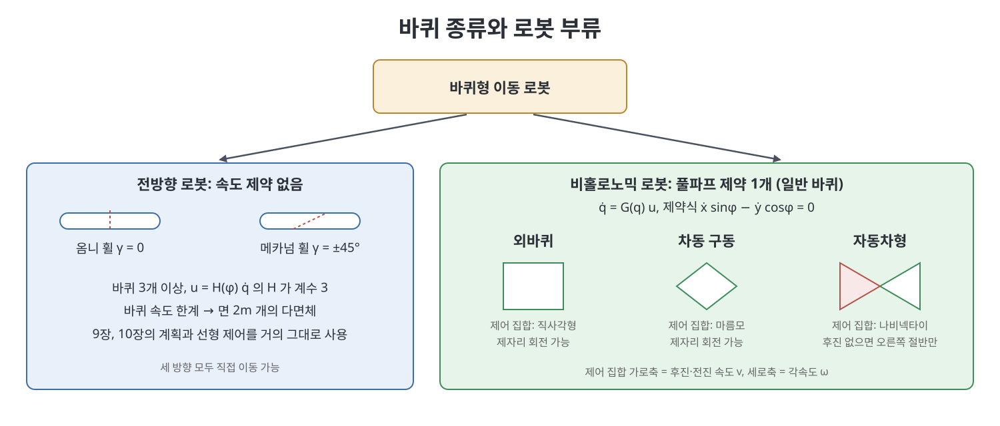
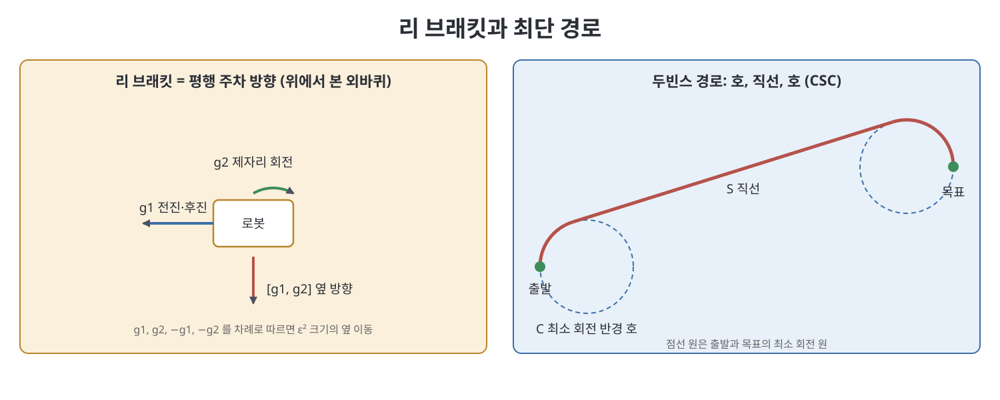

# 13장 바퀴형 이동 로봇 (Wheeled Mobile Robots)

이 장은 바퀴로 굴러다니는 로봇을 다룬다. 바퀴 속도가 로봇 본체의 속도로 어떻게 바뀌는지를 정하는 것이 기구학 모델이고, 바퀴 토크가 가속도로 바뀌는 과정이 동역학 모델이다. 책은 이 장에서 동역학은 접어 두고 기구학만 다룬다. 로봇은 딱딱하고 평평한 바닥에서 미끄러짐 없이 굴러가며, 본체는 하나의 강체라고 가정한다(탱크처럼 미끄러지며 도는 차량이나 트레일러 같은 관절형은 제외). 장은 기구학 모델링, 동작 계획, 피드백 제어, 오도메트리(odometry)를 거쳐 팔을 얹은 이동 조작기(mobile manipulator)로 마무리한다.

> **쉽게 말하면**
> 바퀴가 옆으로도 미끄러질 수 있으면 로봇은 어느 방향으로나 곧장 갈 수 있어 다루기 쉽고, 자동차 바퀴처럼 옆으로 못 미끄러지면 "옆으로 직접 못 가는" 제약 때문에 평행 주차 같은 우회 동작이 필요하다.

> **참고(노트 작성자)** 이 장의 행렬과 제어식은 OCR 텍스트가 많이 깨져서 표준 지식과 서술을 바탕으로 복원했다. 원서의 식과 부호, 바퀴 번호 매김을 대조해 보기 바란다. 비선형 추적 제어식은 구조만 말로 소개했다.

## 이 장의 흐름

1. 바퀴형 이동 로봇의 종류와 본체 표현
2. 전방향 로봇: 모델, 계획, 제어
3. 비홀로노믹 로봇: 모델, 제어 가능성
4. 비홀로노믹 로봇의 계획과 피드백 제어
5. 오도메트리
6. 이동 조작

## 1. 종류와 본체 표현

평면 위 본체의 위치는 $SE(2)$의 원소이고, 좌표는 $q=(\phi, x, y)$로 쓴다. 속도는 $\dot q=(\dot\phi,\dot x,\dot y)$이거나, 본체 고정 좌표계 $\{b\}$에서 본 평면 트위스트 $\mathcal V_b=(\omega_{bz}, v_{bx}, v_{by})$이다. 둘은 회전만 바꿔 주면 된다.

$$\mathcal V_b = \begin{bmatrix}1&0&0\\0&\cos\phi&\sin\phi\\0&-\sin\phi&\cos\phi\end{bmatrix}\dot q$$

즉 각속도는 같고 선속도만 본체 좌표로 돌려서 본다.

로봇은 두 부류로 나뉜다. 전방향(omnidirectional) 로봇은 본체 속도에 등식 제약이 없다. 비홀로노믹(nonholonomic) 로봇은 풀파프(Pfaffian) 속도 제약이 하나 있다. 자동차는 옆으로 곧장 갈 수 없다는 제약이 있지만 그래도 평면의 어느 배위든 갈 수 있다. 이 제약은 적분해서 위치 제약으로 바꿀 수 없으므로 비홀로노믹이다. 두 부류는 바퀴 종류에서 갈린다.

| 바퀴 | 구조 | 옆 미끄러짐 | 로봇 부류 |
|------|------|:---:|-----------|
| 일반 바퀴 | 축 둘레로 구르고 조향 가능 | 없음 | 비홀로노믹 |
| 옴니 휠(omniwheel) | 바퀴 둘레에 바퀴면 방향의 자유 롤러 | 있음 | 전방향 |
| 메카넘 휠(mecanum wheel) | 롤러 축이 바퀴면에서 비스듬함 | 있음 | 전방향 |

옴니 휠과 메카넘 휠은 조향 없이 앞뒤로만 구동하며, 작은 롤러 때문에 평평하고 딱딱한 바닥에서 잘 맞는다.

## 2. 전방향 로봇

### 2.1 모델링

바퀴마다 모터가 하나라서 임의의 3차원 본체 속도를 만들려면 바퀴가 최소 3개 필요하다. 바퀴 중심의 속도를 바퀴 좌표계로 보면, 구동 방향 성분과 롤러가 허용하는 자유 미끄러짐 성분으로 분해된다. 자유 미끄러짐이 구동 방향과 이루는 각을 $\gamma$라 하면 옴니 휠은 $\gamma=0$, 메카넘 휠은 보통 $\gamma=\pm45^\circ$다. 반지름 $r_i$ 바퀴의 구동 각속도 $u_i$는 본체 속도에 선형으로 의존한다.

$$u_i = h_i(\phi)\,\dot q,\qquad u = H(\phi)\,\dot q = H(0)\,\mathcal V_b$$

$m$개 바퀴를 쌓은 $H(0)\in\mathbb R^{m\times3}$는 본체 트위스트를 바퀴 속도로 바꾸는 행렬이다. 올바르게 설계된 전방향 로봇이라면 계수가 3이어야 한다. 모든 바퀴의 구동 방향과 자유 방향이 나란한 설계는 계수가 2에 그쳐 한 방향 병진을 만들 수 없다.

책의 두 예는 다음과 같다. 반지름 $r$, 중심에서 바퀴까지 거리 $d$인 옴니 휠 3개는

$$H(0)=\frac1r\begin{bmatrix}-d&1&0\\-d&-\tfrac12&-\sin\tfrac{\pi}{3}\\-d&-\tfrac12&\sin\tfrac{\pi}{3}\end{bmatrix}$$

로 쓸 수 있고, 메카넘 휠 4개는 $\ell$과 $w$를 바퀴 배치의 반 길이와 반 폭이라 할 때

$$H(0)=\frac1r\begin{bmatrix}-\ell-w&1&-1\\ \ell+w&1&1\\ \ell+w&1&-1\\ -\ell-w&1&1\end{bmatrix}$$

의 형태다(바퀴 번호와 부호 규약은 원서 그림 13.5와 대조 필요). 메카넘 로봇이 $+x_b$로 가려면 네 바퀴가 모두 같은 속도로 앞으로 돈다. $+y_b$로 가려면 바퀴 1, 3은 뒤로, 2, 4는 앞으로 돈다. 제자리에서 반시계로 돌 때는 바퀴 1, 4가 뒤로, 2, 3이 앞으로 돈다. $m>3$이면 $H$ 열공간 밖의 속도를 요구할 때 바퀴가 구동 방향으로 미끄러진다.

각 바퀴의 속도 한계 $|u_i|\le u_{i,\max}$는 본체 트위스트 공간에서 두 개의 평행한 평면이 되고, $m$개 바퀴가 모이면 면이 $2m$개인 볼록 다면체가 된다. 원점이 가운데에 있어서 낼 수 있는 본체 속도의 영역이다. 이 영역은 3바퀴가 6면체, 4바퀴가 8면체다.

### 2.2 계획과 제어

전방향 로봇은 모든 방향으로 움직일 수 있으므로 9장의 궤적 생성과 10장의 모션 플래닝 방법을 대부분 그대로 쓸 수 있다. 궤적 추적은 피드포워드에 PI 피드백을 더한 제어로 원하는 $\dot q$를 만들고, $u=H(\phi)\dot q$로 바퀴 속도에 옮기면 된다. 한 점으로 안정화하는 것은 스프링처럼 당기는 선형 제어 $\dot q=-Kq$로 충분하다.

## 3. 비홀로노믹 로봇

### 3.1 모델링

허용되는 속도를 $n-k$개의 방향의 선형 결합으로 쓰면, 그 계수가 곧 우리가 쓰는 제어 입력이 된다. 책의 모델은 모두 $\dot q=G(q)u$ 꼴이고, 제어가 0이면 속도도 0(표류 없음), 벡터장 $g_i(q)$는 위치에 의존, 제어에 선형이라는 특징이 있다.

- **외바퀴(unicycle)**: 구동 속도 $u_1$과 회전 속도 $u_2$가 입력이다.
- **차동 구동(diff-drive)**: 같은 축에 있는 좌우 바퀴를 따로 구동한다. 축 간격이 $2d$이면 본체 속도는 $v=\tfrac{r}{2}(u_L+u_R)$, $\omega=\tfrac{r}{2d}(u_R-u_L)$이고 제자리 회전이 된다.
- **자동차형(car-like)**: 뒷바퀴는 고정, 앞바퀴는 애커만(Ackermann) 조향으로 모든 바퀴가 미끄러지지 않게 돈다. 조향각 $\psi$와 축거 $\ell$이 있으면 $\dot\phi=v\tan\psi/\ell$.

조향각을 직접 제어한다고 보면 세 로봇은 모두 같은 표준 모델

$$\dot q=\begin{bmatrix}\dot\phi\\\dot x\\\dot y\end{bmatrix}=\begin{bmatrix}0&1\\\cos\phi&0\\\sin\phi&0\end{bmatrix}\begin{bmatrix}v\\\omega\end{bmatrix}$$

로 쓰이며, 달라지는 것은 제어 집합 $\mathcal U$뿐이다. 이 모델의 제약식은 $\dot x\sin\phi-\dot y\cos\phi=0$ 하나다.

| 로봇 | 제어 집합 $(v,\omega)$ | 제자리 회전 |
|------|----------------------|:---:|
| 외바퀴 | 직사각형 | 가능 |
| 차동 구동 | 마름모(속도 합 제한) | 가능 |
| 후진 있는 자동차 | 나비넥타이 모양(최소 회전 반경 때문) | 불가 |
| 전진 전용 자동차 | 나비넥타이의 오른쪽 절반 | 불가 |

차체에 고정된 기준점 $P=(x_r,y_r)$의 세계 속도를 직접 지정하면, 두 제어 입력이 자코비안 $J(q)$로 연결된다. $x_r=0$인 선(차동 구동의 두 바퀴 사이, 자동차의 두 뒷바퀴 사이)에서는 $J$가 특이이므로 기준점을 그 선 밖에 잡아야 한다.

### 3.2 제어 가능성

전방향 로봇과 기준점 $P$의 운동학은 $\dot x=v$ 꼴의 단순 적분기로 쓸 수 있어 선형 제어로 다룬다. 비홀로노믹 로봇의 전체 배위는 그렇지 않다. 책이 증명 없이 소개하는 정리가 이를 말해 준다. $G(0)$의 계수가 $\dim q$보다 작으면 연속적이고 시불변인 피드백 법칙으로는 원점을 안정화할 수 없다. 표준 모델은 제어가 2개, 배위가 3차원이라 여기에 해당한다.

그래도 이 로봇들은 비선형 제어 가능성은 갖는다. 책의 정의는 다음과 같다. 소시간 국소 접근 가능(STLA)은 임의의 짧은 시간과 이웃 안에서 도달 집합이 전차원이라는 뜻이고, 소시간 국소 제어 가능(STLC)은 도달 집합이 출발점의 이웃을 덮는다는 뜻이다. STLC는 STLA보다 강한 조건이다.

판정에는 리 브래킷(Lie bracket)을 쓴다.

$$[g_1,g_2]=\frac{\partial g_2}{\partial q}g_1-\frac{\partial g_1}{\partial q}g_2$$

두 벡터장을 번갈아 따라가는 "$g_1$, $g_2$, $-g_1$, $-g_2$" 동작의 순수 효과가 브래킷 방향이다. 표준 모델에서 $g_1=(0,\cos\phi,\sin\phi)$, $g_2=(1,0,0)$이면 $[g_1,g_2]=(0,\sin\phi,-\cos\phi)$로 옆 방향이며, 평행 주차에 해당한다. 세 벡터장의 행렬식은 항상 1이므로 리 대수의 차원이 3이다. 브래킷 방향의 운동은 시간 $\epsilon$에 대해 $\epsilon^2$ 정도라 직접 가는 것보다 느리다.

| 판정 | 조건 |
|------|------|
| STLA | 리 대수의 차원이 배위 차원과 같고, 제어 집합이 $\mathbb R^m$을 생성 |
| STLC | 위에 더해 제어 집합이 $\mathbb R^m$을 양의 생성 |

그래서 외바퀴, 차동 구동, 후진 있는 자동차는 STLC이고, 전진 전용 자동차는 STLA이지만 STLC는 아니다(좁은 곳에서 바로 뒤로 못 간다). 장애물 없는 평면에서는 넷 모두 임의의 배위에 갈 수 있다. 책은 외바퀴의 구름 각까지 포함한 4차원 배위도 STLC임을 보이고, 차동 구동은 바퀴 각과 본체 각 사이에 홀로노믹 제약이 하나 끼어 5차원 전체로는 STLA가 아님을 보인다.

## 4. 비홀로노믹 로봇의 계획과 제어

### 4.1 장애물 없는 평면의 최단 경로

세 가지 결과를 정리하면 다음과 같다.

| 로봇 | 최적 경로의 구성 | 경로 종류 |
|------|------------------|----------|
| 전진 전용 자동차(두빈스) | 최소 회전 반경 호(C)와 직선(S) | CSC 4종, CCαC 2종 |
| 후진 있는 자동차(리즈-셰프) | 호, 직선, 방향 전환점(cusp) | 9개 부류, 총 48종 |
| 차동 구동(최단 시간) | 직선 이동과 제자리 회전 | 40종 |

두빈스 경로는 출발점과 목표의 최소 회전 원 사이의 접선을 열거해 가장 짧은 것을 고르면 된다. 이때 CCαC의 가운데 호는 각이 $\pi$보다 크다. 차동 구동은 세 구간짜리 중에서도 회전, 직진, 회전보다 직진, 회전, 후진이 더 빠른 경우가 있다고 책은 수치 예로 보인다.

### 4.2 장애물이 있을 때

격자 기반 계획은 위 극단 제어(최소 반경 회전과 직선)만 이산화해서 쓰면 3차원 격자로도 충분하다. 샘플링 방식(RRT, PRM)은 제어 집합을 이산화하거나, 지역 계획기로 위의 최단 경로를 쓴다. 후진 있는 자동차는 STLC라서, 운동 제약을 무시한 경로를 먼저 만들고 반으로 나누어 최단 경로로 잇기를 반복해 실행 가능한 경로로 바꿀 수 있다. 그냥 따라가면 평행 주차로 몇 킬로미터를 가는 셈이라 매우 느리다.

### 4.3 피드백 제어

과제는 세 종류다. 배위 안정화는 위 정리 때문에 연속 시불변 법칙으로 안 된다(시변 또는 불연속 법칙은 존재하나 다루지 않는다). 궤적 추적과 경로 추적은 가능하다. 책은 궤적 추적을 다룬다. 기준 궤적의 제어는 제어 집합의 내부에 있어야 오차를 고칠 여유가 남으므로, 최단 경로나 최단 시간 궤적(극단 제어)은 기준으로 부적합하다.

가장 단순한 방법은 기준점 $P$에 비례 제어를 거는 것이다. 점은 잘 따라가지만, 차체가 의도와 반대 방향을 보며 따라가는 일이 생길 수 있다. 그래서 책은 기준 좌표계 $\{d\}$로 본 오차 $(\phi_e,x_e,y_e)$를 정의하고, 비선형 피드포워드 더하기 피드백 법칙을 제안한다. 이 법칙은 오차가 0이면 공칭 제어와 같아지고, $\phi_e\to\pm\pi/2$에서 제어가 무한히 커지며, 속도 $v_d=0$인 제자리 회전에는 쓸 수 없다. 이 식은 OCR이 심하게 깨져 있어 말로만 정리했다. 이득은 보정 효과가 크되, 제어가 제어 집합 경계에서 떨리지 않을 만큼만 키운다.

## 5. 오도메트리

오도메트리는 바퀴가 구동 방향으로 돈 양에서 본체 배위를 추정하는 방법이다. 싸고 편하지만 미끄러짐과 적분 오차가 시간이 갈수록 쌓인다. 짧은 시간에는 우수하나, GPS, 랜드마크, 거리 센서와 칼만 필터나 파티클 필터로 합쳐 쓰는 것이 바람직하다.

한 주기 동안 바퀴 구동각 변화를 $\Delta\theta$라 하면 속도가 일정하다고 보고

$$\mathcal V_b = F\,\Delta\theta,\qquad F = H^{\dagger}(0)$$

이다. $F$는 $H(0)$의 유사 역행렬이다. 차동 구동이나 자동차(좌우 뒷바퀴)에서는

$$F = r\begin{bmatrix}-\tfrac1{2d}&\tfrac1{2d}\\ \tfrac12&\tfrac12\\0&0\end{bmatrix}$$

이다. 이 트위스트를 한 주기 동안 적분하면 본체 좌표계에서의 변위 $\Delta q_b=(\Delta\phi_b,\Delta x_b,\Delta y_b)$를 얻는다. $\omega_{bz}=0$이면 $\Delta q_b=(0,v_{bx},v_{by})$이고, $\omega_{bz}\neq0$이면

$$\Delta q_b=\begin{bmatrix}\omega_{bz}\\ \dfrac{v_{bx}\sin\omega_{bz}+v_{by}(\cos\omega_{bz}-1)}{\omega_{bz}}\\ \dfrac{v_{by}\sin\omega_{bz}+v_{bx}(1-\cos\omega_{bz})}{\omega_{bz}}\end{bmatrix}$$

다. 이를 현재 방향각 $\phi_k$로 세계 좌표로 돌려 $\Delta q$를 만들고 $q_{k+1}=q_k+\Delta q$로 갱신한다. 요컨대 속도를 주기 동안의 원호 운동으로 보고 그 변위를 누적하는 것이다.

## 6. 이동 조작

팔을 얹은 이동 로봇의 조작은 바퀴와 관절을 함께 움직여 말단장치의 운동을 만든다. 가장 흔한 방식은 이동해서 주차하고 팔로 정밀 작업을 한 뒤 떠나는 것이지만, 바퀴와 팔을 동시에 쓰는 편이 유리하거나 필요한 경우도 있다. 말단장치 배위는

$$X(q,\theta)=T_{se}(q,\theta)=T_{sb}(q)\,T_{b0}\,T_{0e}(\theta)$$

이고, 말단장치 트위스트와 바퀴 속도 $u$, 관절 속도 $\dot\theta$는 하나의 자코비안으로 묶인다.

$$\mathcal V_e = J_e(\theta)\begin{bmatrix}u\\\dot\theta\end{bmatrix},\qquad J_e=[\,J_{base}(\theta)\;\;J_{arm}(\theta)\,]$$

$J_{arm}$은 5장의 본체 자코비안이다. $J_{base}$는 본체 평면 트위스트를 6차원으로 확장하는 행렬 $F_6$을 써서 $[\mathrm{Ad}_{T_{0e}^{-1}(\theta)T_{b0}^{-1}}]F_6$로 얻는다. $J_e$는 $q$에 의존하지 않는다. 그러면 11장의 과제 공간 제어를 그대로 쓸 수 있다. 피드포워드 트위스트를 현재 말단장치 좌표계로 옮기고 비례 및 적분 오차 항을 더해 $\mathcal V$를 만든 뒤, $(u,\dot\theta)=J_e^\dagger\mathcal V$로 바퀴와 관절 명령을 낸다. 책의 예는 차동 구동 위에 평면 팔을 올린 시뮬레이션인데, 이득이 크면 말단이 목표 경로를 지나쳤다가 수렴한다. 임의의 말단 궤적이 가능하려면 $J_e$가 어디서나 계수가 충분해야 한다.

연습문제는 전방향 로봇의 $H(0)$ 계산, 리 브래킷 계산, 경로 계획과 오도메트리 구현 같은 유형이다.

## 핵심 정리

- 평면 본체 배위는 $q=(\phi,x,y)$이고, 전방향 로봇은 속도 제약이 없으며 비홀로노믹 로봇은 적분 불가능한 제약이 하나 있다.
- 전방향 로봇은 바퀴 3개 이상과 계수 3의 $H(0)$로 설계하며, 바퀴 한계는 $2m$면 다면체의 속도 영역을 만든다.
- 외바퀴, 차동 구동, 자동차는 표준 모델 $\dot q=G(q)u$를 공유하고 제어 집합만 다르다. 연속 시불변 피드백으로 배위를 안정화할 수 없지만 리 대수 계수 조건으로 STLA와 STLC는 판정할 수 있다.
- 최단 경로는 최소 반경 호와 직선으로 이루어진다. 두빈스(CSC, CCαC), 리즈-셰프(9개 부류), 차동 구동(40종)이 있다.
- 궤적 추적은 점 추적만으로는 방향이 뒤집힐 수 있어 오차 좌표계 기반 비선형 법칙을 쓴다.
- 오도메트리는 $\mathcal V_b=F\Delta\theta$를 적분해 배위를 갱신하며 오차가 쌓이므로 다른 센서와 융합한다. 이동 조작기는 $J_e=[J_{base}\ J_{arm}]$로 말단 제어를 한다.

 
 
 

이전: [12장 파지와 조작](12%EC%9E%A5%20%ED%8C%8C%EC%A7%80%EC%99%80%20%EC%A1%B0%EC%9E%91.md) | 다음: [부록 Readme](../06.%20%EB%B6%80%EB%A1%9D/Readme.md)

 

[Modern Robotics](../)
