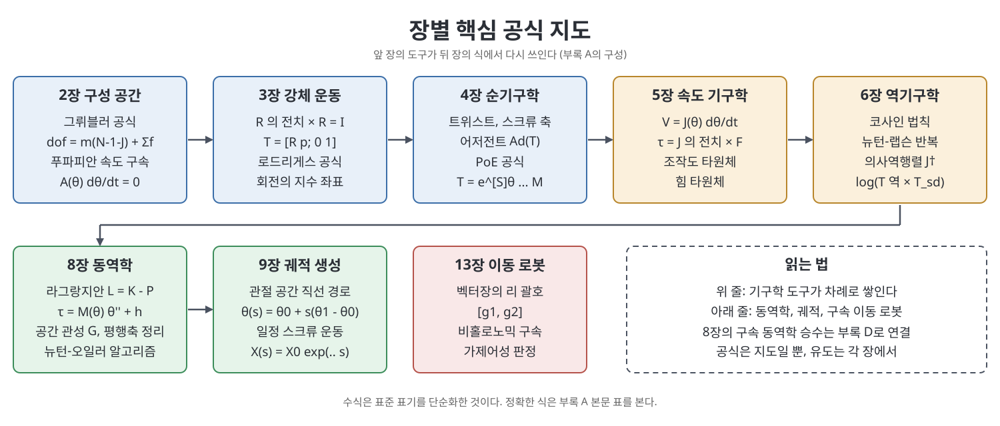

# 부록 A 유용한 공식 요약 (Summary of Useful Formulas)

이 부록은 책 전체에서 쓰인 핵심 공식을 장별로 한곳에 모아 둔 찾아보기용 목록이다. 새로운 내용은 없고, 앞 장에서 배운 식이 어떤 문자와 어떤 조건으로 쓰이는지 한눈에 확인하는 것이 목적이다. 책은 2장, 3장, 4장, 5장, 6장, 8장, 9장, 13장의 공식을 순서대로 묶어 놓았다. 이 노트는 그 구성을 따라 표로 다시 정리하고, 각 묶음 뒤에 어디에 쓰는 식인지 직접 풀어 적었다.

> **쉽게 말하면**
> 이 부록은 로봇공학 공식의 "지도"다. 막혔을 때 어느 장의 어떤 도구를 꺼내야 하는지 찾는 용도로 쓰고, 증명과 직관은 해당 장으로 돌아가서 본다.

> **참고(노트 작성자)** 원서 부록은 OCR 텍스트에서 수식이 많이 깨져 있다. 이 노트의 식은 표준 표기(Modern Robotics의 POE 표기)로 복원한 것이며, 정확한 기호와 첨자는 원서 502~508쪽(인쇄 쪽 486~492쪽)과 대조하라. 확신이 낮은 식은 넣지 않고 말로만 적었다.

## 이 부록의 흐름

1. 2장 구성 공간과 3장 강체 운동의 기본 식
2. 4장 순기구학(PoE)과 5장 속도 기구학
3. 6장 역기구학과 8장 동역학
4. 9장 궤적과 13장 비홀로노믹 구속
5. 그림으로 보는 공식 지도

## 1. 2장과 3장: 구성 공간과 강체 운동

2장은 로봇의 자유도를 세는 식을, 3장은 회전과 이동을 행렬로 다루는 식을 다룬다.

| 주제 | 핵심 식 | 의미 |
|------|---------|------|
| 그뤼블러(Grübler) 공식 | $\text{dof} = m(N-1-J) + \sum_{i=1}^{J} f_i$ | 링크 수 N(지면 포함), 관절 수 J, 관절 i의 자유도 f_i. 평면은 m=3, 공간은 m=6 |
| 회전행렬 | $R^TR = I,\ \det R = 1,\ R^{-1} = R^T$ | SO(3)의 정의와 역행렬 |
| 좌표계 변환 | $R_{ab}R_{bc} = R_{ac},\ R_{ab}p_b = p_a$ | 아래첨자가 사슬처럼 이어짐 |
| 동차변환행렬 | $T = \begin{bmatrix} R & p \\ 0 & 1 \end{bmatrix}$ | SE(3)의 원소 |
| 역변환 | $T^{-1} = \begin{bmatrix} R^T & -R^Tp \\ 0 & 1 \end{bmatrix}$ | 회전의 전치와 위치의 부호 반전 |
| 로드리게스 공식 | $e^{[\hat\omega]\theta} = I + \sin\theta\,[\hat\omega] + (1-\cos\theta)[\hat\omega]^2$ | 단위 축 ω와 각도 θ로 만든 회전행렬 |

그뤼블러 공식은 "물체들의 자유도 합에서 독립 구속의 수를 뺀 값"이라는 일반 원리를 관절 기준으로 쓴 식이다. 책은 푸파피안(Pfaffian) 속도 구속을 $A(\theta)\dot\theta = 0$ 꼴로 쓴다는 점도 함께 짚는다. 3장의 변환은 두 가지 방식으로 읽는다. 고정(space) 좌표계 기준의 변환은 왼쪽에, 몸체(body) 좌표계 기준의 변환은 오른쪽에 곱한다.

## 2. 3장과 4장: 트위스트와 PoE

| 주제 | 핵심 식 | 의미 |
|------|---------|------|
| 각속도 | $[\omega] \in so(3)$는 반대칭 행렬 | 3벡터를 3x3 반대칭 행렬로 바꾼 표기 |
| 회전의 지수 좌표 | $R = e^{[\hat\omega]\theta}$ | 회전축과 각도로 회전을 표현 |
| 트위스트 | $[\mathcal V] = \begin{bmatrix} [\omega] & v \\ 0 & 0 \end{bmatrix} \in se(3)$ | 각속도와 선속도를 묶은 6차원 속도 |
| 어저전트 | $[\mathrm{Ad}_T] = \begin{bmatrix} R & 0 \\ [p]R & R \end{bmatrix}$ | 트위스트의 좌표계를 바꾸는 6x6 행렬 |
| 좌표계 변환 | $\mathcal V_a = [\mathrm{Ad}_{T_{ab}}]\mathcal V_b$ | 스크류 축도 같은 식 |
| 렌치 변환 | $\mathcal F_a = [\mathrm{Ad}_{T_{ba}}]^T\mathcal F_b$ | 어저전트의 전치를 쓴다 |
| PoE (고정 좌표계) | $T = e^{[\mathcal S_1]\theta_1}\cdots e^{[\mathcal S_n]\theta_n}M$ | 스크류 축을 몸 쪽에서 끝 쪽으로 곱함 |
| PoE (몸체 좌표계) | $T = Me^{[\mathcal B_1]\theta_1}\cdots e^{[\mathcal B_n]\theta_n}$ | M은 영 위치에서 말단의 배위 |

책이 강조하는 해석은 이렇다. 고정 좌표계 PoE의 $\mathcal S_i$는 나머지 관절이 모두 영 위치일 때 관절 i가 단위 속도로 움직여 만드는 공간 트위스트이고, 몸체 PoE의 $\mathcal B_i$는 같은 상황에서 말단 좌표계가 느끼는 몸체 트위스트다. 두 식은 $\mathcal B_i = [\mathrm{Ad}_{M^{-1}}]\mathcal S_i$로 서로 옮길 수 있다.

## 3. 5장과 6장: 야코비안과 역기구학

| 주제 | 핵심 식 | 의미 |
|------|---------|------|
| 미분 기구학 | $\dot x = \frac{\partial f}{\partial\theta}\dot\theta = J(\theta)\dot\theta$ | 순기구학 x=f(θ)의 속도 관계 |
| 트위스트 형태 | $\mathcal V_* = J_*(\theta)\dot\theta$ | 별표는 s(공간) 또는 b(몸체) |
| 공간 야코비안 열 | $J_{si} = \mathrm{Ad}_{e^{[\mathcal S_1]\theta_1}\cdots e^{[\mathcal S_{i-1}]\theta_{i-1}}}(\mathcal S_i)$ | 첫 열은 $\mathcal S_1$ |
| 두 야코비안의 관계 | $J_b = [\mathrm{Ad}_{T_{bs}}]J_s$ | 좌표계만 바꾼 같은 속도 관계 |
| 정역학 | $\tau = J^T(\theta)\mathcal F$ | 말단 렌치를 관절 토크로 환산 |
| 조작도 타원체 | $\mathcal V^T(JJ^T)^{-1}\mathcal V = 1$ | 주축은 JJ^T의 고유벡터, 반지름은 고유값의 제곱근 |
| 힘 타원체 | $\mathcal F^TJJ^T\mathcal F = 1$ | 주축은 $(JJ^T)^{-1}$의 고유벡터 |
| 코사인 법칙 | $c^2 = a^2 + b^2 - 2ab\cos\gamma$ | 삼각형 변 a, b, c와 c의 맞은편 각 γ. 해석적 역기구학에 유용 |
| 뉴턴 방법 | $\theta_{i+1} = \theta_i + J^\dagger(\theta_i)\mathcal V_b$ | $[\mathcal V_b] = \log(T_{sb}^{-1}(\theta_i)T_{sd})$ |
| 의사역행렬 | $J^\dagger = J^T(JJ^T)^{-1}$ (n이 m보다 클 때) | n이 m보다 작으면 $(J^TJ)^{-1}J^T$ |

공간 야코비안의 i번째 열은 관절 i보다 몸통 쪽(안쪽) 관절의 배위에만 영향을 받고, 몸체 야코비안의 열은 관절 i보다 말단 쪽(바깥) 관절의 배위에만 영향을 받는다는 것이 책의 설명이다. 의사역행렬 공식은 야코비안이 최대 랭크(특이점이 아님)일 때만 성립한다.

## 4. 8장: 동역학

| 주제 | 핵심 식 | 의미 |
|------|---------|------|
| 라그랑지안 | $\mathcal L(\theta,\dot\theta) = K(\theta,\dot\theta) - P(\theta)$ | 운동에너지 빼기 위치에너지 |
| 오일러-라그랑주 | $\frac{d}{dt}\frac{\partial\mathcal L}{\partial\dot\theta} - \frac{\partial\mathcal L}{\partial\theta} = \tau$ | 운동 방정식을 만드는 규칙 |
| 로봇 운동 방정식 | $\tau = M(\theta)\ddot\theta + h(\theta,\dot\theta)$ | M은 대칭 양의 정부호 질량 행렬 |
| 분해 | $h = C(\theta,\dot\theta)\dot\theta + g(\theta)$ | 코리올리·원심력과 중력 |
| 말단 렌치 보정 | 우변에 $J^T(\theta)\mathcal F_{tip}$를 더함 | 로봇이 환경에 힘을 줄 때 |
| 평행축 정리 | $I_q = I_b + m(q^Tq\,I - qq^T)$ | 질량 중심에서 q만큼 옮긴 관성 |
| 공간 관성 행렬 | $\mathcal G_b = \begin{bmatrix} I_b & 0 \\ 0 & mI \end{bmatrix}$ | 6x6 |
| 좌표계 변경 | $\mathcal G_a = [\mathrm{Ad}_{T_{ba}}]^T\mathcal G_b[\mathrm{Ad}_{T_{ba}}]$ | |
| 강체 동역학 | $\mathcal F_b = \mathcal G_b\dot{\mathcal V}_b - [\mathrm{ad}_{\mathcal V_b}]^T\mathcal G_b\mathcal V_b$ | 트위스트-렌치 형식 |
| 운동에너지 | $\tfrac12\mathcal V^T\mathcal G\mathcal V,\ \tfrac12\dot\theta^TM\dot\theta$ | 강체, 개연쇄 로봇 |
| 작업 공간 질량 행렬 | $\Lambda(\theta) = J^{-T}M(\theta)J^{-1}$ | 작업 공간에서 본 동역학 |

뉴턴-오일러 역동역학 알고리즘은 앞으로 속도와 가속도를 전파하고(base에서 말단), 뒤로 렌치를 전파하는(말단에서 base) 두 번의 반복으로 토크를 구한다. 이 알고리즘의 초기화 규칙(중력을 base의 반대 방향 가속도로 취급하는 것 등)은 8장에서 확인하라.

구속이 있을 때는 구속 $A(\theta)\dot\theta = 0$에 라그랑주 승수를 도입하고, 이를 소거하면 투영 행렬 $P(\theta) = I - A^T(AM^{-1}A^T)^{-1}AM^{-1}$을 얻는다. P는 구속에 맞서는 힘 성분을 걸러 내는 투영이다. 부록 D에서 이 승수의 기본 원리를 다룬다.

## 5. 9장과 13장: 궤적과 비홀로노믹

| 주제 | 핵심 식 | 의미 |
|------|---------|------|
| 관절 공간 직선 경로 | $\theta(s) = \theta_{start} + s(\theta_{end} - \theta_{start})$ | s는 0에서 1까지 |
| 일정 스크류 운동 | $X(s) = X_{start}\exp(\log(X_{start}^{-1}X_{end})s)$ | SE(3)에서의 직선에 해당 |
| 벡터장의 리 괄호 | $[g_1,g_2] = \frac{\partial g_2}{\partial\theta}g_1 - \frac{\partial g_1}{\partial\theta}g_2$ | 13장에서 가제어성 판정에 쓰는 도구 |

9장의 경로 제약 동역학(경로를 따라가는 스칼라 s에 대한 동역학)의 식은 OCR에서 거의 소실되어 이 표에 넣지 않았다. 9장에서 직접 확인하라.

## 핵심 정리

- 자유도는 그뤼블러 공식, 강체의 위치는 $T \in SE(3)$, 속도는 트위스트, 힘은 렌치로 쓴다.
- 순기구학은 PoE로, 속도는 야코비안으로, 정역학은 야코비안의 전치로 쓴다.
- 역기구학은 닫힌 형태가 없으면 의사역행렬 기반의 뉴턴 반복으로 푼다.
- 동역학은 $\tau = M\ddot\theta + h$이고, 좌표계를 바꿀 때는 어저전트와 그 전치를 곱한다.
- 구속이 있으면 라그랑주 승수를 쓰고, 이를 투영 행렬로 소거할 수 있다.

[이전: 부록 개요](Readme.md) | [다음: 부록 B 회전의 다른 표현](%EB%B6%80%EB%A1%9D%20B%20%ED%9A%8C%EC%A0%84%EC%9D%98%20%EB%8B%A4%EB%A5%B8%20%ED%91%9C%ED%98%84.md)

 
 
 

[Modern Robotics](../)
