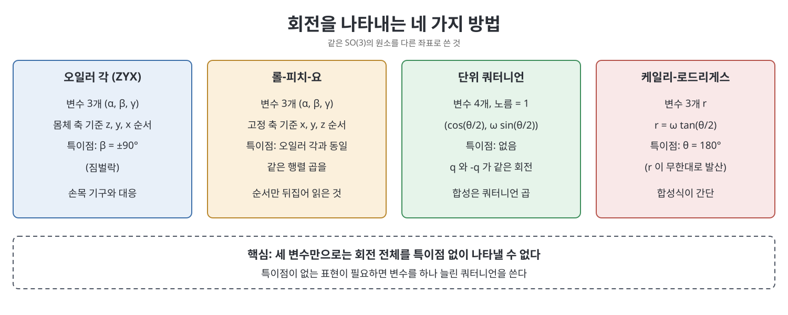

# 부록 B 회전의 다른 표현 (Other Representations of Rotations)

3장에서 회전은 3x3 회전행렬이나 지수 좌표(축과 각도)로 다루었다. 이 부록은 회전을 나타내는 다른 방법 네 가지를 소개한다. 오일러 각(Euler angles), 롤-피치-요 각(roll-pitch-yaw angles), 단위 쿼터니언(unit quaternion), 케일리-로드리게스 매개변수(Cayley-Rodrigues parameters)다. 책이 이들을 따로 부록에 두는 이유는, 방향이 세 개의 독립 좌표로 정해지지만 그 세 좌표를 고르는 방식에 따라 특이점과 계산의 편의가 달라지기 때문이다.

> **쉽게 말하면**
> 같은 회전을 말하는 "주소 체계"가 여러 가지 있다. 오일러 각과 롤-피치-요는 사람이 이해하기 쉽지만 특정 자세에서 막히고, 쿼터니언은 막히지 않는 대신 숫자가 네 개 필요하다.

> **참고(노트 작성자)** 원서 509~517쪽은 OCR에서 행렬 성분이 많이 깨져 있다. 이 노트의 식은 표준 정의로 복원했으며, 원서의 식 번호(B.1 등)와 대조하길 권한다. 확신이 낮은 케일리-로드리게스의 각속도 식은 말로만 설명했다.

## 이 장의 흐름

1. 오일러 각: 몸체 좌표계 기준의 세 번 회전
2. 롤-피치-요: 고정 좌표계 기준의 세 번 회전
3. 단위 쿼터니언: 특이점을 없앤 네 변수 표현
4. 케일리-로드리게스 매개변수: 탄젠트 반각 좌표
5. 네 표현의 비교

## 1. 오일러 각

책은 몸체 좌표계 {b}를 처음에 고정 좌표계 {s}와 일치시킨 뒤, 몸체의 z축으로 α, 그 다음 몸체의 y축으로 β, 마지막으로 몸체의 x축으로 γ만큼 차례로 돌린다고 설명한다. 이렇게 얻는 (α, β, γ)가 ZYX 오일러 각이다. 각 회전이 이전 회전으로 움직인 몸체 축 기준이므로 회전행렬은 오른쪽으로 곱해진다.

$$R(\alpha,\beta,\gamma) = \mathrm{Rot}(\hat z,\alpha)\,\mathrm{Rot}(\hat y,\beta)\,\mathrm{Rot}(\hat x,\gamma)$$

성분을 풀어 쓰면 다음과 같다(s는 sin, c는 cos의 약자).

$$R = \begin{bmatrix} c_\alpha c_\beta & c_\alpha s_\beta s_\gamma - s_\alpha c_\gamma & c_\alpha s_\beta c_\gamma + s_\alpha s_\gamma \\ s_\alpha c_\beta & s_\alpha s_\beta s_\gamma + c_\alpha c_\gamma & s_\alpha s_\beta c_\gamma - c_\alpha s_\gamma \\ -s_\beta & c_\beta s_\gamma & c_\beta c_\gamma \end{bmatrix}$$

임의의 회전행렬 R이 주어지면 각을 거꾸로 구할 수 있다. R의 (i, j) 성분을 $r_{ij}$라 할 때, 책이 구성적으로 보이는 순서는 이렇다.

| 조건 | 해 |
|------|----|
| $r_{31} \ne \pm 1$ | $\beta = \mathrm{atan2}(-r_{31}, \sqrt{r_{11}^2 + r_{21}^2})$, $\alpha = \mathrm{atan2}(r_{21}, r_{11})$, $\gamma = \mathrm{atan2}(r_{32}, r_{33})$ |
| $r_{31} = -1$ | $\beta = \pi/2$. 해가 무수히 많다. 한 해는 $\alpha = 0$, $\gamma = \mathrm{atan2}(r_{12}, r_{22})$ |
| $r_{31} = 1$ | $\beta = -\pi/2$. 한 해는 $\alpha = 0$, $\gamma = -\mathrm{atan2}(r_{12}, r_{22})$ |

제곱근 앞의 부호를 반대로 택하면 β가 다른 범위에 놓이는 두 번째 해가 나온다. β가 ±90도일 때는 α와 γ가 같은 수직축 둘레의 회전이 되어 "자유도 하나를 잃는다". 이 현상이 짐벌락(gimbal lock)이라 불리는 오일러 각의 특이점이다. 책은 손목 기구를 예로 들어, ZYX 각이 영 위치에 있는 세 관절의 각도에 해당함을 보인다.

중요한 일반화도 있다. 첫째 축과 둘째 축이 직교하고 둘째와 셋째가 직교하기만 하면(첫째와 셋째는 달라도 된다) 어떤 순서의 세 회전도 유효한 3변수 표현이 된다. 이 방식으로 ZYZ 오일러 각도 얻는다. 첫째, 셋째 회전의 각은 2π 구간을, 둘째 회전의 각은 길이 π 구간을 움직인다.

## 2. 롤-피치-요 각

오일러 각이 몸체 좌표계 기준의 회전 순서라면, 롤-피치-요(roll-pitch-yaw)는 고정 좌표계의 축 기준으로 차례로 돌린다. 책은 x축으로 γ, y축으로 β, z축으로 α 순서로 돌려서 XYZ 롤-피치-요를 정의한다. 고정 축 기준이므로 새 회전이 왼쪽에 곱해진다.

$$R(\alpha,\beta,\gamma) = \mathrm{Rot}(\hat z,\alpha)\,\mathrm{Rot}(\hat y,\beta)\,\mathrm{Rot}(\hat x,\gamma)$$

식이 ZYX 오일러 각과 똑같다. 같은 세 회전의 곱을 "몸체 기준의 ZYX 순서"로 읽으면 오일러 각, "고정 기준으로 순서를 뒤집은 XYZ"로 읽으면 롤-피치-요다. 책은 비행기를 예로 든다. 기체 앞쪽이 x축, 날개 방향이 y축, 아래쪽이 z축이라면 롤은 앞축 둘레, 피치는 날개축 둘레, 요는 수직축 둘레의 회전이다.

## 3. 단위 쿼터니언

지수 좌표의 로그 공식은 sin θ로 나누므로 θ가 작을 때 수치적으로 민감하다. 쿼터니언은 이 특이점을 없애는 대가로 변수가 하나 늘어난다. 단위 회전축 ω̂와 각도 θ에 대해 책의 정의는 다음과 같다.

$$q = (q_0, q_1, q_2, q_3) = \left(\cos\tfrac{\theta}{2},\ \hat\omega\sin\tfrac{\theta}{2}\right)$$

노름이 1이므로 q는 4차원 공간의 3차원 단위 구면(S^3) 위의 점이다. 네 성분 중 독립은 셋이다. 회전행렬에서 쿼터니언을 구하는 식은 다음과 같다.

$$q_0 = \tfrac12\sqrt{1 + r_{11} + r_{22} + r_{33}},\quad q_1 = \frac{r_{32} - r_{23}}{4q_0},\quad q_2 = \frac{r_{13} - r_{31}}{4q_0},\quad q_3 = \frac{r_{21} - r_{12}}{4q_0}$$

반대로 쿼터니언에서 회전행렬은 다음처럼 만든다.

$$R = \begin{bmatrix} q_0^2 + q_1^2 - q_2^2 - q_3^2 & 2(q_1q_2 - q_0q_3) & 2(q_0q_2 + q_1q_3) \\ 2(q_0q_3 + q_1q_2) & q_0^2 - q_1^2 + q_2^2 - q_3^2 & 2(q_2q_3 - q_0q_1) \\ 2(q_1q_3 - q_0q_2) & 2(q_0q_1 + q_2q_3) & q_0^2 - q_1^2 - q_2^2 + q_3^2 \end{bmatrix}$$

식을 보면 q와 반대점 -q는 같은 R을 만든다. 즉 쿼터니언은 회전 하나를 정확히 두 점으로 나타낸다(이중 덮개). 두 회전의 곱 R_q R_p의 쿼터니언은 쿼터니언 곱으로 얻는다. 책은 2x2 복소 행렬을 곱하는 방식으로 소개하지만, 결과는 아래 익숙한 해밀턴 곱과 같은 식이다.

$$n_0 = q_0p_0 - q_1p_1 - q_2p_2 - q_3p_3,\quad n_1 = q_0p_1 + p_0q_1 + q_2p_3 - q_3p_2$$

$$n_2 = q_0p_2 + p_0q_2 - q_1p_3 + q_3p_1,\quad n_3 = q_0p_3 + p_0q_3 + q_1p_2 - q_2p_1$$

## 4. 케일리-로드리게스 매개변수

회전을 나타내는 또 다른 국소 좌표다. 지수 좌표 $R = e^{[\hat\omega]\theta}$에 대해 단위 축에 탄젠트 반각을 곱한 벡터를 쓴다.

$$r = \hat\omega\tan\tfrac{\theta}{2}$$

r이 0이면 단위행렬이고, -r은 역회전이다. 책의 비유를 빌리면, 3장에서 본 반지름 π의 구(공) 모양 SO(3)의 반지름을 탄젠트 함수로 무한히 늘린 것에 해당한다. 그래서 θ가 π(180도)에 접근하면 r이 무한대로 발산해 이 좌표의 특이점이 된다. 회전행렬은 $R = I + \frac{2}{1 + r^Tr}\left([r] + [r]^2\right)$으로 쓸 수 있다. 가장 큰 장점은 두 회전의 합성이 간단하다는 것이다. 회전 $R_1R_2$의 매개변수는 다음과 같다.

$$r_3 = \frac{r_1 + r_2 + r_1 \times r_2}{1 - r_1^Tr_2}$$

분모가 0이 되는 경우(합성 회전이 180도)에는 책이 sin 반각을 쓰는 보조 공식을 따로 제시한다. 각속도 역시 r과 $\dot r$로 간단히 쓸 수 있고 고정 좌표계와 몸체 좌표계 표현이 모두 있지만, 식이 깨져 있어 이 노트는 생략한다.

## 5. 네 표현의 비교

| 표현 | 변수 개수 | 특이점 | 특징 |
|------|:---:|--------|------|
| 오일러 각 (ZYX, ZYZ) | 3 | β가 ±90도(ZYZ는 0도, 180도) | 이해하기 쉽고 손목 기구와 대응 |
| 롤-피치-요 | 3 | 오일러 각과 동일한 곱 | 고정축 순서로 해석 |
| 단위 쿼터니언 | 4 | 없음 (q와 -q가 같은 회전) | 합성이 쉽고 수치적으로 안정 |
| 케일리-로드리게스 | 3 | θ가 180도에서 발산 | 합성식이 간단 |

핵심은 세 변수만으로 SO(3) 전체를 특이점 없이 나타낼 수 없다는 사실이다. 어떤 3변수 표현도 어딘가에서는 막히므로, 특이점이 없는 표현을 원하면 변수를 하나 더 쓰는 쿼터니언을 택한다.

## 핵심 정리

- ZYX 오일러 각은 몸체 축 기준으로 z, y, x 순서로 돌린 것이고, β가 ±90도이면 해가 무수히 많아진다(짐벌락).
- 롤-피치-요는 같은 세 회전의 곱을 고정 축 기준으로 읽은 것이다.
- 단위 쿼터니언은 $(\cos\frac{\theta}{2}, \hat\omega\sin\frac{\theta}{2})$이고, 회전 하나가 q와 -q 두 점에 대응한다.
- 케일리-로드리게스 매개변수는 $\hat\omega\tan\frac{\theta}{2}$이며 합성식이 간단하지만 180도에서 발산한다.

[이전: 부록 A 유용한 공식 요약](%EB%B6%80%EB%A1%9D%20A%20%EC%9C%A0%EC%9A%A9%ED%95%9C%20%EA%B3%B5%EC%8B%9D%20%EC%9A%94%EC%95%BD.md) | [다음: 부록 C 데나빗-하텐버그 매개변수와 PoE의 관계](%EB%B6%80%EB%A1%9D%20C%20%EB%8D%B0%EB%82%98%EB%B9%97-%ED%95%98%ED%85%90%EB%B2%84%EA%B7%B8%20%EB%A7%A4%EA%B0%9C%EB%B3%80%EC%88%98%EC%99%80%20PoE%EC%9D%98%20%EA%B4%80%EA%B3%84.md)

 
 
 

[Modern Robotics](../)
