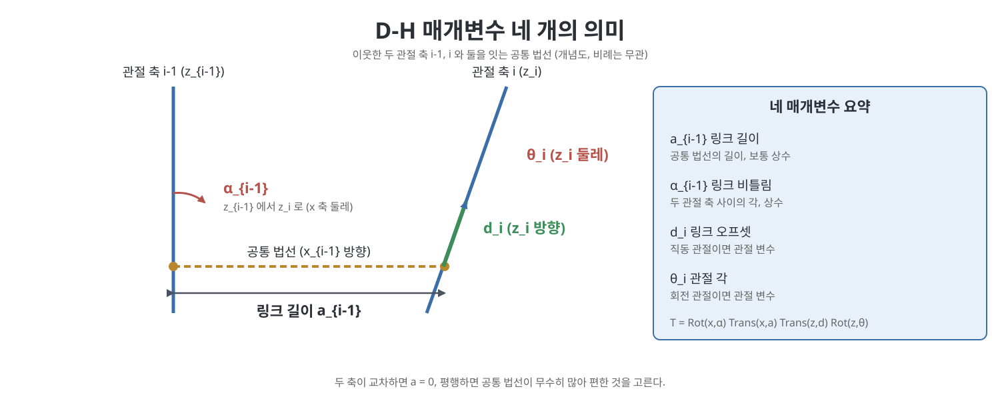
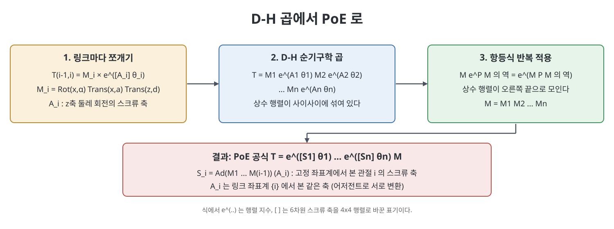

# 부록 C 데나빗-하텐버그 매개변수와 PoE의 관계 (Denavit-Hartenberg Parameters)

4장에서는 순기구학을 지수 곱 공식(PoE)으로 세웠다. 오랫동안 로봇 교재의 표준이던 방법은 이와 다른 데나빗-하텐버그(Denavit-Hartenberg, D-H) 방식이다. 이 부록은 D-H 방식으로 링크 좌표계를 붙이는 규칙, 링크 사이 변환행렬, 대표 예제를 설명하고, 마지막에 D-H 표현에서 PoE 공식을 직접 유도해 두 방식을 비교한다. 결론은 분명하다. 책은 개연쇄 모델링에는 PoE를 쓰는 편이 실용적으로 낫다고 본다.

> **쉽게 말하면**
> D-H는 링크마다 좌표계를 붙이고 이웃 좌표계 사이를 "네 개의 숫자"로 말하는 방식이고, PoE는 영 위치에서 각 관절 축을 "하나의 스크류 축"으로 말하는 방식이다. 같은 로봇을 다른 문법으로 쓴 것이다.

> **참고(노트 작성자)** D-H의 좌표계 부여 규칙은 교재마다 다르다(책이 마지막에 직접 언급한다). 아래 식은 책이 택한 규칙(관절 축이 z축)에 따른 것이며, 다른 책의 표와 섞어 쓰면 안 된다. 예제의 매개변수 표는 OCR이 깨져 값을 옮기지 않았으니 원서 517~526쪽을 보라.

## 이 장의 흐름

1. 링크 좌표계 부여 규칙과 네 매개변수
2. 특수한 경우: 축이 교차, 평행, 직동 관절, 기준·말단 좌표계
3. 왜 네 개로 충분한가
4. 순기구학과 예제
5. D-H에서 PoE 유도와 최종 비교

## 1. 링크 좌표계와 네 매개변수

기준 좌표계를 {0}, 말단 좌표계를 {n}이라 하고, 일자유도 관절 n개의 개연쇄에서 링크를 0부터 n까지 번호 붙인다. 순기구학은 이웃 링크 사이 상대 변환을 곱한 것이다.

$$T_{0n}(\theta_1,\dots,\theta_n) = T_{01}(\theta_1)\,T_{12}(\theta_2)\cdots T_{n-1,n}(\theta_n)$$

책이 정한 규칙은 이렇다. 먼저 각 링크 좌표계의 z축을 그 관절의 축과 일치시키고, 회전의 양의 방향은 오른손 법칙으로 정한다. 다음으로 이웃한 두 관절 축 i-1, i를 모두 수직으로 지나는 선분(공통 법선)을 찾고, 좌표계 {i-1}의 원점을 이 선분이 관절 축 i-1과 만나는 점에 둔다. x축은 이 공통 법선에서 축 i-1로부터 축 i를 향하는 방향이고, y축은 외적으로 정해진다. 이렇게 하면 네 매개변수로 이웃 좌표계 관계가 정해진다.

| 매개변수 | 이름 | 정의 |
|----------|------|------|
| $a_{i-1}$ | 링크 길이(link length) | 공통 법선의 길이. 실제 링크의 물리적 길이와 같을 필요는 없다 |
| $\alpha_{i-1}$ | 링크 비틀림(link twist) | $z_{i-1}$에서 $z_i$까지의 각, $x_{i-1}$ 축 둘레로 잰다 |
| $d_i$ | 링크 오프셋(link offset) | 공통 법선과 축 i가 만나는 점에서 {i} 원점까지의 거리, $z_i$ 방향 |
| $\theta_i$ | 관절 각(joint angle) | $x_{i-1}$에서 $x_i$까지의 각, $z_i$ 축 둘레로 잰다 |

회전 관절만 있는 개연쇄에서는 $a_{i-1}$, $\alpha_{i-1}$, $d_i$가 상수이고 $\theta_i$만 관절 변수가 된다. 그래서 n관절 개연쇄는 4n개의 매개변수로 순기구학이 모두 정해진다.

## 2. 특수한 경우

| 상황 | 처리 |
|------|------|
| 이웃한 두 회전축이 교차 | 공통 법선이 없다. 링크 길이를 0으로 하고 x축을 두 축이 이루는 평면의 수직으로 잡는다. 부호가 다른 두 선택이 모두 가능하다 |
| 이웃한 두 회전축이 평행 | 공통 법선이 무수히 많다. 물리적으로 직관적이고 영이 되는 매개변수가 많은 것을 고른다 |
| 직동 관절 | z축을 이동 방향으로 잡는다. 이때 $d_i$가 관절 변수이고 $\theta_i$는 상수가 된다 |
| 기준 좌표계 {0} | 영 위치의 링크 1 좌표계와 일치시켜 $a_0 = \alpha_0 = d_1 = 0$ 같은 단순화를 얻는다 |
| 말단 좌표계 {n} | 작업을 설명하기 쉽고 매개변수가 영이 되는 지점에 붙인다 |

기준과 말단 좌표계를 아무렇게나 둘 수는 없다는 점에 주의해야 한다. D-H가 허용하는 변환은 x축 둘레 회전, x축 방향 이동, z축 방향 이동, z축 둘레 회전뿐이므로, 이 조합으로 만들 수 없는 상대 위치(예를 들어 y축 방향으로만 평행이동한 좌표계)는 D-H 매개변수로 표현할 수 없다.

## 3. 왜 네 개로 충분한가

3장에서 두 좌표계의 상대 변환에는 독립 변수가 여섯 개(방향 셋, 위치 셋) 필요하다고 했다. 그러면 n링크 팔은 6n개가 필요해 보이지만 D-H는 링크당 네 개로 끝난다. 책은 이것이 모순이 아니라 좌표계 부여 규칙이 변환의 형태를 제한한 결과라고 설명한다. 규칙을 지키지 않고 좌표계를 임의로 붙이면 더 많은 매개변수가 필요하다. 또한 데나빗과 하텐버그가 네 개가 최소임을 보였다고 소개한다.

## 4. 순기구학과 예제

이웃 링크 사이 변환은 네 단계의 곱으로 표현된다. 좌표계 {i-1}을 x축 둘레로 $\alpha_{i-1}$만큼 돌리고, x축 방향으로 $a_{i-1}$만큼 옮기고, z축 방향으로 $d_i$만큼 옮기고, z축 둘레로 $\theta_i$만큼 돌린다.

$$T_{i-1,i} = \mathrm{Rot}(\hat x,\alpha_{i-1})\,\mathrm{Trans}(\hat x,a_{i-1})\,\mathrm{Trans}(\hat z,d_i)\,\mathrm{Rot}(\hat z,\theta_i)$$

곱을 풀어 쓰면 다음과 같다.

$$T_{i-1,i} = \begin{bmatrix} \cos\theta_i & -\sin\theta_i & 0 & a_{i-1} \\ \sin\theta_i\cos\alpha_{i-1} & \cos\theta_i\cos\alpha_{i-1} & -\sin\alpha_{i-1} & -d_i\sin\alpha_{i-1} \\ \sin\theta_i\sin\alpha_{i-1} & \cos\theta_i\sin\alpha_{i-1} & \cos\alpha_{i-1} & d_i\cos\alpha_{i-1} \\ 0 & 0 & 0 & 1 \end{bmatrix}$$

앞의 두 단계끼리, 뒤의 두 단계끼리는 순서를 바꿔도 결과가 같다. 책은 예제 세 가지(3R 공간 개연쇄, RRRP 공간 개연쇄, 6R 로봇 팔)의 매개변수 표를 보인다. 6R 팔은 앞의 세 관절이 위치를, 뒤의 세 관절이 ZYZ 오일러 각 모양의 손목을 이룬다. 예제에서 기준·말단 좌표계는 매개변수가 0이 되도록 골라 표를 단순하게 했다.

## 5. D-H에서 PoE로

책은 D-H 식에서 PoE를 직접 유도한다. 회전 관절 i에서 앞의 세 변환을 상수 행렬 $M_i$로 묶는다.

$$M_i = \mathrm{Rot}(\hat x,\alpha_{i-1})\,\mathrm{Trans}(\hat x,a_{i-1})\,\mathrm{Trans}(\hat z,d_i)$$

그러면 $\mathrm{Rot}(\hat z,\theta_i) = e^{[A_i]\theta_i}$이고 $A_i$는 z축 둘레 회전의 스크류 축(회전 관절은 $(0,0,1,0,0,0)$, 직동 관절은 $(0,0,0,0,0,1)$)이다. 따라서 $T_{i-1,i} = M_i e^{[A_i]\theta_i}$이고 전체는 다음 꼴이다.

$$T_{0n} = M_1e^{[A_1]\theta_1}M_2e^{[A_2]\theta_2}\cdots M_ne^{[A_n]\theta_n}$$

여기에 $Me^{P}M^{-1} = e^{MPM^{-1}}$이라는 행렬 항등식을 왼쪽부터 반복해서 적용하면 상수 행렬이 모두 오른쪽 끝으로 모이고 다음을 얻는다.

$$T_{0n} = e^{[\mathcal S_1]\theta_1}\cdots e^{[\mathcal S_n]\theta_n}M,\quad M = M_1M_2\cdots M_n,\quad \mathcal S_i = \mathrm{Ad}_{M_1\cdots M_{i-1}}(A_i)$$

해석은 이렇다. $A_i$는 링크 좌표계 {i}에서 본 관절 i의 스크류 축이고, $\mathcal S_i$는 같은 축을 고정 좌표계 {0}에서 본 것이다. 두 표현은 어저전트로 연결되는 같은 대상이다.

## 6. 최종 비교

| 항목 | D-H | PoE |
|------|-----|-----|
| 매개변수 수 | 링크당 4개로 최소 | 관절 축 하나당 스크류 축(6개 성분)이라 더 많음 |
| 좌표계 부여 | 규칙에 맞게 링크마다 붙여야 하고 임의의 기준·말단 좌표계는 불가능할 수 있음 | 영 위치와 기준·말단 좌표계만 있으면 되고 제한이 없음 |
| 관절 종류 | 회전은 θ, 직동은 d가 변수라 구분이 필요 | 별도 구분이 불필요 |
| 규칙의 유일성 | 교재마다 규칙이 달라 모호함 | 한 가지로 정해짐 |
| 수치적 성질 | 인접 축이 거의 평행하면 공통 법선이 크게 흔들려 측정·식별이 불안정 | 스크류 축은 연속적으로 변하여 안정적 |
| 야코비안과 연결 | 직접적 해석이 어려움 | 야코비안의 열이 곧 관절 축의 스크류 |

책의 결론은 PoE의 유일한 단점인 더 많은 매개변수는 장점들로 충분히 상쇄되며, 개연쇄 순기구학을 모델링할 때 D-H를 고집할 실용적 이유가 거의 없다는 것이다. 다만 D-H는 기존 문서와 데이터시트에 널리 남아 있어 읽을 줄은 알아야 한다.

## 핵심 정리

- D-H는 관절 축을 z축으로 두고 링크 길이, 비틀림, 오프셋, 관절 각 네 개로 이웃 좌표계 변환을 쓴다.
- 이웃 변환은 $\mathrm{Rot}(\hat x,\alpha)\mathrm{Trans}(\hat x,a)\mathrm{Trans}(\hat z,d)\mathrm{Rot}(\hat z,\theta)$이다.
- 임의의 좌표계는 D-H로 못 쓸 수 있고, 인접 축이 거의 평행하면 수치적으로 불안정하다.
- 행렬 항등식 $Me^{P}M^{-1} = e^{MPM^{-1}}$으로 D-H 곱에서 PoE를 직접 유도할 수 있다.
- 책은 PoE가 더 단순하고 일반적이라 개연쇄 모델링에 권한다.

[이전: 부록 B 회전의 다른 표현](%EB%B6%80%EB%A1%9D%20B%20%ED%9A%8C%EC%A0%84%EC%9D%98%20%EB%8B%A4%EB%A5%B8%20%ED%91%9C%ED%98%84.md) | [다음: 부록 D 최적화와 라그랑주 승수](%EB%B6%80%EB%A1%9D%20D%20%EC%B5%9C%EC%A0%81%ED%99%94%EC%99%80%20%EB%9D%BC%EA%B7%B8%EB%9E%91%EC%A3%BC%20%EC%8A%B9%EC%88%98.md)

 
 
 

[Modern Robotics](../)
