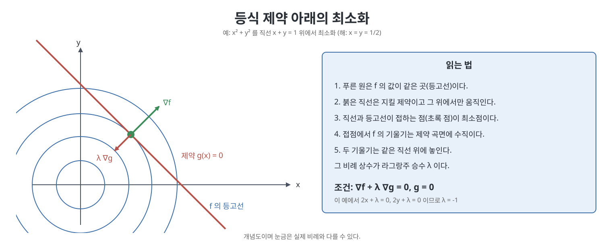

# 부록 D 최적화와 라그랑주 승수 (Optimization and Lagrange Multipliers)

6장의 수치 역기구학, 8장의 구속 동역학, 11장의 제어 등 책 곳곳에서 "어떤 함수를 가장 작게 만드는 값을 찾는다"는 문제가 나온다. 이 짧은 부록은 그 바탕이 되는 최적화 이론을 정리한다. 제약이 없는 경우의 최소 조건, 최소제곱 해, 등식 제약이 있는 경우의 라그랑주 승수(Lagrange multiplier), 그리고 이차 함수에 대한 닫힌 해를 차례로 다룬다.

> **쉽게 말하면**
> 언덕 꼭대기나 골짜기 바닥에서는 기울기가 0이다. 길을 따라서만 움직여야 한다면, 길의 방향으로는 더 내려갈 수 없는 곳이 답이고, 이때 "길이 얼마나 세게 밀어내는지"가 라그랑주 승수다.

> **참고(노트 작성자)** 원서 528~530쪽 중 마지막 쪽은 OCR이 비어 있고 식은 많이 깨져 있다. 이 노트의 이차 함수 해는 노트 작성자가 직접 유도해 적었으므로 승수의 부호 규칙이 원서와 다를 수 있다. 원서 식과 대조하라.

## 이 장의 흐름

1. 제약 없는 최소화의 필요 조건
2. 최소제곱 문제
3. 등식 제약과 라그랑주 승수
4. 이차 함수의 닫힌 해와 간단한 예

## 1. 제약 없는 최소화

미분 가능한 함수 $f:\mathbb R\to\mathbb R$에서 $x^*$가 국소 최소점이면 그 근처의 모든 $x$에 대해 $f(x)\ge f(x^*)$이다. 이때 기울기가 0이고 2계 도함수는 0 이상이다.

$$\frac{df}{dx}(x^*) = 0,\qquad \frac{d^2f}{dx^2}(x^*) \ge 0$$

변수가 여럿인 $f:\mathbb R^n\to\mathbb R$에서는 2계 편도함수까지 존재할 때, $x^*$가 국소 최소점이 되기 위한 필요 조건은 기울기(gradient)가 0이라는 것이다. 이 조건은 필요 조건일 뿐이라 최대점이나 안장점도 만족한다.

$$\nabla f(x^*) = 0$$

## 2. 최소제곱 문제

$Ax = b$에서 $A\in\mathbb R^{m\times n}$이고 $m>n$이면 식이 변수보다 많아 일반적으로 정확한 해가 없다. 대신 오차를 가장 작게 만드는 $x$를 찾는다.

$$\min_x f(x) = \tfrac12\|Ax-b\|^2$$

기울기를 0으로 놓으면 정규 방정식이 된다.

$$A^TAx - A^Tb = 0$$

$A$의 랭크가 $n$이면 $A^TA$가 가역이므로 해는 다음과 같다.

$$x^* = (A^TA)^{-1}A^Tb$$

이 식은 부록 A에서 본 의사역행렬 $(J^TJ)^{-1}J^T$와 같은 모양이다. 야코비안 기반 수치 역기구학이 결국 최소제곱 원리 위에 있음을 보여 준다.

## 3. 등식 제약과 라그랑주 승수

이제 제약 $g(x)=0$ (미분 가능한 $g:\mathbb R^n\to\mathbb R^m$, 보통 $m<n$)을 만족하는 $x$ 중에서 $f$를 최소화한다. $x^*$가 국소 최소점이고 곡면 $g(x)=0$의 정칙점(regular point)이면, $g$의 기울기 행렬의 행들이 일차 독립이라는 조건 아래 다음을 만족하는 벡터 $\lambda\in\mathbb R^m$이 존재한다는 것이 책이 소개하는 결론이다.

$$\nabla f(x^*) + \left(\frac{\partial g}{\partial x}(x^*)\right)^T\lambda = 0,\qquad g(x^*) = 0$$

이 $\lambda$가 라그랑주 승수다. 식은 변수 $x$의 $n$개와 승수 $\lambda$의 $m$개를 합친 $n+m$개 미지수에 대해 $n+m$개의 방정식을 이룬다. 기하학적으로는 최소점에서 $f$의 기울기가 제약 곡면에 수직이어야 한다는 뜻이다. 제약 곡면 위에서 움직일 수 있는 어느 방향으로도 $f$가 더 줄지 않는 곳이기 때문이다.

## 4. 이차 함수의 닫힌 해와 예

책은 대칭 양의 정부호 행렬 $Q$로 정의된 이차 함수를 선형 제약 아래에서 최소화하는 경우를 다룬다.

$$\min_x\ \tfrac12x^TQx + c^Tx\quad\text{subject to}\quad Ax=b$$

$A\in\mathbb R^{m\times n}$이 최대 랭크 $m$이면, 1차 필요 조건 $Qx + c + A^T\lambda = 0$과 $Ax=b$를 풀어 해를 얻는다. $B = (AQ^{-1}A^T)^{-1}$, $G = Q^{-1}A^TB$라 두면 다음과 같다.

$$x^* = Gb - (I-GA)Q^{-1}c,\qquad \lambda = -B\left(b + AQ^{-1}c\right)$$

가장 간단한 예로 $f(x,y) = x^2+y^2$을 직선 $x+y=1$ 위에서 최소화해 보자. 조건은 $2x+\lambda=0$, $2y+\lambda=0$, $x+y=1$이다. 앞의 둘에서 $x=y$이고 셋째에서 $x=y=\tfrac12$, $\lambda=-1$을 얻는다. 원점에서 직선까지의 가장 가까운 점이라는 기하학적 직관과 일치한다.

| 상황 | 조건 | 대표적인 쓰임 |
|------|------|--------------|
| 제약 없음 | $\nabla f = 0$ | 정규 방정식, 최소제곱 |
| 등식 제약 | $\nabla f + (\partial g/\partial x)^T\lambda = 0$, $g = 0$ | 구속이 있는 로봇의 동역학 |
| 이차+선형 제약 | $Qx + c + A^T\lambda = 0$, $Ax = b$ | 닫힌 형태의 해 |

로봇공학에서는 8장의 구속이 있는 로봇의 동역학에서 이 승수가 등장한다. 구속력(라그랑주 승수 $\lambda$)을 소거해 투영 행렬로 정리하는 과정은 이 부록의 원리를 그대로 쓴 것이다.

## 핵심 정리

- 제약이 없으면 국소 최소점에서 기울기가 0이다(필요 조건).
- 식이 변수보다 많은 선형 방정식의 최소제곱 해는 $(A^TA)^{-1}A^Tb$이다.
- 등식 제약이 있으면 $\nabla f$가 제약 곡면에 수직이 되도록 하는 라그랑주 승수 $\lambda$를 도입한다.
- 이차 함수와 선형 제약의 조합은 행렬 연산만으로 닫힌 형태의 해를 구할 수 있다.

[이전: 부록 C 데나빗-하텐버그 매개변수와 PoE의 관계](%EB%B6%80%EB%A1%9D%20C%20%EB%8D%B0%EB%82%98%EB%B9%97-%ED%95%98%ED%85%90%EB%B2%84%EA%B7%B8%20%EB%A7%A4%EA%B0%9C%EB%B3%80%EC%88%98%EC%99%80%20PoE%EC%9D%98%20%EA%B4%80%EA%B3%84.md)

 
 
 

[Modern Robotics](../)
