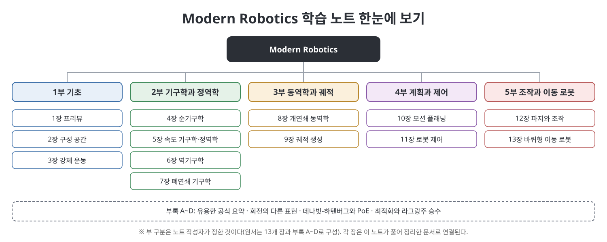

# **Modern Robotics 학습 노트**
(Modern Robotics: Mechanics, Planning, and Control, 장별 정리 노트)
 

이 문서는 Kevin M. Lynch와 Frank C. Park의 『Modern Robotics: Mechanics, Planning, and Control』을 장별로 정리한 한국어 학습 노트입니다. 원문을 번역한 것이 아니라 내용을 우리말로 풀어서 다시 설명했고, 처음 나오는 용어에는 쉬운 풀이와 영어 병기를 붙였습니다. 책은 구성 공간과 강체 운동의 기하학적 기초에서 출발해 순기구학·역기구학·속도 기구학·동역학, 궤적 생성과 모션 플래닝, 로봇 제어, 파지와 조작, 바퀴형 이동 로봇까지 13개 장과 부록 A~D로 로봇의 역학·계획·제어를 한 관점으로 엮습니다. 이 노트는 5개 부와 부록으로 묶어 같은 순서를 따르며, 장마다 개념도와 표를 직접 만들어 넣었습니다.

> **이 노트를 읽을 때 유의할 점**
> - 이 노트는 원서의 **요약·해설본**이며 원서를 대신하지 않습니다. 정확한 식과 증명, 연습문제는 원서에서 확인하세요.
> - 원서 PDF는 스캔본이라 텍스트를 OCR로 읽어 만들었습니다. 수식은 OCR이 잘 읽지 못해 **문맥과 표준 지식으로 복원**했으므로, 식을 쓰기 전에는 원서와 대조하세요. 불확실한 부분은 `참고(노트 작성자)`로 표시했습니다.
> - 책이 소개하는 소프트웨어 라이브러리, 웹사이트 같은 정보는 책이 쓰인 시점(2017년 판 기준)의 서술입니다.
> - 5개 부의 구분은 읽기 편하도록 노트 작성자가 묶은 것이며, 원서에는 부 구분이 없습니다.
 

---

## 목차

- [1부 기초 (1~3장)](01.%201%EB%B6%80%20%EA%B8%B0%EC%B4%88/Readme.md)
  - [1장 프리뷰](01.%201%EB%B6%80%20%EA%B8%B0%EC%B4%88/01%EC%9E%A5%20%ED%94%84%EB%A6%AC%EB%B7%B0.md)
  - [2장 구성 공간](01.%201%EB%B6%80%20%EA%B8%B0%EC%B4%88/02%EC%9E%A5%20%EA%B5%AC%EC%84%B1%20%EA%B3%B5%EA%B0%84.md)
  - [3장 강체 운동](01.%201%EB%B6%80%20%EA%B8%B0%EC%B4%88/03%EC%9E%A5%20%EA%B0%95%EC%B2%B4%20%EC%9A%B4%EB%8F%99.md)
  - [핵심 정리](01.%201%EB%B6%80%20%EA%B8%B0%EC%B4%88/%ED%95%B5%EC%8B%AC%20%EC%A0%95%EB%A6%AC.md)
- [2부 기구학과 정역학 (4~7장)](02.%202%EB%B6%80%20%EA%B8%B0%EA%B5%AC%ED%95%99%EA%B3%BC%20%EC%A0%95%EC%97%AD%ED%95%99/Readme.md)
  - [4장 순기구학](02.%202%EB%B6%80%20%EA%B8%B0%EA%B5%AC%ED%95%99%EA%B3%BC%20%EC%A0%95%EC%97%AD%ED%95%99/04%EC%9E%A5%20%EC%88%9C%EA%B8%B0%EA%B5%AC%ED%95%99.md)
  - [5장 속도 기구학과 정역학](02.%202%EB%B6%80%20%EA%B8%B0%EA%B5%AC%ED%95%99%EA%B3%BC%20%EC%A0%95%EC%97%AD%ED%95%99/05%EC%9E%A5%20%EC%86%8D%EB%8F%84%20%EA%B8%B0%EA%B5%AC%ED%95%99%EA%B3%BC%20%EC%A0%95%EC%97%AD%ED%95%99.md)
  - [6장 역기구학](02.%202%EB%B6%80%20%EA%B8%B0%EA%B5%AC%ED%95%99%EA%B3%BC%20%EC%A0%95%EC%97%AD%ED%95%99/06%EC%9E%A5%20%EC%97%AD%EA%B8%B0%EA%B5%AC%ED%95%99.md)
  - [7장 폐연쇄 기구학](02.%202%EB%B6%80%20%EA%B8%B0%EA%B5%AC%ED%95%99%EA%B3%BC%20%EC%A0%95%EC%97%AD%ED%95%99/07%EC%9E%A5%20%ED%8F%90%EC%97%B0%EC%87%84%20%EA%B8%B0%EA%B5%AC%ED%95%99.md)
  - [핵심 정리](02.%202%EB%B6%80%20%EA%B8%B0%EA%B5%AC%ED%95%99%EA%B3%BC%20%EC%A0%95%EC%97%AD%ED%95%99/%ED%95%B5%EC%8B%AC%20%EC%A0%95%EB%A6%AC.md)
- [3부 동역학과 궤적 (8~9장)](03.%203%EB%B6%80%20%EB%8F%99%EC%97%AD%ED%95%99%EA%B3%BC%20%EA%B6%A4%EC%A0%81/Readme.md)
  - [8장 개연쇄 동역학](03.%203%EB%B6%80%20%EB%8F%99%EC%97%AD%ED%95%99%EA%B3%BC%20%EA%B6%A4%EC%A0%81/08%EC%9E%A5%20%EA%B0%9C%EC%97%B0%EC%87%84%20%EB%8F%99%EC%97%AD%ED%95%99.md)
  - [9장 궤적 생성](03.%203%EB%B6%80%20%EB%8F%99%EC%97%AD%ED%95%99%EA%B3%BC%20%EA%B6%A4%EC%A0%81/09%EC%9E%A5%20%EA%B6%A4%EC%A0%81%20%EC%83%9D%EC%84%B1.md)
  - [핵심 정리](03.%203%EB%B6%80%20%EB%8F%99%EC%97%AD%ED%95%99%EA%B3%BC%20%EA%B6%A4%EC%A0%81/%ED%95%B5%EC%8B%AC%20%EC%A0%95%EB%A6%AC.md)
- [4부 계획과 제어 (10~11장)](04.%204%EB%B6%80%20%EA%B3%84%ED%9A%8D%EA%B3%BC%20%EC%A0%9C%EC%96%B4/Readme.md)
  - [10장 모션 플래닝](04.%204%EB%B6%80%20%EA%B3%84%ED%9A%8D%EA%B3%BC%20%EC%A0%9C%EC%96%B4/10%EC%9E%A5%20%EB%AA%A8%EC%85%98%20%ED%94%8C%EB%9E%98%EB%8B%9D.md)
  - [11장 로봇 제어](04.%204%EB%B6%80%20%EA%B3%84%ED%9A%8D%EA%B3%BC%20%EC%A0%9C%EC%96%B4/11%EC%9E%A5%20%EB%A1%9C%EB%B4%87%20%EC%A0%9C%EC%96%B4.md)
  - [핵심 정리](04.%204%EB%B6%80%20%EA%B3%84%ED%9A%8D%EA%B3%BC%20%EC%A0%9C%EC%96%B4/%ED%95%B5%EC%8B%AC%20%EC%A0%95%EB%A6%AC.md)
- [5부 조작과 이동 로봇 (12~13장)](05.%205%EB%B6%80%20%EC%A1%B0%EC%9E%91%EA%B3%BC%20%EC%9D%B4%EB%8F%99%20%EB%A1%9C%EB%B4%87/Readme.md)
  - [12장 파지와 조작](05.%205%EB%B6%80%20%EC%A1%B0%EC%9E%91%EA%B3%BC%20%EC%9D%B4%EB%8F%99%20%EB%A1%9C%EB%B4%87/12%EC%9E%A5%20%ED%8C%8C%EC%A7%80%EC%99%80%20%EC%A1%B0%EC%9E%91.md)
  - [13장 바퀴형 이동 로봇](05.%205%EB%B6%80%20%EC%A1%B0%EC%9E%91%EA%B3%BC%20%EC%9D%B4%EB%8F%99%20%EB%A1%9C%EB%B4%87/13%EC%9E%A5%20%EB%B0%94%ED%80%B4%ED%98%95%20%EC%9D%B4%EB%8F%99%20%EB%A1%9C%EB%B4%87.md)
  - [핵심 정리](05.%205%EB%B6%80%20%EC%A1%B0%EC%9E%91%EA%B3%BC%20%EC%9D%B4%EB%8F%99%20%EB%A1%9C%EB%B4%87/%ED%95%B5%EC%8B%AC%20%EC%A0%95%EB%A6%AC.md)
- [부록 (A~D)](06.%20%EB%B6%80%EB%A1%9D/Readme.md)
  - [부록 A 유용한 공식 요약](06.%20%EB%B6%80%EB%A1%9D/%EB%B6%80%EB%A1%9D%20A%20%EC%9C%A0%EC%9A%A9%ED%95%9C%20%EA%B3%B5%EC%8B%9D%20%EC%9A%94%EC%95%BD.md)
  - [부록 B 회전의 다른 표현](06.%20%EB%B6%80%EB%A1%9D/%EB%B6%80%EB%A1%9D%20B%20%ED%9A%8C%EC%A0%84%EC%9D%98%20%EB%8B%A4%EB%A5%B8%20%ED%91%9C%ED%98%84.md)
  - [부록 C 데나빗-하텐버그 매개변수와 PoE의 관계](06.%20%EB%B6%80%EB%A1%9D/%EB%B6%80%EB%A1%9D%20C%20%EB%8D%B0%EB%82%98%EB%B9%97-%ED%95%98%ED%85%90%EB%B2%84%EA%B7%B8%20%EB%A7%A4%EA%B0%9C%EB%B3%80%EC%88%98%EC%99%80%20PoE%EC%9D%98%20%EA%B4%80%EA%B3%84.md)
  - [부록 D 최적화와 라그랑주 승수](06.%20%EB%B6%80%EB%A1%9D/%EB%B6%80%EB%A1%9D%20D%20%EC%B5%9C%EC%A0%81%ED%99%94%EC%99%80%20%EB%9D%BC%EA%B7%B8%EB%9E%91%EC%A3%BC%20%EC%8A%B9%EC%88%98.md)

---

## 읽는 순서 제안

| 목적 | 추천 경로 |
|------|-----------|
| 로봇의 자유도와 구성 공간, 강체 운동의 수학을 익히고 싶다 | 1부 (1~3장) |
| 로봇 팔의 위치·속도·힘을 계산하고 싶다 | 2부 (4~7장) |
| 로봇의 동역학과 시간에 따른 궤적을 다루고 싶다 | 3부 (8~9장) |
| 장애물 사이 경로를 계획하고 로봇을 제어하고 싶다 | 4부 (10~11장) |
| 물체를 쥐고 미는 조작과 바퀴 로봇을 알고 싶다 | 5부 (12~13장) |
| 공식, 회전 표현, DH 매개변수를 빠르게 찾고 싶다 | 부록 (A~D) |

책 저자들은 2~6장을 최소한의 필수 내용으로 보고 순서대로 읽을 것을 권합니다. 나머지 장은 관심에 따라 골라 읽을 수 있습니다.

## 용어 몇 가지

| 용어 | 쉬운 설명 |
|------|-----------|
| 구성 공간 (configuration space) | 로봇이 취할 수 있는 모든 자세(관절 값)를 점으로 나타낸 공간 |
| 자유도 (DoF) | 로봇의 자세를 정하는 데 필요한 독립 변수의 개수 |
| 순기구학 / 역기구학 | 관절 값에서 손끝 위치를 구하는 계산 / 원하는 손끝 위치에서 관절 값을 구하는 계산 |
| 트위스트 (twist) | 강체의 각속도와 선속도를 6개 숫자로 묶은 것 |
| 렌치 (wrench) | 강체에 작용하는 토크와 힘을 6개 숫자로 묶은 것 |
| 자코비안 (Jacobian) | 관절 속도를 손끝 트위스트로 바꾸는 행렬 |
| 지수 곱 공식 (PoE) | 관절마다의 운동을 행렬 지수의 곱으로 이어서 순기구학을 쓰는 방법 |

---

## 이 노트에 대하여

- 각 장 문서는 개요, 흐름, 본문 정리, 표, 그림, 핵심 정리, 이전·다음 링크 순서로 구성됩니다.
- 그림은 모두 이 노트용으로 새로 그린 SVG이며 책의 그림을 쓰지 않았습니다.
- 같은 저장소의 다른 학습 노트와 같은 형식을 따릅니다.

