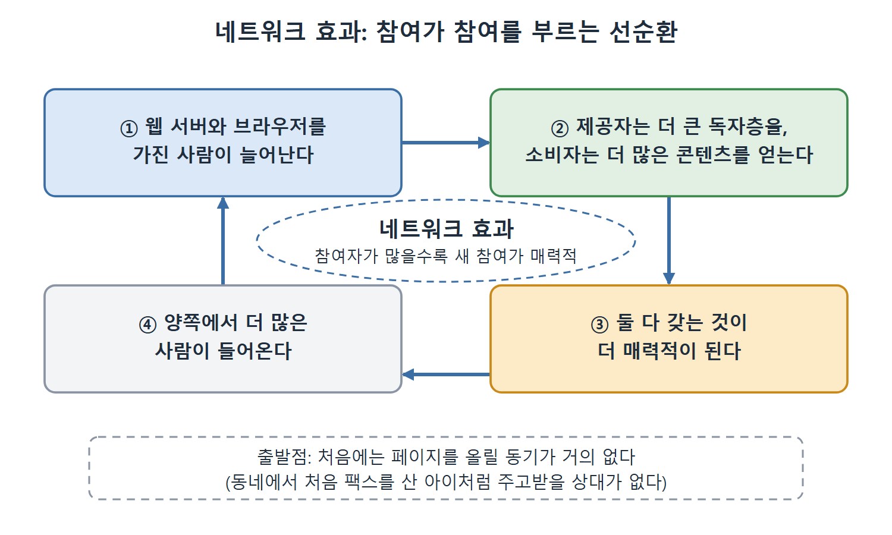

# AAA 슬로건과 네트워크 효과

이 문서는 웹을 웹답게 만든 두 가지 원리, 곧 AAA 슬로건과 네트워크 효과를 설명한다. 이 두 원리가 시맨틱 웹 표준의 설계 결정 상당수를 이끌었고, 품질 높은 시맨틱 웹 응용을 만드는 기술에도 큰 영향을 준다. 이어서 시맨틱 웹의 데이터가 실제로 어떻게 모이고 있는지, Linked Open Data Cloud와 지식 그래프(knowledge graph)가 그 예라는 이야기를 다룬다.

핵심은 "누구나 말할 수 있다"는 자유가 혼란과 성장을 동시에 만든다는 점이다. 먼저 자유가 낳는 모습을, 그다음 그 자유가 성장을 낳는 과정을 읽으면 된다.

---

## 1. AAA 슬로건: Anyone can say Anything about Any topic

웹에서 게시는 대체로 콘텐츠를 만드는 사람의 손에 있다. 누구나 자기 웹 페이지를 만들어 원하는 말을 올릴 수 있다. 어떤 주제든 폭넓은 의견이 발견되며, 무엇을 믿을지는 읽는 사람이 판단한다. 웹은 "사는 사람이 조심하라(caveat emptor)"는 경고의 대표적인 예다. 이 특징이 웹의 성격에서 워낙 핵심이라 저자들은 이름을 붙였다. AAA 슬로건이다.

> Anyone can say Anything about Any topic.

| 대상 | AAA 슬로건이 뜻하는 것 |
|---|---|
| 하이퍼텍스트 웹 | 누구나 원하는 내용의 페이지를 써서 웹 인프라에 올릴 수 있다 |
| 시맨틱 웹 | 누구나 어떤 대상에 대한 데이터 조각을 다른 출처의 데이터와 합칠 수 있는 형태로 표현할 수 있어야 한다 |

이 요구가 RDF 설계의 토대 일부를 이룬다.

### 데이터의 황무지

AAA 슬로건은 웹이 "데이터 황무지(data wilderness)"라는 뜻이기도 하다. 값진 보물이 가득하지만 풀이 무성하고 얽혀 있다. 찾아낸 값진 데이터도 황무지의 각자 구역에 맞춰 여러 형태를 띤다.

| 구분 | 대형 기업 데이터 센터 | 웹 |
|---|---|---|
| 관리자 | 데이터베이스 관리자 한 명이 추가와 수정을 철권으로 통제 | 문지기(gatekeeper)가 없다 |
| 데이터 성장 방식 | 승인된 것만 | 무엇이든 자란다 |
| 성격 | 통제된 시스템 | 모든 출처에서 기여가 들어오는 유기적 시스템 |

웹 위의 정보를 이해하려는 사람에게는 미칠 노릇일 수 있다. 하지만 이 표현의 자유가 웹이 아래에서 위로 올라가는 풀뿌리 현상으로 도약할 수 있게 했다.

## 2. 네트워크 효과: 그래서 내가 말할 수 있다

하이퍼텍스트 웹 초기에, 처음 듣는 회의론자들은 이렇게 물었다. "그 모든 내용을 누가 만들 건데요. 누군가는 웹 페이지를 써야 하잖아요." 회의론자는 물론이고 웹의 지지자 다수도 놀랄 답은, 모두가 내용을 제공한다는 것이었다. 누구나 아무 주제에 대해 말할 수 있는 인프라가 갖춰지자 사람들이 우르르 나와서 그렇게 했다. 곧 모든 주제에 공식이든 비공식이든 웹 페이지가 생겼다. 할 말이 있는 사람이 많았고, 그들은 말하는 데 노력을 들일 의향이 있었다.

이 흐름은 Wikipedia와 IMDb(Internet Movie Database) 같은 협업 "크라우드소싱" 자원으로 이어졌다. 소셜 네트워크에서는 매일 십억 명이 기여하고, 그 기여가 모여 그 자체로 상당한 가치를 지닌 거대한 데이터 원천이 된다.

### 선순환의 구조

하이퍼텍스트 웹은 네트워크 효과(network effect)라는 선순환으로 성장했다. 인프라가 누구나 게시하게 해 주었지만, 그렇게 하고 싶게 만든 것은 무엇이었을까.

| 단계 | 상황 |
|---|---|
| 초기 | 웹 브라우저가 신기한 물건일 때는 페이지를 올릴 동기가 거의 없다. 누가 읽을까 싶다. |
| 비유 | 동네에서 맨 처음 팩스를 산 아이는 팩스를 주고받을 상대가 없다. 웹 서버를 처음 가진 사람도 별로 재미없었다. |
| 전환 | 몇 명이 웹 서버를 갖고 몇 명이 브라우저를 갖게 되자 둘 다 갖는 것이 더 매력적이 되었다. |
| 결과 | 콘텐츠 제공자는 더 큰 독자층을, 소비자는 더 많은 콘텐츠를 얻었다. 양쪽에서 점점 더 많은 사람이 들어왔다. |

위 표의 초기, 전환, 결과 단계를 고리 모양으로 이은 그림이다. 참여자가 늘면 참여가 더 매력적이 되고, 그것이 다시 참여자를 늘리는 순환이 반복된다.

네트워크 효과의 정의는 이렇다. 지금 참여하는 사람이 많을수록 새로 참여하는 사람에게 더 매력적이다.

웹이 가능했던 또 다른 특징은 자기 문서화(auto documented)다. 웹을 짓고, 쓰고, 기여하는 방법에 대한 문서가 웹 자체에 있다. 그래서 시맨틱 웹 같은 진화가 나올 때도 웹에 문서화되어 네트워크 효과를 뒷받침할 수 있다.

## 3. 시맨틱 웹의 데이터는 누가 만드는가

시맨틱 웹을 채우는 정보 상당수는 하이퍼텍스트 웹에서 시작했다. 표, 스프레드시트, 데이터베이스로 있었거나, Wikipedia 같은 조직적 집단 노력으로 만들어졌다. 그렇다면 이 데이터를 RDF로 바꿔 분산 접근을 가능하게 하는 일은 누가 할까.

초기 시맨틱 웹에서는 그럴 동기가 거의 없었고, 시맨틱 웹 기술 자체에 관심이 있는 선구자들이 주로 했다. RDF 형태의 데이터가 늘수록 이 분산 데이터를 쓰는 응용을 만드는 것이 더 유용해진다. 이미 여러 대형 공개 데이터 원천이 RDF로 제공된다.

| 사례 | 설명 |
|---|---|
| dbpedia | Wikipedia를 RDF로 옮긴 것 |
| 정부 데이터셋 | 놀랄 만큼 많은 수의 정부 데이터셋이 RDF로 제공된다 |
| RDFa + Schema.org | 소규모 소매업체가 RDFa라는 시맨틱 웹 형식과 공유 기술 프레임워크 Schema.org(10.1절)로 상품 정보를 게시한다 |
| Open Graph Protocol | Facebook이 콘텐츠 관리자가 RDFa와 Open Graph Protocol이라는 형식으로 구조화된 데이터를 제공하게 한다 |

이런 데이터 원천이 있을수록 링크드 형태로 데이터를 만드는 것이 더 유용해진다. 시맨틱 웹 설계는 하이퍼텍스트 웹을 키운 것과 같은 네트워크 효과의 혜택을 받을 수 있다.

## 4. Linked Open Data Cloud

이 경로를 따른 대표적 노력이 Linked Open Data Cloud(http://lod-cloud.net/)다. 2007년 아일랜드 국립대학교(National University of Ireland)의 연구자 그룹이 여러 주제의 링크드 데이터셋을 모으는 프로젝트를 시작했다. 책의 그림 1.1은 2007년부터 2017년까지 링크드 오픈 데이터셋 수의 성장을 보여 주는데, 네트워크 효과를 따라 늘었다. 초기에는 데이터셋을 클라우드에 넣을 동기가 거의 없었지만, Wikipedia를 포함해 더 많은 데이터셋이 연결될수록 새 데이터셋을 넣는 것이 쉬워지고 가치도 커졌다.

- 이 클라우드는 공통된 참조를 공유하는 데이터셋을 담는다. 데이터의 웹 자체는 이보다 훨씬 크다.
- 포함 분야는 지리, 정부, 생명과학, 언어학, 미디어, 출판 등이다.

## 5. 지식 그래프

같은 표준 위에 세워진 또 다른 노력을 지식 그래프(knowledge graph)라고 한다. 이름은 폭넓은 정보 공유 접근을 가리키지만, 2012년경 Google이 검색을 더 똑똑하게 하려고 "knowledge graph"라 부르는 것을 쓴다고 발표하면서 널리 퍼졌다. Google은 시맨틱 웹처럼 난해하게 들리는 이름 대신 Knowledge Graph라는 이름이 기본 개념을 이해시키기 쉽다고 생각했다. 의미의 웹(Web of Semantics) 대신 지식의 그래프(Graph of Knowledge)라고 부르겠다는 것이다.

이 이름은 자리를 잡았고, 지금은 기업 환경에서 시맨틱 웹 기술과 접근법을 쓰는 것을 가리킬 때 쓴다. 기술의 기본은 같다. 이 책이 설명하는 표준은 시맨틱 웹, 링크드 데이터, 지식 그래프에 똑같이 적용된다.

| 이름 | 강조점 | 대표 맥락 |
|---|---|---|
| Linked Open Data Cloud | 공통 참조를 공유하는 공개 링크드 데이터셋 | 2007년 시작, 지리·정부·생명과학 등 |
| 지식 그래프 | 정보 공유 접근을 쉬운 말로 | 2012년경 Google 발표 이후 기업 환경에서 널리 사용 |

두 줄 모두 같은 표준 위에 서 있다는 것이 읽을 때의 핵심이다.

 
 
 

[Semantic Web for the Working Ontologist](../)
