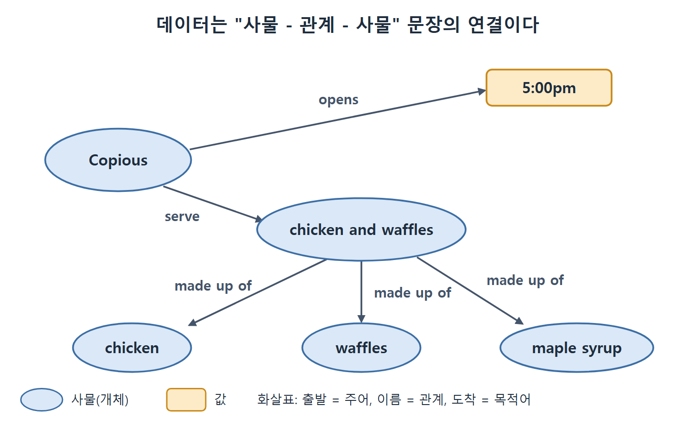

# 분산된 데이터 웹

이 문서는 시맨틱 웹의 핵심 아이디어인 "데이터 수준의 분산 웹"을 설명한다. 하이퍼텍스트 웹이 페이지끼리 링크를 걸었다면, 시맨틱 웹은 데이터 항목끼리 같은 방식으로 링크를 건다. 이 아이디어가 앞 문서의 사례들을 어떻게 풀어 주는지, 그리고 왜 "데이터베이스를 웹에 올리면 끝"이 아닌지를 정리한다.

URL과 URI의 관계, 데이터가 "한 사물과 다른 사물을 잇는 문장"이라는 시각, 기업 내부 데이터도 분산 자원으로 볼 수 있다는 점이 이 문서의 요점이다.

---

## 1. 사람을 위한 표현에서 기계 사이의 교환으로

식당 예로 돌아가 보자. 영업시간, 오늘의 메뉴, 휴일 휴무가 사람 눈으로 읽게 올라 있었기 때문에 자동 비서는 읽지 못했다. 한 가지 해법은 웹 페이지를 읽고 영업시간을 알아내는 정교한 알고리즘을 만드는 것이다. 하지만 영업시간을 아는 사람은 식당 주인이고, 주인은 손님이 정확한 시간을 찾기를 바란다. 왜 주인이 제3자의 해석에 의존해야 하는가.

| 주체 | 원하는 것 | 제3자에 맡기면 생기는 불편 |
|---|---|---|
| 식당 주인 | 손님이 정확한 영업시간을 찾는 것 | 해석 알고리즘이 틀리면 부정확해진다 |
| 논문 저자 | 해당 화합물에 관심 있는 연구자와 연결되는 것 | 누군가 중간에서 연결해 주기를 기다려야 한다 |
| 은행 | 상품 조건을 파트너, 고객, 규제 기관에 분명하게 전달하는 것 | 조건이 모호하게 전달된다 |
| IAU | 천문학계에 관측과 분류 소식을 알리는 것(IAU의 설립 목적) | 소식이 각자 해석되어 퍼진다 |
| 치과 | 환자가 자기 병원을 찾는 것 | 분류 방식의 차이로 못 찾는다 |

표의 모든 행에서 데이터 제공자는 자기 이야기를 직접, 정확하게 전하고 싶어 한다. 이것이 공통된 이해관계다.

이 흐름을 한 문장으로 줄이면, 특정 청중에게 보여 주는 표현(사람이 해석해야 하는 것)에서 기계끼리 주고받는 데이터 교환으로 옮겨 가는 것이다. 사람의 직관에만 해석을 맡기지 않고 중간에서 만난다. 데이터 제공자가 소비하기 쉽게 만들어 주고, 사람 사용자와 기계 응용 프로그램은 제공자와 협력한다. 공유하려는 욕구를 이용해 소비하기 쉽게 만드는 셈이다.

각 데이터 출처를 "한 사람에게 하나를 전하는 한 점"이 아니라, 서로 연결된 데이터 네트워크의 여러 용도로 쓰이는 일부로 본다는 점이 중요하다.

## 2. 하이퍼텍스트 웹에서 데이터 웹으로

기존 웹 구조는 하이퍼텍스트 페이지가 URL(Uniform Resource Locator)이라는 전역 링크로 서로를 가리키는 분산 네트워크를 지원한다. 웹 구조는 이 개념을 URI(Uniform Resource Identifier)로 일반화해서 하이퍼텍스트 웹 밖의 맥락에서도 쓸 수 있게 했다.

| 용어 | 뜻 | 용도 |
|---|---|---|
| URL | 웹 위의 자원을 찾는 주소 | 페이지가 서로를 가리키는 전역 링크 |
| URI | URL을 일반화한 식별자 | 하이퍼텍스트 웹 밖의 대상까지 가리킨다 |

시맨틱 웹의 중심 아이디어는 프레젠테이션 수준이 아니라 데이터 수준에서 분산 웹을 지원하는 것이다. 웹 페이지 하나가 다른 페이지를 가리키는 대신, 데이터 항목 하나가 다른 데이터 항목을 가리킨다. 웹이 이미 쓰는 같은 전역 참조 방식, 곧 URI를 쓴다.

그래서 Mongotel이 호텔과 위치 정보를 공개하거나 Copious가 영업시간을 공개할 때, 사람이 읽기 좋게 보여 주는 것에 그치지 않고 분산 가능하고 기계가 읽을 수 있는 데이터 설명을 함께 내놓는다.

## 3. "데이터를 웹에 올리면 되지 않나"

처음 보면 분산 데이터는 쉬워 보인다. 데이터베이스를 웹 곳곳에 두면 된다는 생각이다(웹 위의 데이터). 그러나 이것이 진짜 분산된 데이터의 웹으로 작동하려면, 다양한 세상에서 여러 이해 당사자가 데이터를 공유할 때 어떤 일이 벌어지는지 이해해야 한다.

- 출처마다 의견이 일치할 수도, 갈릴 수도 있다.
- 여러 출처의 데이터를 합쳐서 한 주제에 대한 통찰을 더 얻을 수도 있다.

하이퍼텍스트 웹이 문서의 가용성에 대한 생각을 바꾼 것처럼, 시맨틱 웹은 데이터에 대한 근본적으로 다른 사고방식이다.

### 회사 안에서도 같은 문제다

한 회사 내부의 데이터도 분산 자원이다. 사업부마다 다른 데이터베이스를 쓰고, 합병이나 인수로 들어온 부문의 데이터베이스도 있다. 이런 데이터베이스들은 웹 곳곳의 출처만큼 서로 이질적일 수 있다. 분산 데이터란 데이터가 여러 이해 당사자에게서 온다는 뜻이고, 이 데이터를 의미 있게 합치는 방법을 알아야 한다.

| 분산 데이터가 생기는 곳 | 예 |
|---|---|
| 웹 전체 | 호텔, 식당, 연구소가 각자 올리는 데이터 |
| 한 회사 안 | 사업부별 데이터베이스, 합병·인수로 들어온 데이터베이스 |

두 행의 처방은 같다. 출처가 달라도 의미 있게 합치는 방법이 필요하다.

## 4. 데이터는 "사물과 사물을 잇는 문장"이다

넓게 보면 데이터는 어떤 방식으로 한 사물을 다른 사물과 연결하는 진술이다. 책은 Copious를 예로 든다.

| 진술에서의 역할 | Copious 예 | 설명 |
|---|---|---|
| 어떤 것 | Copious | 한 사물 |
| 다른 것과 관계 맺는 방식 | opens(문을 연다) | 관계 |
| 다른 것(이번에는 값) | 5:00pm | 값 |
| 또 다른 관계 | serve(내놓는다) | 관계 |
| 다른 것(이번에는 요리) | chicken and waffles | 요리 |
| 또 다른 관계 | made up of(~로 이루어진다) | 관계 |
| 다른 것들 | chicken, waffles, maple syrup 등 | 이름에는 없는 재료도 포함 |

표를 보면 "사물 - 관계 - 사물(또는 값)" 세 칸이 반복되고, 한 문장의 끝이 다음 문장의 시작이 되어 이어진다. 이 세 칸짜리 문장이 나중에 트리플(주어·서술어·목적어 세 쌍으로 이루어진 문장 하나)이라 부르는 단위다. 책 본문은 이 문장 구조를 말로 풀어 쓸 뿐이다. 표로 정리하고 트리플과 잇는 것은 독자의 이해를 돕기 위한 이 노트의 해설이다.

위 그림은 표의 Copious 예를 그래프로 그린 것이다. 원은 사물, 사각형은 값이고, 이름 붙은 화살표가 "출발점(주어) - 관계 - 도착점(목적어)" 문장 하나를 이룬다. 한 문장의 끝(chicken and waffles)이 다음 문장의 시작이 되어 이어진다.

이런 사물들은 분산 데이터 웹의 어느 출처에서든 표현할 수 있다. 분산 데이터 웹을 나타내는 시맨틱 웹의 데이터 모델이 RDF(Resource Description Framework)이고, 3장의 주제다.

## 5. 한눈에 정리

| 비교 항목 | 하이퍼텍스트 웹 | 시맨틱 웹 |
|---|---|---|
| 링크가 이어 주는 것 | 페이지와 페이지 | 데이터 항목과 데이터 항목 |
| 링크의 방식 | URL | URI |
| 주 독자 | 사람 | 사람과 기계 |
| 공개하는 것 | 사람이 읽는 표현 | 분산 가능하고 기계가 읽는 데이터 설명 |

표를 읽는 법은 간단하다. 시맨틱 웹은 웹을 새로 만드는 것이 아니라, 웹이 이미 쓰는 링크 방식을 데이터 수준으로 한 단계 내리는 것이다.

 
 
 

[Semantic Web for the Working Ontologist](../)
