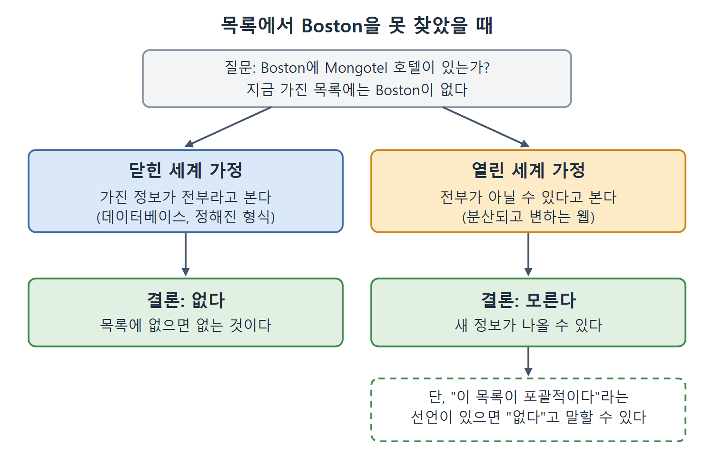

# 열린 세계 가정과 여러 이름

이 문서는 분산된 웹에서 결론을 낼 때 생기는 미묘하지만 깊은 문제, 곧 열린 세계 가정(Open World Assumption)을 설명한다. 이어서 시맨틱 웹이 여러 이름으로 불리는 이유를 이름별 강조점으로 정리한다.

열린 세계 가정은 "지금까지 본 것이 전부가 아닐 수 있다"는 태도다. 평소 데이터베이스에 익숙한 개발자는 반대의 태도, 곧 "없으면 없는 것"에 익숙하다. 두 태도의 차이를 비교표로 잡아 두면 이후 OWL 장이 훨씬 쉬워진다.

---

## 1. "항상 하나가 더 있다"

분산된 정보 네트워크에서는 원칙적으로 네트워크의 모든 정보를 봤다고 가정할 수 없다. 한 주제에 대해 단언된 모든 것을 안다고도 가정할 수 없다. Pluto와 UB313의 역사가 이를 보여 준다.

오랫동안 행성은 "태양을 도는 일정 크기의 천체"로 정의하면 충분했다. 그 시기 가용한 정보로는 태양 주위에 행성이 아홉 개라고 말하기 쉬웠다. 하지만 UB313에 대한 새 정보가 그것을 바꿨다. 행성이 태양을 도는 일정 크기의 천체라면 UB313도 행성으로 봐야 했다. 20세기 후반의 신중한 화자는 "알려진(known)" 행성이라고 말했는데, 또 다른 행성이 가능하고 심지어 있을 것으로 의심된다는 것을 알았기 때문이다. 알려지지 않았지만 있을 것으로 짐작되던 행성을 오랫동안 대신 가리킨 이름이 "Planet X"다.

시맨틱 웹도 같은 상황이다.

- 천문학에서처럼 언제든 새 정보가 발견될 수 있다.
- 웹이 네트워크이므로 어떤 순간 특정한 정보를 가진 서버가 사용 불가일 수도 있다.

그래서 시맨틱 웹에서는 "행성이 아홉 개다" 같은 결론을 내리기가 어렵다. 어떤 새 정보가 나올지 모르기 때문이다.

## 2. 열린 세계 가정

웹의 이 면모는 미묘하지만 깊은 영향을 준다. 우리는 웹을 열린 세계(Open World)로 보고 열린 세계 가정으로 다뤄야 한다. 이 의미의 열린 세계란, 언제든 새 정보가 나올 수 있다고 가정해야 하고, 어느 한 시점에 가진 정보가 가능한 정보의 전부라고 가정하는 데 기대는 결론은 내릴 수 없는 세계다.

### 영향이 없는 경우와 있는 경우

| 구분 | 예 | 영향 |
|---|---|---|
| 영향 없음 | Boston의 Mongotel 호텔을 전부 지도에 그린다 | 지금 아는 호텔을 그린 지도가 된다. 더 있을 수 있거나 새로 열려도 이미 나열된 호텔의 존재가 틀리게 되지는 않는다. |
| 영향 있음 | Mongotel이 서비스하지 않는 도시 목록에 Boston을 넣는다(신규 입점지 시장 조사의 일부로) | Boston에서 Mongotel 목록을 찾지 못했다고 해서 호텔이 없다고 가정할 수 없다. |

많은 시맨틱 웹 응용에서는 열린 세계 가정을 무시해도 되고, 응용이 다른 웹 페이지처럼 어느 한 시점에 접근한 정보를 보고할 뿐이라고 이해하면 된다. 열린 세계가 문제가 되는 때는 분산 데이터에 기반해 결론을 내려고 할 때뿐이다. 특히 "없다"는 결론이 그렇다.

### 현실 세계의 대처법을 그대로 가져온다

시맨틱 웹에는 현실에서 열린 세계를 다루는 모든 방법에 대응하는 기능이 있고, 이후 장에서 다룬다.

| 현실의 대처 | 시맨틱 웹의 대응 |
|---|---|
| 어떤 목록이 Mongotel 전부를 나열한 포괄 목록이라고 선언하면 빠진 Mongotel에 대해 결론을 낼 수 있다 | 목록이 완전하다는 것을 명시해 결론을 가능하게 한다 |
| 알려지지 않았지만 예상되는 개체를 "Planet X"처럼 익명으로 둔다 | 익명 개체로 알려지지 않은 개체를 대신한다 |

이 기법들로 사람의 지식이라는 열린 세계에서처럼 시맨틱 웹에서도 열린 세계 가정에 대처한다.

## 3. 닫힌 세계 가정과의 비교

반대로 대부분의 데이터 시스템은 닫힌 세계 가정(Closed World Assumption) 아래에서 동작한다. 문서나 레코드에 데이터가 빠져 있다면 그 데이터는 그냥 가용하지 않은 것이다. 정해진 형식이 있는 문서나 특정 데이터베이스 스키마를 따르는 레코드를 평가할 때처럼 많은 상황에서 닫힌 세계 가정이 적절하다. 시맨틱 웹 표준에는 닫힌 세계 가정이 적절할 때 이를 쓰는 장치도 마련되어 있다.

| 비교 항목 | 열린 세계 가정 | 닫힌 세계 가정 |
|---|---|---|
| 데이터가 없을 때 | 모르는 것이다. 새 정보가 나올 수 있다 | 없는 것이다 |
| 현재 가진 정보 | 전부라고 가정하지 않는다 | 전부라고 가정한다 |
| 적합한 상황 | 분산되고 계속 변하는 웹 | 정해진 형식의 문서, 데이터베이스 스키마를 따르는 레코드 |
| "Boston에 Mongotel이 없다"는 결론 | 목록이 포괄적이라는 선언이 없으면 낼 수 없다 | 목록에 없으면 없다고 결론 낸다 |
| 시맨틱 웹 표준의 입장 | 기본 | 적절할 때 쓰도록 제공 |

같은 상황, 곧 목록에서 Boston을 찾지 못했을 때 두 가정이 어떻게 다른 결론에 이르는지 나란히 그린 그림이다. 닫힌 세계는 "없다"로 끝나고, 열린 세계는 "모른다"에서 멈추며 포괄 목록 선언이 있을 때만 "없다"로 나아간다.

표의 마지막 두 행이 이 장의 실무적 결론이다. 시맨틱 웹의 기본은 열린 세계지만, 닫힌 세계가 맞는 일에는 그것을 쓰는 방법도 갖췄다. 표의 네 번째 행 "목록에 없으면 없다"는 닫힌 세계의 전형적 추론을 풀어 쓴 것으로, 책이 직접 쓴 문장이 아니고 이 노트가 앞의 Mongotel 예에 맞춰 정리한 것이다.

## 4. 시맨틱 웹의 "비고유한 이름"

시맨틱 웹과 링크드 데이터를 처음 접할 때 겪는 어려움이 있다. 웹의 이 진화가 서로 다른 이름으로 인식되고 소개되며, 각 이름은 전체 구조의 서로 다른 측면을 강조한다는 점이다. 책 제목은 데이터 공유에서 의미(meaning)의 중요성을 강조하려고 "시맨틱 웹"이라는 이름을 쓴다. 이 이름 자체가 비고유 이름의 예인 셈이다.

| 이름 | 강조하는 것 |
|---|---|
| 시맨틱 웹(Semantic Web) | 데이터 모델, 스키마, 어휘와 그에 딸린 의미를 데이터셋과 함께 교환할 수 있다는 점. 이를 통해 데이터에 수행할 수 있는 자동 처리의 범위를 넓힌다(7장에서 본다). |
| 데이터의 웹(Web of data) | 개인 호텔 목록 같은 작은 데이터셋부터 거대한 천문 데이터베이스까지 모든 크기의 데이터 사일로(silo)를 열고, 필요에 따라 웹에서 교환, 연결, 결합할 수 있다는 기회 |
| 링크드 데이터(linked data) | 웹 주소 지정과 링크 기능으로 데이터셋 안과 데이터셋 사이의 데이터 조각을 연결할 수 있다는 점. 하이퍼텍스트 웹에서 웹 페이지를 참조하고 연결하는 것과 비슷하다. 구조화된 데이터라서 응용이 링크를 따라가 새 데이터를 더 자동화된 방식으로 발견할 수 있다. |
| 링크드 오픈 데이터(linked open data) | 웹의 공개 데이터를 응용에서 활용하는 기회와, URI를 쓰고 재사용해 여러 출처의 진술을 잇는 큰 이득. 링크드 데이터가 반드시 공개일 필요는 없고, 소개하는 모든 기법을 사설 공간(인트라넷, 인트라웹, 엑스트라넷 등)에서도 쓸 수 있음을 상기시킨다. |
| 지식 그래프(Knowledge Graph) | 기업에서 흔히 쓰는 이름. 그 기업에 특화된 것이지만, 거래하는 다른 기업에 대한 정보를 포함해 기업이 추적해야 하는 모든 정보를 담을 수 있다. |

이름이 달라도 같은 기술을 서로 다른 각도에서 부르는 것이다. 표의 "강조하는 것" 열을 읽으면 각 이름이 어느 면을 보는지 구별된다.

 
 
 

[Semantic Web for the Working Ontologist](../)
