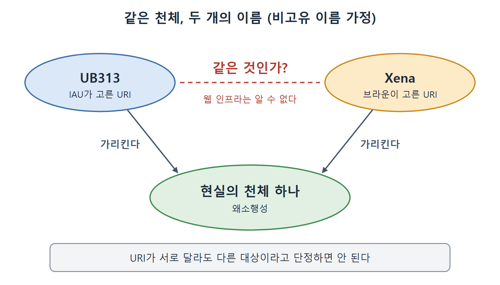

# 의견 충돌과 이름 문제

이 문서는 AAA 슬로건의 결과로 따라오는 두 가지 문제를 다룬다. 첫째는 웹의 정보가 서로 어긋날 수 있다는 점이고, 둘째는 같은 대상을 사람마다 다른 이름으로 부른다는 점이다. 책은 둘 다 명왕성(Pluto)의 지위 변화 사례로 설명한다.

시맨틱 웹이 모두를 한 가지 용어에 동의시키는 프로젝트가 아니라, 동의하지 않는 세상에서도 어느 정도 상호 운용성을 얻으려는 프로젝트라는 점이 이 문서의 결론이다.

---

## 1. 열린 시스템의 대가: 의견은 갈린다

네트워크 효과가 일어나려면 웹 정보의 폭넓은 차이를 감당할 준비가 되어 있어야 한다. 어떤 차이는 대체로 합의된 영역의 사소한 세부일 수 있고, 어떤 차이는 사회의 정치·문화 담론을 이끄는 본질적 불일치일 수 있다. 하이퍼텍스트 웹에서 이미 분명히 보이는 현상이다. 거의 모든 주제에서 상반된 의견을 담은 페이지를 찾을 수 있다.

의견이 갈릴 수 있다는 것, 그것도 여러 수준에서 갈릴 수 있다는 것은 인간 담론의 필수 요소이고 웹이 성공한 핵심 요인이다. 누군가는 아주 이상한 의견을 내놓고 싶을 수 있다. 세상이 둥글다고 하는 쪽과 평평하다고 우기는 쪽이 있을 수도 있다. 웹 인프라는 이 상충하는 두 의견이 똑같이 접근 가능하게 허용해야 한다. 책은 이 대목의 소제목을 "What about the round-worlders?(둥근 지구론자는 어떻게 하나?)"로 달았다.

## 2. 의견이 어긋나는 네 가지 이유

책은 웹에서 두 화자가 어긋날 수 있는 방식을 Pluto의 행성 지위로 설명한다.

| 이유 | 설명 | Pluto 예 |
|---|---|---|
| 근본적으로 의견이 다르다 | 주제 자체에 대한 입장이 다르다. | IAU는 행성 정의를 바꿔 Pluto를 뺐지만, 모든 천문 동호회나 국가 기관이 이 분류에 동의하는 것은 아니다. 특히 Pluto를 행성으로 보는 데 이해관계가 있는 많은 점성술사는 계속 행성으로 본다. 이 경우 출처들은 그냥 의견이 다르다. |
| 일부러 속이려 한다 | 의도적인 기만이다. | 아홉 개 행성을 그린 포스터나 모형을 파는 사람은 IAU의 결과를 늦게 알리거나 상황에 대한 불확실성을 퍼뜨릴 이유가 있다. |
| 단순히 틀렸다 | 사람이 만들고 관리하므로 오류가 있다. | 어떤 사이트는 Pluto를 행성으로 잘못 올리거나, 여덟 개 "비왜소" 행성 중 하나를 빠뜨릴 수도 있다. |
| 정보가 낡았다 | 갱신되지 않았다. | 세계 곳곳의 태양계 축척 모형 전시는 행성 지위가 말 그대로 돌에 새겨져 있어서, 아홉 번째 천체의 설명을 새로 새길 예산이 생길 때까지 Pluto를 행성으로 계속 올려 둔다. 웹 사이트는 돌에 새겨져 있지 않지만 갱신에는 노력이 들고, 모두가 서둘러 하지는 않는다. |

표에서 중요한 점은 이유가 달라도 결과는 똑같이 "서로 다른 진술"이라는 것이다. 일부 이유는 반갑지 않지만(거짓말을 못 하게 막을 수 있다면 좋겠지만), 기술적 관점에서는 이 이유들을 구별할 방법이 없다.

따라서 웹 인프라는 정보가 때때로 어긋난다는 사실을 감당해야 하고, 그것은 일시적인 상태가 아니다. 변이와 불일치는 웹의 본성이다. 숫자 데이터에서도 마찬가지다. 예컨대 분쟁의 사상자 수는 관련 당사자마다 전혀 다른 값으로 데이터 웹에 올라올 수 있다.

### 시맨틱 웹의 목표에 대한 오해

시맨틱 웹은 종종 모두가 하나의 온톨로지, 곧 한 가지 용어 집합에 동의하게 하는 노력으로 오해받는다. 하지만 웹은 그렇게 돌아가지 않는다. 시맨틱 웹은 모두를 합의시키는 것이 아니라, 모두가 동의하지는 않는 세상에서 버티면서 그래도 어느 정도의 상호 운용성(interoperability)을 이루는 것이다.

| 흔한 오해 | 실제 목표 |
|---|---|
| 모두가 하나의 온톨로지에 합의하게 한다 | 합의하지 않는 세상에서 대처한다 |
| 불일치는 해소되어야 할 일시적 상태다 | 불일치는 웹의 본성이며 계속된다 |
| 온톨로지와 진술은 하나로 수렴한다 | 온톨로지와 엇갈린 진술은 언제나 여럿 있다 |

웹 페이지가 한 주제에 대해 항상 여러 개 있듯이 온톨로지도 항상 여러 개 있을 것이다. 웹이 이전의 어떤 것과도 다르고 그토록 성공한 이유 중 하나가 처음부터 이 여러 관점이 공존하도록 허용했다는 점이다.

## 3. 서로 다른 의견을 어떻게 지원하는가

웹 구조는 이런 의견 차이를 어떻게 지원할까. 두 사람이 같은 주제에 서로 다른 말을 하려면 어떻게 해야 할까. 접근은 두 가지인데, 먼저 웹 맥락에서 진술을 하나라도 하려면 어떻게 해야 하는지부터 얘기해야 한다.

IAU는 "Pluto는 왜소행성이다"라고 영어로 말할 수 있다. 하지만 자연어 진술에는 모호함과 문맥 의존성이 따라붙는다. "Pluto"가 무엇을 가리키는지는 안다고 생각하지만, "dwarf planet"은 어떨까. 누군가 "dwarf planet"의 정의에 이견을 낼 가능성은 없을까. 이런 것을 논의하기나 할 수 있을까.

전역 웹에서 진술하기 위한 첫 요구 사항은 말하려는 대상을 식별하는 전역적 방법이다. "IAU가 쓰는 의미의 Pluto"와 "미국점성술연맹(American Federation of Astrologers)이 쓰는 의미의 Pluto"를 따로 가리킬 수 있어야, 두 조직이 이 이름으로 같은 것을 말하는지를 논의할 수 있다.

## 4. 같은 천체, 두 이름: UB313과 Xena

Pluto 말고도 "왜소행성"으로 분류된 천체가 하나 있다. UB313이라고도, Xena라고도 불리는 천체다. IAU가 UB313이라 부르는 천체가 발견자 마이클 브라운(Michael Brown)이 "Xena"라고 부르는 천체와 같다는 것을 어떻게 말할 수 있을까.

한 가지 방법은 이름의 전역 중재자가 천체를 가리키는 이름을 정해 주는 것이다. 그러면 브라운과 IAU 모두 그 "공식" 이름을 참조하고, 자기 이름은 사적인 "별명"이라고 말하면 된다. IAU 자체가 그 중재 기관의 좋은 후보이지만, 이 천체의 이름을 정하는 데에만 2년 넘게 걸렸다. 합의된 좋은 전역 이름을 만드는 일은 쉽지 않다.

## 5. 웹에서 이름 붙이기: URI

웹에서는 URI로 이름을 붙인다. URI 표준은 주변의 무엇에든 식별자를 만들어 내는 규칙을 제공한다. 가장 흔한 URI 형태는 웹 주소라고 부르는 URL이고, 웹 위의 특정 자원의 위치를 가리킨다(예: http://www.inria.fr/).

합의가 없으면 웹 저자마다 같은 현실 세계 자원에 다른 URI를 고른다. 브라운의 Xena는 IAU의 UB313이다. 이 서로 다른 출처의 정보가 분산 데이터 네트워크에서 합쳐질 때, 웹 인프라는 이 둘을 같은 개체로 다뤄야 한다는 것을 알 방법이 없다.

그림은 IAU의 UB313과 브라운의 Xena가 서로 다른 URI이면서 현실의 천체 하나를 가리키는 상황을 보여 준다. 웹 인프라는 두 이름이 같은 것인지 스스로 알 수 없으므로, URI가 다르다는 이유만으로 다른 대상이라고 단정해서는 안 된다.

이것의 이면이 있다. 두 URI가 서로 다르다고 해서 서로 다른 자원을 가리킨다고 가정할 수 없다. 시맨틱 웹의 이 특성을 비고유 이름 가정(Nonunique Naming Assumption)이라 한다. 다른 말이 있기 전까지는, 어떤 웹 자원이 사람마다 다른 이름으로 불릴 수 있다고 가정해야 한다는 것이다.

또 하나 중요한 점은 유일한 이름이 있으면 좋겠지만 불가능할 때가 있다는 것이다. 예컨대 IAU가 아닌 다른 조직은 새 명명법을 받아들이지 않기로 결정할 수 있다.

| 상황 | 결과 |
|---|---|
| 합의된 이름이 없다 | 저자마다 같은 자원에 다른 URI를 고른다 |
| 서로 다른 URI가 합쳐진다 | 웹 인프라는 같은 개체인지 알지 못한다 |
| URI가 다르다 | 다른 자원이라고 가정하면 안 된다 |
| 유일한 이름이 불가능한 경우 | 다른 조직이 새 명명법을 거부할 수 있다 |

표를 아래로 읽으면 "합의 없음 → 이름 중복 → 같음 여부 불명 → 그래서 URI가 다르다고 다른 것으로 단정할 수 없다"로 이어진다. 이 가정은 데이터를 합칠 때 "같은 것"을 따로 선언해야 한다는 사실로 이어지며, 그 방법은 이후 장에서 다룬다.

 
 
 

[Semantic Web for the Working Ontologist](../)
