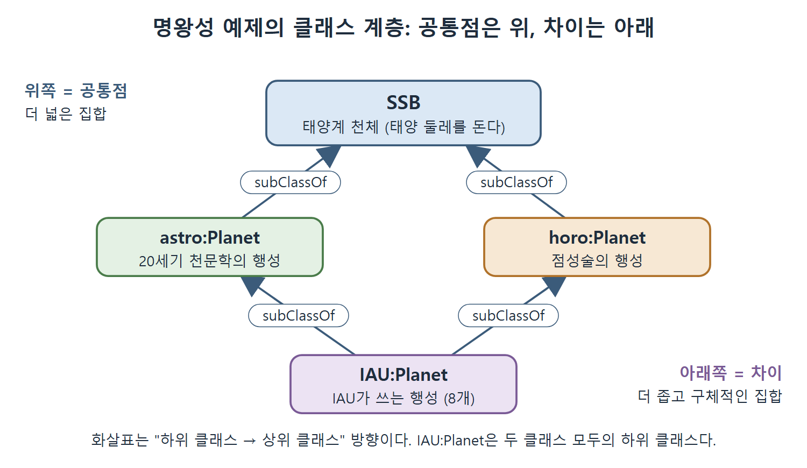
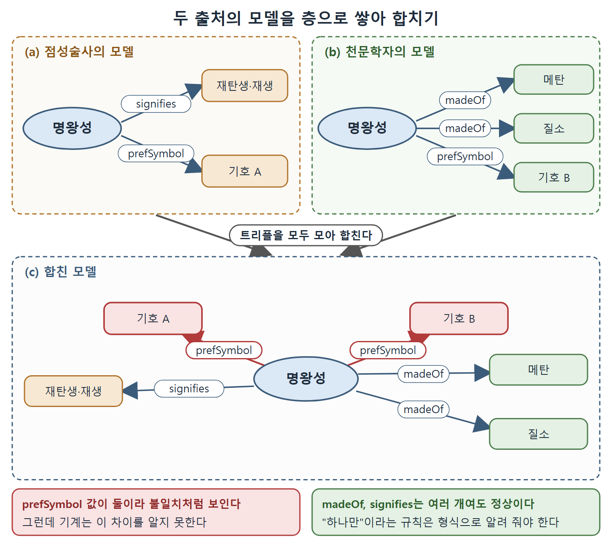

# 다양한 관점 조율하기

웹에서는 의견이 다양한 것이 정상이고 오히려 환영받는다. 네트워크 효과는 여러 의견을 표현할 수 있어야 생기기 때문이다. 좋은 모델은 공통된 부분은 함께 표현하고 서로 다른 부분도 따로 표현하도록 의견들을 정리해 준다. 이 문서는 명왕성 사례를 따라가며 세 가지 방법, 즉 한 입장만 허용하기, 각자 따로 두기, 모델로 조율하기를 비교한 뒤 클래스 계층과 층 쌓기 방식을 설명한다.

---

## 1. 명왕성 사례

명왕성은 1930년부터 2006년까지 천문학자와 점성술사 모두에게 행성이었다. 2006년 IAU(국제천문연맹)가 행성의 정의를 바꾸자, IAU와 IAU를 권위로 인정하는 천문학자들에게 명왕성은 행성이 아니라 더 정확히는 왜소행성이 되었다. 하지만 점성술사들은 IAU의 규칙을 채택하지 않고 계속 행성으로 본다. 일부 아마추어 천문가들도 주로 향수 때문에 계속 행성으로 본다. 이 모든 의견 차이를 웹에서 어떻게 수용할까 하는 것이 질문이다.

---

## 2. 세 가지 접근 비교

| 접근 | 방식 | 어디서 쓰이나 | 문제점 |
|---|---|---|---|
| 하나만 허용 | "선호"하는 입장을 정하고 나머지는 막는다 | 기업 데이터센터. 소수 또는 한 명의 DB 관리자가 어떤 데이터를 넣을지 결정 | AAA 슬로건(누구나 어떤 주제든 무엇이든 말할 수 있다)을 막아 네트워크 효과가 생기지 않는다 |
| 각자 따로 | 서로 참조 없이 각 관점을 따로 표현하고 소비자가 연결한다 | 지금의 하이퍼텍스트 웹 | 공통 개념(행성, 태양계, 명왕성 자체)을 파악하는 일이 전적으로 독자의 해석에 달린다 |
| 모델로 조율 | 식별 장치와 각 관점의 표현을 함께 제공 | 시맨틱 웹 | 이 문서의 나머지 부분에서 설명 |

지금의 웹에서 명왕성을 검색하면 행성이라는 글(점성술이나 갱신되지 않은 천문학 글), 왜소행성이라는 글(IAU 공식 사이트), 아직 논쟁 중인 글이 섞여 나온다. 이들에 공통된 것을 알아채는 일은 읽는 사람의 몫이다. 모델이 이를 정리하려면 먼저 이름 붙이기와 설명을 분리하는 식별 장치(예를 들어 URI)가 있어야 하고, 서로 다른 관점이 각각 표현될 수 있어야 한다.

---

## 3. 차이와 클래스

이 문제는 새롭지 않다. 소프트웨어 공학에서는 오래된 문제다. 소프트웨어 컴포넌트를 설계할 때는 어떤 기능을 제공해야 하고, 그 동작은 실행 시점에 받는 정보로 결정된다. 여기에 절충이 있다. 다양한 상황에서 동작하게 만들면 동작 방식을 설명하는 입력이 복잡해지고, 입력을 단순하게 하면 아주 한정된 상황에서만 쓸모가 있다. 컴포넌트 설계에는 배치될 환경의 공통점과 가변성에 대한 모델이 본질적으로 들어 있다. 이를 정리하려고 소프트웨어 방법론은 객체 지향 프로그래밍(OOP)의 객체 모델링 기술을 발전시켰다.

OOP의 대표 정리 도구는 클래스와 하위 클래스의 계층이다. 계층의 위쪽 클래스는 많은 컴포넌트에 공통인 기능을, 아래쪽 클래스는 더 구체적인 기능을 나타낸다. 시맨틱 웹 표준도 공통점과 가변성을 나타내려고 이 계층을 쓴다. 다만 시맨틱 웹은 OOP처럼 소프트웨어를 표현하는 데 초점이 없으므로 클래스를 행동이나 함수로 정의하지 않는다. 그래도 클래스와 하위 클래스라는 개념은 거의 같은 역할을 한다. 높은 수준의 클래스는 아주 다양한 개체의 공통점을, 낮은 수준의 클래스는 작고 구체적인 집합의 공통점을 나타낸다.

### IAU의 행성 정의

2006년 IAU 정의는 천체가 행성이 되려면 세 조건이 모두 필요하다고 못 박는다.

| 번호 | 조건 |
|---|---|
| 1 | 태양 둘레를 공전한다 |
| 2 | 거의 둥글 만큼 질량이 충분하다 |
| 3 | 자기 궤도 주변의 천체를 정리했다 |

IAU는 더 나아가 1, 2번만 만족하고 3번은 만족하지 않는 천체를 왜소행성, 1번만 만족하는 천체를 태양계 소천체(SSSB)로 정한다. 이 정의에서 분명해지는 점이 있다. SSSB, 왜소행성, 행성은 서로 배타적이라서 어떤 천체도 둘 이상의 클래스에 속하지 않는다. 그러나 이들 모두에 공통점이 하나 있다. 모두 태양 둘레를 돈다는 것이다.

| 클래스 | 만족 조건 | 비고 |
|---|---|---|
| 행성 | 1, 2, 3 | 모두 만족 |
| 왜소행성 | 1, 2 (3은 아님) | |
| 태양계 소천체(SSSB) | 1만 | |

### 여러 용법을 구분하는 이름 붙이기

20세기 천문학과 점성술은 이렇게 엄밀한 정의가 없었다. 이를 21세기의 행성 개념과 어떻게 연결할지가 문제다. 먼저 "행성"이라는 단어의 여러 용법, 즉 IAU의 용법, 점성술의 용법, 20세기 천문학의 용법을 따로 가리킬 방법이 필요하다. 간단해 보이지만 이것이 갖춰져야 용어 사이의 관계를 이야기할 수 있다. 시맨틱 웹의 해법은 3장에서 보고, 여기서는 출처의 짧은 약자를 접두어로 붙인다.

| 접두어 이름 | 의미 |
|---|---|
| IAU:Planet | IAU가 쓰는 행성 |
| horo:Planet | 점성술의 행성 |
| astro:Planet | 20세기 천문학의 행성 |

세 개념의 공통점은 태양 둘레를 돈다는 점이다. 그래서 태양 둘레를 도는 것의 클래스를 정하고 태양계 천체(solar system body), 줄여서 SSB라고 부르자. 세 개념은 모두 SSB의 하위 클래스다(원서의 그림 2.1).

더 나아가면, IAU 행성은 여덟 개뿐이고 각각 horo:Planet이기도 하고 astro:Planet이기도 하다. 그러므로 IAU:Planet은 horo:Planet과 astro:Planet 둘 모두의 하위 클래스다(그림 2.2). 같은 식으로 IAU:DwarfPlanet과 IAU:SSSB까지 관계를 이어 갈 수 있다.

```
SSB
 ├─ astro:Planet
 │    └─ IAU:Planet
 └─ horo:Planet
      └─ IAU:Planet
```

위 트리는 원서의 그림을 글로 옮긴 간단한 스케치다. IAU:Planet이 두 곳에 나오는 것은 두 클래스 모두의 하위 클래스라는 뜻이다. 아래로 내려갈수록 각 클래스는 더 좁은 개체 집합을 가리킨다. 이렇게 공통점은 위쪽(높은 수준)에서, 차이는 아래쪽(낮은 수준)에서 존중하면서 모델링한다.



SSB 아래에 astro:Planet과 horo:Planet이 놓이고, IAU:Planet이 이 둘의 하위 클래스로 이어지는 구조를 화살표로 보여 준다. 위쪽은 공통점(태양 둘레를 돈다), 아래쪽은 차이를 나타낸다.

---

## 4. 차이와 층

클래스와 하위 클래스는 모델링 대상 사이에 단순하고 알려진 관계가 있어서 클래스의 명확한 순서를 정할 수 있을 때 잘 맞는다. 하지만 웹에서는 대개 그렇지 않다. 기여자마다 새로 할 말이 있고, 그것이 이전 진술과 어울리는 방식도 가지각색이다. 설명 대상을 클래스 모델로 구조화할 수 없는데 출처의 다양성을 어떻게 수용할지가 문제다.

시맨틱 웹의 해법은 우아하다. 모델이 여러 출처의 기여로 쌓일 수 있다는 것이다. 모델이 층으로 이루어진다고 생각하면 된다. 층마다 출처가 다르고, 전체 모델은 모든 층을 합쳐 하나로 본 것이다. Git에서 여러 사람의 커밋을 합쳐 하나의 트리로 보는 것과 닮았다.

### 명왕성의 층

원서의 그림 2.3이 보여 주는 것은 다음과 같다.

| 부분 | 출처 | 담긴 내용 |
|---|---|---|
| (a) | 점성술사 | 명왕성은 재탄생과 재생을 상징하고, 선호하는 기호(glyph)가 있다 |
| (b) | 천문학자 | 명왕성의 구성 성분(메탄, 질소)과 선호하는 기호 |
| (c) | 두 모델을 합친 것 | (a)와 (b)의 모든 정보 |

가장 단순하게 두 모델을 하나로 합치면 된다. 이렇게 합치는 일은 개념적으로 간단하고, 가변성에도 가장 단순한 방식으로 대응한다. 점성술사와 천문학자 모두 명왕성에 대해 할 말을 하게 해 주는 것이다(AAA 슬로건). 둘 다에 관심 있는 사람, 예를 들어 원소의 영적 의미를 찾는 사람에게는 정보가 하나로 통합된 전체로 보인다.



점성술사의 모델과 천문학자의 모델을 하나로 합치면 명왕성에 대한 모든 말이 한곳에 모인다. 이때 prefSymbol은 값이 둘로 보여 불일치처럼 보이지만, madeOf와 signifies는 여러 개여도 문제가 없다는 점을 색으로 구분했다.

### 합치기의 단점: 일관성 문제

그림 2.3(c)에는 서로 다른 기호 두 개가 각각 명왕성의 "선호" 기호라고 주장한다. 이름만 보면 SSB에는 선호 기호(prefSymbol)가 정확히 하나만 있어야 할 것 같으니 불일치로 보인다. 그런데 기계가 이를 어떻게 아는가. 기계에게 prefSymbol은 madeOf나 signifies 같은 다른 이름표와 똑같은 레이블일 뿐이다. 명왕성이 여러 화합물로 구성되거나 여러 영적 주제를 상징해도 불일치가 아닌 것은 누구나 안다. prefSymbol만 다르다는 점을 자연어 주석으로 따로 적어 두는 방법도 있지만, 그러면 기계는 여전히 모른다.

| 속성 이름 | 값이 여러 개여도 되는가 | 이유 |
|---|---|---|
| prefSymbol | 아니오(하나여야 할 것 같다) | 이름이 "선호 기호"이므로 하나라고 기대한다 |
| madeOf | 예 | 여러 화합물로 구성될 수 있다 |
| signifies | 예 | 여러 영적 주제를 상징할 수 있다 |

이 구분을 기계에게 충분히 형식적으로 알려 줄 수 있다면, 인프라는 이런 불일치를 찾아내고 경우에 따라 해결까지 할 수 있다. 이런 질문에 구체적으로 답하려고 모델을 시맨틱 웹에 게시하는 것이다. 둘 이상의 관점이 지식의 웹에서 만나면 시너지와 협력 이전에 중복, 불일치, 혼란이 먼저 나타나기 마련이다. 이 거친 단계를 웹의 인프라가 돕게 하려면 "대충 이렇게 맞춰질 것이다" 같은 비형식적인 감각으로는 부족하다.

---

## 5. 시맨틱 웹 모델링의 핵심

이것이 시맨틱 웹 모델링의 본질이다. 누구나 어떤 주제든 무엇이든 말할 수 있게 하는 인프라를 제공하는 데서 끝나지 않고, 그 결과 생기는 혼란을 공동체가 정리해 나가도록 인프라가 도와야 한다. 모델은 이미 알려진 공통점과 가변성을 표현하고 정리하는 틀(클래스와 하위 클래스 같은)을 줄 수 있다. 그런 정리가 이루어지기 전이라도, 어떤 것에 대해 어떤 종류의 말을 할 수 있는지를 서술하는 틀을 줄 수 있다. 명왕성의 기호에 합의하지 못해도, 선호 기호는 하나뿐이어야 한다는 점에는 합의할 수 있다.

| 도구 | 어떤 상황에 맞나 |
|---|---|
| 클래스 계층 | 대상 사이의 관계가 단순하고 순서가 분명할 때 |
| 층 쌓기(합치기) | 출처마다 말이 다르고 구조화가 어려울 때 |
| 속성에 대한 규칙(prefSymbol은 하나) | 어떤 말을 할 수 있는지 미리 정하고 불일치를 기계가 찾게 할 때 |

<br>
<br>
<br>

[Semantic Web for the Working Ontologist](../)
