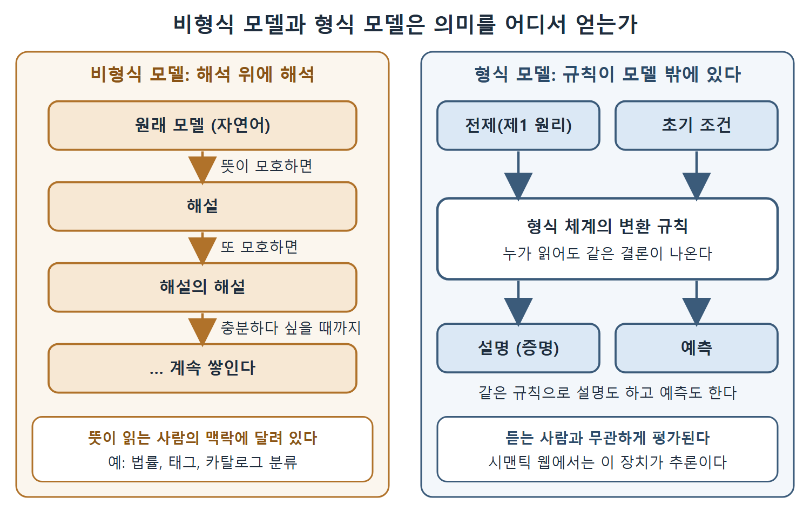

# 설명과 예측 그리고 형식 체계

모델의 두 번째 역할은 설명과 예측이다. 앞 문서의 소통용 모델은 사람의 해석에 기댔지만, 설명과 예측을 하려면 훨씬 엄밀한 모델이 필요하다. 이 문서는 설명이 왜 가치가 있는지, 형식 체계가 무엇인지, 형식 모델이 사회적으로 비형식 모델과 어떻게 다른지, 그리고 시맨틱 웹의 추론으로 이어지는 연결을 정리한다.

---

## 1. 설명이 주는 이점

모델은 설명의 형태로 사람의 생각을 정리한다. 어떤 현상이 더 기본적인 원리에서 어떻게 나오는지 이해하면 여러 이점이 생긴다.

- **이해했다는 확신.** 사람들은 어떤 개념을 이해하면 "감을 잡았다", "머리로 소화했다"고 말한다. 설명이 이런 이해에서 큰 역할을 한다.
- **기억에 도움.** 불붙은 냄비에 뚜껑을 덮으면 불이 꺼진다는 사실은, 불이 타려면 공기가 필요하다는 설명을 알면 훨씬 외우기 쉽다.
- **재사용.** 시맨틱 웹에서 가장 중요한 이점이다. 설명은 결론을 더 기본적인 원리에 연결하므로 모델의 전체나 일부를 다시 쓰기 쉬워진다. 냄비 뚜껑이 불을 끄는 이치를 알면 촛불 끄개가 어떻게 작동하는지도 이해할 수 있다.
- **신뢰와 의사 결정.** 해석할 수 있는 결과와 설명이 있어야 모델을 믿고 의사 결정에 쓸 수 있다. 결과를 해석하게 해 주고 왜 이 모델이 적합한지 설명해 주면 그 모델을 더 믿게 된다. 해석 가능성과 설명은 모델이 언제 적용되고 언제 적용되지 않는지 알게 해 주는 열쇠다.

---

## 2. 예측과 과학적 방법

설명과 가까운 개념이 예측이다. 모델이 현상을 충분히 설명하면 그 모델로 예측도 할 수 있다. 모델이 한 예측이 틀렸음을 보이는 반증이 탐구 방법의 바탕이기 때문에, 이 측면은 과학적 방법의 중심에 놓인다.

---

## 3. 형식 체계란 무엇인가

설명과 예측은 보통 사람 사이의 소통에 필요한 것보다 훨씬 형식적인 모델을 요구한다. 설명은 현상을 "제1 원리"에 연결한다. 이 원리와 원리들을 잇는 규칙은 소비자의 해석에 의존하지 않고, 소통의 바깥에 있는 객관적인 형태로 존재한다. 이런 객관적인 형태와, 그것이 작동하는 방식을 정하는 규칙을 형식 체계(formalism)라고 한다.

형식 모델의 대표가 수학적 모델이다. 계산과 기호 조작의 규칙이 아주 구체적으로 정해져 있어서, 모델의 구조와 한 항목이 다른 항목을 가리킬 수 있는 올바른 방법이 규칙으로 정해진다. 수학의 설명은 증명의 형태를 띤다. 어떤 형식 체계로 쓴 전제에서 결론까지, 그 체계의 엄격한 변환 규칙에 따라 한 단계씩 나아간다. 정밀성과 객관성이 필요한 지적 활동에는 어디서나 형식 모델이 쓰인다.

### 같은 규칙으로 예측도 한다

증명에서 쓰는 변환 규칙은 예측에도 그대로 쓸 수 있다. 창밖으로 던진 물체의 궤적은 힘, 중력, 속도, 질량의 형식 모델로 설명할 수 있다. 그리고 던진 순간의 초기 조건이 주어지면 같은 모델로 궤적을 계산해, 즉 예측할 수 있다.

### 듣는 사람과 무관한 평가

형식적 예측과 설명 덕분에 모델이 언제 적용되는지를 평가할 수 있고, 이 평가는 듣는 사람이 누구인지와 상관없다. 2 + 2 = 4라는 결과에 대해 2, 4, +, =가 무슨 뜻이냐고 따질 수는 있다. 하지만 뜻에 합의하고 나면 이 식이 맞다는 점을 (합리적으로는) 다툴 수 없다.

---

## 4. 형식 모델과 비형식 모델, 사회적으로 무엇이 다른가

| 비교 항목 | 비형식 모델 | 형식 모델 |
|---|---|---|
| 의미의 기준 | 읽는 사람의 맥락 | 모델 밖의 객관적 형식 체계 |
| 의견이 갈릴 때 | 해설 위에 해설이 쌓인다(탈무드식) | 형식 체계에서 결론이 난다 |
| 설명의 모양 | 자연어 서술 | 증명 |
| 예시 | 법률, 태그, 카탈로그 분류 | 수학, 물리 방정식 |

표를 읽는 핵심은 형식 모델이 "책임을 형식 체계에 넘긴다"는 점이다. 원문 표현으로는 책임이 형식 체계에서 멈춘다. 객관적인 기준이 있으니 해석을 겹겹이 쌓을 필요가 없다.

왼쪽은 뜻이 모호할 때마다 해설이 쌓이는 비형식 모델이고, 오른쪽은 모델 밖의 변환 규칙으로 설명과 예측을 모두 끌어내는 형식 모델이다. 형식 모델은 듣는 사람과 무관하게 평가할 수 있다.

---

## 5. 시맨틱 웹으로 이어지는 연결

시맨틱 웹 표준에는 소수의 모델링 형식 체계가 포함되어 있다. 형식 체계이기 때문에 시맨틱 웹에서의 모델링은 해석 위에 해석을 얹는 과정이 될 필요가 없다. 또 형식 체계이므로 시맨틱 웹에서의 설명을 증명 형태로 만들 수 있고, 그 증명 장치로 예측도 할 수 있다. 시맨틱 웹 모델의 이 측면을 추론(inference)이라고 하며, 책의 7장에서 자세히 다룬다.

개발자 입장에서 비유하면 이렇다. 주석으로만 설명한 규칙은 읽는 사람마다 다르게 이해하지만, 타입 시스템이나 컴파일러 규칙으로 정해 둔 규칙은 누가 읽어도 같은 결론이 나온다. 시맨틱 웹의 형식 체계는 후자에 가깝다.

| 개념 | 한 줄 정리 |
|---|---|
| 형식 체계 | 모델의 의미를 모델 밖에서 객관적으로 정해 주는 규칙 모음 |
| 증명 | 전제에서 결론까지 형식 체계의 변환 규칙으로 나아가는 설명 |
| 예측 | 증명과 같은 규칙으로 초기 조건에서 결과를 계산하는 일 |
| 추론 | 시맨틱 웹 모델에서 설명과 예측을 해 주는 장치(7장에서 상세히) |

 
 
 

[Semantic Web for the Working Ontologist](../)
