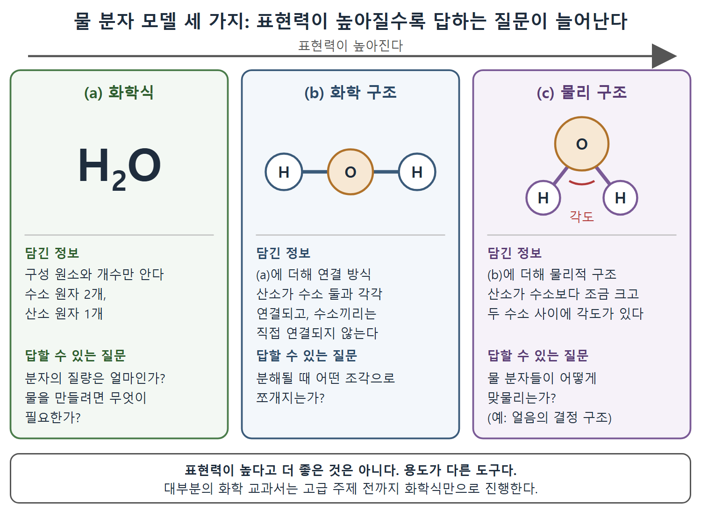

# 표현력과 시맨틱 웹 언어

모든 사람이 같은 종류의 말을 하고 싶어 하는 것은 아니다. 어떤 사람은 개별 대상의 세부를, 어떤 사람은 범주를, 어떤 사람은 정보를 지정하는 규칙을 말하고 싶어 한다. 필요한 도구도 다르다. 이 차이를 표현력(expressivity)의 수준이라고 한다. 이 문서는 물 분자 모델 비유로 표현력을 설명하고, 시맨틱 웹의 모델링 언어 RDF, SHACL, RDFS, RDFS-Plus, OWL을 표현력이 낮은 것부터 높은 것까지 차례로 소개한다.

---

## 1. 누가 어떤 말을 하고 싶어 하는가

| 사람 | 하고 싶은 말 | 예 |
|---|---|---|
| 개별 대상에 관심 있는 사람 | 개체의 세부 | 명왕성의 선호 기호, 명왕성이 상징하는 삶의 주제 |
| IAU 같은 분류 담당자 | 범주, 무엇이 범주에 속하는지, 어떻게 구별하는지 | 행성과 왜소행성의 구분 |
| 사전 편찬자, 정보 설계자, 사서 | 정보를 지정하는 규칙 | 개체마다 선호 레이블이 둘 이상 있을 수 있는가 |

모두 지식의 웹에 기여할 수 있지만 기여의 종류가 매우 다르다. 그래서 표현력이 다른 도구가 필요하다.

---

## 2. 물 분자 모델 세 가지

표현력의 차이는 인류가 협력해서 지식을 쌓은 역사만큼이나 익숙한 개념이다. 원서는 물 분자 모델의 발전을 예로 든다(그림 2.4).

| 모델 | 담긴 정보 | 답할 수 있는 질문 |
|---|---|---|
| (a) 화학식 H2O | 구성 원소와 개수: 수소 원자 둘, 산소 원자 하나 | 분자의 질량(구성 원자의 질량이 주어질 때), 물을 만들려면 어떤 구성 요소가 있어야 하는가 |
| (b) 화학 구조 H-O-H | (a)에 더해 연결 방식: 산소가 각 수소와 연결되고 수소끼리는 (직접) 연결되지 않는다 | 물이 분해될 때 수소 원자(H) 또는 산소-수소 이온(OH)으로 쪼개질 수 있지만, 분해 직후에 재결합 없이 수소 분자(H2)로는 쪼개질 수 없다 |
| (c) 물리 구조 | (b)에 더해 물리적 구조: 산소 원자가 수소 원자보다 약간 크다, 산소에 붙은 두 수소 사이의 각도 | 물 분자들의 결합 기하, 예를 들어 얼음의 결정 구조 |

표는 위에서 아래로 갈수록 더 표현력이 높다는 뜻이다. (b)는 (a)가 답하지 못하는 질문에 답하고, (c)는 (b)가 답하지 못하는 질문에 답한다.

화학식, 화학 구조, 물리 구조가 각각 어떤 정보를 담고 어떤 질문에 답하는지 나란히 보여 준다. 오른쪽으로 갈수록 표현력이 높지만, 더 좋은 것이 아니라 용도가 다른 도구라는 점도 함께 적었다.

### 표현력이 높다고 더 좋은 것은 아니다

한 모델이 다른 모델보다 표현력이 높다고 해서 우월한 것은 아니다. 표현력이 서로 다른 모델링 틀은 용도가 다른 도구다. 물의 화학식은 더 표현력이 높은 복잡한 모델보다 정하기 쉽고, 화학의 다양한 질문을 푸는 데 유용하다. 실제로 대부분의 화학 교과서는 고급 주제를 다루기 전까지는 구조 모델을 쓰지 않고 한동안 화학식만으로 진행한다. 개발자에게는 단순한 키-값 설정이면 충분한 곳에 복잡한 스키마를 들이대지 않는 것과 같은 감각이다.

---

## 3. 시맨틱 웹의 모델링 언어들

시맨틱 웹은 표현력 수준이 다른 여러 모델링 언어를 제공한다. 서로 다른 사람이 서로 다른 종류의 정보를 표현하게 해 주는 서로 다른 도구다. 표준은 각 언어 수준이 앞 수준 위에 쌓이는 층 구조로 짜여 있다. 아래는 원서가 소개하는 순서, 즉 표현력이 낮은 것에서 높은 것의 순서다.

| 언어 | 풀어 쓴 이름 | 핵심 역할 | 시기 |
|---|---|---|---|
| RDF | Resource Description Framework(자원 기술 프레임워크) | 누구나 어떤 것에 대해 기본적인 진술을 하고, 그 진술들을 하나의 모델로 층층이 합치게 한다. 시맨틱 웹의 바탕 | 1997년 작업 시작. 1999년 W3C 권고안. 2004년과 2014년(RDF 1.1)에 갱신 |
| SHACL | Shapes Constraint Language(셰이프 제약 언어) | 데이터가 일정한 형태(shape)를 가질 것이라는 기대를 표현한다 | 2017년 W3C 권고안 |
| RDFS | RDF Schema Language | 클래스, 하위 클래스, 속성 같은 객체 언어와 클래스 체계의 공통점과 가변성 개념을 표현한다 | 1999년 초안. 2004년 W3C 권고안 |
| RDFS-Plus | (OWL의 부분 집합) | RDFS보다 표현력이 높고 OWL보다 단순하다. 속성이 어떻게 쓰이고 서로 어떤 관계인지 표현한다 | 진행 중인 표준 없음 |
| OWL | Web Ontology Language(웹 온톨로지 언어) | 논리의 표현력을 시맨틱 웹에 가져온다. 클래스, 개체, 속성 사이의 상세한 제약을 표현한다 | 2004년 W3C 권고안. 2009년 두 번째 버전 |

표는 원서가 소개하는 순서대로 표현력이 낮은 언어에서 높은 언어로 늘어놓았다. 각 언어는 앞 수준 위에 쌓인다.

### 언어별 풀이

**RDF.** 앞 문서의 그림 2.3에서 본 것이 RDF의 기본 능력, 즉 모델 합치기다. 누구나 기본 진술을 하고 하나의 모델로 합칠 수 있다.

**SHACL.** 데이터가 어떤 형태일 것이라고 기대한다는 직관에서 나온 언어다. 모델러가 기대하는 데이터 설명의 형태를 표현할 수 있고, 이 형태는 데이터를 검증하는 데 쓰거나 사람이 데이터를 채워 넣을 입력 폼을 보여 주는 데 쓸 수 있다. 다른 시맨틱 웹 모델링 언어들이 열린 세계 가정(Open World Assumption)에 기초하는 것과 달리, SHACL은 닫힌 세계 가정(Closed World Assumption)으로 작동한다. 데이터가 설명에 포함되어 있지 않으면 빠진 것으로 본다. 시맨틱 웹 스택에서 가장 새로운 모델링 언어 중 하나다.

**RDFS.** 객체 지향 언어 등에서 익숙한 공통점과 가변성의 기본 개념, 즉 클래스, 하위 클래스, 속성을 표현할 수 있다. 앞 문서의 그림 2.1과 2.2가 RDFS의 능력을 보여 준다.

**RDFS-Plus.** OWL의 부분 집합으로, RDFS보다 표현력이 높지만 OWL의 복잡함은 없다. 표준화가 진행 중이지는 않지만, RDFS와 OWL 사이에 산업적으로 의미 있는 무언가가 있다는 인식이 커지고 있다. 이 책은 OWL의 기능을 점진적으로 보여 주려고 OWL 기능의 특정 부분 집합을 골랐다. RDFS-Plus는 속성을 어떻게 쓸 수 있고 서로 어떤 관계인지를 설명할 만큼의 표현력이 있다. RDFS를 넘어서는 구성 요소의 유용성을 보여 주기에 충분하면서, 초보 모델러가 OWL을 어렵게 느끼는 복잡함은 없다. 선호 기호가 하나뿐이라는 유일성 문제가 RDFS-Plus 표현력의 예다.

**OWL.** 논리의 표현력을 시맨틱 웹에 가져온다. 모델러가 클래스, 개체, 속성 사이의 세부 제약을 표현할 수 있다.

---

## 4. 모델링 요구와 언어 연결

| 하고 싶은 말 | 맞는 언어 |
|---|---|
| 누구나 기본 진술을 하고 합치기 | RDF |
| 클래스와 하위 클래스로 공통점과 가변성 정리 | RDFS |
| 선호 기호는 하나뿐이라는 속성 규칙 | RDFS-Plus |
| 클래스, 개체, 속성 사이의 상세한 제약 | OWL |
| 데이터가 기대하는 형태인지 검증하기 | SHACL |

---

## 5. 그 밖의 W3C 표준

W3C는 이 스택 위에 출처 관리(provenance), 서비스, 데이터 카탈로그, 온라인 분석 처리(OLAP) 등 여러 영역을 위한 표준도 제공한다. 그중 많은 것을 뒤 장에서 다룬다. 하지만 위의 언어들이 다른 것들이 기대는 기초 모델링 언어이고, 이 책의 주된 주제다.

 
 
 

[Semantic Web for the Working Ontologist](../)
