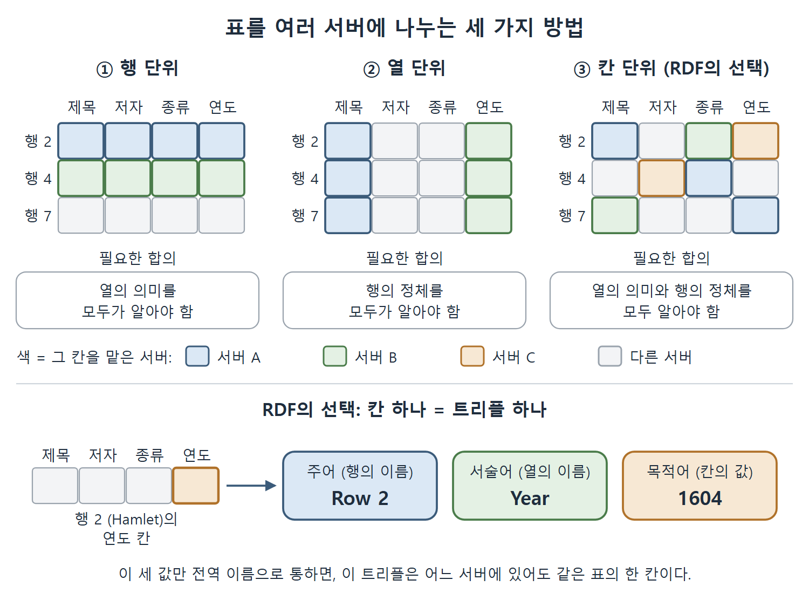
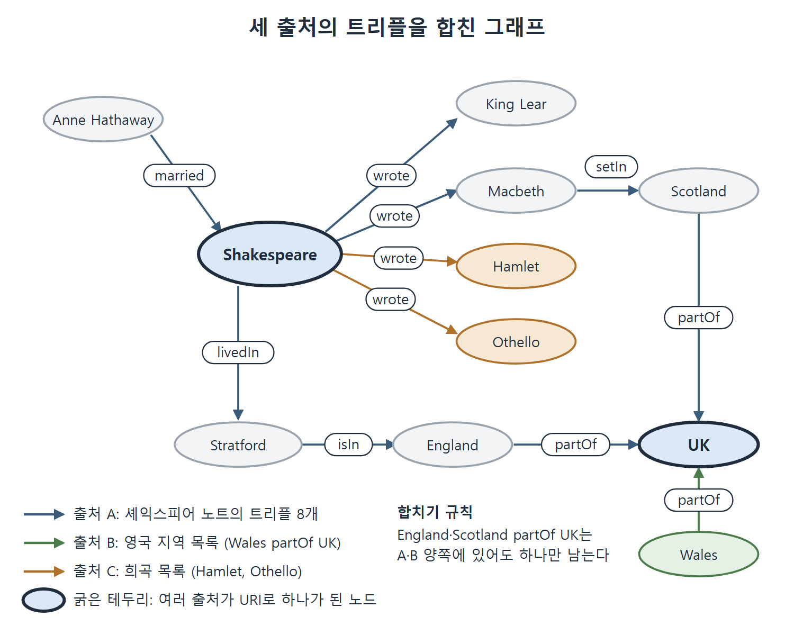

# RDF와 분산 데이터

시맨틱 웹의 바닥에는 RDF(Resource Description Framework, 자원 기술 프레임워크)가 있다. RDF가 풀려는 문제는 하나다. 서로 다른 컴퓨터에 흩어진 데이터를 어떻게 표현하고, 나중에 어떻게 다시 합칠 것인가 하는 문제다. RDFS, OWL, SPARQL 같은 나머지 표준은 모두 이 위에 올라간다.

이 문서는 하이퍼텍스트 웹과 데이터 웹이 어떻게 다른지에서 출발해, 표 데이터를 나누는 세 가지 방법을 비교하고, 왜 RDF가 "셀 하나하나를 나누는" 방식을 택했는지, 그리고 그렇게 쪼갠 데이터를 어떻게 다시 합치는지를 정리한다.

---

## 1. 문서의 웹과 데이터의 웹

지금 우리가 쓰는 웹은 서로 링크로 이어진 하이퍼텍스트 문서의 모음이다. 셰익스피어에 대한 문서에서 스트랫퍼드어폰에이번에 대한 문서로 링크를 걸 수는 있다. 하지만 "셰익스피어라는 사람"이나 "스트랫퍼드라는 장소" 자체를 가리키는 개념은 웹에 없다. 문서와 문서가 이어질 뿐이고, 그 문서가 세상의 어떤 것을 설명하는지는 읽는 사람이 머릿속에서 연결한다.

시맨틱 웹은 이 지점을 바꾼다. 세상의 어떤 것이든 말할 거리가 되면 리소스(resource, 자원)라고 부른다.

- 셰익스피어, 스트랫퍼드 같은 사람과 장소
- "X의 값" 같은 추상적인 값
- "텍사스의 모든 소" 같은 집합

"자원"이라는 말은 어색하다. 저자들도 인정한다. "엔티티"나 "사물"이 더 정확할 수 있지만 그쪽도 나름의 문제가 있고, 어쨌든 표준이 이 단어를 쓴다. RDF라는 이름 자체가 Resource Description Framework의 줄임말이라서 이 단어를 피할 수 없다.

현재의 웹이 폭발적으로 커진 이유는 누구나 어떤 대상에 대해서든 정보를 덧붙일 수 있었기 때문이다. 시맨틱 웹도 같은 성질이 필요하다. 그래서 정보를 웹 여기저기에 흩어 놓을 수 있는 데이터 모델이 있어야 한다. RDF는 웹의 기존 인프라와 검증된 기능을 그대로 활용하면서 이를 데이터의 분산 네트워크로 확장한다. 이렇게 웹 위에 데이터가 연결되는 방식을 링크드 데이터(Linked Data)라고 하며, 자세한 내용은 5장에서 다룬다.

| 구분 | 하이퍼텍스트 웹 | 시맨틱 웹 |
| --- | --- | --- |
| 연결하는 대상 | 문서와 문서 | 세상의 대상(리소스)과 리소스 |
| 대상을 가리키는 방법 | 문서 URL | 리소스마다 붙인 전역 이름 |
| 문서와 실제 대상의 연결 | 읽는 사람이 판단 | 데이터에 명시 |
| 누가 덧붙일 수 있나 | 누구나 | 누구나 |

표에서 보듯 바뀌는 것은 "연결의 단위"다. 문서가 아니라 대상 자체가 연결의 주인공이 된다.

---

## 2. 표 데이터를 웹에 나누어 놓는 세 가지 방법

데이터는 보통 표 형태다. 행 하나가 설명할 대상 하나이고, 열 하나가 대상의 속성 하나이며, 칸에는 값이 들어간다. 책은 셰익스피어 시대의 작품 여덟 개를 담은 표를 예로 든다.

| ID | 제목 | 저자 | 종류 | 연도 |
| --- | --- | --- | --- | --- |
| 1 | As You Like It | Shakespeare | Play | 1599 |
| 2 | Hamlet | Shakespeare | Play | 1604 |
| 3 | Othello | Shakespeare | Play | 1603 |
| 4 | Sonnet 78 | Shakespeare | Poem | 1609 |
| 5 | Astrophil and Stella | Sir Philip Sidney | Poem | 1590 |
| 6 | Edward II | Christopher Marlowe | Play | 1592 |
| 7 | Hero and Leander | Christopher Marlowe | Poem | 1593 |
| 8 | Greensleeves | Henry VIII | Song | 1525 |

이 표를 여러 서버에 나눠 담는다고 해 보자. 방법은 세 가지다.

### 2.1 행 단위로 나누기

서버마다 완전한 행을 몇 개씩 맡는다. 한 서버는 Sonnet 78과 Edward II의 행을, 다른 서버는 As You Like It의 행을 가진다. 어떤 대상에 대한 질문이든 그 행을 가진 서버 한 곳이 답할 수 있다. 서버끼리 부하를 나눠 가질 수 있어 유연하다.

대신 조건이 붙는다. 서버들이 열의 의미를 서로 합의해야 한다. 서버 A의 두 번째 열과 서버 B의 두 번째 열이 같은 정보인지 알 방법이 있어야 한다. 이것은 해결 못 할 문제는 아니지만 데이터 분산의 근본적인 문제다. 결국 "이 열이 어떤 속성인가"를 전역적으로 가리키는 이름이 필요하다.

### 2.2 열 단위로 나누기

서버마다 완전한 열을 몇 개씩 맡는다. 한 서버는 출판 연도와 종류를, 다른 서버는 제목을 맡는다. 이 방식은 행 단위와는 다른 쪽으로 유연하다.

- 출판 연도에 관심이 없으면 그 서버는 쳐다보지 않아도 된다.
- 원고 쪽수처럼 새 속성을 추가하고 싶으면 새 서버를 하나 세우면 된다. 기존 서버는 건드리지 않는다.

이쪽도 합의가 필요하다. 이번에는 "어느 대상인가"에 대한 합의다. 서버 A의 3번째 행과 서버 B의 3번째 행이 같은 작품인지 알려면, 대상을 가리키는 전역 식별자가 있어야 한다.

### 2.3 칸 단위로 나누기

두 방법을 합친 것이 칸(셀) 단위다. 서버마다 표의 칸 몇 개를 맡는다. 예를 들어 Hamlet의 제목과 연도를 서로 다른 서버가 따로 들고 있을 수 있고, 6번 행과 7번 행의 종류(Medium)가 서로 다른 서버에 있을 수도 있다. 이러면 한 대상의 설명을 여러 서버가 나눠 맡고, 하나의 속성을 여러 서버가 나눠 쓸 수 있다.

| 방식 | 서버가 맡는 단위 | 좋은 점 | 필요한 합의 |
| --- | --- | --- | --- |
| 행 단위 | 완전한 행 | 대상 하나의 질문을 한 서버가 답함 | 열의 의미(속성의 전역 이름) |
| 열 단위 | 완전한 열 | 속성 하나만 골라 쓰거나 새 속성을 서버째 추가 | 행의 정체(대상의 전역 식별자) |
| 칸 단위 | 칸 몇 개 | 두 방식의 장점을 모두 가짐 | 열의 의미와 행의 정체 모두 |

읽는 법은 간단하다. 쪼개는 단위가 작을수록 유연해지고, 그만큼 합의할 이름이 늘어난다. 칸 단위는 유연성이 가장 크지만 비용도 가장 크다.



그림은 같은 표를 서버 A·B·C가 행, 열, 칸 단위로 나눠 맡는 모습과, RDF가 택한 칸 단위에서 칸 하나가 주어·서술어·목적어 트리플 하나가 되는 과정을 보여 준다.

---

## 3. AAA 슬로건과 RDF의 선택

시맨틱 웹에는 "Anyone can say Anything about Any topic", 줄여서 AAA라는 슬로건이 있다. 누구나 어떤 주제에 대해서든 무엇이든 말할 수 있다는 뜻이다. 이를 진지하게 받아들이면 두 가지가 필요하다.

- 어떤 서버든 어떤 대상에 대해서도 진술할 수 있어야 한다(열 단위 방식의 장점).
- 어떤 서버든 대상의 어떤 속성이든 정할 수 있어야 한다(행 단위 방식의 장점).

칸 단위 방식은 이 두 가지를 모두 만족한다. RDF가 택한 길이 바로 이것이다. 대가로, 열 제목에 대한 전역 참조뿐 아니라 행에 대한 전역 참조도 필요하다. 그래서 칸 하나는 세 가지 값으로 표현된다.

1. 행을 가리키는 전역 참조
2. 열을 가리키는 전역 참조
3. 칸 안의 값

이 세 값의 묶음이 RDF의 기본 구성 요소인 트리플(triple)이다. 문법 용어를 빌려 이름을 붙였다.

| 트리플의 자리 | 표에서의 대응 | 문법에서의 이름 | 이름의 이유 |
| --- | --- | --- | --- |
| 첫째 | 행의 식별자 | 주어(subject) | 문장이 말하려는 대상 |
| 둘째 | 열의 식별자 | 서술어(predicate) | 열이 대상의 속성을 나타냄 |
| 셋째 | 칸의 값 | 목적어(object) | 속성의 값 |

위 표의 칸 몇 개를 트리플로 쓰면 다음과 같다.

| 주어 | 서술어 | 목적어 |
| --- | --- | --- |
| Row 7 | Medium | Poem |
| Row 2 | Title | Hamlet |
| Row 2 | Year | 1604 |
| Row 4 | Author | Shakespeare |
| Row 6 | Medium | Play |

이 다섯 줄은 서로 다른 서버에 있어도 상관없다. 행 이름과 열 이름만 전역적으로 통한다면 어디에 있든 같은 표의 한 칸이다.

---

## 4. 트리플을 그래프로 보기

트리플이 여러 개 모여 같은 대상을 가리키기 시작하면 방향 그래프로 보는 것이 편하다. 트리플 하나는 주어에서 목적어로 향하는 화살표(간선)이고, 서술어는 그 화살표에 붙은 이름표다. 책은 다음 여덟 개 트리플로 예를 든다.

| 주어 | 서술어 | 목적어 |
| --- | --- | --- |
| Shakespeare | wrote | King Lear |
| Shakespeare | wrote | Macbeth |
| Anne Hathaway | married | Shakespeare |
| Shakespeare | livedIn | Stratford |
| Stratford | isIn | England |
| Macbeth | setIn | Scotland |
| England | partOf | UK |
| Scotland | partOf | UK |

이 표를 글로 그리면 이런 모양이다.

```text
Anne Hathaway --married--> Shakespeare --wrote--> King Lear
                               |  \--wrote--> Macbeth --setIn--> Scotland --partOf--> UK
                               \--livedIn--> Stratford --isIn--> England --partOf--> UK
```

표와 그래프는 같은 정보를 담고 있다. 다만 그래프에서는 셰익스피어에 관해 아는 모든 것이 노드 하나에 모인다. 주어로 나오든 목적어로 나오든 마찬가지다. 표에서는 셰익스피어가 여러 줄에 흩어져 있어 한눈에 보이지 않는다.

---

## 5. 여러 출처의 데이터 합치기

RDF를 분산의 수단으로 소개했지만, 쓸 때는 흩어진 데이터를 다시 모아야 한다. 트리플 표현의 큰 장점은 합치기가 쉽다는 점이다. 정보가 트리플일 뿐이므로, 두 그래프를 합친 결과는 두 그래프의 트리플을 전부 모은 그래프다. 합집합을 구하는 것과 같다.

책은 앞의 여덟 개 트리플에 두 출처를 더 붙인다.

| 출처 | 내용 | 트리플 수 | 서술어 |
| --- | --- | --- | --- |
| 영국 구성 지역 목록 | Scotland, England, Wales, Northern Ireland, Channel Islands, Isle of Man 각각이 The UK의 일부 | 6 | partOf |
| 셰익스피어 희곡 목록 | As You Like It, Henry V, Love's Labour's Lost, Measure for Measure, Twelfth Night, The Winter's Tale, Hamlet, Othello | 8 | wrote |

세 출처를 합치면 이 세 그래프의 트리플이 모두 들어간 그래프가 된다. 같은 트리플(예: England partOf UK)은 그래프가 트리플의 집합이므로 한 번만 남는다. 합친 그래프에서는 "셰익스피어 노드"에 쓴 작품이 한꺼번에 붙고, "UK 노드"에는 여섯 지역이 모두 붙는다.



그림은 앞의 트리플 여덟 개에 영국 지역 목록(Wales partOf UK)과 희곡 목록(Hamlet, Othello)을 더한 결과를 보여 준다. Shakespeare와 UK처럼 URI가 같은 노드끼리 하나로 합쳐지고, 중복된 트리플은 한 번만 남는다.

다만 이 합치기는 한 가지 조건에서만 단순하다. 각 그래프의 노드 중 어느 것끼리 같은 노드인지 알고 있을 때다. 한 그래프의 "Shakespeare"와 다른 그래프의 "Shakespeare"가 같은 대상이라는 것을 어떻게 아느냐 하는 문제는 다음 문서에서 다룬다.

| 합치기에서 정해야 하는 것 | RDF의 답 |
| --- | --- |
| 합친 결과는 무엇인가 | 모든 트리플의 합집합 |
| 같은 트리플이 양쪽에 있으면 | 하나로 본다(집합이므로) |
| 어느 노드가 같은 노드인가 | 같은 URI를 가진 노드끼리(다음 문서) |

<br>
<br>
<br>

[Semantic Web for the Working Ontologist](../)
