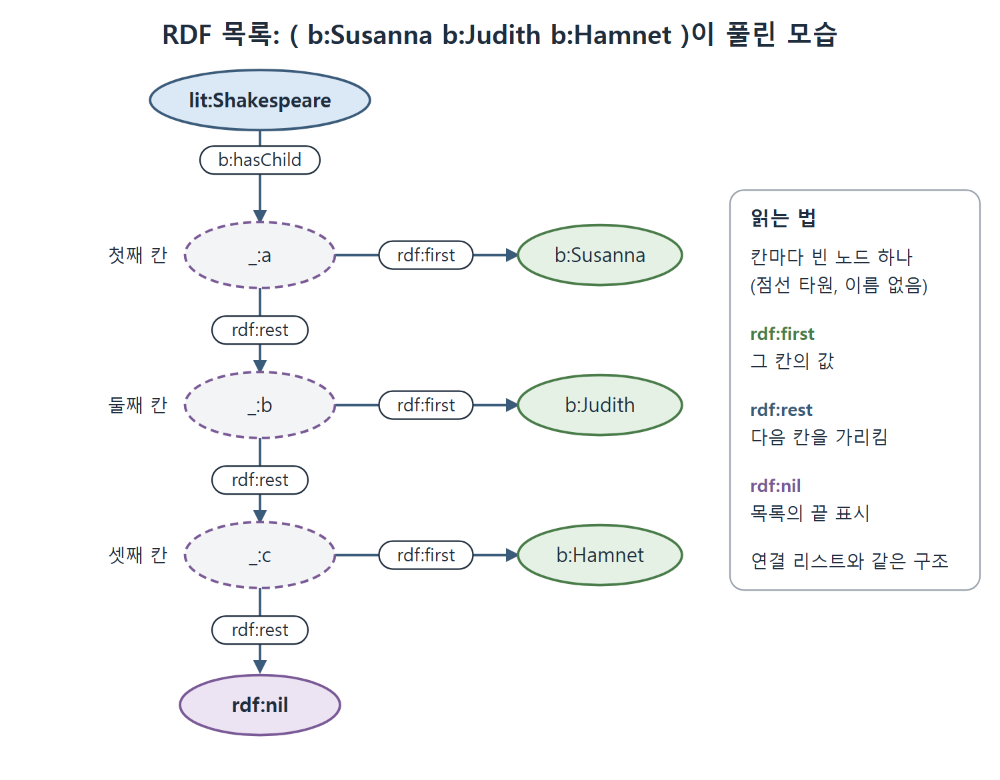

# 빈 노드와 순서 있는 목록

RDF의 자원은 원칙적으로 웹 표준인 URI로 정체를 가진다. 그런데 웹에서의 정체가 전혀 없는 자원도 RDF에서 표현할 수 있다. 이 문서는 그런 자원인 빈 노드(blank node)가 왜 필요한지, Turtle에서 어떻게 쓰는지, 그리고 RDF에서 순서를 표현하는 방법인 목록(list)이 빈 노드로 어떻게 풀리는지 설명한다.

---

## 1. 이름 없는 대상이 필요한 이유

어떤 것이 존재한다는 것은 알고, 그것에 대해 몇 가지도 알지만, 누구인지는 모르는 경우가 있다. 책의 예는 이렇다. 셰익스피어에게 정체가 알려지지 않은 연인이 있었다는 추측이 있다. 그녀에 대해 아는 것은 세 가지다.

- 여성이었다.
- 영국에 살았다.
- 「소네트 78」의 영감이 되었다.

이 진술을 RDF로 쓰는 것은 어렵지 않지만 그녀를 가리킬 식별자가 필요하다. Turtle에서 식별자를 붙여 쓰면 이렇게 된다.

```turtle
lit:Mistress1 rdf:type bio:Woman ;
              bio:LivedIn geo:England .
lit:Sonnet78 lit:hasInspiration lit:Mistress1 .
```

(원문 예시에서는 `bio:LivedIn`이 대문자로 시작하고, 이후 예시에서는 `bio:livedIn`으로 쓴다. 원문 그대로 옮겼으며 오타로 보이지만 확실하지는 않다.)

그런데 식별자를 주고 싶지 않다면 어떻게 할까. 이때 쓰는 것이 빈 노드, 줄여서 bnode다.

---

## 2. 빈 노드는 "존재한다"는 말이다

빈 노드의 쓰임은 논리의 "존재한다"는 말로 해석할 수 있다. 책은 임시로 빈 노드를 `?`로 표시해 보인다.

```text
? rdf:type bio:Woman ;
  bio:livedIn geo:England .
lit:Sonnet78 lit:hasInspiration ? .
```

이 진술은 "영국에 살았고 「소네트 78」의 영감이 된 어떤 여성이 존재한다"는 뜻이다. 누구인지 밝히지는 않는다.

| 방식 | 주어 자리의 모습 | 뜻 |
| --- | --- | --- |
| 식별자를 붙임 | `lit:Mistress1` | 이름이 있는 특정 대상 |
| 빈 노드 | `?`(설명용 표시) | 어떤 대상이 존재한다. 누구인지는 모른다 |

다만 이 `?` 표기는 올바른 Turtle이 아니다. 빈 노드가 둘 이상이면 `?`가 어느 노드를 가리키는지 알 수 없는 문제가 있다.

---

## 3. Turtle의 대괄호 표기

Turtle은 빈 노드를 간결하고 모호하지 않게 쓰는 표기를 따로 갖고 있다. 빈 노드가 주어인 트리플을 모두 대괄호(`[`, `]`) 안에 넣는다.

```turtle
[ rdf:type bio:Woman ;
  bio:livedIn geo:England ]
```

여는 대괄호 뒤에 공백을 두는 것이 관례이고 필수는 아니다. 마치 주어가 있는 것처럼 보이지만 지정하지 않았다는 점을 나타낸다. 이 빈 노드를 다른 트리플에서 가리키려면 대괄호 덩어리를 그 자리에 통째로 넣는다. 여기에 rdf:type을 줄인 `a`를 쓰면 더 편하다. 연인에 관한 진술 전체가 이렇게 된다.

```turtle
lit:Sonnet78 lit:hasInspiration [ a :Woman ;
                                  bio:livedIn geo:England ] .
```

원문에서는 `a :Woman`처럼 기본 네임스페이스 표기를 쓰고 있다. 이 식은 거의 영어 문장처럼 읽힌다. "Sonnet78 has [as] inspiration a Woman [who] lived in England", 곧 영국에 살았던 여성이 「소네트 78」의 영감이다. 그 여성이 누구인지는 정해지지 않는다.

| 표기 | 설명 |
| --- | --- |
| `[ ... ]` | 안에 있는 트리플의 주어가 되는 빈 노드 |
| `[ ... ]`을 다른 트리플의 목적어 자리에 | 그 빈 노드를 가리킴 |
| `a` | rdf:type의 줄임. 이 문맥에서 특히 유용 |

책은 빈 노드를 OWL 설명에서 아주 특별하게 쓴다고 예고한다. OWL을 위한 쓰임을 제외하면 RDF가 빈 노드를 많은 상황에서 허용하더라도 일반적으로는 쓰지 말라고 권한다.

---

## 4. RDF에서 순서 표현하기

셰익스피어의 자녀들은 지면에서는 순서대로 적혀 있다. 그러나 RDF의 관점에서는 순서가 없다. 셰익스피어와 각 자녀의 관계를 말하는 트리플 세 개가 있을 뿐이다. 순서를 지정하고 싶다면 어떻게 할까.

RDF는 요소를 목록 형태로 순서 있게 두는 기능이 있다. Turtle에서는 소괄호로 간단히 쓴다.

```turtle
lit:Shakespeare b:hasChild ( b:Susanna b:Judith b:Hamnet ) .
```

이 한 줄은 다음의 트리플로 풀린다. `_:a`, `_:b`, `_:c`는 빈 노드이고, 순서는 RDF의 예약된 속성 rdf:first와 rdf:rest로 표시한다. 목록의 끝은 rdf:nil이라는 자원으로 닫는다.

```turtle
lit:Shakespeare b:hasChild _:a .
_:a rdf:first b:Susanna ;  rdf:rest _:b .
_:b rdf:first b:Judith ;   rdf:rest _:c .
_:c rdf:first b:Hamnet ;   rdf:rest rdf:nil .
```

(원문은 이 트리플들을 한 줄에 하나씩 쓴다. 이 문서는 세미콜론으로 합쳐 적었다.)

| 이름 | 역할 |
| --- | --- |
| rdf:first | 목록 칸의 값(그 자리의 요소) |
| rdf:rest | 다음 칸을 가리킴(나머지 목록) |
| rdf:nil | 목록의 끝 |
| `_:a`, `_:b`, `_:c` | 각 칸을 나타내는 빈 노드 |

이 구조는 프로그래밍의 연결 리스트와 같다. 칸마다 값(first)과 다음 칸의 포인터(rest)가 있고, 마지막 칸은 nil을 가리킨다. 이 표현은 순서를 지켜 주지만 표현이 상당히 복잡해지는 대가를 치른다. 다행히 Turtle 표기가 간결하므로 평소에는 뒤에 있는 트리플의 세부를 기억할 필요가 없다.



그림은 세 자녀 목록이 빈 노드 세 개로 이어진 사슬이 되는 모습을 보여 준다. 각 칸은 rdf:first로 값을, rdf:rest로 다음 칸을 가리키고, 마지막 칸은 rdf:nil로 끝난다.

---

## 5. 정리

| 질문 | 답 |
| --- | --- |
| 빈 노드는 무엇인가 | URI가 없어 웹에서 전역으로 가리킬 수 없는 노드. 이름 없는 대상을 대신한다 |
| 무슨 뜻으로 읽나 | "그런 것이 존재한다" |
| Turtle에서는 어떻게 쓰나 | `[ ... ]` |
| 언제 쓰나 | 대상을 알지만 식별자가 없을 때. OWL에서 특별한 쓰임이 있다. 그 밖에는 가급적 피한다 |
| RDF에 순서가 있나 | 기본은 없다. 목록(rdf:first, rdf:rest, rdf:nil)으로 순서를 표현한다 |

<br>
<br>
<br>

[Semantic Web for the Working Ontologist](../)
