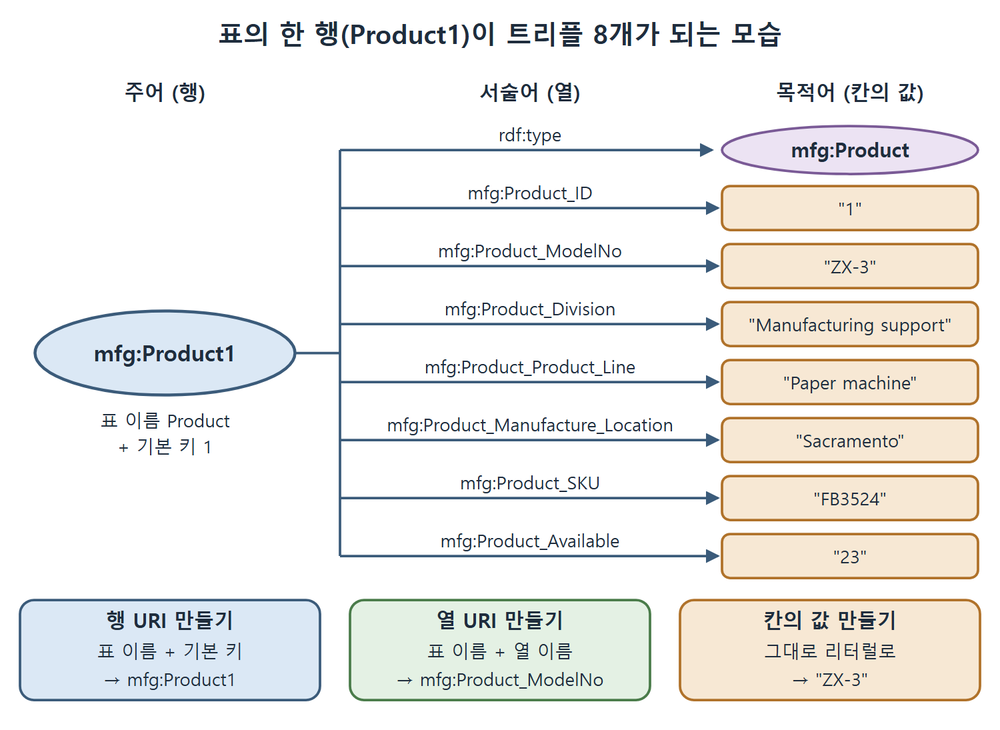

# 표 데이터를 RDF로 바꾸기

관계형 데이터베이스의 표를 RDF 그래프로 옮기는 방법을 다룬다. 이 장은 RDF를 표 데이터를 웹에 분산하는 수단으로 소개하며 시작했다. 이제 네임스페이스와 트리플이라는 도구가 모두 갖춰졌으니, 표를 일관된 규칙으로 RDF로 바꾸는 과제를 풀어 본다. 한 번 규칙을 익히면 어떤 표든 같은 방식으로 바꿀 수 있다.

---

## 1. 과제

제품, 공급처, 재고 정보를 담은 관계형 표가 있다. 정보의 뜻을 그대로 지키면서, RDF의 병합과 질의 같은 연산을 쓸 수 있는 RDF 그래프로 바꾸는 것이 목표다. 예시 표는 제품 아홉 개를 담고 있다.

| ID | 모델 번호 | 사업부 | 제품군 | 생산지 | SKU | 재고 |
| --- | --- | --- | --- | --- | --- | --- |
| 1 | ZX-3 | Manufacturing support | Paper machine | Sacramento | FB3524 | 23 |
| 2 | ZX-3P | Manufacturing support | Paper machine | Sacramento | KD5243 | 4 |
| 3 | ZX-3S | Manufacturing support | Paper machine | Sacramento | IL4028 | 34 |
| 4 | B-1430 | Control engineering | Feedback line | Elizabeth | KS4520 | 23 |
| 5 | B-1430X | Control engineering | Feedback line | Elizabeth | CL5934 | 14 |
| 6 | B-1431 | Control engineering | Active sensor | Seoul | KK3945 | 0 |
| 7 | DBB-12 | Accessories | Monitor | Hong Kong | ND5520 | 100 |
| 8 | SP-1234 | Safety | Safety valve | Cleveland | HI4554 | 4 |
| 9 | SPX-1234 | Safety | Safety valve | Cleveland | OP5333 | 14 |

원서의 첫 열 제목은 "Machine number"이고, 이 문서에서는 이후 속성 이름과 맞춰 "모델 번호"로 옮겼다.

---

## 2. 풀이 ① 행에 URI를 붙인다

각 행은 같은 종류의 개체 하나를 설명한다. 그 종류는 표의 이름, 곧 Product다. 행마다 서로 다른 URI가 필요하다. 다행히 데이터베이스에도 고유 식별자가 필요하므로 이미 (그 표 안에서만 유일한) 식별자가 있다. 기본 키, 여기서는 ID 열이다. 시맨틱 웹에는 이것을 전역에서 유일하게 만드는 일이 남는다.

가장 쉬운 방법은 데이터베이스 전체에 URI를 하나 정하고, 그것을 데이터베이스의 모든 식별자의 네임스페이스로 삼는 것이다. 데이터베이스가 웹에 있다면 그 주소(URL)를 써도 된다. URI를 만드는 일은 5장에서 더 자세히 다룬다. 이 데이터베이스는 제조 회사의 것이므로 네임스페이스를 mfg:라고 부른다.

그다음 표 이름 "Product"와 기본 키를 이어 붙여 mfg: 네임스페이스에 속한 식별자를 만든다. 결과는 `mfg:Product1`, `mfg:Product2` 같은 이름이다.

## 3. 풀이 ② 열에 URI를 붙인다

행은 모델 번호, 사업부 같은 여러 정보를 알려 준다. RDF에서 이것은 각각 Product를 설명하는 속성이 된다. 행과 마찬가지로 속성에도 전역에서 유일한 식별자가 필요하다. 같은 네임스페이스를 써도 되지만, 서로 다른 표가 같은 열 이름을 가질 수 있다(그렇다고 같은 속성은 아니다). 그래서 표 이름과 열 이름을 이어 붙인다. 결과는 `mfg:Product_ModelNo`, `mfg:Product_Division` 같은 이름이다.

| 원래 것 | 만드는 규칙 | 결과 |
| --- | --- | --- |
| 행(개체) | 표 이름 + 기본 키 | `mfg:Product1` |
| 열(속성) | 표 이름 + 열 이름 | `mfg:Product_ModelNo` |
| 칸의 값 | 그대로 | `"ZX-3"` |

읽는 법은 이렇다. 행과 열 모두 네임스페이스 안에서 표 이름을 앞에 붙여 이름이 겹치지 않게 만든다. 값은 그대로 리터럴로 남는다.

---

## 4. 칸마다 트리플 하나

이 규칙을 적용하면 표의 모든 정보를 트리플로 쓸 수 있다. 칸 하나에 트리플 하나가 대응하므로, 행이 n개이고 열이 c개이면 트리플은 n × c개다. 예시 표는 열이 7개, 행이 9개이므로 트리플이 63개다. 그중 Product1의 일곱 칸은 이렇게 쓴다.

| 주어 | 서술어 | 목적어 |
| --- | --- | --- |
| mfg:Product1 | mfg:Product_ID | 1 |
| mfg:Product1 | mfg:Product_ModelNo | ZX-3 |
| mfg:Product1 | mfg:Product_Division | Manufacturing support |
| mfg:Product1 | mfg:Product_Product_Line | Paper machine |
| mfg:Product1 | mfg:Product_Manufacture_Location | Sacramento |
| mfg:Product1 | mfg:Product_SKU | FB3524 |
| mfg:Product1 | mfg:Product_Available | 23 |

이 트리플은 지금까지 본 것과 조금 다르다. 주어와 서술어는 CURIE가 붙은 RDF 자원이지만 목적어는 자원이 아니라 리터럴(literal) 데이터, 곧 문자열이나 정수 같은 값이다. 놀랄 일은 아니다. RDF는 결국 데이터를 표현하는 체계이기 때문이다. RDF는 XML에서 리터럴의 모든 데이터 타입을 가져와 목적어의 값으로 쓸 수 있게 했다. 이 예시에서는 모든 값이 문자열이거나 정수다.

| 트리플의 자리 | 올 수 있는 것 |
| --- | --- |
| 주어 | URI로 이름 붙인 자원 |
| 서술어 | URI로 이름 붙인 자원(속성) |
| 목적어 | 자원 또는 리터럴 값 |

### 4.1 타입 트리플 추가

표를 읽는 보통의 해석은 행 하나가 개체 하나이고, 그 개체의 타입이 표 이름이라는 것이다. 이 예에서 각 행은 Product다. RDF에는 행마다 트리플 하나를 더해 이를 표현한다.

```turtle
mfg:Product1 rdf:type mfg:Product .
mfg:Product2 rdf:type mfg:Product .
mfg:Product9 rdf:type mfg:Product .
```

원문은 Product1부터 Product9까지 아홉 개를 모두 보인다. 이렇게 하면 최종 트리플은 값 63개에 타입 9개를 더한 72개가 된다(72는 이 문서에서 계산한 합이며 원문에 명시된 수치는 아니다).

원서의 그래프 그림은 이 모든 트리플을 보여 준다. rdf:type 연결(주어는 각 제품, 목적어는 클래스 mfg:Product)은 그래프에서 간선으로 그려지고, 목적어가 리터럴인 트리플은 그림이 복잡해지지 않도록 공통 주어의 이름을 붙인 상자 안에 모아 그렸다.



그림은 Product1 행 하나에서 칸 일곱 개가 리터럴을 목적어로 하는 트리플 일곱 개가 되고, 여기에 rdf:type 트리플 하나가 더해져 모두 여덟 개가 되는 과정을 보여 준다. 행 URI와 열 URI는 표 이름을 앞에 붙여 만든다.

---

## 5. 정리

| 단계 | 할 일 | 예 |
| --- | --- | --- |
| 1 | 데이터베이스에 네임스페이스 정하기 | `mfg:` |
| 2 | 행 URI 만들기 | `mfg:Product1` |
| 3 | 열 URI 만들기 | `mfg:Product_ModelNo` |
| 4 | 칸마다 (행, 열, 값) 트리플 만들기 | 7열 × 9행 = 63개 |
| 5 | 행마다 rdf:type 트리플 추가하기 | `mfg:Product1 rdf:type mfg:Product` |

이 방식으로 표 데이터는 정보의 뜻을 잃지 않고 RDF가 된다. 이렇게 바뀐 데이터는 이제 다른 출처의 그래프와 URI가 같은 노드끼리 합쳐질 수 있고, 질의에도 쓸 수 있다.

<br>
<br>
<br>

[Semantic Web for the Working Ontologist](../)
