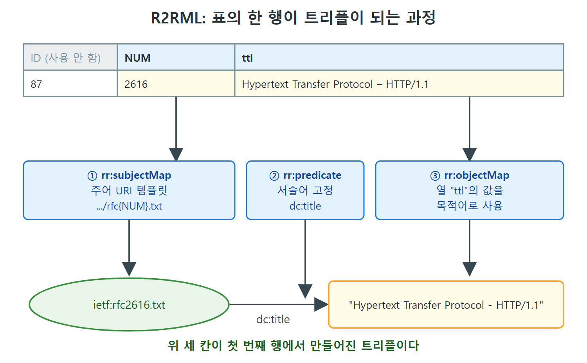

# RDF 파서와 시리얼라이저

RDF 기반 시스템은 처음에 트리플을 어디서 구할까. 가장 간단한 답은 웹에서 바로 찾는 것이다. 이 문서는 파일을 트리플로 읽어 들이는 파서, 그 반대로 써 내는 시리얼라이저(직렬화기), 그리고 RDF가 아닌 데이터(관계형 데이터베이스, 웹 페이지)를 RDF로 바꿔 들여오는 방법을 정리한다.

---

## 1. 파서와 시리얼라이저의 역할

구글에서 확장자가 .rdf인 파일은 수백만 개가 나온다. 이 파일들은 모두 RDF 애플리케이션의 데이터 원천이 될 수 있다. 다만 읽을 프로그램이 없으면 쓸모가 없다. 그 프로그램이 RDF 파서다.

- 파서는 어떤 RDF 형식의 파일을 입력으로 받는다. 대부분의 파서는 3장에서 본 표준 RDF 형식을 모두 지원한다.
- 파서는 파일 내용을 트리플의 내부 표현으로 바꾼다. 이 시점부터 트리플은 트리플 스토어에 들어가 스토어의 모든 연산을 쓸 수 있다.
- 시리얼라이저는 반대로 트리플 묶음을 같은 텍스트 형식이나 다른 텍스트 형식의 파일로 써 낸다.

| 구분 | 입력 | 출력 | 비유 |
|---|---|---|---|
| 파서 | 특정 형식의 RDF 파일 | 트리플(내부 표현) | 문서를 읽는 사람 |
| 시리얼라이저 | 트리플 묶음 | 특정 형식의 RDF 파일 | 내용을 문서로 옮겨 적는 사람 |

두 도구는 같은 형식 쌍으로 쓰면 맞물린다. 예를 들어 Turtle 시리얼라이저로 쓴 문자열을 Turtle 파서로 읽으면 처음 트리플 집합과 똑같은 결과가 나온다. 이것을 왕복(round-trip)이라 부른다.

### 파일에서 시작하면 왕복이 같지 않을 수 있다

이 성질은 한 방향으로만 성립한다. 트리플에서 시작해서 직렬화하고 다시 파싱하면 같은 트리플이 돌아온다. 그러나 텍스트 파일에서 시작하면 그렇지 않을 수 있다. 같은 형식 안에서도 똑같은 트리플 집합을 나타내는 서로 다른 파일이 여러 개 있기 때문이다. 접두어를 다르게 쓰거나 줄 순서를 바꿔도 트리플은 같다.

결론은 이렇다. RDF 파일을 읽어 들였다가 다시 내보냈을 때 원래 파일과 글자 단위로 똑같은 결과가 나온다고 장담할 수 없다. 같은 것은 파일의 글자가 아니라 트리플 집합이다.

---

## 2. RDF가 아닌 데이터를 RDF로 바꾸기

표준 형식으로 된 RDF 데이터는 많지만 RDF가 아닌 데이터는 훨씬 많다. 다행히 많은 일반 형식(표 형태의 데이터 등)은 RDF 트리플로 바꾸기가 어렵지 않다.

### 2.1 관계형 데이터베이스

챌린지 1에서는 관계형 데이터베이스의 표를 RDF로 바꾸는 방법을 봤다. 규칙은 단순했다. 첫 번째 열과 표 이름으로 모든 트리플의 주어 URI를 만들고, 열 이름과 표 이름으로 속성 URI를 만들었다.

하지만 이 변환은 표에 대해 많은 것을 가정한다. 첫 열(ID)이 주어의 식별자로 적절하고, 열 이름이 속성 이름으로 적절하다는 가정이다. 대개는 맞지만 보장되지 않는다. 다음 표로 보자.

| ID | NUM | ttl |
|---|---|---|
| 87 | 2616 | Hypertext Transfer Protocol – HTTP/1.1 |
| 88 | 2396 | Uniform Resource Identifiers (URI): Generic Syntax |

겉보기엔 첫 열 ID가 행의 식별자가 될 것 같지만 이 데이터는 IETF(Internet Engineering Task Force)의 표준 문서를 가리키고, 실제로 개체를 유일하게 식별하는 것은 표준 번호인 NUM이다. ID는 데이터베이스 시스템이 이 표 안에서만 쓰려고 붙인 순번이라서, 다른 데이터와 연결할 때는 의미가 없다. ID를 식별자로 쓰면 불편한 정도가 아니라 틀린 것이다. 이 레코드는 시스템 전체에서 ID가 아니라 NUM으로 알려져 있기 때문이다.

마지막 열 ttl도 마찬가지다. Turtle이라는 시맨틱 웹 형식을 말하는 것이 아니라 "title"의 줄임말이다. 출판물의 표준 메타데이터(저자, 제목 등)를 정리한 서지 표준 더블린 코어(Dublin Core, 줄여서 dc)가 있으니 :ttl이라는 속성을 새로 만들기보다 dc:title을 쓰는 편이 낫다.

#### R2RML

이런 상황을 위해 W3C는 권고안 R2RML(Relational To RDF Markup Language)과 Direct Mapping을 제공한다. R2RML의 임무는 표를 RDF로 옮기는 방법을 충분히 밝혀 두어서 위와 같은 사항을 추측하지 않아도 되게 하는 것이다. 위 예의 매핑은 다음과 같이 쓴다.

```turtle
:My_Table rdf:type rr:TriplesMap;
  rr:subjectMap [ rr:template
    "https://www.ietf.org/rfc/rfc{NUM}.txt" ];
  rr:predicateObjectMap [
    rr:predicateMap [ rr:predicate dc:title ];
    rr:objectMap [ rr:column "ttl" ]
  ] .
```

코드를 풀어 보면 다음과 같다.

| 구성 요소 | 역할 |
|---|---|
| rr:subjectMap | 주어 URI를 만드는 템플릿을 지정한다. 여기서는 IETF라는 기관과 RFC(Requests for Comments)라는 주제를 URI에 담고, 템플릿의 {NUM} 자리에 두 번째 열 NUM의 값을 채운다 |
| rr:predicateObjectMap | 서술어와 목적어를 한 쌍으로 지정한다 |
| rr:predicateMap | 출력에 쓸 서술어(dc:title)를 지정한다 |
| rr:objectMap과 rr:column | 입력의 어느 열(문자열 "ttl")에서 값을 가져올지 지정한다. 데이터베이스에서 열은 아직 URI가 아니라 문자열이다 |

해석은 이렇다. 지정한 열의 값이 지정한 서술어의 값으로 출력된다. 이 매핑을 표에 적용하면 ietf:를 https://www.ietf.org/rfc/의 접두어라고 할 때 다음 두 트리플이 나온다.

```turtle
ietf:rfc2616.txt dc:title
  "Hypertext Transfer Protocol - HTTP/1.1" .
ietf:rfc2396.txt dc:title
  "Uniform Resource Identifiers (URI): Generic Syntax" .
```



그림은 표의 첫 번째 행이 R2RML 매핑의 세 규칙을 거쳐 `ietf:rfc2616.txt dc:title "Hypertext Transfer Protocol - HTTP/1.1"` 트리플이 되는 과정을 보여 준다. 주어는 NUM 열로, 목적어는 ttl 열로 만들고 ID 열은 쓰지 않는다.

#### 외래 키와 자동화

관계형 데이터베이스에 외래 키가 있으면 조금 복잡하다. 일부 트리플의 목적어가 그 자체로 URI가 되어야 하고, 그 URI도 지정해야 하기 때문이다. 그러나 접근법은 같다. R2RML은 원본 표 데이터에서 출력 트리플 하나로 가는 템플릿을 정의하는 언어를 제공한다.

어떤 관계형 데이터베이스든 단순한 R2RML 매핑을 만드는 일은 간단하고, 실제로 이 작업은 자동화되어 있다. 덕분에 관계형 데이터베이스에 대해 SPARQL 쿼리를 직접 쓸 수 있고, 데이터베이스가 웹의 링크드 데이터 원천이 될 수 있다. 이 기능은 많은 시맨틱 웹 데이터 처리 도구에 들어 있어서 관계형 데이터베이스를 사실상 시맨틱 웹 데이터 원천으로 바꿔 준다.

### 2.2 웹 페이지

또 하나의 풍부한 데이터 원천은 기존 HTML 웹 페이지다. 이런 페이지에는 연락처, 행사 설명, 상품 설명, 출판물, 영업 시간, 가격 같은 구조적 정보가 자주 들어 있다. 사람은 쉽게 이해하지만, 페이지에 특별한 데이터 마크업이 없으면 링크드 데이터로 뽑아내기는 어렵다.

10장에서는 웹 페이지에 박힌 데이터를 쓰는 여러 시스템을 본다. 페이스북의 Open Graph Protocol, 그리고 구글, 마이크로소프트, 야후, 얀덱스가 만든 컨소시엄의 Schema.org가 대표적이다. 이런 노력은 모두 HTML 페이지에 구조화된 데이터를 넣는 마크업 방법과 그것을 추출하는 변환기를 필요로 한다.

#### 리치 스니펫

웹 페이지에 구조화된 데이터를 넣을 수 있어서 가능해지는 핵심 기능이 리치 스니펫(rich snippet)이다. 검색 결과 화면에 구조화된 데이터를 함께 보여 주는 것을 말한다. 원서의 그림 4.1은 리치 스니펫이 있는 검색 결과와 없는 평범한 결과를 나란히 보여 준다. 쇼핑을 하다 보면 수없이 봤을 것이다.

리치 스니펫은 해당 웹 페이지에 인코딩된 데이터로 만든다. 예를 들어 페이지의 상품이 CURIE(Compact URI) bnb:Buffalo로 주어진다면, "재고 있음" 표시에 필요한 정보는 트리플 하나뿐이다.

```turtle
bnb:Buffalo :availability :InStock .
```

:availability와 :InStock 같은 자원이 어떻게 쓰이는지는 10장에서 Schema.org 어휘를 보면서 자세히 다룬다.

#### HTML에 RDF를 넣는 세 가지 방법

| 방법 | 특징 |
|---|---|
| Microdata | Schema.org가 앞서 쓴 방식 |
| RDFa | W3C가 표준화했다 |
| JSON-LD | 3.8절에서 본 RDF 직렬화 형식 |

Microdata와 RDFa는 원리가 비슷하다. RDF 변환기가 이해하는 새 요소를 HTML에 추가한다. 이 요소는 웹 브라우저가 이해하지 못하고 무시하므로 일반 방문자 눈에는 아무 변화가 없다. 반면 적절한 변환기로 페이지를 읽는 애플리케이션은 RDF 데이터를 얻어 검색을 보강하거나 리치 스니펫을 만들거나, 구조화된 상품 데이터가 필요한 다른 용도로 쓸 수 있다. 14장에서는 이런 데이터로 가격 비교 쇼핑 애플리케이션을 만드는 것을 본다.

JSON-LD는 RDF의 직렬화 형식이라 임의의 트리플을 얼마든지 인코딩할 수 있다. 동시에 웹 친화적이어서 웹 페이지에 그대로 포함할 수 있다. 그래서 웹 제작자는 아무리 복잡한 데이터라도 페이지에 넣을 수 있다. 제작자에게 좋은 점은 검색 엔진 같은 하위 애플리케이션이 자기 상품에 대해 정확한 그림을 얻도록 보장할 수 있다는 것이다. 표준 형식이 있어서 애플리케이션 개발자에게 좋은 점은 웹 전체를 돌아다니며 리치 스니펫 같은 데이터 기반 애플리케이션을 만들어 웹 경험의 질을 높일 수 있다는 것이다.

이 방법들은 모두 RDF 트리플을 만들어 내므로 함께 써도 되고 따로 써도 된다. 어느 쪽이든 서로 연결되는 데이터 조각이 된다.

---

## 3. 데이터 원천별 정리

| 데이터 원천 | RDF로 가져오는 방법 | 핵심 도구나 형식 |
|---|---|---|
| .rdf 등 RDF 파일 | 파서로 바로 읽는다 | RDF 파서 |
| 관계형 데이터베이스 | 표를 트리플로 매핑한다 | R2RML, Direct Mapping |
| 웹 페이지 | 페이지에 넣은 구조화 데이터를 변환기로 추출한다 | Microdata, RDFa, JSON-LD |
| 표 형태의 일반 데이터 | 변환기로 트리플로 바꾼다 | 변환기 |

이 표는 "어떤 원천이든 최종적으로는 트리플로 모인다"는 점을 보여 준다. 4.4절에서 다룰 데이터 연합이 가능한 이유도 여기에 있다.

<br>
<br>
<br>

[Semantic Web for the Working Ontologist](../)
