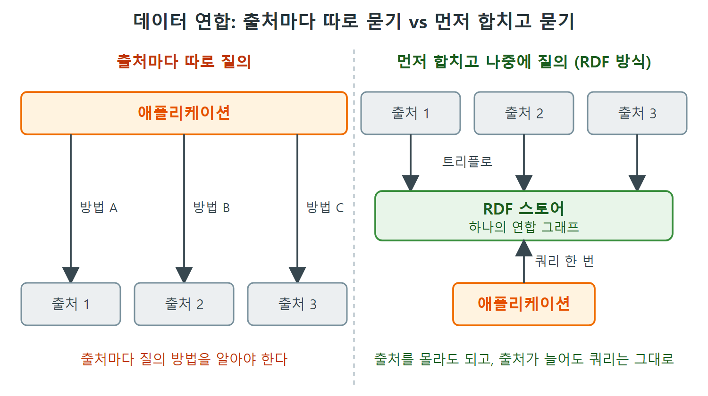

# 데이터 연합

여러 곳에 흩어진 데이터를 하나처럼 쓰는 것을 데이터 연합(data federation)이라 한다. 이 문서는 RDF가 이 일을 왜 단일한 방식으로 해낼 수 있는지, "먼저 합치고 나중에 질의한다"는 전략이 왜 좋은지, 그리고 이 책이 이후 내용에서 연합을 어떻게 전제하는지를 정리한다.

---

## 1. 모든 것을 트리플로 바꾼다

RDF 데이터 모델은 처음부터 데이터 연합을 염두에 두고 설계되었다. 어떤 출처의 정보든 트리플 집합으로 바꾸므로, 스프레드시트, XML, 데이터베이스 표, 웹 페이지 어느 쪽이든 연합이 하나의 메커니즘으로 이루어진다.

비유하자면 여러 나라 여행자의 돈을 한 가지 통화로 환전해서 한 지갑에 넣는 방식이다. 환전을 마친 뒤에는 어느 나라 돈이었는지 따지지 않고 지갑에서 꺼내 쓴다.

| 전략 | 순서 | 쿼리 작성자의 부담 |
|---|---|---|
| RDF 방식 | 여러 출처를 하나의 형식(트리플)으로 바꾸고 하나의 스토어에 합친 뒤 질의한다 | 출처를 신경 쓰지 않는다 |
| 대조되는 방식 | 애플리케이션이 각 출처를 그 형식에 맞는 방법으로 따로 질의한다 | 출처마다 방법을 알아야 한다 |

이 표는 원서가 말한 두 전략의 차이를 정리한 것이다. 오른쪽 열의 해석은 원서의 서술에서 이끌어 낸 것이다.

왼쪽은 애플리케이션이 출처마다 다른 방법으로 질의해야 하는 방식이고, 오른쪽은 출처를 트리플로 바꿔 스토어에 합친 뒤 쿼리 한 번으로 묻는 RDF 방식이다. 오른쪽에서는 출처가 늘어도 애플리케이션의 쿼리가 달라지지 않는다.

---

## 2. RDF는 파일 형식이 아니라 데이터 모델이다

여기서 기억할 점은 RDF가 파일 형식이나 데이터를 인코딩하는 특정 언어를 가리키지 않는다는 것이다. RDF는 정보를 트리플로 나타내는 데이터 모델이다. 이 특징 덕분에 위 방식의 연합이 가능하다.

병합 방법과 RDF 데이터 모델의 세부 사항은 소프트웨어 하나, 즉 RDF 스토어 안에 캡슐화해서 애플리케이션의 빌딩 블록으로 쓸 수 있다. 개발자는 병합 규칙을 직접 구현하지 않고 스토어에 맡기면 된다.

---

## 3. 먼저 합치고 나중에 묻는 전략의 이점

먼저 연합하고 연합된 정보 저장소에 질의하는 전략은 데이터 연합이라는 관심사를 애플리케이션의 운영상 관심사에서 분리한다. 이점은 다음과 같다.

| 이점 | 설명 |
|---|---|
| 출처를 몰라도 되는 쿼리 | 애플리케이션이 작성한 쿼리는 어떤 트리플이 어디서 왔는지 알 필요가 없다 |
| 여러 출처에 걸친 쿼리 | 쿼리 작성자가 정교하게 계획하지 않아도 하나의 쿼리가 여러 데이터 원천 위에서 매끄럽게 동작한다 |
| 변경에 강함 | 데이터 원천을 더 연합하도록 애플리케이션을 바꿔도 애플리케이션 안의 쿼리는 영향을 받지 않는다 |

쉽게 말해 데이터 원천을 추가하는 일이 쿼리를 고치는 일로 번지지 않는다. 새 원천은 스토어에 합치는 쪽에서만 처리하면 된다.

---

## 4. 이 책에서 연합이 갖는 위치

데이터 연합은 앞으로 이어질 논의의 열쇠가 되는 특징이다. RDFS(RDF Schema)와 OWL(Web Ontology Language)을 다룰 때, 이 책은 애플리케이션에 필요한 연합이 이미 끝났다고 가정한다. 모든 쿼리와 추론이 연합 그래프 위에서 일어난다는 뜻이다.

연합 그래프(federated graph)는 애플리케이션 쿼리가 실행될 모든 연합 데이터 원천의 정보를 담은 그래프를 말한다.

이 정의를 외워 두면 이후 장의 예제를 읽기 쉽다. 예제 속 데이터가 어디서 왔는지는 묻지 않고 "이미 합쳐진 하나의 그래프"로 생각하면 된다.

 
 
 

[Semantic Web for the Working Ontologist](../)
