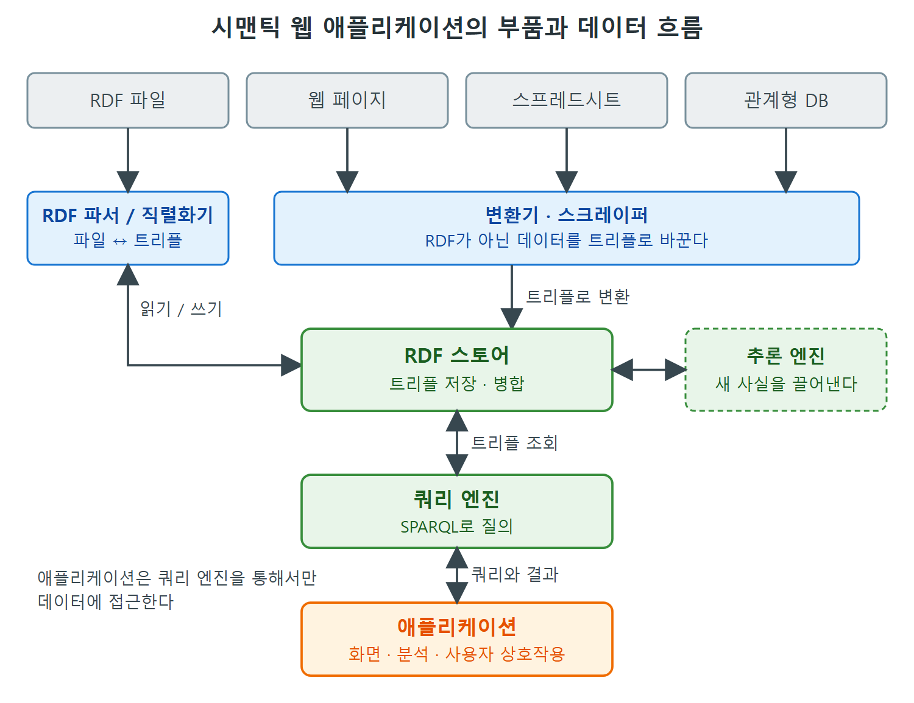

# 애플리케이션의 구성 요소

온톨로지를 만드는 이유는 결국 쓰기 위해서다. 이 책은 모델링을 다루는 책이지만, 만든 모델이 실제 애플리케이션 안에서 어떻게 돌아가는지 큰 그림을 알아야 모델링의 목적이 분명해진다. 이 문서는 시맨틱 웹 애플리케이션이 어떤 부품으로 이루어지는지, 그리고 익숙한 관계형 데이터베이스 기반 애플리케이션과 무엇이 같고 무엇이 다른지를 정리한다.

저자들은 특정 제품이나 도구 이름을 다루지 않는다. 새 제품이 계속 나오고, 연구 그룹과 전문 회사가 만든 제품도 있고 여러 라이선스의 무료 소프트웨어도 있기 때문이다. 대신 "어떤 종류의 부품이 있고 어떻게 맞물리는가"에 집중한다. W3C가 도구 목록을 위키 페이지로 관리하고 있다는 정도만 언급한다.

---

## 1. 왜 아키텍처를 알아야 하는가

모델링만 다루는 책이라면 시스템 구조 이야기는 빠져도 된다고 말할 수 있다. 하지만 이 책은 "일하는 온톨로지스트", 즉 모델을 쓰기 위해 만드는 사람을 위한 책이다. 모델은 웹에 흩어진 정보를 이용하는 어떤 애플리케이션을 만들 때 쓰인다.

그래서 시맨틱 웹을 실제로 일하게 하려면 다음 네 가지를 높은 수준에서 설명할 수 있어야 한다.

- 애플리케이션을 이루는 부품이 무엇인가
- 어떤 종류의 입력이 어디서 들어오는가
- RDF(Resource Description Framework, 자원 기술 프레임워크)를 어떻게 활용하는가
- 이것이 다른 애플리케이션 구조와 왜 다른가

앞 장들에서 RDF가 데이터를 웹 전체에 분산해서 표현하게 해 준다는 것을 봤다. 그 덕분에 시맨틱 웹은 "누구나, 어떤 주제에 대해서든, 무엇이든 말할 수 있는" 데이터의 웹이 된다. 원서는 이 원칙을 AAA(Anyone can say Anything about Any topic)라고 부른다. 이 책의 관심사는 그렇게 흩어진 데이터를 다시 쓸모 있게 모을 수 있도록 데이터를 기술하고 정의하는 모델링이다.

---

## 2. 부품 목록

원서는 파서/직렬화기, 스토어, 쿼리 엔진, 애플리케이션, 추론 엔진의 다섯 묶음을 든다. 아래 표는 이해를 돕기 위해 파서와 직렬화기를 나누어 적었다.

| 부품 | 하는 일 | 비고 |
|---|---|---|
| RDF 파서(parser) | 여러 직렬화 형식의 텍스트를 읽어 트리플로 해석한다 | 파일을 데이터로 바꾸는 입구 |
| RDF 직렬화기(serializer) | 트리플 묶음을 받아 특정 형식의 파일로 써 낸다 | 파서의 반대 방향 |
| RDF 스토어(store) | 트리플을 저장하고 꺼내는 데 맞춰 튜닝한 데이터베이스. 트리플 스토어라고도 한다 | 여러 출처의 정보를 합치는 기능이 기본 |
| RDF 쿼리 엔진(query engine) | 구조화된 질의에 맞춰 RDF 스토어에서 정보를 꺼낸다 | 스토어와 밀접하게 붙어 있다 |
| 애플리케이션 | 분석, 사용자 상호작용, 보관 같은 실제 일을 한다 | 프로그래밍 언어로 쓰고, 쿼리를 통해 스토어에 접근한다 |
| 추론 엔진(reasoning engine) | RDF 데이터와 스키마에서 논리적 결과를 끌어낸다 | 스토어나 쿼리 엔진과 가깝게 동작한다 |

표를 읽는 법은 간단하다. 파서와 직렬화기는 "파일과 트리플 사이의 통역사", 스토어와 쿼리 엔진은 "데이터 창고와 창구", 애플리케이션은 "창구를 이용하는 손님", 추론 엔진은 "저장된 사실에서 새 사실을 끌어내는 도우미"로 기억하면 된다.

다만 이 장의 본문은 추론 엔진을 따로 자세히 풀지 않고, 목록에서 한 줄로 소개하는 데 그친다.

---

## 3. 전체 구조를 그려 보면

부품이 서로 어떻게 이어지는지를 글자 그림으로 나타내면 다음과 같다. 원서의 그림은 쓰지 않았고, 본문 설명을 바탕으로 새로 그렸다.

```
  웹 페이지 / 스프레드시트 / DB ...
              |
        Converters & Scrapers
              |
  RDF Files --+--> Parser / Serializer
                          |
                      RDF Store <--> Query Engine
                                          |
                  Application (UI, Analytics, ...)
```

아래쪽 애플리케이션은 오직 쿼리 엔진을 통해서만 데이터에 접근한다. 위쪽에서는 여러 종류의 원천 데이터가 변환기와 파서를 거쳐 하나의 스토어로 모인다. 이 구조가 시맨틱 웹 애플리케이션의 핵심이다.



그림은 위쪽의 여러 출처가 파서나 변환기를 거쳐 RDF 스토어로 모이고, 애플리케이션이 쿼리 엔진을 통해서만 스토어에 접근하는 흐름을 보여 준다. 추론 엔진은 스토어 옆에서 저장된 사실로부터 새 사실을 끌어낸다.

---

## 4. 관계형 DB 기반 애플리케이션과의 비교

이 부품 대부분은 우리가 아는 관계형 데이터베이스 기반 애플리케이션에도 대응하는 것이 있다.

| 시맨틱 웹 쪽 | 관계형 쪽 | 같은 점과 다른 점 |
|---|---|---|
| RDF 스토어 | 관계형 데이터베이스 | 둘 다 데이터를 저장한다 |
| RDF 쿼리 엔진 (SPARQL) | 쿼리 언어와 쿼리 엔진 (SQL) | 둘 다 쿼리로 데이터를 꺼낸다 |
| 애플리케이션 | 애플리케이션 | 둘 다 범용 프로그래밍 언어로 쓰고 쿼리를 날려 결과를 처리한다 |
| 파서/직렬화기 | 표준 기준으로는 대응물이 없다 | 아래에서 설명 |

차이가 큰 곳은 파서와 직렬화기다. 표준 기준으로 볼 때 관계형 시스템에는 이에 해당하는 것이 없다. 어떤 관계형 데이터베이스의 내용을 직렬화해서, 의미 변화 없이 경쟁 제품에 그대로 불러올 수 있는 표준 형식이 없기 때문이다. 원서는 이것을 RDF 스토어가 전통적인 데이터 저장소보다 갖는 핵심 장점이라고 강조한다.

쉽게 비유하면, 관계형 DB 사이의 이사는 가구를 전부 분해해서 제조사마다 다른 방식으로 다시 조립하는 일에 가깝다. RDF 스토어 사이의 이사는 표준 규격의 박스에 담아 옮기는 일이다. 자세한 이야기는 스토어를 다루는 문서에서 이어 간다.

---

## 5. 이 장에서 앞으로 볼 내용

이 장은 각 부품을 차례로 살핀다. 새 제품이 계속 나오기 때문에 특정 제품을 지목하지 않고 일반적인 형태로만 설명한다.

| 절 | 주제 | 다루는 부품 |
|---|---|---|
| 4.1 | RDF 파서/직렬화기 | 트리플의 입출력, 관계형 DB와 웹 페이지에서 데이터 가져오기 |
| 4.2 | RDF 스토어 | 저장, 병합, 표준화의 이점, 쿼리 엔진 |
| 4.3 | 애플리케이션 코드 | 애플리케이션이 하는 일, 포털 구조 |
| 4.4 | 데이터 연합 | 합친 뒤에 질의하는 전략 |
| 4.5 | 요약 | 의미 모델이 구조 안에서 차지하는 자리 |

각 절은 이 노트의 다음 문서들과 그대로 이어진다. 전체를 훑고 싶다면 마지막 문서인 요약과 핵심 개념을 먼저 읽어도 된다.

<br>
<br>
<br>

[Semantic Web for the Working Ontologist](../)
