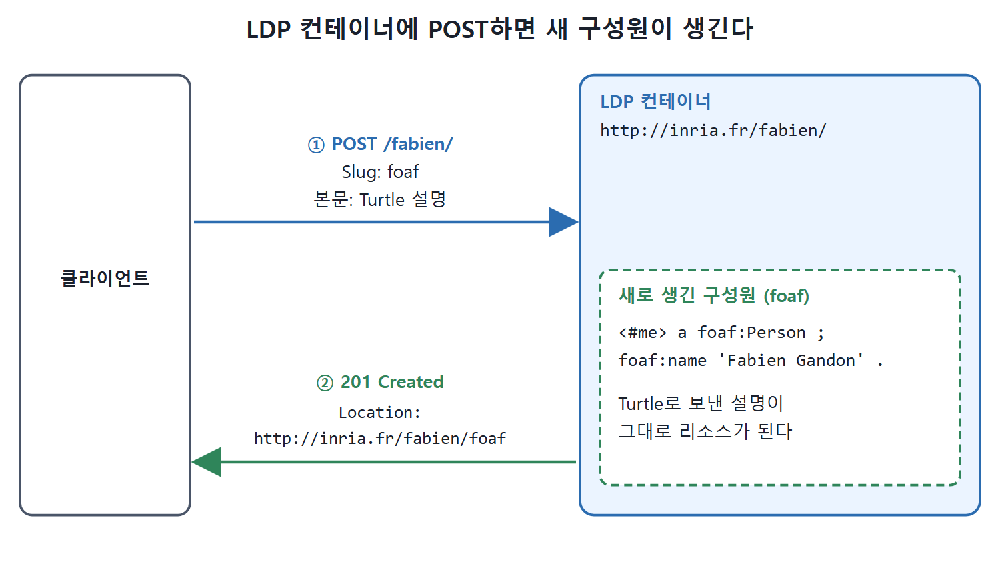

# 5스타 원칙과 LOD 클라우드

링크드 데이터가 얼마나 잘 갖춰졌는지 가늠하는 기준, 그리고 전 세계에 공개된 링크드 데이터 전체가 어떤 모양인지를 다루는 문서다. 별 다섯 개로 단계를 매기는 5스타 배포 체계와, 데이터셋을 점과 선으로 그린 링크드 오픈 데이터 클라우드(LOD Cloud), 그 안에서 중심 역할을 하는 출처들을 차례로 정리한다.

---

## 1. 머그잔에 새긴 링크드 데이터 원칙: 5스타 체계

W3C는 링크드 데이터 원칙을 요약해서 머그잔에 인쇄하기도 했다. 팀 버너스리가 제안한 링크드 데이터 5스타 배포 체계(5-star deployment scheme)다. 웹 데이터를 별 하나에서 다섯 개로 끌어올리는 규칙을 누적해서 나열한 것이다. 별을 하나 더 얻는 규칙은 앞의 모든 규칙을 만족한다고 전제한다. 규칙은 데이터를 웹에 공개하고, 비독점적인 구조화 형식으로, 열린 W3C 표준을 써서, 다른 데이터에 링크하라고 권한다.

| 별 | 조건 | 예 |
|---|---|---|
| 1개 | 어떤 형식이든 데이터가 웹에 있다 | 웹에 올린 PDF |
| 2개 | 기계가 읽을 수 있는 구조화 데이터로 제공한다 | 스캔한 이미지가 아니라 표 데이터 |
| 3개 | 비독점 형식으로 제공한다 | 마이크로소프트 엑셀이 아니라 CSV |
| 4개 | W3C의 열린 표준(RDF와 SPARQL)으로 게시한다 | RDF로 공개하고 SPARQL로 질의 |
| 5개 | 위의 모든 것에 더해 다른 링크드 오픈 데이터로 링크한다 | 다른 데이터셋의 URI를 재사용 |

표를 아래에서 위로 읽으면 "누적"의 의미가 보인다. 별 다섯 개짜리 데이터는 1~4개의 조건을 모두 갖춘 위에 링크까지 걸려 있다.

---

## 2. 또 하나의 구름: LOD 클라우드

링크드 오픈 데이터 클라우드(Linked Open Data Cloud, LOD Cloud)에서 "클라우드"는 컴퓨터 과학의 클라우드 컴퓨팅 방식과 상관이 없다. 링크드 데이터 원칙을 적용해서 얻은 링크드 데이터셋의 집합을 가리킨다.

이 구름은 그래프다. 노드는 공개 데이터셋을 나타내고, 두 데이터셋의 데이터가 연결되어 있으면 선으로 이어진다. 한 데이터셋이 다른 데이터셋의 식별자를 재사용해서 같은 리소스(사람, 장소 등)를 식별하는 경우가 이에 해당한다.

| 항목 | 내용 |
|---|---|
| 규모(2017년판) | 약 3000개에 가까운 데이터셋, 1500억 개 트리플 |
| 노드의 색 | 응용 분야(생명 과학, 출판, 정부, 지리 등) |
| 포함 기준 | Linked Open Data Hub 사이트에 등록한 데이터셋 |

이 구름은 데이터의 웹의 일부분일 뿐이다. 데이터셋 설명을 모으고 정리하는 Linked Open Data Hub 사이트에 등록한 데이터셋으로만 구성되고, 거기서 링크드 오픈 데이터 클라우드 다이어그램(Linking Open Data Cloud diagram)이 만들어진다. 책은 2007년과 2017년 십 년 간격의 다이어그램을 나란히 보여 준다.

---

## 3. 구름 속의 중심 출처들

구름에 포함된 출처 중에는 중심적이거나 역사가 깊어서 널리 알려진 것이 있다. 앞에서 대부분 본 것들이다.

| 출처 | 설명 |
|---|---|
| DBpedia | 처음으로 믿을 만한 열린 데이터와 식별자 출처의 하나. 개척자 격이고, 백과사전적 성격 덕분에 다른 데이터셋의 참조 기준으로 쓰기 좋다 |
| Wikidata | DBpedia의 가까운 친척. 다른 출처에서 데이터를 뽑는 대신, 구조화 데이터를 위키 방식으로 직접 편집하고 가꾼다. 이 데이터를 질의해서 다른 사이트의 표나 정보 상자(infobox) 같은 콘텐츠를 만들 수 있다 |
| Geonames | 모든 나라를 다루는 무료 지리 데이터베이스. 책을 쓸 때 1100만 개가 넘는 장소 설명(나라, 도시, 지역 등)이 있었고, 이름과 함께 통화, 인구, 언어, 면적, 지리 좌표 같은 정보가 있다 |
| UniProt | Universal Protein Resource. 단백질 서열과 주석의 포괄적인 데이터셋을 만들어 공개하는 국제 이니셔티브 |

---

## 4. 링크드 데이터 플랫폼(LDP)

웹이 애플리케이션 구조로 발전해 온 역사에서 큰 진전은 REST(Representational State Transfer)의 명세였다. REST는 웹에서 서비스를 구성하고 공개하는 방법에 대한 권장 사항이다. 핵심 구조는 이렇다. 리소스의 표현에 접근하고 조작하는 작고 통일되고 미리 정해진 연산 집합(특히 표준 HTTP 메서드 GET, PUT, PATCH, POST, DELETE)에 기대어 웹 서비스 사이의 상호 운용성을 보장한다. REST 원칙을 따르는 서비스를 RESTful하다고 한다. 책은 REST만으로도 책 한 권이 나온다며 이 정도만 소개한다.

REST가 성공한 뒤 W3C는 링크드 데이터 플랫폼(LDP, Linked Data Platform)을 정의했다. 웹 애플리케이션이 HTTP로 데이터 리소스를 게시, 편집, 삭제하는 방법을 정한 규격이다. 링크드 데이터에 REST식으로 접근하는 방법을 표준화한 명세이며, 링크드 데이터 리소스를 만들고 읽고 쓰는 클라이언트와 서버를 만드는 방법을 설명한다.

### 리소스의 두 종류

실제 애플리케이션은 여러 파일과 데이터 형식을 다루어야 하므로 LDP는 리소스를 두 가지로 나눈다.

| 종류 | 예 |
|---|---|
| RDF 표현이 있는 리소스(RDF 설명) | RDF로 쓴 프로필, 카탈로그 |
| 다른 형식의 리소스 | HTML 파일, 이미지, 바이너리 파일 |

### 컨테이너

웹에서 리소스를 더하거나 빼려면 그것을 읽고 쓸 데이터 공간이 필요하다. 그래서 LDP는 리소스를 묶고 관리하는 컨테이너(container) 개념을 도입한다. 컨테이너는 리소스의 컬렉션이며, 보통 구성원이 동질적이다(사용자 프로필 모음, 책 설명 카탈로그, 자동차 재고 목록 같은 것). 컨테이너 안의 리소스 관리를 얼마나 자동화해 주느냐에 따라 세 종류가 있다.

| 컨테이너 | 하는 일 |
|---|---|
| Basic Container(기본) | 단순한 포함 어휘와 접근 방식을 제공한다 |
| Direct Container(직접) | 분야별 소속 단언을 쓸 수 있다. 예를 들어 책 모음의 모든 리소스와 저자를 나타내는 리소스 사이에 "author"라는 관계를 단언한다 |
| Indirect Container(간접) | 만들어지는 분야별 구성원 리소스의 URI를 더 정밀하게 통제한다 |

### HTTP 동사가 하는 일

LDP는 각 HTTP 동사가 리소스와 컨테이너에 어떤 효과를 내는지 정한다. 책의 그림 5.16을 한국어 표로 옮기면 다음과 같다.

| 대상 | 메서드 | 결과 |
|---|---|---|
| 컨테이너 | GET | 컨테이너의 모든 구성원을 나열한다 |
| 컨테이너 | POST | 컨테이너에 새 구성원을 만든다 |
| 컨테이너 | PUT | 컨테이너의 설명을 갱신한다 |
| 컨테이너 | PATCH | 컨테이너 설명을 부분 갱신한다 |
| 컨테이너 | DELETE | 컨테이너를 삭제한다 |
| 그 밖의 리소스 | GET | 리소스의 표현을 가져온다 |
| 그 밖의 리소스 | PUT | 리소스 설명을 갱신한다 |
| 그 밖의 리소스 | PATCH | 리소스 설명을 부분 갱신한다 |
| 그 밖의 리소스 | DELETE | 리소스 설명을 삭제한다 |
| 컨테이너 또는 리소스 | OPTIONS | 리소스에 허용된 연산을 알아본다 |
| 컨테이너 또는 리소스 | HEAD | 리소스의 메타 정보만 가져온다 |

REST에 익숙한 개발자라면 평소 쓰던 동사 그대로이고, 대상이 "컨테이너"이냐 "그 밖의 리소스"이냐에 따라 뜻이 갈린다는 점만 기억하면 된다.

---

## 5. LDP 요청 예: 컨테이너에 POST

책의 그림 5.17은 LDP 컨테이너에 POST 요청을 보내고 결과를 받는 기록이다. 요청(1~13행)은 웹 서버(`inria.fr`, 2행)에 있는 LDP 플랫폼의 컨테이너(`/fabien/`, 1행)로 간다. 동사는 POST(1행)다. 앞의 표에서 컨테이너에 POST를 쓰면 새 구성원이 만들어진다. 요청은 RDF 리소스의 설명을 Turtle로 담아 보내고(4행에서 직렬화 지정), 새 리소스의 데이터를 요청 본문에 직접 넣는다(7~13행).

```
POST /fabien/ HTTP/1.1
Host: inria.fr
Link: <http://www.w3.org/ns/ldp#Resource>; rel="type"
Content-Type: text/turtle
Slug: foaf

<#me> a foaf:Person ;
    foaf:name 'Fabien Gandon' .
```

본문에는 원래 `foaf:PersonalProfileDocument`로 문서 자체를 설명하는 부분(`foaf:primaryTopic <#me>`, `dc:title`)과 `@prefix` 줄이 더 있지만 줄여서 옮겼다. 서버의 응답(15~18행)은 다음과 같다.

```
HTTP/1.1 201 Created
Location: http://inria.fr/fabien/foaf
Link: <http://www.w3.org/ns/ldp#Resource>; rel="type"
Content-Length: 0
```



위 그림은 요청과 응답이 어떻게 오가는지, 그리고 요청 본문의 Turtle 설명이 컨테이너 안의 새 리소스가 되는 모습을 보여 준다.

첫 줄의 `201 Created`는 서버가 요청을 받아들였고 리소스가 만들어졌음을 알리고, `Location` 헤더는 새로 만들어진 설명의 URI를 돌려준다. 요청의 `Slug: foaf` 헤더가 새 URI 끝부분 `foaf`가 되었다고 읽을 수 있지만, 이 해석은 원문이 직접 설명하지 않은 것이라 추정이다.

<br>
<br>
<br>

[Semantic Web for the Working Ontologist](../)
