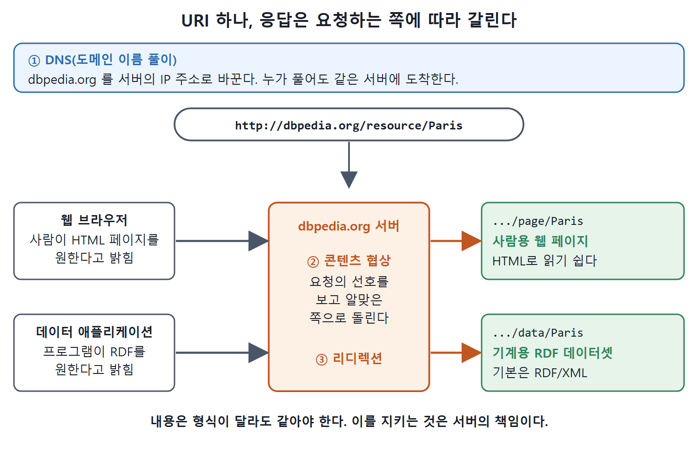

# HTTP와 웹의 세 기둥

HTTP URI가 "이름이면서 조회 수단"이 되려면 웹의 기본 구조가 받쳐 줘야 한다. 책은 이 구조를 세 개의 기둥으로 설명한다. 도메인 이름 풀이(DNS), 콘텐츠 협상, 그리고 리디렉션이다. 이 문서는 세 기둥이 각각 무슨 일을 하고, 데이터를 게시하는 사람과 소비하는 사람에게 어떤 의미인지 정리한다.

---

## 1. 세 기둥 한눈에 보기

| 기둥 | 하는 일 | 쉬운 비유 |
|---|---|---|
| 도메인 이름 풀이(DNS) | 도메인 이름을 서버의 인터넷 주소로 바꾼다 | 전화번호부 |
| 콘텐츠 협상(conneg) | 같은 URI에 대해 클라이언트가 원하는 형식으로 답한다 | 식당에서 "한국어 메뉴판 주세요" |
| 리디렉션 | 요청을 다른 주소로 돌려보낸다 | 이사 간 가게의 "새 주소 안내문" |

---

## 2. 첫째 기둥: 도메인 이름 풀이

HTTP URI를 풀 때 첫 단계는 "인터넷의 어느 호스트(기계)에 물어봐야 이 리소스의 데이터를 얻는가"를 알아내는 일이다. 이 일을 DNS(Domain Name System)가 맡는다. DNS는 인터넷에 연결된 장치와 서비스에 이름을 붙이는 분산형 계층 구조 체계다. 웹을 쓰는 사람은 매일 DNS를 쓴다. 도메인 이름(예: `ns.inria.fr`)을 그 도메인에 답하는 기계나 서비스의 인터넷 주소(IP 주소, 예: `128.93.162.87`)로 바꿔 주기 때문이다.

호스트를 IP 주소로 바로 적을 수도 있다(`http://128.93.162.87/`도 유효한 HTTP URI). 그래도 도메인 이름을 쓰는 것이 낫다.

- 사람이 읽고 기억하기 쉽다(예: `http://ns.inria.fr`).
- 더 중요한 이유로, URI가 안정된다. 서버의 주소가 바뀌어도 거기 있는 데이터의 URI는 그대로 둘 수 있다.

### DNS가 주는 것: 무엇에 대해 의견이 다른지에 대한 합의

DNS는 전 세계 누가 같은 HTTP URI를 풀어도 같은 곳에 도착하게 만든다. 그래서 전 세계에 통하는 참조 수단이 된다.

고양이 미치를 예로 들면, 한 출처는 "삼색 얼룩(calico)"이라고 하고 다른 출처는 "거북 등딱지(tortoiseshell)"라고 주장할 수 있고, 또 다른 출처는 주 단위로 몸무게를 기록할 수 있다. 전 세계에 분산된 데이터의 웹에서는 모두가 같은 말을 하리라고 기대할 수 없다. 하지만 DNS 덕분에 "우리가 지금 무엇을 두고 의견이 갈리는지"에는 합의할 수 있다.

### 도메인을 잃으면 데이터도 잃는다

모든 조회는 도메인 이름 풀이로 시작한다. 그래서 어떤 도메인의 DNS 등록을 통제하는 사람이, 그 도메인으로 만든 HTTP URI의 접근을 통제한다. DNS가 URI를 어느 서버로 연결할지 그 사람이 정하기 때문이다. 도메인 이름 통제권을 잃으면 그 도메인을 쓴 링크드 데이터의 통제권도 잃는다. HTTP URI를 조회했을 때 나오는 답을 더 이상 통제하지 못한다.

따라서 링크드 데이터의 식별자 패턴에 쓸 host 도메인을 고를 때는 영속성과 통제권을 확보할 수 있는지 신중히 따져야 한다.

W3C(World Wide Web Consortium)가 정의한 `rdf:`, `rdfs:`, `owl:` 네임스페이스가 좋은 예다. 예를 들어 `rdf:type`(`http://www.w3.org/1999/02/22-rdf-syntax-ns#type`의 줄임)이 무슨 뜻인지 궁금하면 그 URI를 풀어 보면 된다(웹 브라우저로 해 보라고 책은 권한다). 결과는 `w3.org` 도메인을 소유한 W3C가 통제한다. W3C 네임스페이스는 모두 `w3.org`를 host로 쓰므로, 누가 조회하든 W3C가 주기로 한 답을 얻는다. 그리고 이 접근 하나하나는 맞춤 응답을 협상할 수 있다.

---

## 3. 둘째 기둥: 콘텐츠 협상

웹은 하나이고, 데이터, 하이퍼텍스트, 스키마, 서비스 같은 여러 면이 서로 연결되어 있다. 웹은 기계와 사람이 동시에 쓰는 공유 공간이다. 그러니 사람이든 소프트웨어 에이전트든 같은 리소스의 설명을 각자에게 가장 알맞은 형식으로 받을 수 있어야 한다. 사람에게는 HTML 웹 페이지, 웹 로봇에게는 RDF/XML 설명이 맞다. 사람마다 선호하는 언어(영어, 중국어, 프랑스어)가 다르고, 소프트웨어도 선호하는 데이터 형식(JSON-LD인지 CSV인지)이 다르다.

HTTP 프로토콜을 쓰면 웹 클라이언트가 HTTP URI 조회에 대한 응답 내용을 협상할 수 있다. 이 방식을 줄여서 conneg라고 부르며 HTTP 표준의 일부다. 클라이언트는 요청에 헤더를 넣어 선호를 밝힌다. 이 헤더들은 여러 표준에 기대어 다음을 지정한다.

| 지정하는 것 | 근거 표준 |
|---|---|
| 형식 | 미디어 타입(MIME 타입) |
| 자연어 | ISO 언어 코드 |

서버는 클라이언트의 선호와 자신이 가진 선택지를 맞춰 보고 가장 알맞은 응답을 고르거나 요청을 다른 곳으로 돌린다. 이 맞추는 책임은 서버에 있다. 그 결과 같은 URI에 두 클라이언트가 접근해도, 사람이 쓰는 웹 브라우저는 HTML 설명을 받고, 소프트웨어는 같은 HTTP URI에서 RDF 설명을 협상해 받는다.

링크드 데이터 애플리케이션은 더 나아가 선호하는 RDF 문법(XML, Turtle, JSON-LD)이나 다른 표현(HTML, 텍스트, 이미지)도 협상할 수 있다.

### 예: DBpedia의 파리

DBpedia는 Wikipedia에서 뽑은 RDF 데이터를 제공하는 사이트다. 파리(Paris)라는 대상은 다음 URI로 식별된다.

```
http://dbpedia.org/resource/Paris
```

| 요청하는 쪽 | 도착하는 곳 | 내용 |
|---|---|---|
| 웹 브라우저로 보는 사람 | `http://dbpedia.org/page/Paris` | 사람용 웹 페이지 |
| 데이터를 협상하는 애플리케이션 | `http://dbpedia.org/data/Paris` | RDF로 된 데이터셋(기본은 RDF/XML) |



위 그림은 DNS가 서버를 찾아 준 뒤, 서버가 콘텐츠 협상으로 요청한 쪽의 선호를 보고 같은 URI에서 웹 페이지 또는 RDF로 돌려보내는 흐름을 보여 준다.

표에서 보듯 URI는 하나이고 응답만 상대에 따라 갈린다. conneg 덕분에 하이퍼텍스트 웹과 데이터 웹(어차피 같은 웹)에서 같은 HTTP URI를 쓰면서도 묻는 쪽에 따라 다른 응답을 줄 수 있다. 응답의 내용이 형식과 상관없이 같도록 지키는 것은 서버의 책임이다.

---

## 4. 셋째 기둥: HTTP 리디렉션

웹을 써 본 사람은 링크가 깨졌을 때 브라우저에 뜨는 "404 Not Found"를 안다. 페이지가 삭제됐거나 애초에 없는 URL(오타 등)을 열었을 때다. 404는 가장 눈에 많이 띄어서 유명한 HTTP 코드일 뿐이고, 다른 코드도 많다. "200 OK"는 요청이 성공해서 원하는 내용이나 결과를 응답에 담았다는 뜻이다. 매번 받지만 눈에 띄지 않는다.

리디렉션의 평범한 용도는 깨진 링크를 막는 것이다. 페이지가 옮겨지거나, 웹 애플리케이션을 다시 설계하거나, 사이트를 이전하면, 서버에 리디렉션을 걸어 클라이언트를 새 주소로 보낸다. 주소창이 바뀌는 걸 눈여겨보지 않으면 알아채지도 못할 만큼 흔하다. 리디렉션 코드는 3으로 시작하고 종류를 나타낸다.

| 코드 | 이름 | 의미 |
|---|---|---|
| 200 | OK | 요청 성공, 응답에 내용이 담겨 있다 |
| 301 | (영구 이동) | 요청한 리소스에 새 영구 URI가 할당되었고, 응답에 그 URI가 있다 |
| 302 | (임시 이동) | 리소스가 일시적으로 다른 URI에 있고, 응답에 그 URI가 있다 |
| 303 | See Other | 다른 주소로 가서 응답을 찾으라고 안내한다 |
| 404 | Not Found | 링크가 깨졌거나 URL이 없다. 인식되지 않는 URI라는 뜻 |

### 웹에 없는 것의 URI에는 303

고양이, 자동차, 법, 사람처럼 웹에 없는 리소스를 HTTP URI로 식별하는 경우를 생각해 보자. 이때 "200 OK"로 응답하는 것은 맞지 않다. 식별된 리소스에 웹으로 접근할 수 없기 때문이다. "404 Not Found"도 URI를 인식하지 못한다는 뜻으로 오해시키므로 맞지 않다.

한 가지 방법이 "303 See Other"다. 응답을 찾을 수 있는 다른 주소로 요청을 돌리라는 코드다. 303 응답은 다음과 같이 생겼고 Location 헤더가 조회할 다른 주소를 알려 준다.

```
HTTP/1.1 303 See Other
Location: http://animals.org/page/cat/1278
```

HTTP URI에 303으로 응답한다는 것은 DNS가 URI를 맡긴 서비스가 대상 리소스의 표현을 직접 줄 수는 없지만, 요청한 쪽을 다른 리소스로 안내할 수는 있다는 뜻이다. 그 다른 리소스는 대상 리소스에 대한 설명이고 HTTP로 전송할 수 있다. 웹에 없는 것을 가리키는 URI 요청에 웹과 어긋나지 않게 답하는 방법이 이것이다.

단, 안내받은 설명에는 대상 리소스에 대한 정보가 담겨 있어야 한다. 협상한 콘텐츠가 웹 페이지라면 최소한 일부 내용이 대상 리소스에 대한 것이어야 하고, RDF라면 응답의 트리플 중 적어도 일부가 대상 리소스의 URI를 사용해야 한다.

---

## 5. 정리

| 질문 | 답 |
|---|---|
| 이 URI는 어느 서버로 가는가? | DNS가 정한다. 도메인 통제권이 곧 URI 통제권이다 |
| 사람과 프로그램에 다른 응답을 주려면? | 콘텐츠 협상(conneg)을 쓴다 |
| 웹에 없는 대상의 URI에는 어떻게 답하는가? | 303 See Other로 설명 문서 주소를 안내한다 |
| 서버가 지켜야 할 것은? | 형식이 달라도 응답의 내용이 같도록 지킨다 |

<br>
<br>
<br>

[Semantic Web for the Working Ontologist](../)
