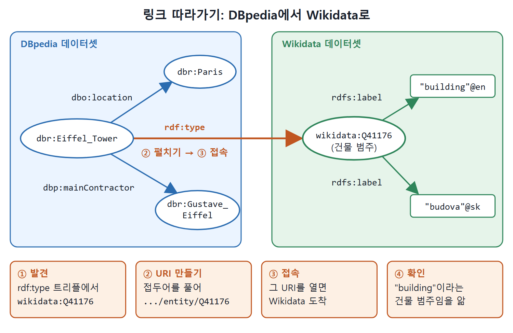

# 실제 링크드 데이터 둘러보기

이론만 읽으면 링크드 데이터가 와닿지 않는다. 책은 웹에 실제로 공개된 예를 직접 열어 보게 한다. 이 문서는 서지 정보 서비스 DBLP, 단백질 데이터 UniProt, 위키백과를 데이터로 만든 DBpedia, 그리고 DBpedia에서 Wikidata로 넘어가는 링크 따라가기를 차례로 본다. 책은 이 예들이 책을 쓰던 때에는 접속할 수 있었지만, 웹은 빨리 바뀌므로 앞으로도 그대로 동작한다는 보장은 없다고 말한다.

---

## 1. 사례 한눈에 보기

| 사례 | 무엇을 제공하나 | 보여 주는 점 |
|---|---|---|
| DBLP | 컴퓨터 과학 논문과 책의 서지 정보 | 같은 데이터를 사람용 HTML과 기계용 RDF로 제공 |
| UniProt | 단백질 서열과 기능 정보 | 영속 URI에서 사람용과 기계용으로 리디렉션 |
| DBpedia | Wikipedia 등에서 뽑은 구조화 데이터 | 리디렉션과 conneg, 그리고 외부 데이터셋과의 링크 |
| Wikidata | 위키미디어 프로젝트의 구조화 데이터 저장소 | 링크를 따라가 도착하는 다른 데이터셋 |

---

## 2. DBLP: 같은 데이터, 두 가지 얼굴

DBLP는 전 세계 컴퓨터 과학 출판물의 서지 정보를 관리하는 서비스다. DBLP에 기록된 출판물은 모두 RDF 데이터로도 얻을 수 있다. 각 페이지에는 여러 형식의 RDF 데이터로 가는 링크가 있다. 이 책은 RDF를 늘 Turtle로 보여 주는 관례에 맞춰 Turtle로 옮기는데, DBLP가 직접 내려주는 형식에는 Turtle이 없다.

이 책의 2판(Semantic Web for the Working Ontologist, Second Edition)이 DBLP에 색인되어 있고 식별 번호는 0028543이다. 이 정보는 두 가지로 얻는다.

| 형태 | 주소 |
|---|---|
| 사람이 읽는 HTML | `https://dblp.org/rec/html/books/daglib/0028543` |
| 기계가 읽는 RDF | `https://dblp.org/rec/rdf/books/daglib/0028543` |

RDF의 트리플 일부(원문 그림 5.5를 줄임)는 다음과 같은 모양이다.

```
<https://dblp.org/rec/books/daglib/0028543>
    rdf:type dblp:Publication ;
    owl:sameAs <urn:isbn:978-0-12-385965-5> ;
    dblp:bibtexType bibtex:Book ;
    dblp:publicationType dblp:Book ;
    dblp:authoredBy <https://dblp.org/pers/a/Allemang:Dean> ;
    dblp:yearOfPublication "2011" ;
    dblp:publishedBy "Morgan Kaufmann" ;
    dblp:isbn13 "978-0-12-385965-5" .
```

주의: 추출 본문에서 이 코드는 공백이 섞여 깨져 있어 줄 구성을 문맥으로 복원했다. `dblp:authoredBy`는 저자 수만큼 반복되며 원문에는 Hendler 항목도 있다.

DBLP는 같은 데이터를 목적에 맞게 다른 형태로 주는 간단한 예다. HTML은 활자와 스타일 덕분에 사람에게 보기 좋지만 기계가 읽기는 어렵다. RDF 트리플은 상호 참조와 고유 식별자에 의존해서 사람이 읽기는 어렵지만 기계가 처리하기는 쉽다.

---

## 3. UniProt: 영속 URI와 리디렉션

UniProt(Universal Protein Resource)는 과학계에 포괄적이고 품질 좋고 자유롭게 쓸 수 있는 단백질 서열과 기능 정보를 제공하는 서비스다. 그중 단백질 서열과 기능에 대한 RDF 설명도 제공한다. 생물학자가 "Cell surface glycoprotein MUC18"에 관심이 있다면 그 단백질의 URI는 다음과 같다.

```
http://purl.uniprot.org/uniprot/P43121
```

이 영속 URI에 누가 접속하느냐에 따라 응답이 리디렉션된다.

| 접속하는 쪽 | 리디렉션되는 곳 | 결과 |
|---|---|---|
| 사람이 쓰는 웹 브라우저 | `https://www.uniprot.org/uniprot/P43121` | 브라우저로 보는 HTML 페이지 |
| 기계 | `https://www.uniprot.org/uniprot/P43121.ttl` | RDF 문서(Turtle) |

기계용 RDF 문서의 발췌(원문 그림 5.7, 일부 줄만)는 아래와 같다.

```
:P43121 rdf:type up:Protein ;
    up:reviewed true ;
    up:created "1995-11-01" ;
    up:modified "2019-05-08" ;
    up:version 173 ;
    up:mnemonic "MUC18_HUMAN" ;
    up:oldMnemonic "MU18_HUMAN" .
```

원문에는 `up:replaces`로 다른 단백질 ID 네 개를 가리키는 줄과 `up:citation` 줄도 이어진다.

---

## 4. DBpedia: 위키백과를 데이터로

DBpedia는 여러 위키미디어 프로젝트(유명한 Wikipedia 백과사전 포함)에서 구조화된 내용을 뽑아내는, 크라우드소싱 기반 커뮤니티 활동이다. Wikipedia 등의 페이지에서 구조화 데이터를 뽑아 공개하므로 폭넓은 분야와 주제를 다룬다. 앞의 사례들처럼 DBpedia도 RDF와 링크드 데이터 원칙으로 정보를 게시한다. 모든 주제가 HTTP URI를 가지고, 그 설명은 리디렉션과 콘텐츠 협상으로 HTML이나 RDF로 제공된다.

예로 "에펠 탑"(Eiffel Tower) 개념의 식별자는 `http://dbpedia.org/resource/Eiffel_Tower`다.

| 접속 | 리디렉션 |
|---|---|
| 브라우저로 접속 | `http://dbpedia.org/page/Eiffel_Tower`: 공개된 링크드 데이터로 추출한 모든 데이터를 보여 주는 HTML 페이지 |
| Turtle/N3 형식을 협상 | `http://dbpedia.org/data/Eiffel_Tower.n3` 같은 URL |

N3로 받은 데이터의 일부(원문 그림 5.9에서 줄임, 접두어 선언은 생략)는 다음과 같다.

```
dbr:Eiffel_Tower
    rdf:type umbel-rc:Skyscraper , wikidata:Q41176 ,
             umbel-rc:Building , dbo:Building ;
    dbo:buildingStartDate "28 January 1887" ;
    dbo:floorCount "3"^^xsd:positiveInteger ;
    dbp:mainContractor dbr:Gustave_Eiffel ;
    dbo:location dbr:Paris , dbr:France ;
    dbp:elevatorCount 8 ;
    dbp:height 300 .
```

원문에는 위도와 경도 속성(`dbp:latd`, `dbp:latm`, `dbp:longd` 등)과 `dbo:Location`, `dbo:Place` 타입, 7구(7th arrondissement) 위치도 있다. 추출 본문에서 일부 접두어가 깨져 있어 줄을 문맥으로 복원했다.

---

## 5. 링크 따라가기: DBpedia에서 Wikidata로

이제 링크드 데이터를 제대로 해 보자. 위 RDF에는 에펠 탑의 타입이 `wikidata:Q41176`이라는 트리플이 있다(책의 그림 5.9에서는 8행). `wikidata:` 접두어는 6행에서 선언한 네임스페이스다. 이 이름이 무슨 뜻인지 아직 모르지만, Follow Your Nose대로 CURIE를 펼쳐(접두어를 선언된 네임스페이스로 바꿔) HTTP URI를 만들고 접속해 보면 된다.

```
http://www.wikidata.org/entity/Q41176
```

브라우저로 접속하면 `https://www.wikidata.org/wiki/Q41176`으로 리디렉션되고, 이 리소스에 관한 모든 데이터를 보여 주는 HTML 페이지가 나온다. 이 페이지는 데이터의 웹에서 중요한 또 다른 출처인 Wikidata의 일부다.

Wikidata는 위키미디어 재단의 또 다른 프로젝트로, Wikipedia, Wikivoyage 등 재단의 다른 프로젝트가 쓰는 구조화 데이터의 중앙 저장소다. 재단의 많은 활동처럼 이 지식 베이스도 웹에 열려 있고 사람과 기계 모두 읽고 편집할 수 있다. 앞의 사례처럼 응용 프로그램이 같은 데이터를 다른 형식(예: RDF N-Triples)으로 달라고 요청할 수도 있다.

N-Triples 본문의 일부(원문 그림 5.11)는 이 리소스에 언어별 이름표가 달려 있음을 보여 준다.

```
<http://www.wikidata.org/entity/Q41176> rdfs:label "building"@en .
<http://www.wikidata.org/entity/Q41176> skos:prefLabel "building"@en .
<http://www.wikidata.org/entity/Q41176> <http://schema.org/name> "building"@en .
<http://www.wikidata.org/entity/Q41176> rdfs:label "budova"@sk .
```

같은 이름표가 `rdfs:label`, `skos:prefLabel`, `schema:name` 세 가지 속성으로 반복되고, 언어별(영어 en, 슬로바키아어 sk, 원문에는 pih도 있다)로도 있다.

이 조각들을 맞추면, DBpedia가 에펠 탑의 타입으로 나열한 수수께끼 같은 `wikidata:Q41176`은 Wikidata가 표현하는 "건물(Building)" 범주다. 에펠 탑의 전체 모습, 즉 건물이라는 사실까지 얻으려면 DBpedia와 Wikidata 두 데이터셋의 정보를 합쳐야 한다. 두 데이터 출처 사이의 링크가 실제로 동작하는 것을 본 셈이다.

| 단계 | 한 일 | 결과 |
|---|---|---|
| 1 | DBpedia에서 에펠 탑의 URI 조회 | RDF에서 `wikidata:Q41176` 발견 |
| 2 | CURIE를 네임스페이스로 펼쳐 URI 생성 | `http://www.wikidata.org/entity/Q41176` |
| 3 | 그 URI에 접속 | Wikidata 페이지 도착 |
| 4 | 설명 확인 | "건물" 범주임을 알게 됨 |



위 그림은 에펠 탑의 `rdf:type` 트리플이 DBpedia 밖의 Wikidata 리소스를 가리키고, 그 링크를 따라가면 두 데이터셋이 이어져 "건물"이라는 이름표를 얻는 과정을 보여 준다.

---

## 6. RDF가 링크드 데이터에 잘 맞는 이유

링크드 데이터를 게시하는 권장 형식은 RDF다. 3장에서 보았듯 RDF는 XML, Turtle, JSON-LD, RDFa 등 여러 직렬화가 있고, HTTP URI를 디레퍼런싱할 때 콘텐츠 협상으로 형식을 지정할 수 있다. 어떤 직렬화든 내용은 트리플의 집합이고, 각 트리플의 구성 요소는 HTTP URI다.

RDF가 모든 것을 URI로 식별한다는 사실 자체가 웹에서 설명을 게시, 교환, 확장하기에 좋은 데이터 모델이 되게 한다. HTTP URI는 어떤 식별자에 대한 데이터든 얻고 보강하는 표준 방식을 제공한다. 트리플에는 최대 세 개의 HTTP URI(주어, 서술어, 목적어)가 들어 있고, 각각이 코를 따라가 새 데이터를 찾는 출발점이 된다. RDF 데이터셋에 쓰인 HTTP URI는 모두 더 알아보려고 조회할 수 있다.

<br>
<br>
<br>

[Semantic Web for the Working Ontologist](../)
