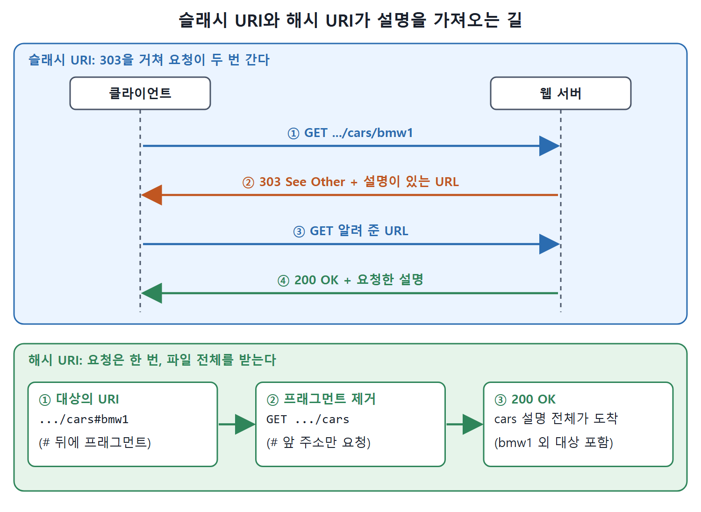

# 해시 URI와 슬래시 URI

웹에 없는 것(고양이, 자동차, 개념)에 HTTP URI를 붙일 때는 "그것의 URI"와 "그것을 설명하는 문서의 URI"를 서로 다르게 유지해야 한다. 이 요구를 HTTP 규칙에 맞게 풀어 주는 설계 패턴이 크게 두 가지 있다. URI에 `#`을 쓰는 해시 URI와, `/`만 쓰고 303 리디렉션을 쓰는 슬래시 URI다. 『걸리버 여행기』와 컴퓨터 과학의 관계를 아는 독자라면 처음에는 이 구분이 리틀엔디언 대 빅엔디언 논쟁처럼 들릴 수 있다고 책은 말한다. 하지만 실제로는 각자 장단점이 뚜렷하다. 둘 다 콘텐츠 협상과 함께 쓸 수 있다.

---

## 1. 해시 URI

해시 URI는 URI 안에 해시 문자 `#`이 들어 있는 방식이다. `#`과 그 뒤의 문자열을 프래그먼트 식별자(fragment identifier)라고 한다. 원래 URL에서는 웹 페이지의 한 부분을 가리키는 데 쓴다. 예를 들어 아래 주소는 `publications.html` 페이지 안의 "navothers"라는 절을 가리킬 수 있다.

```
http://fabien.info/publications.html#navothers
```

`#`으로 프래그먼트를 구분한 URI를 디레퍼런싱하면, 프래그먼트를 떼어 내고 그 앞의 URI로 조회한다. 위 예에서 웹 브라우저가 실제로 접근하는 곳은 `http://fabien.info/publications.html`뿐이다. 받아 온 표현에서 프래그먼트를 다시 써서, 문서 안의 해당 절로 자동 스크롤하는 식이다.

일반화하면 다음과 같다. HTTP 표준은 클라이언트가 요청 전에 프래그먼트를 제거하도록 요구하므로, 아래 URI로 HTTP 호출을 하면 실제로는 `#` 앞의 주소로 요청이 간다.

```
http://my.domain.name/my/path#the-fragment
```

이렇게 프래그먼트를 쓰면 "대상의 URI(프래그먼트 있음)"와 "설명의 URI(프래그먼트 없음)"가 서로 다른 식별자가 된다.

### 해시 URI의 장점

| 장점 | 설명 |
|---|---|
| 리디렉션 없이 구분한다 | 설명의 이름과 설명되는 리소스의 이름을 따로 두면서 리디렉션을 하지 않는다 |
| 여러 설명을 묶는다 | 한 리소스에 여러 설명을 모아 두고, 클라이언트가 이를 캐시해 연결된 리소스를 찾을 때마다 여러 번 호출하지 않게 한다 |

예를 들어 `http://workingontologist.org/fabien/objects/cars` 한 곳에서 여러 대상을 설명할 수 있다.

```
http://workingontologist.org/fabien/objects/cars#bmw1
http://workingontologist.org/fabien/objects/cars#smart1
http://workingontologist.org/fabien/objects/cars#tesla1
```

### 해시 URI의 단점

장점이 곧 단점이 된다. 주소에 접근할 때마다 설명 출처 전체를 가져오므로, 리소스 하나의 설명만 얻을 수는 없다. 설명하는 리소스가 많으면 네트워크 트래픽, 메모리, 처리 비용이 커질 수 있다.

---

## 2. 슬래시 URI(303 URI)

대안은 `#` 없이 슬래시(`/`)만으로 식별자를 만드는 것이다. 예는 다음과 같다.

```
http://workingontologist.org/fabien/objects/cars/bmw1
```

이 방식은 "303 URI", "슬래시 URI", "303 리디렉션"이라고도 부른다. 대상의 HTTP URI에 접근하면 "303 See Other"로, 그 대상의 설명이 있는 어떤 URL로 돌려보낸다. 슬래시 URI의 디레퍼런싱은 네 단계로 진행된다.

| 단계 | 누가 | 무엇을 |
|---|---|---|
| 1 | 클라이언트 | 슬래시 URI에 첫 접속을 시도한다(HTTP GET) |
| 2 | 서버 | "303 See Other" 코드와 설명을 얻을 URL로 응답한다 |
| 3 | 클라이언트 | 알려 준 URL로 두 번째 호출을 한다(HTTP GET) |
| 4 | 서버 | 요청한 설명을 준다(200 OK) |

다른 URI 풀이와 마찬가지로, 이 과정도 콘텐츠 협상과 결합하면 클라이언트의 선호에 최대한 맞는 결과를 웹 서버가 준다.

| 장점 | 단점 |
|---|---|
| 설명의 저장과 전송을 훨씬 모듈식으로 할 수 있다. 클라이언트가 필요한 설명만 가져온다 | HTTP 호출이 두 배로 늘어난다(처음 접속과 리디렉션 후 두 번째) |
| | 데이터가 조각나서, 여러 개를 모아 가져오려면 호출이 여러 번 필요하다 |

---

## 3. 어느 쪽을 고를까



위 그림은 슬래시 URI가 303 리디렉션을 거쳐 요청을 두 번 보내는 반면, 해시 URI는 프래그먼트를 떼고 한 번만 요청해 파일 전체를 받는다는 차이를 나란히 보여 준다.

| 기준 | 해시 URI | 슬래시 URI |
|---|---|---|
| 설명 단위 | 파일 하나에 여러 대상을 묶는다 | 대상마다 따로 설명을 줄 수 있다 |
| 요청 횟수 | 1번 | 2번(303 후 다시 요청) |
| 부분 조회 | 불가. 파일 전체를 받는다 | 가능 |
| 구현 난이도 | 쉽다. 파일을 웹 서버에 올려 두면 된다 | 더 기술적이다. 대신 내려주는 데이터를 더 통제할 수 있다 |
| 알맞은 경우 | 작은 데이터셋. 묶는 것이 자연스러운 경우(내용이 하나, 서로 연결, 수명 주기가 같음) | 큰 데이터셋. 조각 단위로 전송하고 싶을 때 |

책은 프래그먼트(해시) 방식을 작은 데이터셋에 쓰라고 권한다. 전형적인 예가 어휘, 스키마, 온톨로지다. 이것들은 한 묶음으로 같이 읽고 같이 바뀌는 경우가 많기 때문이다.

---

## 4. 둘을 섞기: 인위적 프래그먼트

두 방식을 같은 데이터셋 안에서 섞어 써도 된다. 흔한 방법은 `#me`나 `#this` 같은 인위적인 프래그먼트를 붙여, 슬래시 URI의 모듈성과 해시 URI의 단순함을 함께 얻는 것이다.

전체 경로는 슬래시로 만들어 설명의 저장과 전송을 모듈식으로 하고, 끝에 인위적 프래그먼트(`#this`)를 붙인다. 그러면 대상의 URI(프래그먼트 있음)와 설명의 URI(프래그먼트 없음)가 다른 식별자가 되어 리디렉션도 피할 수 있다. 책은 이를 "케이크를 가지면서 먹기도 하는" 방법이라고 표현한다.

```
http://workingontologist.org/fabien/objects/cars/tesla1#this
```

이 URI에서 `.../cars/tesla1`은 설명 문서의 주소이고, `#this`가 붙은 URI가 테슬라 자동차 자체를 가리킨다. 클라이언트는 `#this`를 떼고 `tesla1` 문서만 요청하므로, 303 없이 한 번에 그 대상의 설명을 받는다.

---

## 5. 핵심 정리

| 질문 | 답 |
|---|---|
| 왜 두 방식이 필요한가? | 웹에 없는 대상의 URI와 설명 문서의 URI를 구분하면서 HTTP 규칙을 지키기 위해서다 |
| 해시 URI에서 서버가 받는 주소는? | `#` 앞부분까지다. 클라이언트가 프래그먼트를 제거하고 요청한다 |
| 슬래시 URI의 핵심 응답 코드는? | 303 See Other |
| 둘의 절충안은? | 슬래시 경로에 `#this`, `#me` 같은 인위적 프래그먼트를 붙인다 |

<br>
<br>
<br>

[Semantic Web for the Working Ontologist](../)
