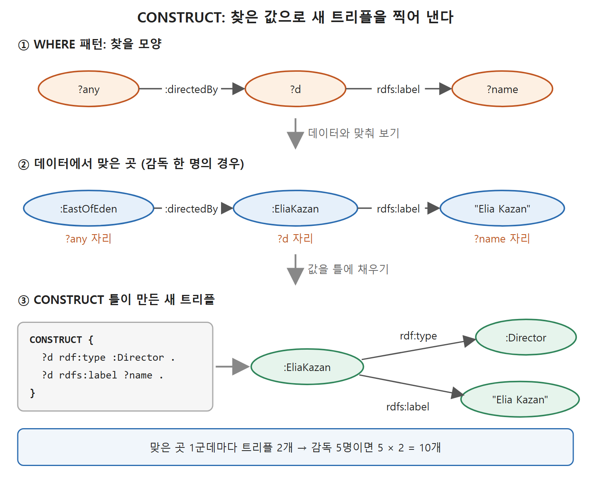
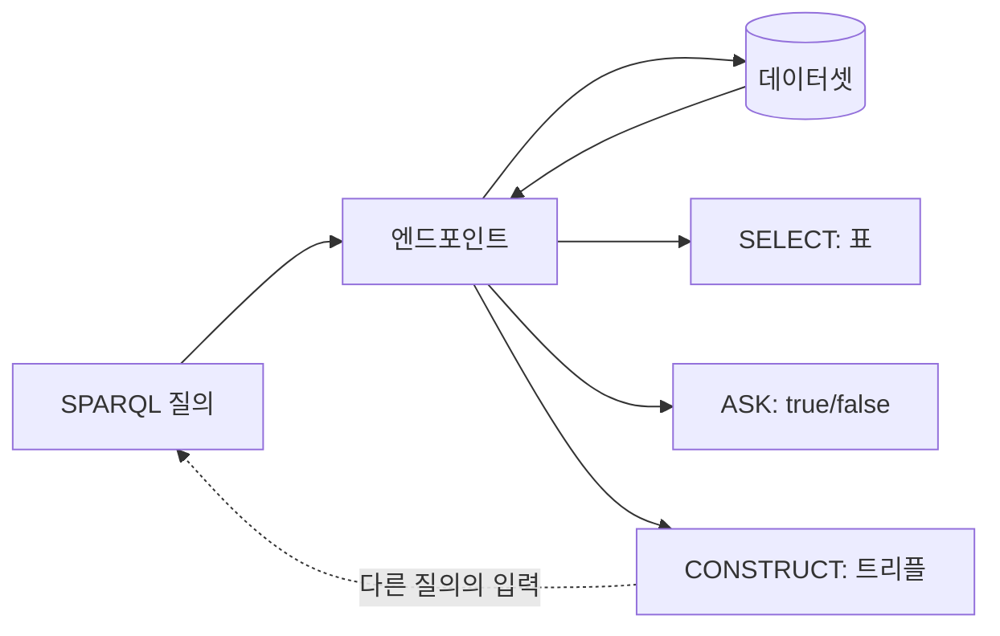

# CONSTRUCT 질의와 결과 활용

지금까지 질의의 답은 표(SELECT)이거나 참/거짓 한 비트(ASK)였다. RDF 세계에서는 답이 RDF 그래프 자체일 수도 있다. 그것이 CONSTRUCT 질의다. 이 문서는 CONSTRUCT가 어떻게 새 트리플을 만들어 내는지, 그 결과를 어디에 쓸 수 있는지, 그리고 SPARQL의 "P"인 프로토콜과 엔드포인트(endpoint, 질의를 받아 주는 웹 주소의 서비스)가 무엇인지 다룬다.

---

## 1. 왜 표만으로는 부족한가

데이터셋의 모든 영화감독을 알고 싶다고 하자. 영화가 누구에게 감독되었는지 찾는 질의로도 가능하다.

```
SELECT ?director
WHERE { ?m :directedBy ?director }
```

결과는 :EliaKazan, :FredGuiol, :GeorgeCukor, :GeorgeStevens, :NicholasRay 등의 표다. 이 표를 보고 "이들은 감독이다"라고 아는 것은 우리가 변수 이름을 ?director라고 지었기 때문이다. 표 자체는 스프레드시트나 관계형 데이터베이스에 붙여 넣기에는 좋지만, 정보를 더 완전하게 전달하지는 못한다.

더 풍부하게 전하고 싶은 것이 있다. 첫째, 이 사람들이 감독이라는 사실. 그것도 "Director"가 특정 URI(Uniform Resource Identifier, 자원을 가리키는 고유 주소)로 정해진 개념이라는 사실. 둘째, 지금까지 쓴 CURIE(Compact URI, 줄여 쓴 URI)인 :EliaKazan 대신 "Elia Kazan"이라는 사람이 읽을 이름. RDF에서는 이를 트리플로 표현한다.

```
:EliaKazan rdf:type :Director .
:EliaKazan rdfs:label "Elia Kazan" .
```

---

## 2. CONSTRUCT의 구조

CONSTRUCT는 이 트리플을 질의로 만들어 낸다. WHERE 절은 이전과 똑같이 데이터에서 트리플 패턴을 찾는다. 달라진 것은 SELECT로 변수를 고르는 대신, CONSTRUCT 키워드 뒤에 그래프 패턴을 적는다는 점이다. 이 패턴은 새 그래프를 만드는 틀(template)로 쓰인다. 틀의 변수 자리에 매칭 결과가 채워진다.

```
CONSTRUCT { ?d rdf:type :Director .
            ?d rdfs:label ?name . }
WHERE { ?any :directedBy ?d .
        ?d rdfs:label ?name . }
```

| 부분 | 역할 | 이 예에서 |
|---|---|---|
| WHERE | 옛 데이터에서 찾을 모양 | 누군가가 감독한 영화가 있고, 그 사람의 label이 있다 |
| CONSTRUCT | 새 그래프를 찍어 낼 틀 | 그 사람은 Director이고 같은 label을 가진다 |

원서의 그림(Figure 6.8)은 이를 이렇게 보여 준다. 데이터 쪽에는 여러 사람과 그들이 감독한 영화가 있고, 질의는 그 각각과 rdfs:label에 매칭된다. 감독 한 명마다 CONSTRUCT 틀이 트리플 두 개(rdf:type 하나, rdfs:label 하나)를 만든다. 감독이 다섯 명이면 트리플 열 개가 만들어진다.

| 항목 | 값 |
|---|---|
| 감독 수 | 5명 |
| 감독 한 명당 만들어지는 트리플 | 2개 (rdf:type, rdfs:label) |
| 만들어진 트리플 합계 | 10개 |

읽는 법: 결과 크기는 "매칭 개수 x 틀의 트리플 수"다. 이 예에서는 5 x 2 = 10이다.



위 그림은 감독 한 명(Elia Kazan)을 예로, WHERE 패턴이 데이터에 맞고 그 값이 CONSTRUCT 틀의 변수 자리에 채워져 새 트리플 두 개가 되는 흐름을 보여 준다.

이렇게 보면 CONSTRUCT는 "영화를 감독한 사람이라는 관계"에서 "감독이라는 클래스에 속한 개체"라는 새 모델을 만들어 내는 도구다. 질의 결과가 곧 RDF이므로 RDF의 표현력을 질의의 답에서도 그대로 쓰게 된다.

---

## 3. CONSTRUCT 결과는 어디로 가는가

질의 언어는 질문을 던지는 방법이다. 질문은 질의를 처리하는 시스템에 전달되고, 시스템은 답을 돌려준다. 답은 여러 모양이다. 예/아니오(ASK), 표(SELECT), 앞에서 본 트리플 묶음(CONSTRUCT)이다. 그렇다면 이 정보는 어디로 가는가.

예/아니오나 표는 웹 페이지 같은 사용자 화면에 보여 주는 것을 쉽게 떠올릴 수 있고, 표를 Excel에 넣거나 데이터베이스에 주입해 다른 애플리케이션에 통합할 수도 있다. 하지만 이것은 질의 언어가 정할 일이 아니다. 질의 언어는 주어진 데이터에 대해 어떤 답이 돌아와야 하는지, 곧 질의의 의미를 서술하는 형식일 뿐이다. 대부분의 질의 언어에는 (흔히 독자적인) 스크립트 언어가 따라붙어서 질의 결과로 무엇을 할지 지정한다. 정교한 RDF 질의 시스템은 작업대(workbench)를 제공해서, 만들어진 트리플로 할 일을 사용자가 고르게 한다.

| 선택지 | 설명 | 어울리는 경우(해석) |
|---|---|---|
| 원래 데이터 소스에 되넣기 | 질의를 돌린 대상 데이터에 새 트리플을 추가한다 | 도출한 정보를 기존 데이터의 일부로 쓰고 싶을 때 |
| 별도 그래프로 저장 | 결과만 따로 그래프로 두고 후속 트리플 처리에 쓴다 | 원본은 건드리지 않고 다음 처리를 이어 갈 때 |
| 새 데이터셋에 저장 | 다른 데이터베이스의 새 데이터셋에 넣어 공개한다 | 결과를 발행하고 싶을 때 |
| 표준 형식으로 파일에 저장 | 결과를 표준 직렬화 형식으로 파일에 쓴다 | 다른 도구와 파일로 주고받을 때 |

이 중 무엇이 적절한지는 사용자가 데이터를 앞으로 어떻게 쓸지에 달렸다. 이 선택지는 다른 질의 시스템에서 제공하는 정보 저장 선택지와 비슷하다. 위 표의 세 번째 열은 이해를 돕기 위한 이 노트의 해석이다.

---

## 4. SPARQL 프로토콜과 엔드포인트

웹 서비스 환경에는 또 다른 선택지가 있다. SPARQL의 "P"는 Protocol(프로토콜)이다. SPARQL은 웹을 위한 질의 언어로 설계되었으므로, 질의 결과를 웹에 공개하는 프로토콜을 갖고 있다. 이 프로토콜은 세 가지 결과를 모두 다룬다.

| 질의 | 프로토콜이 전하는 결과 |
|---|---|
| ASK | 이진 값 (예/아니오) |
| SELECT | 표 |
| CONSTRUCT | 트리플 |

중요한 귀결이 있다. SPARQL 질의는 트리플 집합에서 정보를 꺼내고, CONSTRUCT는 트리플 집합을 내놓는다. 그러니 한 SPARQL 질의의 출력이 웹에서 다른 질의의 입력이 될 수 있다.

SPARQL 프로토콜을 제공하는 서버를 SPARQL 엔드포인트라고 한다. 엔드포인트는 SPARQL 질의를 받아 프로토콜의 규칙에 따라 결과를 돌려주는 서비스다. 오늘날 다양한 주제의 정보를 제공하는 SPARQL 엔드포인트가 많이 공개되어 있다. 엔드포인트는 URL로 식별되며 데이터셋에 유연하게 접근하게 해 준다. 원서는 이것을 RDF 데이터에 접근을 제공하는 가장 웹 친화적인 방법이라고 평가한다.

어떤 데이터셋에 SPARQL 프로토콜로 응답하는 서비스를 붙여 접근을 제공하는 것을 그 데이터셋을 SPARQL 엔드포인트로 "감싼다(wrapping)"고 흔히 말한다.



읽는 법: CONSTRUCT가 돌려준 트리플은 다시 질의의 대상 데이터가 될 수 있다. 그래서 질의를 단계별로 엮어 새 데이터를 만들어 가는 구성이 가능하다.

---

## 5. 정리

- CONSTRUCT는 WHERE로 매칭한 결과를 틀(template)에 채워 새 RDF 그래프를 만든다.
- 매칭 하나마다 틀의 트리플 수만큼 새 트리플이 생긴다.
- 결과로 무엇을 할지는 질의 언어의 일이 아니라 도구(작업대, 스크립트)의 일이다.
- SPARQL 프로토콜은 ASK, SELECT, CONSTRUCT의 결과를 웹으로 내보내고, 이를 제공하는 서버가 SPARQL 엔드포인트다.

<br>
<br>
<br>

[Semantic Web for the Working Ontologist](../)
