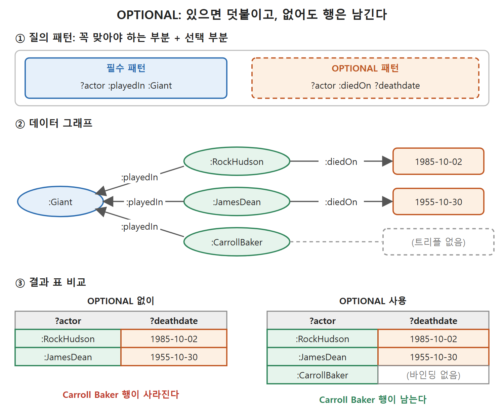

# OPTIONAL, 부정 조건, ASK

SELECT 질의는 패턴의 트리플이 전부 맞아야만 결과 행을 낸다. 하나라도 어긋나면 그 행은 통째로 사라진다. 이 문서는 이 "전부 아니면 없음" 규칙을 누그러뜨리는 OPTIONAL, 반대로 "이 트리플이 없어야 한다"를 표현하는 FILTER NOT EXISTS, 그리고 표 대신 참/거짓만 돌려주는 ASK 질의를 다룬다.

---

## 1. 왜 행이 사라지는가

Giant 출연 배우의 사망일을 묻는 질의를 다시 보자.

```
SELECT ?actor ?deathdate
WHERE { ?actor :playedIn :Giant ;
               :diedOn ?deathdate . }
```

결과에는 RockHudson 1985-10-02, JamesDean 1955-10-30 등이 나오지만 Carroll Baker는 없다. 아직 살아 있어서 :diedOn 트리플이 데이터에 없기 때문이다. 이 데이터에 "값이 비어 있음"을 뜻하는 null 같은 예약 값은 없다. 그냥 해당 트리플 자체가 없다. 패턴 전체가 맞지 않으면 그 배우에 대한 어떤 변수도 매칭되지 않으므로 행이 아예 나타나지 않는다.

여기서 용어를 하나 정리한다. 결과 표의 한 행에는 선택한 변수마다 값이 있다. 이 값을 그 변수의 바인딩(binding)이라 하고, 그 행에서 변수가 그 값에 "바인딩되었다"고 말한다. 첫 행에서 ?actor는 RockHudson에, ?deathdate는 1985-10-02에 바인딩된다. Carroll Baker는 패턴의 트리플 하나가 실패했으므로 ?actor에 그녀가 바인딩되는 일이 아예 없다.

---

## 2. OPTIONAL: 맞으면 채우고 안 맞아도 넘어간다

"Giant에 출연한 사람은 누구이고, 죽었다면 언제 죽었나"라고 묻는 것은 합리적이다. 이럴 때 OPTIONAL을 쓴다. OPTIONAL은 또 다른 그래프 패턴을 지정하는데, 이 패턴은 전체 매칭이 성립하기 위해 꼭 맞을 필요가 없다. 맞으면 변수를 바인딩하고, 안 맞아도 전체 매칭을 무효로 만들지 않는다.

```
SELECT ?actor ?deathdate
WHERE { ?actor :playedIn :Giant .
        OPTIONAL { ?actor :diedOn ?deathdate . } }
```

| actor | deathdate |
|---|---|
| RockHudson | 1985-10-02 |
| JamesDean | 1955-10-30 |
| Carroll Baker | (no binding) |

이제 Carroll Baker도 행에 나온다. 표로 쓰려면 칸에 무엇이든 적어야 하지만, 실제 SPARQL 결과에서 ?deathdate에는 어떤 값도 들어 있지 않다. 바인딩 자체가 없다. 원서는 표에 이를 "(no binding)"으로 표시했다.

| 비교 | 필수 패턴만 쓴 질의 | OPTIONAL을 쓴 질의 |
|---|---|---|
| 사망일 트리플이 있는 배우 | 행이 나온다 | 행이 나오고 값도 채워진다 |
| 사망일 트리플이 없는 배우 | 행이 사라진다 | 행은 나오되 ?deathdate는 바인딩이 없다 |

읽는 법: OPTIONAL은 "있으면 덧붙여 줘, 없어도 이 사람은 빼지 마"라는 뜻이다. 관계형 데이터베이스를 아는 독자에게는 왼쪽 외부 조인과 비슷한 쓰임이라고 이해해도 된다(이 비유는 이 노트의 보충이며 원서의 설명은 아니다).



위 그림은 Giant 출연 배우 데이터에서 사망일 트리플이 없는 Carroll Baker가 필수 패턴만 쓰면 사라지고, OPTIONAL을 쓰면 "바인딩 없음"으로 남는 차이를 보여 준다.

---

## 3. 부정: 없는 것을 찾기 (SPARQL 1.1)

그래프 패턴은 "이런 트리플이 있다"를 표현하는 데 유연하다. 하지만 때로는 "이런 트리플이 없다"를 말하고 싶다. 위 OPTIONAL 결과에서 "(no binding)"이 있는 행을 눈으로 찾으면 생존한 배우를 알 수 있다. 그래도 "Giant 출연 배우 중 아직 살아 있는 사람은?"이라고 직접 묻고 싶다.

SPARQL 1.1에는 방법이 둘 있다. 하나는 새 키워드 MINUS이고 다른 하나는 FILTER를 쓰는 방법이다. 둘 사이에는 미묘한 차이가 있지만 이 책의 범위를 벗어나므로, 원서는 FILTER 방식으로 설명한다.

### EXISTS

EXISTS는 중괄호로 묶은 그래프 패턴을 받아 참/거짓 값으로 바꿔 준다. 데이터에서 그 패턴이 맞는 곳이 있으면 참, 없으면 거짓이다. 그래서 FILTER 안에 쓸 수 있다.

```
FILTER EXISTS { :JamesDean a :Man }
```

이 필터는 그 트리플이 데이터에 있을 때만 통과한다. 하지만 이것만으로는 흥미롭지 않다. EXISTS 없이 트리플 패턴을 쓴 것과 같은 동작이기 때문이다. EXISTS의 쓸모는 NOT과 만났을 때 드러난다.

### FILTER NOT EXISTS

NOT으로 부정하면, 지정한 하위 패턴이 맞지 않을 때만 통과하는 질의가 된다.

```
SELECT ?actor
WHERE { ?actor :playedIn :Giant .
        FILTER NOT EXISTS { ?actor :diedOn ?deathdate . } }
```

Giant에 출연했으면서 사망일 기록이 데이터에 없는 배우, 곧 생존한 배우가 나온다. 원서 본문은 이 질의를 설명하면서 "East of Eden의 생존 배우"라고 썼지만, 질의 자체는 Giant 기준이다. 원서 표기의 불일치로 보이므로 이 노트는 질의 기준을 따랐다.

FILTER NOT EXISTS는 집합의 차집합을 구하는 데도 쓸 수 있다. 배우 중 일부는 제작자를 겸한다. 제작자 클래스 :Producer의 구성원이 아닌 배우만 찾는 질의는 다음과 같다.

```
SELECT ?actor
WHERE { ?actor a :Actor .
        FILTER NOT EXISTS { ?actor a :Producer } }
```

### 닫힌 세계 가정에 주의

NOT EXISTS를 부정으로 읽는 것은 닫힌 세계 가정(closed-world assumption, 데이터에 없는 것은 거짓으로 보는 태도)을 택한 것이다. 이 질의가 찾은 것은 "제작자가 아닌 배우"가 아니라 "이 데이터셋에 제작자라는 정보가 없는 배우"다. 시맨틱 웹에서는 누구든 어떤 주제에 대해서든 무엇이든 말할 수 있으므로(열린 세계 가정, open-world assumption), 나중에 그 사람이 제작자라는 새 사실이 알려질 수도 있다. 그래서 NOT EXISTS는 질의가 지금 다루고 있는 데이터에 대해서만 말한다. 웹 전체에 대한 말이 아니다. NOT EXISTS 키워드는 SPARQL 1.1에서만 쓸 수 있다.

| 구분 | 닫힌 세계 가정 (NOT EXISTS의 해석) | 열린 세계 가정 (시맨틱 웹의 기본) |
|---|---|---|
| 데이터에 없는 사실 | 거짓으로 본다 | 모를 뿐 거짓이 아니다 |
| "제작자가 아닌 배우" | 제작자 정보가 없는 배우 | 제작자가 아니라고 확인된 배우는 아직 모른다 |
| 새 데이터가 들어오면 | 결과가 바뀔 수 있다 | 기존 결론을 뒤집지 않는다(새 사실만 더해진다) |

읽는 법: NOT EXISTS의 답은 "현재 가진 데이터 기준"이라는 꼬리표가 붙은 답이다.

---

## 4. ASK: 예/아니오 질의

SELECT는 변수의 바인딩을 고르는 질의라서 이름이 SELECT다. 그래프에 예/아니오로 물을 수도 있다. "Elizabeth Taylor는 아직 살아 있나?", "Giant 출연 배우 중 1950년 이후에 태어난 사람이 있나?" 같은 질문이다. 보고서 소프트웨어가 특정 절을 포함할지 결정할 때, 또는 의사결정 지원 소프트웨어가 추천을 만들 때 이런 질문을 쓸 수 있다.

SPARQL에서는 질의 맨 앞의 SELECT 자리에 ASK를 쓴다.

```
ASK WHERE { :ElizabethTaylor :diedOn ?any }
```

ASK 질의는 WHERE 절이 맞는 곳을 하나라도 찾으면 true, 아니면 false를 돌려준다. 위 질의는 Elizabeth Taylor의 사망일이 어떤 값이든 있으면 true인데, 이 데이터셋에서는 true다. FILTER NOT EXISTS와 합치면 "살아 있나?"가 된다.

```
ASK WHERE { FILTER NOT EXISTS { :ElizabethTaylor :diedOn ?any } }
```

답은 false다. 복잡한 패턴도 똑같이 물을 수 있다. "Giant 출연 배우 중 1950년 이후 출생자가 있나?"는 다음과 같다.

```
ASK WHERE { ?any :playedIn :Giant ;
                 :bornOn ?birthday .
            FILTER (?birthday > "1950-01-01"^^xsd:date ) }
```

Giant가 1956년 작품이므로 답이 false인 것은 놀랍지 않다.

---

## 5. 질의 종류별 결과 비교

| 질의 | 질문의 성격 | 결과 모양 | 예 |
|---|---|---|---|
| SELECT | 어떤 값들인가 | 변수별 열을 가진 표 | James Dean의 감독들 |
| SELECT + OPTIONAL | 값들, 있으면 부가 정보까지 | 일부 칸이 바인딩 없음인 표 | 배우와 사망일(없을 수도) |
| SELECT + FILTER NOT EXISTS | 어떤 것이 아닌 값들 | 표 | 생존 배우 |
| ASK | 그런 것이 있는가 | true 또는 false 하나 | Elizabeth Taylor는 사망했나 |

읽는 법: 질의의 키워드가 결과의 모양을 정한다. 패턴 쓰는 법은 같고, 결과를 표로 받을지 참/거짓으로 받을지가 다르다. 다음 문서의 CONSTRUCT는 세 번째 모양, 곧 새로운 RDF 그래프를 돌려준다.

<br>
<br>
<br>

[Semantic Web for the Working Ontologist](../)
