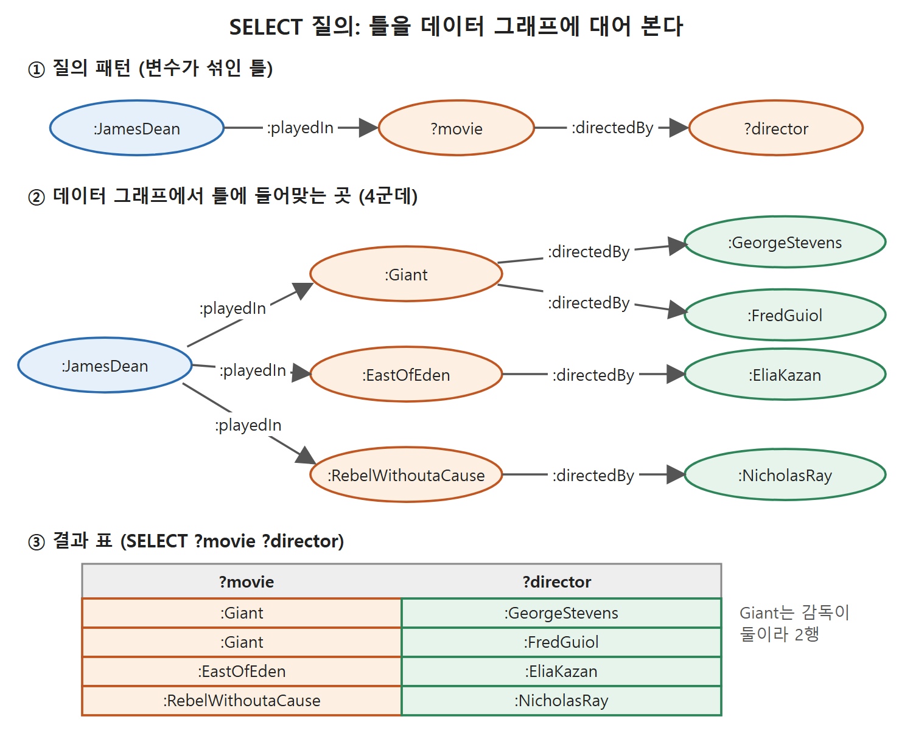
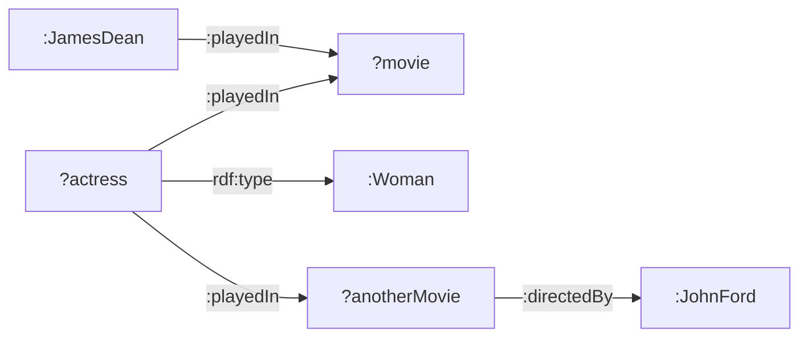

# SELECT 질의와 그래프 패턴

SPARQL 질의의 뼈대는 "무엇을 보여 줄지(SELECT)"와 "어떤 모양을 찾을지(WHERE)"다. 이 문서는 가장 기본이 되는 SELECT 질의를 다룬다. 트리플 한 줄짜리 질문에서 시작해 여러 트리플을 이어 붙인 그래프 패턴까지 가고, 변수 이름이 뜻을 갖지 않는다는 점과 데이터 예시에서 질의를 거꾸로 만들어 내는 요령을 설명한다.

예제는 모두 영화 데이터다. James Dean이 Giant, East of Eden, Rebel Without a Cause에 출연했고 각 영화에 감독이 있다는 사실이 바탕이다.

---

## 1. SELECT 질의의 생김새

SPARQL 문법은 Turtle과 닮았다. 앞 문서의 질문을 실제 문법으로 쓰면 다음과 같다. 접두어 없는 `:`는 기본 네임스페이스(namespace, 이름 충돌을 막는 주소 접두어)를 뜻한다.

```
:JamesDean :playedIn :Giant .
:JamesDean :playedIn ?what .
?who :playedIn :Giant .
:JamesDean ?what :Giant .
```

첫 줄은 알려주는 사실(Tell)이고 나머지 셋은 질문(Ask)이다. SQL을 아는 사람이라면 SELECT, WHERE 같은 키워드가 낯익을 것이다. SPARQL이 SQL 사용자가 쉽게 배우도록 일부러 비슷하게 설계되었기 때문이다.

SELECT 질의는 두 부분으로 되어 있다.

| 부분 | 역할 | 예 |
|---|---|---|
| SELECT 뒤의 변수 목록 | 결과 표에 어떤 열을 내보낼지 정한다 | `SELECT ?what` |
| WHERE 뒤 중괄호 안 패턴 | 데이터에서 찾을 모양을 적는다 | `{ :JamesDean :playedIn ?what }` |

질문 세 가지를 질의로 옮기면 다음과 같다.

```
SELECT ?what WHERE { :JamesDean :playedIn ?what . }
SELECT ?who WHERE { ?who :playedIn :Giant . }
SELECT ?what WHERE { :JamesDean ?what :Giant . }
```

패턴에 나온 변수를 SELECT에 모두 적을 필요는 없다. 결과에는 SELECT에 적은 변수만 나온다. 나중에 보겠지만 이 목록을 조절하면 유용한 일이 많다.

---

## 2. 여러 값은 그냥 된다

RDF와 SPARQL은 값이 여럿인 경우를 잘 다룬다. 스프레드시트처럼 열을 늘릴지 행을 늘릴지 고민할 필요 없이 같은 관계의 트리플을 여러 개 적으면 된다.

```
:JamesDean :playedIn :Giant .
:JamesDean :playedIn :EastOfEden .
:JamesDean :playedIn :RebelWithoutaCause .
```

이 데이터에 아래 질의를 던지면 세 영화가 모두 돌아온다.

```
SELECT ?what WHERE { :JamesDean :playedIn ?what }
```

답은 :Giant, :EastOfEden, :RebelWithoutaCause다.

### 질의 엔진은 무엇을 하는가

WHERE 절은 그래프 패턴, 곧 데이터 그래프에 대어 보는 틀이다. 이 질의의 패턴은 주어가 :JamesDean, 서술어가 :playedIn이고 목적어 자리가 변수인 트리플 하나다. 질의 엔진은 데이터에서 이 틀에 맞는 곳을 모두 찾아, 변수에 들어맞은 값을 돌려준다. 이 예에서는 맞는 곳이 세 군데다. 규칙은 하나다. 틀에 적힌 구체적인 자원(resource)은 정확히 같아야 하고, 변수 자리는 무엇이든 들어맞을 수 있다.

---

## 3. 트리플을 이어 붙이기: 조인

James Dean과 함께 일한 감독을 알고 싶다고 하자. 영화마다 감독이 있고, 한 영화에 감독이 둘일 수도 있다. 이 질문은 "James Dean이 출연한 영화를 찾고, 그 영화를 감독한 사람을 찾는다"는 두 단계다. 패턴에 트리플 두 개를 쓴다.

```
:JamesDean :playedIn ?what .
?what :directedBy ?who .
```

변수 ?what이 두 트리플에 모두 나온다. 이 지점에서 두 트리플이 이어진다. 그래프로 그리면 두 화살표가 ?what에서 만나는 사슬 모양이다. 변수가 둘이므로 엔진은 두 변수가 동시에 들어맞는 모든 조합을 찾는다.

| ?what | ?who |
|---|---|
| :Giant | :GeorgeStevens |
| :Giant | :FredGuiol |
| :EastOfEden | :EliaKazan |
| :RebelWithoutaCause | :NicholasRay |

Giant는 감독이 두 명이라 두 줄이 나왔다. 여기서 감독만 알고 싶고 영화는 중간 다리일 뿐이라면 SELECT에서 ?who만 고르면 된다.

```
SELECT ?who
WHERE { :JamesDean :playedIn ?what .
        ?what :directedBy ?who . }
```

결과는 :GeorgeStevens, :EliaKazan, :NicholasRay, :FredGuiol 네 줄이다. 변수가 여럿이고 답도 여럿일 수 있으므로, 결과는 변수 하나가 열 하나, 답 하나가 행 하나인 표로 보여 준다. SELECT에 ?what과 ?who를 둘 다 적으면 위의 두 열짜리 표가 된다.

| SELECT에 적은 변수 | 결과 표 |
|---|---|
| ?who | 감독 한 열 (4행) |
| ?what ?who | 영화와 감독 두 열 (4행) |

읽는 법: SELECT 목록은 "표의 열 선택"이다. 패턴이 같으면 엔진이 찾는 조합은 같고, 그중 어떤 열을 보여 줄지만 달라진다.



위 그림은 변수가 섞인 틀이 데이터 그래프의 네 군데에 들어맞고, 들어맞은 값이 결과 표의 네 행이 되는 과정을 보여 준다. 색이 틀의 변수, 데이터의 노드, 표의 칸을 서로 이어 준다.

---

## 4. 변수 이름은 아무 뜻이 없다

영어에는 who, what, where 같은 의문사가 정해져 있지만, SPARQL에서는 앞에 물음표만 붙으면 무엇이든 변수다. ?foo도 ?bar도 된다. 그렇다면 ?who, ?what이라는 이름은 표만 보고는 뜻을 알기 어렵다. 그래서 읽는 사람을 위해 의도가 드러나는 이름을 붙이는 것이 관례다.

```
SELECT ?movie ?director
WHERE { :JamesDean :playedIn ?movie .
        ?movie :directedBy ?director . }
```

결과 표의 열 이름이 ?movie, ?director가 되어 질문을 모르는 사람도 표를 이해할 수 있다.

### 패턴을 길게 늘리기

그래프 패턴은 데이터 그래프만큼 정교하게 만들 수 있다. James Dean과 같은 영화에 출연한 여배우를 찾으려면 이렇게 쓴다.

```
SELECT ?actress ?movie
WHERE { :JamesDean :playedIn ?movie .
        ?actress :playedIn ?movie .
        ?actress rdf:type :Woman }
```

결과 ?actress는 :AnnDoran, :ElizabethTaylor, :CarrollBaker, :JoVanFleet, :JulieHarris, :MercedesMcCambridge, :NatalieWood다. 같은 영화 Giant에 출연한 Rock Hudson은 포함되지 않는다. 이유는 세 번째 트리플 `:RockHudson rdf:type :Woman`이 데이터에 없기 때문이다. 변수 이름이 ?actress라서 여성만 매칭되는 것이 아니다. 변수의 의미는 이름이 아니라 그래프 패턴의 구조가 정한다. 데이터가 받쳐 주지 않으면 맞지 않을 뿐이다.

### ?movie가 영화라는 보장은?

같은 이유로 ?movie가 정말 영화만 가리킨다는 보장도 없다. 이 데이터에서는 James Dean이 출연한 것이 영화뿐이라 문제가 없었지만, 시맨틱 웹에는 다른 정보가 더 있을 수 있다. ?movie를 Movie 클래스의 구성원으로 제한하려면 트리플 한 줄을 더한다.

```
SELECT ?actress
WHERE { :JamesDean :playedIn ?movie .
        ?movie rdf:type :Movie .
        ?actress :playedIn ?movie .
        ?actress rdf:type :Woman }
```

`?movie rdf:type :Movie` 같은 줄이 처음엔 헷갈릴 수 있다. movie가 두 번 나오기 때문이다. 하지만 ?movie는 표에 예쁘게 찍히라고 붙인 이름일 뿐이고, 이 트리플이 비로소 "?movie는 영화"라는 의미를 질의에 넣어 준다. 의미는 이름에 있지 않으니 트리플로 적어야 한다.

### :director와 ?director

어떤 모델은 속성 이름을 가리키는 대상의 클래스 이름과 똑같이 짓는다. :directedBy 대신 :director라고 짓는 식이다. 그 모델에서 감독을 찾는 질의는 이렇게 된다.

```
SELECT ?director
WHERE { :JamesDean :playedIn ?movie .
        ?movie :director ?director . }
```

:director와 ?director의 차이를 정리하면 다음과 같다.

| 표기 | 정체 | 설명 |
|---|---|---|
| `:director` | 특정 자원 | 기본 네임스페이스에 정의된 속성 |
| `?director` | 변수 | ?foo나 ?bar라고 써도 같다. 읽는 사람을 위한 이름일 뿐 |

원서는 그러니 이런 모델을 만난다면 당황하지 말고 물음표 유무만 보라고 한다. 그리고 직접 모델을 만든다면 :directedBy처럼 속성 이름과 변수 이름이 겹치지 않게 짓기를 권한다.

---

## 5. 질의 구조는 데이터 구조를 닮는다

그래프 패턴은 매칭하려는 데이터 그래프와 모양이 닮는다. SPARQL로 물을 수 있는 질문의 복잡도는 데이터의 복잡도가 한계다. 예를 들어 "James Dean과 같은 영화에 출연했고, 그 자신은 John Ford가 감독한 다른 영화에도 출연한 여배우"는 다음과 같이 쓴다.

```
SELECT ?actress ?movie
WHERE { :JamesDean :playedIn ?movie .
        ?actress :playedIn ?movie .
        ?actress a :Woman .
        ?actress :playedIn ?anotherMovie .
        ?anotherMovie :directedBy :JohnFord . }
```

`a`는 rdf:type의 줄임말이다. 결과는 NatalieWood와 CarrollBaker다. 같은 변수가 여러 트리플에 나오는 곳이 "같은 대상"이어야 하는 연결점이다.

| 변수 | 연결하는 것 |
|---|---|
| ?movie | James Dean과 ?actress를 잇는다 (같은 영화) |
| ?actress | ?movie와 ?anotherMovie를 잇는다 (같은 배우) |
| ?anotherMovie | ?actress와 John Ford를 잇는다 |



읽는 법: 변수 ?movie, ?actress, ?anotherMovie가 각각 두 개 이상의 화살표가 모이는 연결점이다. 패턴의 화살표 다섯 개가 곧 트리플 다섯 줄이다.

---

## 6. 예시 데이터에서 질의 만들기: "이런 것 더 찾기"

복잡한 질의를 쓰는 방법에는 두 가지가 있다. 하나는 질문을 따라가며 트리플을 한 줄씩 적어 나가는 것이다. 다른 하나는 데이터에서 출발하는 방법이다. 이미 "Natalie Wood가 John Ford가 감독한 The Searchers에 출연했다"는 사실을 안다고 하자. 질의 패턴은 데이터와 트리플 단위로 똑같이 생겼으니, 이 예시를 복사한 뒤 어떤 값을 그대로 둘지, 어떤 값을 변수로 바꿀지만 정하면 된다.

| 예시 속 자원 | 처리 | 이유 |
|---|---|---|
| James Dean, John Ford, Woman | 그대로 둔다 | 조건으로 고정할 값 |
| Natalie Wood, The Searchers, Rebel Without a Cause | 변수로 바꾼다 | 바뀌어도 되는 값 |

변수 이름은 엔진에게 의미가 없으니 ?q1, ?q2처럼 지어도 된다. 같은 값이 쓰이는 자리에는 같은 변수를 써야 한다. 화살표 다섯 개를 Turtle로 옮기면 트리플 다섯 줄이 된다. 한 자원이 여러 화살표에 걸리면 여러 번 나온다.

```
:JamesDean :playedIn ?q1 .
?q3 :playedIn ?q1 .
?q3 rdf:type :Woman .
?q3 :playedIn ?q2 .
?q2 :directedBy :JohnFord .
```

여기에 SELECT를 붙이고 보기 좋은 이름(?actress 등)을 주면 앞에서 쓴 질의와 거의 같은 질의가 된다. 차이는 선택되지 않는 변수 이름뿐이다. 이 질의는 샘플 데이터에서 Natalie Wood와 Carroll Baker 둘을 찾는다. Natalie Wood는 예시로 썼으니 당연하다. Carroll Baker는 예시와 같은 특징, 곧 여성이고, James Dean과 같은 영화에 출연했고, John Ford 감독 영화에도 출연했다는 점을 모두 갖고 있어서 찾아진다.

이 방법은 "more like this(이런 것 더 보여 줘)" 기능으로 볼 수 있다. 예시 하나가 있으면, 예시에서 어떤 트리플을 패턴에 포함하느냐로 "이런 것"의 기준이 정해진다.

### 트리플 하나를 빼면 의미가 달라진다

?q3가 여성이라는 줄을 빼면 어떻게 될까. Natalie Wood가 여성이라는 사실이 데이터에 있더라도, 예시에 넣지 않았으니 질의에는 복사되지 않는다.

```
SELECT ?q3
WHERE { :JamesDean :playedIn ?q1 .
        ?q3 :playedIn ?q1 .
        ?q3 :playedIn ?q2 .
        ?q2 :directedBy :JohnFord . }
```

트리플이 한 줄 줄었고, 결과에는 Raymond Massey가 새로 나타난다. 그는 East of Eden에도 출연한 사람이다. 이 상황에서 변수 이름을 ?actress라고 짓는 것은 오해를 부른다. SPARQL로서는 문제가 없지만, ?actor(여성도 actor라는 관례로) 혹은 의미 없는 ?q3로 두는 편이 낫다.

| 질의 | "이런 것"의 뜻 | 결과 |
|---|---|---|
| 여성 조건 트리플 포함 | James Dean과 같은 영화에 나오고 John Ford 영화에도 나온 여성 | Natalie Wood, Carroll Baker |
| 여성 조건 트리플 제외 | 같은 조건을 만족하는 누구든(무엇이든) | 위의 둘에 Raymond Massey 추가 |

읽는 법: 조건을 하나 빼면 결과 범위는 넓어지기만 한다. 질의는 "넣은 트리플"만 지키고 "넣지 않은 사실"은 요구하지 않기 때문이다.

---

## 7. 트리플을 적는 순서는 상관없다

그래프 패턴을 Turtle로 옮길 때 트리플을 어떤 순서로 적을지 고민할 수 있다. 걱정할 필요가 없다. RDF 데이터 모델의 의미는 그래프가 정하므로, 데이터 그래프에서 트리플을 적는 순서가 결과에 영향을 주지 않는다. 그래프 패턴도 마찬가지다. 같은 트리플을 순서만 바꿔 적은 두 패턴은 같은 데이터에서 같은 결과를 낸다.

이 장의 이후 예제부터는 세미콜론과 쉼표 같은 Turtle의 줄임 표기를 쓴다. 질의가 짧아지고 읽기도 쉬워진다.

<br>
<br>
<br>

[Semantic Web for the Working Ontologist](../)
