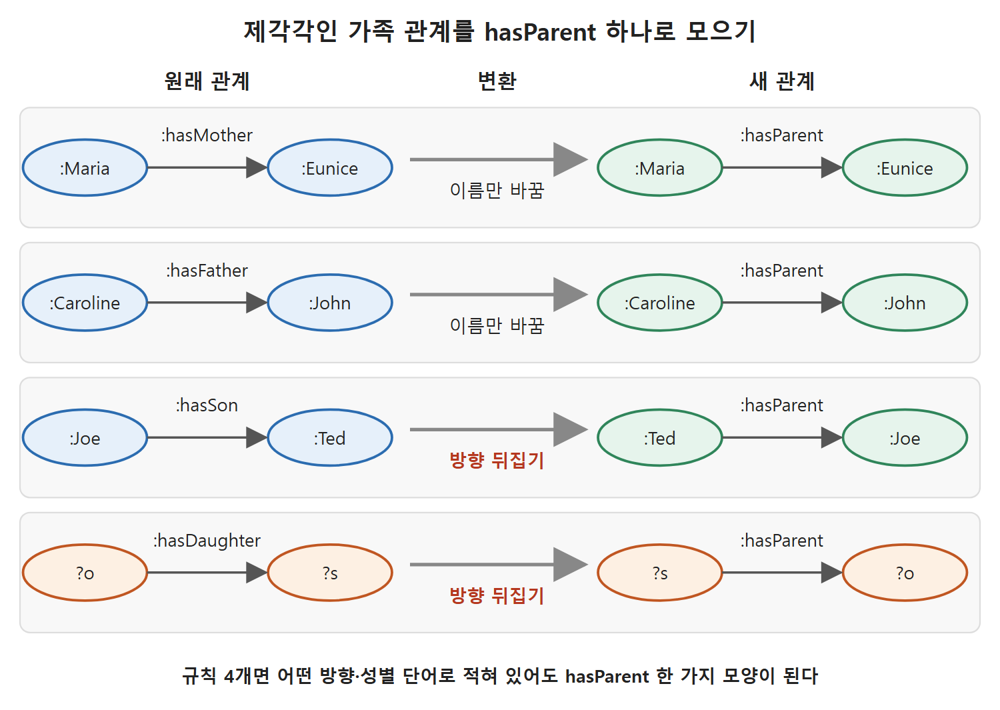

# SPARQL을 규칙으로 쓰기

CONSTRUCT는 "이런 모양을 찾으면 저런 트리플을 만들어라"라고 적는 질의다. 이 말은 규칙(rule)의 모양과 같다. "~이면 ~이다"라는 문장을 SPARQL로 옮기면 그대로 쓸 수 있는 규칙이 된다. 이 문서는 CONSTRUCT를 규칙으로 쓰는 방법과 함정, 그리고 제각각인 관계를 하나로 맞추는 변환 사례(원서의 Challenge 2)를 다룬다.

---

## 1. 규칙이란 무엇인가

규칙은 "이것을 보면 저것을 결론으로 내려라"라는 지시다. 원서가 드는 예를 종류별로 정리하면 다음과 같다.

| 규칙 종류 | 예 | 성격 |
|---|---|---|
| 데이터 완결성 규칙 | John의 아버지가 Joe이면, Joe의 아들은 John이다 | 한쪽 방향만 적힌 관계를 반대 방향으로 채운다 |
| 논리 규칙 | Socrates가 사람이고 모든 사람이 죽는다면, Socrates도 죽는다 | 일반 법칙에서 개별 결론을 낸다 |
| 정의 | Ted의 누이가 Maria의 어머니이면, Ted는 Maria의 삼촌이다 | 용어를 다른 용어로 풀어 정의한다 |
| 업무 규칙 | 우리와 5000달러 넘게 거래한 고객은 우대 고객이다 | 회사 정책을 데이터 조건으로 옮긴다 |

읽는 법: 네 종류 모두 "조건 패턴 → 새 트리플"이라는 같은 틀이다. 그래서 CONSTRUCT 하나로 다 표현된다. 다만 원서는 쓸 만한 규칙은 SPARQL로 간단히 쓸 수 있지만 미묘한 점이 있다고 경고한다.

이 절의 예제 데이터는 다음과 같다(핵심만 옮긴다).

```
:John a :Man .          :Eunice a :Woman .
:Ted a :Man .           :Socrates a :Man .
:Caroline :hasFather :John .
:Ted :hasBrother :John .
:John :hasFather :Joe .
:Maria :hasMother :Eunice .
:Maria :hasFather :Sargent .
:Ted :hasSister :Eunice .
```

원서 목록에는 :Joe, :Maria, :Caroline도 각각 :Man 또는 :Woman으로 선언되어 있다.

---

## 2. 규칙을 너무 넓게 쓰면 틀린 결론이 나온다

아버지와 아들 관계를 이렇게 쓰고 싶어진다.

```
CONSTRUCT { ?q1 :hasSon ?q2 . }
WHERE { ?q2 :hasFather ?q1 }
```

이 질의는 `:Joe :hasSon :John`을 정확히 만든다. 그런데 `:Sargent :hasSon :Maria`도 만든다. Maria는 딸이므로 이 결론은 틀렸다. 규칙이 "아버지가 있는 모든 자식"에 적용되었기 때문이다. 해결은 "아들은 남자"라는 조건을 넣는 것이다(Query 6.28).

```
CONSTRUCT { ?q1 :hasSon ?q2 . }
WHERE { ?q2 a :Man .
        ?q2 :hasFather ?q1 }
```

일상 비유로 말하면, "자식은 다 아들이라고 부르라"고 지시하는 것과 "남자 자식만 아들이라고 부르라"고 지시하는 것의 차이다. 규칙은 필요한 만큼 좁게 적용 대상을 제한해야 한다. SPARQL은 원하는 만큼 구체적으로 조건을 걸 수 있다.

Socrates 규칙은 이미 남자로 제한되어 있다.

```
CONSTRUCT { ?q1 a :Mortal }
WHERE { ?q1 a :Man }
```

이 규칙으로 Socrates, Ted, John, Joe, Sargent가 죽는 존재(:Mortal)라는 결론이 나온다. Maria와 Eunice는 :Woman이므로 아무 결론도 나오지 않는다. 원서는 여기서 "여자들은 이 규칙에서 빠진다"는 식으로 우스갯소리를 곁들인다.

---

## 3. 삼촌 정의에서 보는 함정

원서의 정의("Ted의 누이가 Maria의 어머니이면 Ted는 Maria의 삼촌이다")를 그대로 규칙으로 옮긴다고 하자. 처음 떠올리기 쉬운 규칙은 이렇다.

```
CONSTRUCT { ?q1 :hasUncle ?q2 }
WHERE { ?q2 :hasSister ?s .
        ?q1 :hasMother ?s . }
```

이 규칙은 `:Maria :hasUncle :Ted`를 만든다. 데이터에 `:Ted :hasSister :Eunice`와 `:Maria :hasMother :Eunice`가 둘 다 있기 때문이다. 하지만 원서는 이 규칙이 너무 느슨하면서 동시에 너무 엄격하다고 지적한다. 실제로는 삼촌인 `:Caroline :hasUncle :Ted`가 나오지 않는다. 데이터에는 Caroline의 아버지가 John이고 John과 Ted가 형제라는 사실이 있어서 Ted는 Caroline의 삼촌이 맞는데, 이 규칙은 "어머니 쪽 누이" 경로만 보기 때문이다.

| 규칙 | 찾는 경로 | Maria의 삼촌 Ted | Caroline의 삼촌 Ted |
|---|---|---|---|
| 첫 번째 규칙 | Ted의 누이가 내 어머니 | 찾는다 | 놓친다 |
| 아래 세 단계 규칙 | 내 부모의 형제자매인 남자 | 찾는다 | 찾는다 |

읽는 법: 정의를 한 줄로 쓰면 모든 경우를 덮지 못한다. 먼저 "부모"와 "형제자매"라는 일반 개념을 채워 놓고, 그 위에서 삼촌을 정의하는 편이 안전하다.

해법은 규칙을 여러 개로 나누는 것이다. 먼저 완결성 규칙으로 형제자매와 부모 관계를 일반화한다(Query 6.29).

```
CONSTRUCT {?q1 :hasSibling ?q2} WHERE {?q1 :hasBrother ?q2}
CONSTRUCT {?q1 :hasSibling ?q2} WHERE {?q1 :hasSister ?q2}
CONSTRUCT {?q1 :hasParent ?q2} WHERE {?q1 :hasFather ?q2}
CONSTRUCT {?q1 :hasParent ?q2} WHERE {?q1 :hasMother ?q2}
```

원서 인쇄본의 네 번째 줄은 닫는 중괄호가 하나 빠져 있다. 위에는 문맥에 맞게 복원해서 적었다.

그다음 삼촌을 형제자매와 부모로 정의한다(Query 6.30).

```
CONSTRUCT { ?q1 :hasUncle ?q2 }
WHERE { ?q2 :hasSibling ?parent .
        ?q2 a :Man .
        ?q1 :hasParent ?parent }
```

이제 `:Caroline :hasUncle :Ted`와 `:Maria :hasUncle :Ted`가 둘 다 나온다. 원서는 가족 관계를 완전하게 모델링하려면 이런 형제자매와 부모 완결성 규칙이 꽤 많이 필요하다고 덧붙이고, 이런 규칙 묶음을 더 체계적으로 정리하는 방법은 7.1절에서 본다고 예고한다.

---

## 4. 업무 규칙: 우대 고객

데이터에 고객별 총 거래액이 있다고 하자.

```
:ACME :totalBusiness 5253.00 .
:PRIME :totalBusiness 12453.00 .
:ABC :totalbusiness 1545.00 .
```

원서의 세 번째 줄은 속성 이름이 `:totalbusiness`로 b가 소문자인데, 이것이 오타인지 의도인지는 원문만으로 알 수 없다. 어느 쪽이든 ABC는 1545라서 결과는 같다. 규칙은 이렇다(Query 6.31).

```
CONSTRUCT { ?c a :PreferredCustomer }
WHERE { ?c :totalBusiness ?tb .
        FILTER (?tb > 5000) }
```

결과로 `:ACME a :PreferredCustomer`와 `:PRIME a :PreferredCustomer`가 만들어진다. 숫자 비교는 FILTER로 한다. 원서는 이 절 뒤쪽에서 집계(aggregate)와 서브쿼리로 개별 거래 기록에서 총 거래액을 계산하는 방법을 다시 보여 준다(이 노트의 "집계와 그룹, 서브쿼리" 문서에서 다룬다).

세 규칙에서 공통으로 눈에 띄는 점은 "규칙은 특정 종류의 개체에만 적용된다"는 것이다. 삼촌과 아들은 남자에게만 해당된다. 7장에서는 RDFS 클래스 구조로 서로 맞물린 SPARQL 규칙 묶음을 정리하는 방법을 다시 본다.

---

## 5. 변환 사례: 제각각인 가족 관계를 parent 하나로

데이터 황야에서는 같은 정보가 여러 모양으로 들어 있다. 스프레드시트, XML, 관계형 DB, 문서 등 시스템과 문법이 다르기 때문이다. RDF는 이런 표면적인 차이를 줄여 주지만, 한 시스템 안에서도 같은 정보를 표현하는 방식은 여러 가지다. 그래서 데이터를 쓰기 좋게 변환하는 일이 흔하다.

다음 데이터는 일관성이 없다. 어떤 줄은 자식에서 부모로(hasFather, hasMother) 가고, 어떤 줄은 부모에서 자식으로(hasSon) 간다.

```
:Caroline :hasFather :John .
:John :hasFather :Joe .
:Eunice :hasFather :Joe .
:Maria :hasMother :Eunice .
:Maria :hasFather :Sargent .
:Joe :hasSon :Robert .
:Joe :hasSon :Ted .
:Ted :hasSon :Patrick .
```

원서는 데이터가 여러 출처에서 오거나 서로 다른 방법으로 입력했을 때 이런 상태가 된다고 설명하고, 이것이 데이터 황야의 흔한 모습이라고 한다. 목표는 성별과 상관없이 자녀와 손자녀를 한 화면에 보여 주는 가계도를 만드는 것이다(원서 Figure 6.9). 가계도는 "Eunice의 부모는 Joe, Maria의 부모는 Eunice와 Sargent, Caroline의 부모는 John" 같은 균일한 형태로 정의된다. 필요한 정보는 이미 데이터에 있다. 성별 단어(Son, Daughter, Mother, Father)를 추상화하고 hasSon은 방향을 뒤집어 hasParent로 바꾸면 된다.

규칙 네 개로 가능하다(Query 6.32).

```
CONSTRUCT {?s :hasParent ?o } WHERE {?s :hasMother ?o }
CONSTRUCT {?s :hasParent ?o } WHERE {?s :hasFather ?o }
CONSTRUCT {?s :hasParent ?o } WHERE {?o :hasSon ?s }
CONSTRUCT {?s :hasParent ?o } WHERE {?o :hasDaughter ?s }
```

| 원래 관계 | 방향 | hasParent로 바꾸는 법 |
|---|---|---|
| hasMother | 자식 → 부모 | 그대로 hasParent로 바꾼다 |
| hasFather | 자식 → 부모 | 그대로 hasParent로 바꾼다 |
| hasSon | 부모 → 자식 | 주어와 목적어를 뒤집어 hasParent로 만든다 |
| hasDaughter | 부모 → 자식 | 주어와 목적어를 뒤집어 hasParent로 만든다 |

읽는 법: 앞의 두 줄은 이름만 바꾸고, 뒤의 두 줄은 방향까지 뒤집는다. 그래서 규칙 네 개면 모든 변형이 한 가지 모양으로 모인다.



위 그림은 hasMother와 hasFather는 이름만 바꾸고, hasSon과 hasDaughter는 주어와 목적어를 뒤집어 모두 hasParent로 만드는 모습을 보여 준다. 마지막 줄은 변수로 적은 일반형이다.

결과 트리플은 다음 여덟 개다.

```
:Caroline :hasParent :John .   :Eunice :hasParent :Joe .
:John :hasParent :Joe .        :Maria :hasParent :Sargent .
:Maria :hasParent :Eunice .    :Patrick :hasParent :Ted .
:Robert :hasParent :Joe .      :Ted :hasParent :Joe .
```

### 성별도 함께 복원하기

원래 관계에는 성별 정보가 들어 있었다. 그것을 잃지 않으려면 틀에 성별 트리플을 하나 더 넣는다(Query 6.33). 핵심은 누가 Man이고 누가 Woman인지 어디서 알아내느냐다.

```
CONSTRUCT {?s :hasParent ?o . ?o a :Woman .}
WHERE {?s :hasMother ?o }

CONSTRUCT {?s :hasParent ?o . ?s a :Man .}
WHERE {?o :hasSon ?s }
```

| 원래 관계 | 새로 만드는 성별 트리플 | 성별이 붙는 쪽 |
|---|---|---|
| hasMother | `?o a :Woman` | 어머니(목적어) |
| hasFather | `?o a :Man` | 아버지(목적어) |
| hasSon | `?s a :Man` | 아들(자식) |
| hasDaughter | `?s a :Woman` | 딸(자식) |

읽는 법: 가리키는 방향에 따라 성별이 붙는 쪽이 달라진다. 자식에서 부모 쪽으로 가는 관계는 목적어(부모)가, 부모에서 자식 쪽으로 가는 관계는 뒤집은 뒤의 주어(자식)가 해당 성별이다.

---

## 6. 정리

- CONSTRUCT는 "조건 패턴 → 결론 트리플"이므로 규칙 언어로 쓸 수 있다.
- 규칙을 너무 넓게 쓰면 틀린 결론(Sargent의 아들 Maria)이 나오므로 적용 대상을 클래스로 좁힌다.
- 정의가 복잡하면 기초 개념(부모, 형제자매)부터 규칙으로 채우고 그 위에서 정의한다.
- 제각각인 관계는 규칙 몇 개로 하나의 균일한 모양으로 변환할 수 있다.

<br>
<br>
<br>

[Semantic Web for the Working Ontologist](../)
