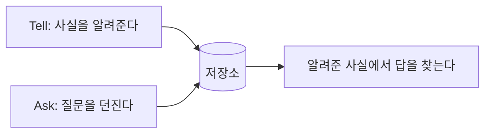

# 알려주고 묻는 시스템: 주소록에서 RDF까지

SPARQL을 배우기 전에, 데이터를 "넣고 꺼내는" 시스템이 어떤 구조인지부터 짚는다. 원서는 이것을 tell-and-ask(알려주고 묻기) 시스템이라고 부른다. 사실을 알려주면 시스템이 저장해 두었다가, 나중에 던지는 질문에 그 사실을 바탕으로 답하는 가장 단순한 형태의 정보 시스템이다.

이 문서에서는 주소록, 스프레드시트, 관계형 데이터베이스가 각각 이 구조를 어떻게 구현하는지 보고, RDF가 그 계보에서 어디에 서 있는지 정리한다. SPARQL의 생김새가 왜 그렇게 생겼는지 이해하는 밑바탕이 된다.

---

## 1. SPARQL이란 무엇인가

RDF는 두 대상을 이름 붙은 관계로 잇는 트리플(주어·서술어·목적어 세 쌍으로 이루어진 문장 하나)로 데이터를 표현한다. 하지만 데이터를 표현하기만 해서는 쓸모가 없다. 저장한 데이터를 꺼낼 방법이 있어야 한다. RDF 데이터를 꺼내는 표준 방법이 질의 언어(query language) SPARQL이다.

SPARQL은 "SPARQL Protocol And RDF Query Language"의 약자다. 약자 안에 자기 이름이 다시 들어 있는 재귀 약어라서 원서도 농담 삼아 한숨을 쉰다. SPARQL의 특징은 다음과 같다.

- 질의 패턴을 Turtle의 변형으로 쓴다. 이 책이 RDF를 적는 데 줄곧 써 온 문법과 거의 같다.
- 질의 대상 RDF 그래프는 한 종류의 데이터로 만들 수도 있고 여러 곳에서 합쳐 만들 수도 있다. 어느 쪽이든 질의 방법은 SPARQL 하나다.
- 이 장의 예제는 대부분 2008년에 나온 SPARQL 1.0 기준이다. 더 새로운 기능은 SPARQL 1.1에 들어 있고, 1.1은 1.0과 하위 호환이므로 기본 기능은 두 버전 모두에서 쓸 수 있다.

SPARQL은 XQuery나 SQL과 닮은 점이 많지만 중요한 부분에서 다르다. 이 책은 독자가 특정 질의 언어를 안다고 가정하지 않으므로, 먼저 질의라는 개념 자체를 쉽게 풀어 간다.

---

## 2. 가장 단순한 형태: 알려주고 묻기

규칙은 간단하다. 사실을 알려주고(Tell), 그것에 대해 묻는다(Ask).

| 구분 | 내용 |
|---|---|
| Tell | James Dean은 영화 Giant에 출연했다. |
| Ask | Giant에 출연한 사람은? |
| Answer | James Dean |
| Ask | James Dean은 무엇에 출연했나? |
| Answer | Giant |

사실을 더 알려 주면 답도 늘어난다. East of Eden과 Rebel Without a Cause에도 출연했다고 알려 주면, "James Dean은 무엇에 출연했나?"의 답은 세 편이 된다. 자연어로 "James Dean이 주연한 영화는?"이라고 물어도 같은 답이 나오는 시스템을 상상할 수 있다. 하지만 실제 시스템은 대부분 자연어 처리를 하지 않는다. 질문이 복잡해질수록 원하는 바를 정확히 말하기 어렵기 때문에, 정밀하고 기술적인 언어를 쓰는 편이 낫기 때문이다.

이런 시스템은 시시해 보일 수 있다. 알려 준 것 이상은 알아내지 못하고, 계산도 분석도 하지 않는다. 그러나 이 판단은 성급하다. 아주 단순한 tell-and-ask 시스템도 충분히 쓸모가 있다. 주소록이 바로 그런 예다.

### 주소록

종이 주소록도 tell-and-ask 시스템이다. 주소를 적는 일이 "알려주기"이고, 주소를 찾아보는 일이 "묻기"다. 컴퓨터 주소록은 이 과정을 폼으로 바꾼 것이다.

- 알려주기: 이름, 주소, 전화번호, 이메일 칸이 있는 폼을 채운다.
- 묻기: 이름을 입력하면 그 사람의 정보가 나온다. 사실상 "Maggie Smith의 주소는? 전화번호는? 이메일은?"을 한꺼번에 물은 셈이다.

주소록을 조금 더 똑똑하게 만드는 방법은 사용자가 덜 입력해도 되게 하는 것이다. "Maggie"만 쳐도 이름에 Maggie가 들어간 사람을 모두 보여 주는 식이다. 그러면 Maggie King의 주소도 함께 나온다. 이름이 아니라 주소 칸에 "Downing"을 넣어 "이 주소에 사는 사람은 누구인가"를 물을 수도 있다. 주소록은 돌려받는 것이 알려 준 것뿐이지만, 정보를 정리해 두고 필요할 때 찾게 해 준다는 점에서 이미 유용하다.

---

## 3. 스프레드시트: 눈으로 묻는 시스템

주소록이 한 가지 일에 고정된 전용 시스템이라면, 스프레드시트는 어디에나 쓸 수 있게 설정 가능한 tell-and-ask 시스템이다. 무거운 기술 교육 없이 똑똑한 사람이 데이터를 직접 다루게 해 준, 가장 성공한 "킬러 애플리케이션"으로 흔히 꼽힌다. 데이터 관리에 WYSIWYG(보이는 대로 얻는다) 개념을 적용한 셈이다.

스프레드시트에서는 행과 열에 값을 입력해서 알려주고, 표를 눈으로 훑어서 묻는다. 별도의 질의 언어가 없다. "Maggie는 어디에 사나?"라고 쓰는 대신, name 열에서 Maggie를 찾고 같은 행의 address 열을 읽는다.

### 표 하나로 안 담기는 데이터

문제는 데이터가 표 하나에 깔끔히 들어가지 않을 때 생긴다. 가장 단순한 예가 값이 여러 개인 경우다. Maggie Smith의 이메일이 둘이라고 하자.

| 방법 | 모양 | 문제 |
|---|---|---|
| 열을 늘린다 | Name, Email1, Email2 | 이메일이 세 개인 사람이 나오면 막힌다 |
| 행을 늘린다 | Maggie Smith 행을 이메일마다 하나씩 | 한 사람의 이메일 둘인지, 이름만 같은 두 사람인지 알 수 없다 |

데이터가 서로 깊이 얽혀 있을 때는 더 나빠진다. 사람과 그가 일하는 회사를 한 표에 적고, 회사의 계약 담당자와 본사 위치까지 같은 표에 넣었다고 하자.

| Name | Email | Company | Contract Officer | Headquarters |
|---|---|---|---|---|
| Maggie Smith | MSmith@acme.com | ACME Product Inc. | Cynthia Wiley | Pittsburgh |
| Maggie King | MKing@acme.com | ACME Product Inc. | Cynthia Wiley | Pittsburgh |

두 사람이 모두 ACME에서 일하므로 회사 정보가 행마다 중복된다. 중복은 낭비일 뿐 아니라 오류의 원인이다. ACME의 계약 담당자가 바뀌면 ACME 직원 행을 전부 고쳐야 한다. 흔한 해법은 사람 표와 회사 표를 나누는 것이다.

| Name | Email | Company |
|---|---|---|
| Maggie Smith | MSmith@acme.com | ACME Product Inc. |
| Maggie King | MKing@acme.com | ACME Product Inc. |

| Company | Contract Officer | Headquarters |
|---|---|---|
| ACME Product Inc. | Cynthia Wiley | Pittsburgh |

이렇게 나누면 최신 스프레드시트에서도 쓸 수 있지만 스프레드시트의 가장 큰 장점이 흐려진다. 눈으로 보고 답할 수 없게 되기 때문이다. 표 사이를 잇는 상호 참조가 화면에 드러나지 않는다. 사실 이 시점에서 시스템은 스프레드시트를 벗어나 더 구조화된 tell-and-ask 시스템, 곧 관계형 데이터베이스로 넘어간 것이다.

---

## 4. 관계형 데이터베이스: 구조의 대가는 긴 질문

대규모 tell-and-ask 시스템은 대부분 관계형 데이터베이스를 바탕으로 한다. 스프레드시트처럼 데이터를 표로 보여 주지만, 관계 대수라는 수학적 형식 체계로 표들을 체계적으로 연결한다. 이 형식 체계와 잘 다듬어진 방법론 덕분에 구조가 강한 데이터를 담고 아주 세부적인 질문에 답할 수 있다.

예를 들어 다음 사실을 알려 주었다고 하자.

- Maggie King은 Acme Product Inc.에서 일한다.
- Acme Product Inc.의 계약 담당자는 Cynthia Wiley다.
- Cynthia Wiley의 이메일은 CJWiley@acme.com이다.

그러면 "Maggie King이 일하는 회사의 계약 담당자의 이메일은?"이라는 질문에 CJWiley@acme.com이라고 답할 수 있다. 하지만 이런 세밀한 구조에는 대가가 따른다. 질문 자체가 매우 세세한 과정이 되고 전용 질의 언어가 필요해진다. 관계형 데이터베이스의 질의 언어에서는 표 사이를 상호 참조로 잇기 때문에, 위 질문을 더 정확히 옮기면 "이름이 Maggie King인 사람의 'works for' 참조가 가리키는 회사의 'contract officer' 참조가 가리키는 사람의 이메일은?"이 된다. 말이 장황해 보이지만, 복잡한 데이터 구조에서 정보를 정확히 꺼내려면 이 정도로 정밀하게 물어야 한다.

---

## 5. RDF도 알려주고 묻는 시스템이다

RDF 역시 tell-and-ask 시스템이다. 관계형 데이터베이스처럼 복잡하고 구조적인 데이터를 표현할 수 있고, 질문을 정확히 지정할 질의 언어가 필요하다. 다른 점이 있다. 관계형 데이터베이스와 달리 상호 참조가 사용자에게 보이지 않으며, 질의 언어에서 그 참조를 명시적으로 표현할 필요도 없다. 관계가 이미 트리플 안에 이름 붙어 있기 때문이다.

RDF에서 트리플 하나를 단언(assert)하는 것이 곧 트리플 저장소(triple store)에 사실 하나를 알려주는 일이다. 트리플 하나만 있어도 던질 수 있는 질문이 여럿이다.

| 알려준 사실 | James Dean played in the movie Giant. |
|---|---|
| 질문 1 | James Dean은 무엇에 출연했나? |
| 질문 2 | Giant에는 누가 출연했나? |
| 질문 3 | James Dean은 Giant에서 무엇을 했나? |

SPARQL에서는 트리플의 한 자리를 의문사(Who, What, Where 등)로 바꾸면 이 질문들이 된다. SPARQL은 의문사의 종류를 구분하지 않으므로 영어로 읽기 좋은 단어를 고르면 된다. 의문사 앞에는 물음표를 붙인다. ?who, ?where, ?when 같은 식이다.

| 질문 | 빈칸을 뚫은 모양 | 답 |
|---|---|---|
| 무엇에 출연했나 | James Dean played in ?what | Giant |
| 누가 출연했나 | ?who played in Giant | James Dean |
| 어떤 관계인가 | James Dean ?what Giant | played in |

이것이 SPARQL의 기본 발상이다. 데이터와 닮은 모양으로 질문을 쓰되, 알고 싶은 자리에 의문사를 넣는다. SPARQL은 스프레드시트나 관계형 DB의 질의 언어처럼 자연어 문법을 흉내 내지 않는다. 다만 "질문은 평서문과 똑같이 생겼고, 알고 싶은 자리만 의문사로 표시한다"는 아이디어를 쓴다.

### 세 시스템 비교

| 구분 | 주소록 | 스프레드시트 | 관계형 데이터베이스 | RDF |
|---|---|---|---|---|
| 알려주는 방법 | 폼 입력 | 행·열에 입력 | 여러 표에 입력하고 참조로 연결 | 트리플 단언 |
| 묻는 방법 | 이름 등 입력 | 표를 눈으로 훑음 | 전용 질의 언어와 상호 참조 | SPARQL 패턴 (의문사 사용) |
| 강점 | 단순하고 목적이 분명함 | 시각적이고 설정이 자유로움 | 구조가 강한 데이터와 세밀한 질문 | 연결 관계가 데이터 안에 있어 참조를 따로 쓰지 않음 |
| 약점 | 한 가지 일에 고정 | 다중 값과 얽힌 데이터에 약함 | 질문이 길고 정밀해야 함 | 정밀한 질의 언어가 필요함 |

읽는 법: 오른쪽으로 갈수록 데이터의 구조는 풍부해지고, 대신 묻는 데 필요한 언어가 정교해진다. RDF는 구조를 풍부하게 유지하면서도 참조를 질의에 일일이 적지 않아도 되는 점이 다르다.

---

## 6. 구조 한눈에 보기

읽는 법: 어떤 tell-and-ask 시스템이든 위 흐름이다. 시스템마다 "알려주는 방식"과 "묻는 방식"이 다를 뿐이다. 다음 문서에서는 RDF 저장소에 묻는 방식, 곧 SPARQL의 SELECT 질의를 하나씩 따라간다.

 
 
 

[Semantic Web for the Working Ontologist](../)
