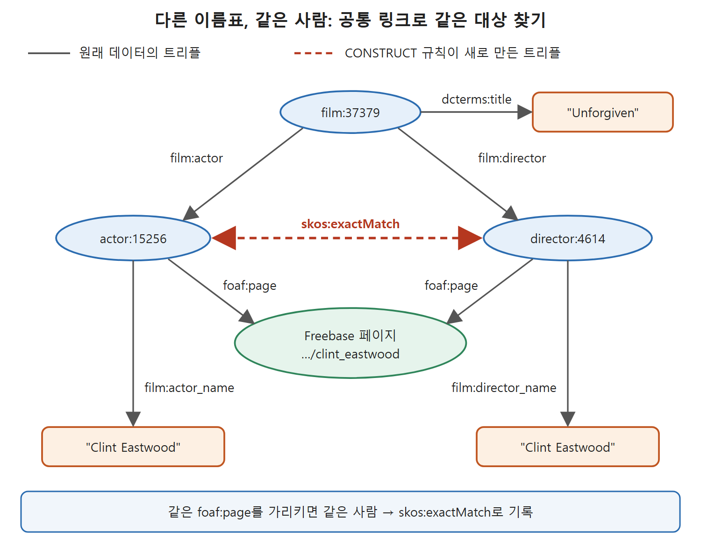

# 전이 질의와 같은 대상 찾기

계층 데이터에서 "몇 단계든 따라가서 모두 찾기"는 질의하기 까다로운 일이다. SPARQL 1.1은 이를 위해 속성 뒤에 붙이는 `*`, `+` 기호를 준다. 이 문서는 먼저 전이 질의(transitive query)를 설명하고, 이어서 서로 다른 URI로 흩어진 같은 대상을 찾아 연결하는 사례(원서의 Challenge 3, LinkedMDB)를 다룬다. 이 사례에서는 FILTER로 군더더기 결과를 걷어 내는 요령도 나온다.

---

## 1. 몇 단계든 따라가기: `*`와 `+`

앞 문서에서 만든 가계도(hasParent)를 쓴다. Joe의 자녀는 단순한 패턴으로 구한다(Query 6.34).

```
SELECT ?member
WHERE { ?member :hasParent :Joe }
```

답은 Eunice, John, Robert, Ted 네 명이다. 손자녀를 구하려면 중간 변수를 하나 두고 패턴을 이어 붙인다(Query 6.35).

```
SELECT ?member
WHERE { ?int :hasParent :Joe .
        ?member :hasParent ?int . }
```

답은 Maria, Caroline, Patrick이다. 증손자녀는 한 단계 더 붙이면 되는데, 몇 대까지 있는지 모르는 상태에서 "모든 후손"을 구하려면 질의를 몇 개 써야 할지 알 수 없다. 사내 조직도에서 "이 팀장 아래 모든 사람"을 찾는 문제와 같은 모양이다.

SPARQL 1.1에서는 속성 이름 뒤에 `*`를 붙이면 같은 속성이 몇 번이든 이어진 사슬에 매칭된다(Query 6.36).

```
SELECT ?member
WHERE { ?member :hasParent* :Joe . }
```

답은 Joe, Eunice, Maria, John, Caroline, Robert, Ted, Patrick이다. Joe 자신도 들어 있다. 사슬 길이가 0인 경우도 매칭되기 때문이다. 자기 자신을 빼려면 `+`를 쓴다(Query 6.37).

```
SELECT ?member
WHERE { ?member :hasParent+ :Joe . }
```

| 표기 | 사슬 길이 | Joe의 가계도에서 결과 |
|---|---|---|
| `:hasParent` | 정확히 1 | 자녀 4명(Eunice, John, Robert, Ted) |
| 중간 변수로 두 번 이음 | 정확히 2 | 손자녀 3명(Maria, Caroline, Patrick) |
| `:hasParent*` | 0 이상 | Joe 본인 포함 8명 |
| `:hasParent+` | 1 이상 | Joe를 뺀 후손 7명 |

읽는 법: `*`와 `+`의 차이는 "0번도 허용하는가"뿐이다. 본인을 빼고 싶으면 `+`, 본인을 포함해도 좋으면 `*`다. 원서는 이 밖에도 같은 계열의 변형이 SPARQL 1.1 표준에 더 있다고만 말하고 자세히는 다루지 않는다.

---

## 2. 같은 것이 다른 이름으로 있을 때

여러 출처의 정보를 합치면 같은 대상이 출처마다 다른 식별자로 나타나기 쉽다. 하나의 출처 안에서도 같은 일이 생긴다. 관계형 데이터베이스에서 온 데이터가 특히 그렇다. 응용 프로그램에서의 역할별로 테이블을 나누는 것이 일반적이기 때문이다.

LinkedMDB(Linked Movie DataBase)는 영화 정보를 담은 열린 데이터 소스다. 원래 관계형 DB였고, 감독이 만든 영화와 배우가 출연한 영화가 director 테이블과 actor 테이블로 나뉘어 있었다. 트리플로 바꾸니 공개 데이터셋에 director와 actor라는 두 클래스가 생겼다. 구성원에게는 숫자 URI가 붙는다. 아주 작은 발췌는 이렇다.

```
actor:15256 rdf:type film:actor ;
    film:actor_name "Clint Eastwood" .
film:37379 rdf:type film:film ;
    dcterms:title "Unforgiven" ;
    film:actor actor:15256 ;
    film:director director:4614 .
director:4614 film:director_name "Clint Eastwood" ;
    rdf:type film:director ;
    foaf:made film:37379 .
```

영화 "Unforgiven"(dcterms:title이 제목이다)에는 배우 15256번과 감독 4614번이 있고 둘 다 이름이 "Clint Eastwood"다. dcterms는 전 세계 도서관들이 쓰는 메타데이터 표준(DCMI Metadata Terms)의 네임스페이스다. 이름이 같다는 것만으로 같은 사람이라고 결론 내릴 수 있을까. 이름이 같은 다른 사람일 수도 있다.

다행히 LinkedMDB에는 각 자원에 대한 트리플이 하나씩 더 있다.

```
actor:15256 foaf:page <http://www.freebase.com/view/topic/en/clint_eastwood> .
director:4614 foaf:page <http://www.freebase.com/view/topic/en/clint_eastwood> .
```

Freebase는 (다른 기능과 함께) 웹 자원의 신원을 확인해 주는 링크드 데이터 서비스였다. 원서는 지금은 새 항목이 추가되지 않으며 더 큰 구글 지식 그래프에 흡수되었다고 쓴다. 그래도 Freebase 참조는 많은 웹 자원에 고유 식별자를 준다. 웹의 어떤 데이터 소스든 Freebase URI를 가리켜 자기 자원을 분명하게 식별할 수 있다. 이런 신원 서비스는 Freebase만 있는 것이 아니다. 생명과학에는 단백질, 유전자 같은 생물 개체를 위한 서비스가 여럿 있고 다른 분야에도 있다. 일반 용도로는 DBpedia가 위키백과에 나오는 모든 것의 사실상 고유 식별자 원천이다.

이 경우 두 "Clint Eastwood"가 같은 Freebase 자원을 가리키므로 같은 사람이다. 그런데 이 결론을 어떻게 기록할까.

---

## 3. CONSTRUCT로 "같음"을 기록하기

같은 foaf:page를 가진 두 자원을 skos:exactMatch로 잇는 규칙을 쓸 수 있다(Query 6.38).

```
CONSTRUCT {?a skos:exactMatch ?b }
WHERE {?a foaf:page ?page .
       ?b foaf:page ?page . }
```

foaf:page와 skos:exactMatch의 자세한 내용은 원서 10.3절과 11장에서 다루지만, 이 질의의 뜻은 몰라도 읽힌다. 같은 foaf:page를 가진 두 자원은 서로 exactMatch라는 뜻이다. 결과는 네 개다.

```
actor:15256 skos:exactMatch director:4614 .
director:4614 skos:exactMatch actor:15256 .
actor:15256 skos:exactMatch actor:15256 .
director:4614 skos:exactMatch director:4614 .
```



위 그림은 LinkedMDB의 배우 자원과 감독 자원이 같은 Freebase 페이지를 가리키는 것을 근거로, CONSTRUCT 규칙이 둘 사이에 skos:exactMatch(점선)를 만드는 모습을 보여 준다. 점선 양쪽 화살표는 아래에서 보는 질의 6.39의 양방향 결과 두 개를 합쳐 그린 것이다.

원하던 일치는 담겨 있지만 군더더기가 붙었다. 하나는 같은 관계가 양방향으로 두 번 나온다는 것이고, 다른 하나는 배우가 자기 자신과, 감독이 자기 자신과 일치한다는 자명한 결과다. SPARQL은 패턴에 맞는 모든 매칭을 찾는데, ?a와 ?b에 director:4614와 actor:15256을 넣는 네 가지 조합이 모두 같은 page 값을 갖기 때문이다.

이 군더더기는 해롭지는 않다(자기 자신과 정확히 일치한다는 말은 맞는 말이다). 하지만 쓸데없다. 앞서 중복을 없애려고 쓴 DISTINCT도 도움이 되지 않는다. 네 트리플은 이미 서로 달라서(주어, 서술어, 목적어 세 자리의 값이 모두 같은 쌍이 없어서) 중복이 아니기 때문이다.

---

## 4. FILTER로 군더더기 걷어 내기

자기 자신과의 일치는 FILTER로 걷어 낸다(Query 6.39).

```
CONSTRUCT { ?a skos:exactMatch ?b }
WHERE { ?a foaf:page ?page .
        ?b foaf:page ?page .
        FILTER (?a != ?b) }
```

`!=`는 "같지 않다"이며, ?a와 ?b가 다른 자원일 때만 참이 된다. 결과는 두 트리플(배우→감독, 감독→배우)로 줄어든다. 원서는 skos:exactMatch가 대칭 속성이라는 점(11장)을 모른다면 여기서 충분하다고 말한다.

한 걸음 더 나가 쌍마다 하나만 남기려면 값을 비교한다. FILTER에는 XML에서 빌린 데이터 타입 처리 기능이 있어 값을 비교하는 방법이 많다. URI를 문자열로 바꿔 사전순으로 비교하는 요령을 쓸 수 있다(Query 6.40).

```
CONSTRUCT {?a skos:exactMatch ?b }
WHERE {?a foaf:page ?page .
       ?b foaf:page ?page .
       FILTER ( xsd:string(?a) > xsd:string(?b) ) }
```

주어가 목적어보다 사전순으로 뒤에 올 때만 남기므로, 앞 결과의 두 트리플 중 두 번째 `director:4614 skos:exactMatch actor:15256`만 살아남는다.

| 질의 | 조건 | 결과 트리플 수 | 남는 것 |
|---|---|---|---|
| 6.38 | 조건 없음 | 4개 | 양방향 2개 + 자기 자신 2개 |
| 6.39 | `?a != ?b` | 2개 | 양방향 2개 |
| 6.40 | `xsd:string(?a) > xsd:string(?b)` | 1개 | director→actor 한 방향 |

읽는 법: 필터를 한 겹 더할 때마다 군더더기가 줄어든다. 자기 자신과의 일치는 `!=`로, 대칭인 쌍은 사전순 비교로 하나만 남긴다.

---

## 5. 참조 서비스가 없을 때, 그리고 이 기록의 쓸모

같은 대상임을 알아내는 방법은 여러 가지다. Freebase나 DBpedia 같은 참조 체계가 있으면 가장 쉽다. 이런 참조 체계의 필요는 시맨틱 웹 이전부터 수백 년 있었고, 시맨틱 웹은 그것을 웹에 공개하고 가리킬 수단을 줄 뿐이다. 참조 서비스가 없으면 더 복잡한 방법을 쓸 수 있다. 같은 CONSTRUCT 전략을 쓰고 skos:exactMatch로 기록하면 된다. 예컨대 데이터에 출생지와 생년월일이 있고 이름, 출생지, 생년월일이 모두 같은 사람은 같은 사람이라고 가정해도 좋다면 다음 규칙이 일치를 만든다(Query 6.41, 핵심만).

```
CONSTRUCT {?a skos:exactMatch ?b }
WHERE {?a :name ?name ;
          :birthplace ?bplace ;
          :birthdate ?date .
       ?b :name ?name ;
          :birthplace ?bplace ;
          :birthdate ?date .
       FILTER ( xsd:string(?a) > xsd:string(?b) ) }
```

중요한 점은 시맨틱 웹이 "두 자원이 같은 개체를 가리키는지"를 판정하는 특별한 장치를 주지는 않는다는 것이다. 시맨틱 웹이 하는 일은 그 결론을 적어서 웹에 공개하게 해 주는 것이다.

이제 두 Clint Eastwood가 같은 사람임을 알았으니 "자기가 감독한 영화에 출연한 감독은 누구인가"에 답할 수 있다(Query 6.42).

```
SELECT DISTINCT ?director
WHERE { ?dir foaf:made ?m ;
            linkedmdb:director_name ?director ;
            skos:exactMatch ?player .
        ?m linkedmdb:actor ?player .
}
```

답은 "Clint Eastwood"다. 원서는 전체 LinkedMDB에는 이 조건을 만족하는 사람이 더 많지만 간단히 보이려고 하나로 줄였다고 밝힌다.

이 질의가 동작하는 이유는 exactMatch가 감독과 배우를 이어 주기 때문이다. 감독이 만든 영화(foaf:made)의 배우(linkedmdb:actor)가 그 감독과 exactMatch인 배우이면 자기 영화에 출연한 것이다.

---

## 6. 정리

- 속성 뒤에 `*`를 붙이면 0번 이상, `+`를 붙이면 1번 이상 반복된 사슬을 따라간다(SPARQL 1.1).
- 같은 대상의 다른 식별자는 공통 참조(foaf:page 등)로 알아내고 CONSTRUCT로 skos:exactMatch를 만들어 기록할 수 있다.
- 군더더기 트리플은 DISTINCT가 아니라 FILTER(`!=`, 사전순 비교)로 걷어 낸다.
- 같음을 판정하는 방법은 데이터에 달렸고, 시맨틱 웹은 그 결과를 적어 공개하는 수단을 준다.

<br>
<br>
<br>

[Semantic Web for the Working Ontologist](../)
