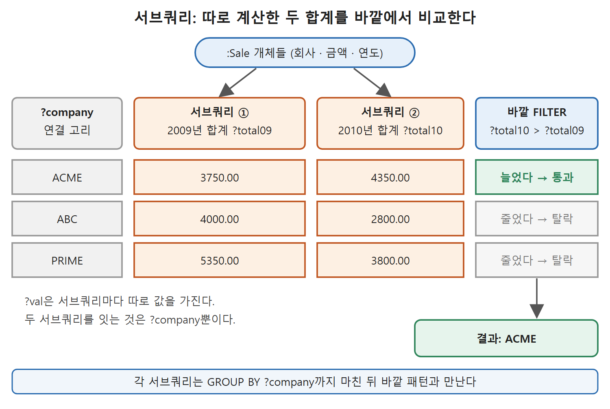

# 집계와 그룹, 서브쿼리

SQL에서 COUNT, SUM, GROUP BY, HAVING, 서브쿼리를 써 본 개발자라면 이 문서는 낯익다. SPARQL 1.1도 같은 도구를 준다. 다만 데이터가 표가 아니라 트리플이라서, 표의 한 행을 어떻게 트리플로 옮기는지부터 보는 것이 좋다. 이 문서는 집계 함수, 그룹 나누기, 그룹 결과 거르기, 그리고 질의 속의 질의를 순서대로 설명한다.

---

## 1. 집계 함수

집계(aggregate)는 매칭된 여러 결과를 하나의 값으로 요약하는 것이다. SPARQL 1.1이 주는 집계 함수는 다섯 가지다.

| 함수 | 계산 |
|---|---|
| COUNT | 개수를 센다 |
| MIN | 가장 작은 값 |
| MAX | 가장 큰 값 |
| AVG | 평균 |
| SUM | 합계 |

읽는 법: 이 함수들은 어떤 그래프 패턴과도 함께 쓸 수 있고, 패턴에 매칭된 모든 결과에 대해 하나의 값을 계산한다.

문법은 SELECT 절에 있다. 괄호 안에 집계 함수 이름, 집계할 변수(이것도 괄호 안), 키워드 AS, 그리고 집계값이 묶일 새 변수를 적는다. James Dean이 출연한 영화가 몇 편인지 세는 질의는 다음과 같다(Query 6.52).

```
SELECT (COUNT(?movie) AS ?howmany)
WHERE { :JamesDean :playedIn ?movie . }
```

원서에는 서술어 자리가 `:playedIn`이 아니라 `?playedIn`으로 인쇄된 오류가 있다. 문맥으로 위처럼 복원했다. 결과는 ?howmany가 3인 한 줄이다.

---

## 2. 표 한 행을 트리플로 옮기기

합계 예제를 위해 판매 기록을 쓴다. 회사, 금액, 연도의 표다.

| 회사 | 금액 | 연도 |
|---|---|---|
| ACME | 1250 | 2010 |
| PRIME | 3000 | 2009 |
| ABC | 2500 | 2009 |
| ABC | 2800 | 2010 |
| PRIME | 1950 | 2010 |
| ACME | 2500 | 2009 |
| ACME | 3100 | 2010 |
| ABC | 1500 | 2009 |
| ACME | 1250 | 2009 |
| PRIME | 2350 | 2009 |
| PRIME | 1850 | 2010 |

각 행은 임의의 URI를 가진 :Sale 클래스의 개체이며, 열마다 트리플이 하나씩이라 행당 네 개의 트리플이 된다(타입 하나, 회사, 금액, 연도). 첫 행은 이렇다(Query 6.53).

```
:row1 a :Sale ;
    :company :ACME ;
    :amount 1250 ;
    :year 2010 .
```

관계형 테이블의 행 번호 역할을 임의의 URI가 맡는다. 이렇게 하면 "표의 행"이 "여러 속성을 가진 개체"가 된다.

---

## 3. 합계와 그룹 나누기

전체 매출은 SUM으로 구한다(Query 6.54).

```
SELECT (SUM(?val) AS ?total)
WHERE {?s a :Sale ;
          :amount ?val }
```

답은 24050.00이다. 하지만 "고객별로, 연도별로 얼마인가"를 알고 싶을 때가 많다. 이때 GROUP BY로 합계를 쪼갠다. 연도별 매출은 이렇다(Query 6.55).

```
SELECT ?year (SUM(?val) AS ?total)
WHERE { ?s a :Sale ;
           :amount ?val ;
           :year ?year }
GROUP BY ?year
```

| ?year | ?total |
|---|---|
| 2009 | 13100.00 |
| 2010 | 10950.00 |

읽는 법: 두 연도의 합계 13100 + 10950이 앞의 전체 합계 24050과 같다. GROUP BY는 전체를 한 번에 더하는 대신 지정한 변수의 값별로 따로 더한다.

GROUP BY의 규칙을 정리하면 다음과 같다.

- GROUP BY는 그래프 패턴 뒤에 온다.
- GROUP BY에 쓰는 변수는 그래프 패턴 안에서 이미 묶여 있어야 한다.
- GROUP BY 변수는 한 그룹 안에서 모든 더하는 항에 대해 같은 값을 가진다. 그래서 SELECT 절에 넣어도 된다.
- ?s나 ?val처럼 항마다 값이 다른 변수는 그룹 합계에 하나의 값으로 정해지지 않는다. 이런 변수는 SELECT 절에 넣을 수 없다.

변수를 둘 이상 나열하면 더 잘게 나눈다. 회사별 연도별 매출이다(Query 6.56).

```
SELECT ?year ?company (SUM(?val) AS ?total)
WHERE { ?s a :Sale ;
           :amount ?val ;
           :year ?year ;
           :company ?company . }
GROUP BY ?year ?company
```

| ?year | ?company | ?total |
|---|---|---|
| 2009 | ACME | 3750.00 |
| 2009 | ABC | 4000.00 |
| 2009 | PRIME | 5350.00 |
| 2010 | ACME | 4350.00 |
| 2010 | PRIME | 3800.00 |
| 2010 | ABC | 2800.00 |

읽는 법: 이 표는 특정 연도에 각 고객과 거래한 금액이다. 예컨대 2009년 PRIME의 합계 5350은 3000과 2350을 더한 값이다.

---

## 4. HAVING: 그룹 결과 거르기

"어떤 해에 5000달러를 넘게 거래한 고객"만 보고 싶으면 HAVING으로 그룹 결과를 거른다(Query 6.57). 앞 질의 끝에 한 줄을 더하면 된다.

```
GROUP BY ?year ?company
HAVING (?total > 5000)
```

결과는 2009년 PRIME의 5350.00 하나다. 조건을 만족한 경우는 PRIME의 2009년뿐이다.

HAVING과 FILTER는 닮았다. 둘 다 결과가 충족해야 할 조건을 붙인다. 차이는 어디에 쓰이는 변수를 가리키느냐다.

| 키워드 | 가리키는 변수 | 쓰는 위치 |
|---|---|---|
| FILTER | 그래프 패턴 안에서 묶인 변수 | 패턴 안쪽, 중괄호 사이 |
| HAVING | SELECT 절의 집계로 정의된 변수 | 패턴 바깥(GROUP BY 뒤) |

읽는 법: 집계값은 패턴이 매칭된 뒤에 계산되므로, 집계값에 거는 조건은 패턴 밖에서 HAVING으로 건다. SQL에서 WHERE와 HAVING을 구분하는 것과 같은 감각이다.

---

## 5. 서브쿼리

서브쿼리(subquery)는 질의 안에 들어 있는 질의다. SPARQL의 그래프 패턴은 변수와 자원 사이에 임의의 연결을 쓸 수 있어서 다른 질의 언어만큼 서브쿼리가 필요하지는 않다. 사실 기본 SPARQL(LIMIT이나 집계 함수가 없는 경우)에는 서브쿼리가 전혀 필요 없다. 하지만 LIMIT과 집계를 다른 그래프 패턴과 섞을 때 유용하다. 서브쿼리는 집계, 정렬, 제한이 미치는 범위를 질의의 일부로 한정한다. 원서의 표현으로는 꽤 복잡한 질문이 되어야 서브쿼리가 필요하다.

### 5.1 독립된 두 부분 비교하기

2009년에서 2010년 사이에 매출이 늘어난 회사를 찾아보자(Query 6.58). 2009년 합계와 2010년 합계를 각각 계산해서 비교해야 하니, 서로 독립된 데이터 부분이 필요하다.

```
SELECT ?company
WHERE {
  { SELECT ?company (SUM(?val) AS ?total09)
    WHERE { ?s a :Sale ; :amount ?val ;
               :company ?company ; :year 2009 . }
    GROUP BY ?company }
  { SELECT ?company (SUM(?val) AS ?total10)
    WHERE { ?s a :Sale ; :amount ?val ;
               :company ?company ; :year 2010 . }
    GROUP BY ?company }
  FILTER (?total10 > ?total09) .
}
```

두 서브쿼리가 2009년과 2010년의 합계를 각각 계산하고, 바깥의 FILTER가 2010년 합계가 2009년보다 큰 경우만 남긴다. 답은 ACME다(3750에서 4350으로 증가). 각 서브쿼리는 GROUP BY까지 포함해 중괄호로 감싼다. 서브쿼리 안의 변수는 자기만의 범위를 가진다. ?val은 한 서브쿼리에서는 2009년 금액에, 다른 서브쿼리에서는 2010년 금액에 매칭된다. 같은 ?company만 바깥에서 두 결과를 이어 주는 연결 고리다.

| 회사 | 2009 합계 | 2010 합계 | 늘었는가 |
|---|---|---|---|
| ACME | 3750.00 | 4350.00 | 늘었다 |
| ABC | 4000.00 | 2800.00 | 줄었다 |
| PRIME | 5350.00 | 3800.00 | 줄었다 |

읽는 법: 이 표 숫자는 앞의 회사별 연도별 결과(Query 6.56)에서 가져왔다. 늘어난 회사가 ACME 하나뿐이라는 질의 답과 일치한다.



위 그림은 서브쿼리 ①과 ②가 회사별 2009년·2010년 합계를 각각 만들고, ?company로 이어 붙인 뒤 바깥 FILTER가 늘어난 회사만 남기는 흐름을 보여 준다.

### 5.2 CONSTRUCT에 집계 붙이기

집계는 SELECT 질의에서만 쓸 수 있다. 그런데 CONSTRUCT나 ASK에 집계 결과를 쓰고 싶다면 서브쿼리로 해결한다. 앞의 "5000달러 넘는 고객" 질의를 서브쿼리로 넣어 CONSTRUCT를 만든다(Query 6.59).

```
CONSTRUCT { ?company a :PreferredCustomer .
            ?company :totalSales ?total . }
WHERE { SELECT ?year ?company (SUM(?val) as ?total)
        WHERE { ?s a :Sale ; :amount ?val ;
                   :year ?year ; :company ?company . }
        GROUP BY ?year ?company
        HAVING (?total > 5000) }
```

결과는 두 트리플이다.

```
:PRIME a :PreferredCustomer .
:PRIME :totalSales 5350.00 .
```

서브쿼리는 앞에서 본 그 질의 그대로이고, 바깥 CONSTRUCT가 우대 고객 클래스 소속과 총 매출 값을 담은 그래프를 만든다. 이 방식으로 앞 문서의 우대 고객 규칙(총 거래액이 이미 주어졌다고 가정한 규칙)을 개별 거래 기록에서부터 계산하게 확장할 수 있다.

---

## 6. 정리

- SPARQL 1.1은 COUNT, MIN, MAX, AVG, SUM을 준다. 문법은 `(집계(?변수) AS ?새변수)`다.
- GROUP BY로 합계를 변수 값별로 나눈다. SELECT에는 GROUP BY 변수와 집계 결과만 둘 수 있다.
- HAVING은 집계 결과를 거르고 패턴 밖에, FILTER는 패턴 안의 변수를 거르고 패턴 안에 둔다.
- 서브쿼리는 집계, 정렬, 제한의 범위를 한정하고, 독립된 데이터 부분을 비교하거나 CONSTRUCT에 집계를 쓸 때 필요하다.

<br>
<br>
<br>

[Semantic Web for the Working Ontologist](../)
