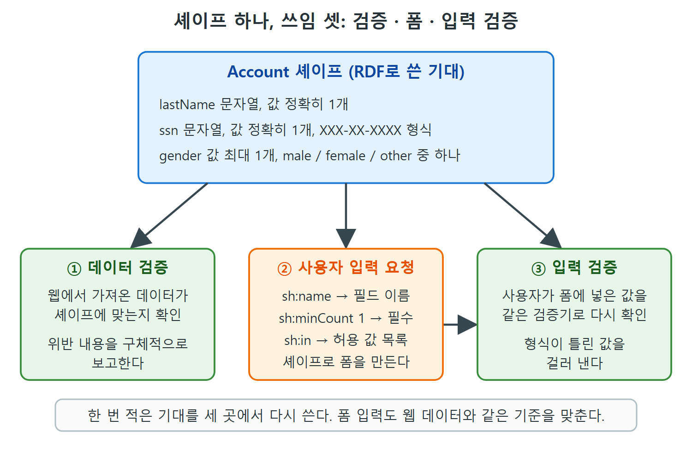

# SHACL로 검증하고 폼 만들기

앞 문서에서 Account 셰이프를 읽었다. 이 문서에서는 같은 셰이프 하나로 세 가지 일을 해낸다. 웹에서 가져온 데이터를 검증하고, 사용자에게 입력 폼을 보여 주고, 사용자가 입력한 값을 다시 검증한다. 한 번 적은 기대가 여러 곳에 재사용된다는 점이 SHACL의 큰 장점이다.

---

## 1. 데이터 검증

활성 계정 데이터가 다음과 같다고 하자. 원서 그림의 데이터에서 핵심 줄만 옮긴다.

```turtle
active:Account_1  account:firstName "Aaron" ;
  account:gender "male" ;
  account:lastName "Beatte" ;
  account:ssn "123-45-6789" .
active:Account_2  account:firstName "George" ;
  account:gender "unknown" ;
  account:lastName "Deller" ;
  account:ssn "12-345678" .
active:Account_3  account:firstName "Edelyn" ;
  account:lastName "Zetta" .
```

(실제 원문에서는 각 계정이 rdf:type account:Account와 rdfs:label도 가진다. 줄 수를 줄이려고 생략했다.)

세 속성을 차례로 검사해 보자.

- **lastName**: 세 계정 모두 문자열 값이 하나씩 있다. 위반이 없다.
- **gender**: Account_1은 "male"이라 허용 값이므로 위반이 없다. Account_2는 "unknown"인데 허용 목록에 없으므로 위반이다. SHACL은 위반 내용을 구체적으로 알려 준다. 주어진 값 "unknown"이 허용 값("female", "male", "other")에 없다는 식이다. Account_3은 gender가 아예 없다. 제약은 최대 개수 1만 말하고 최소는 말하지 않으므로, 값이 없는 것은 유효하다. 다만 "unknown"이라는 구체적인 값은 유효하지 않다.
- **ssn**: Account_1은 형식이 맞다. Account_2는 값이 있지만 형식이 패턴에 맞지 않는다. SHACL은 이 값이 셰이프의 패턴과 맞지 않는다고 구체적으로 알린다. Account_3은 값이 아예 없다. 셰이프에 sh:minCount 1이 있으므로 이번에는 위반이고, 속성에 값이 최소 1개 필요한데 0개를 찾았다는 식으로 보고된다.

| 계정 | lastName | gender | ssn | 결과 |
|---|---|---|---|---|
| Account_1 | "Beatte" (통과) | "male" (통과) | "123-45-6789" (통과) | 위반 없음 |
| Account_2 | "Deller" (통과) | "unknown" (허용 목록에 없음, 위반) | "12-345678" (패턴 불일치, 위반) | 위반 2건 |
| Account_3 | "Zetta" (통과) | 값 없음 (통과, 최소 개수 없음) | 값 없음 (위반, 최소 1개 필요) | 위반 1건 |

표를 보면 gender와 ssn의 값이 없는 경우의 결과가 서로 다르다. 차이는 minCount 유무뿐이다.

이 과정을 SHACL 검증(SHACL validation)이라 한다. SHACL 셰이프 정의와, 그 셰이프에 맞는다고 주장하는 데이터가 주어지면, 데이터가 제약을 어기는지 그리고 어떻게 어기는지 자동으로 알아낼 수 있다.

검증은 데이터 웹에서 특히 중요하다. 데이터를 발행하고 소비하는 애플리케이션을 서로 다른 조직이 만들고 운영하기 때문이다. 열려 있고 이질적인 시스템 사이에서 상호운용성을 지키려면, 상대가 내놓고 받을 데이터에 대한 기대를 명시할 수단이 필요하다. SHACL이 그 기대를 명시하는 수단이고, SHACL 검증이 그것을 강제하는 수단이다.

## 2. 사용자 입력 요청: 셰이프로 폼 만들기

데이터를 검증하는 제약은 사용자에게 데이터를 요청하는 데도 쓸 수 있다. Account 셰이프로 폼을 만든다면, 직관적으로 account:lastName, account:ssn, account:gender에 대응하는 필드 세 개가 있을 것이다. 물론 폼에서 속성의 CURIE(compact URI)를 그대로 보여 줄 수는 없다. 다행히 셰이프에는 각 제약의 이름이 있고, 이 이름이 사람이 읽기 좋다. "family name", "SSN", "gender"가 그것이다. 더 설명이 필요하면(SSN이 무슨 약자인지 등) sh:description이 자세한 설명을 준다.

제약은 폼이 어떻게 동작해야 하는지도 암시한다.

| 셰이프 정보 | 폼에 주는 힌트 |
|---|---|
| sh:name | 필드 이름("family name", "SSN", "gender") |
| sh:description | 도움말(SSN이 무엇인지 등) |
| sh:datatype, sh:pattern | SSN에는 숫자만 입력하게 한다 |
| sh:minCount 1 | family name과 SSN은 필수 입력 |
| minCount 없음 | gender는 선택 입력 |
| sh:in | gender를 입력하면 "male", "female", "other" 중 하나만 허용 |

폼을 만드는 기술은 많다. SHACL은 필드 이름, 타입, 허용 값 같은 폼이 가져야 할 내용을 제공할 뿐이다. 원서는 기본 HTML로 이 셰이프에서 만든 폼 예시를 그림으로 보여 준다.

## 3. 사용자 입력 검증

다음 상황을 생각해 보자. 사용자가 셰이프로 만든 폼에 정보를 채운다. 그런데 이 폼은 XXX-XX-XXXX 형태의 숫자를 강제하지 못하고, 최대 11글자의 자유 텍스트 칸만 둔다. 많은 폼 기술은 숫자만 입력하게 하거나 특정 형식을 강제할 만큼 정교하지 않다. 그래서 사용자가 다른 형식으로 숫자를 입력했다. SHACL이 폼 제작에 쓰였어도 여전히 유효하지 않은 데이터가 생긴다. 이때도 SHACL이 도울 수 있다.

SHACL 같은 기계가 읽을 수 있는 셰이프 언어의 장점은 같은 모델(앞의 Account 셰이프)로 데이터 검증도 하고 사람에게 데이터를 요청하는 것도 한다는 점이다. SHACL은 RDF이므로 6장에서 본 것처럼 SPARQL로 조회할 수도 있다. 이 둘을 결합해 같은 모델로 사용자 입력도 검증한다. 폼에서 받은 결과를 웹 데이터에 쓰는 것과 같은 도구, 곧 SHACL 검증기(validator)로 처리하면 된다. 사람이 입력한 데이터도 웹에서 찾은 데이터와 같은 수준의 기준을 맞추게 된다.



그림은 Account 셰이프 하나에서 세 가지 쓰임이 갈라지는 모습을 보여 준다. 폼에서 받은 값도 웹에서 가져온 데이터와 같은 셰이프, 같은 검증기로 확인한다.

원서는 이렇게 SHACL이 "데이터의 야생"이 가진 가치를 지키면서 그 거친 성질을 어느 정도 길들인다고 말한다. 웹 전체에서 데이터를 받고 누구든 어떤 주제에 대해서든 말하게 하지만, 셰이프와 제약을 강제해 애플리케이션이 폭주하지 않도록 지킨다.

---

## 4. 정리

- SHACL 검증은 셰이프와 데이터를 받아 어떤 제약을 어떻게 어겼는지 구체적으로 알려 준다.
- 최소 개수를 정하지 않은 속성은 비어 있어도 유효하고, minCount 1이면 비어 있는 것이 위반이다.
- 같은 셰이프에서 폼의 필드 이름, 설명, 필수 여부, 허용 값을 얻을 수 있다.
- 폼이 형식을 강제하지 못해도, 같은 셰이프와 검증기로 사용자 입력을 다시 걸러 낼 수 있다.

<br>
<br>
<br>

[Semantic Web for the Working Ontologist](../)
