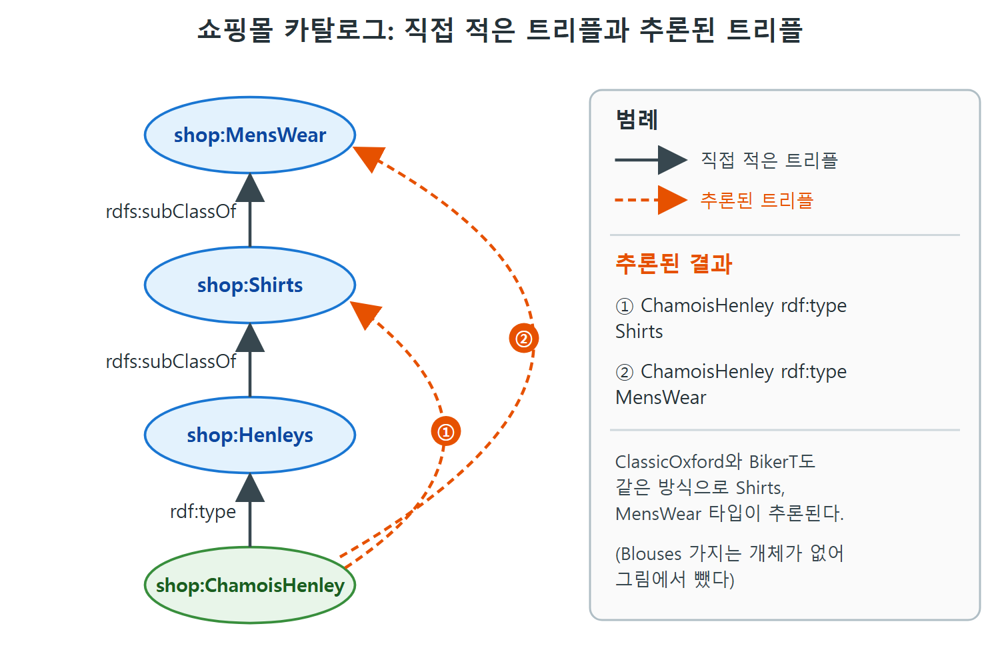

# 추론 엔진과 쇼핑몰 예제

추론 규칙을 정의했다고 해서 애플리케이션이 저절로 똑똑해지지는 않는다. 규칙을 실제로 적용해 줄 "똑똑한 부분"이 구조 어딘가에 있어야 한다. 이 문서는 추론 엔진이 구조의 어디에 들어가는지, 쇼핑몰 카탈로그 예제에서 추론 결과가 어떻게 나오는지, 직접 적은 트리플과 추론된 트리플을 어떻게 구분하는지를 다룬다.

---

## 1. 추론 엔진은 어디에 있나

원서는 이 구조를 4장의 RDF 쿼리 구조에 추론 층을 더한 그림으로 보여 준다. 그림 속 구성 요소를 글로 풀면 다음과 같다.

| 구성 요소 | 하는 일 |
|---|---|
| 애플리케이션, 분석, 사용자 인터페이스 | 데이터를 쓰는 쪽 |
| 추론 및 쿼리 엔진 | 새로 추가된 부분. 직접 적힌 트리플뿐 아니라 추론 규칙으로 얻을 수 있는 트리플까지 포함해 질의에 답한다 |
| 데이터베이스(RDF 저장소) | 트리플을 보관한다 |
| 파서/직렬화기, 변환기와 스크래퍼 | RDF 파일, 웹 페이지, 스프레드시트, 데이터베이스 등에서 데이터를 가져온다 |

```text
애플리케이션 / 분석 / UI
        |
  추론 및 쿼리 엔진
        |
  데이터베이스 (RDF)
        |
 파서 / 변환기 <- RDF 파일, 웹 페이지, 스프레드시트 등
```

새로운 점은 애플리케이션과 RDF 저장소 사이에 쿼리 부품과 나란히 추론 능력이 놓인다는 것이다. 쿼리 엔진의 힘은 그 엔진이 지원하는 추론의 집합이 결정한다. RDFS 추론 쿼리 엔진은 RDFS 표준이 정한 작은 추론 집합을, OWL 추론 쿼리 엔진은 더 큰 OWL 추론 집합을 지원한다. 원서는 데이터를 미리 추론 엔진으로 처리해 둔 다음 직접 쿼리하는 대안도 있다고 덧붙이며, 이는 이 장 뒤쪽에서 다룬다.

## 2. 예제 1: 간단한 RDFS 쿼리

타입 전파 규칙을 지원하는 추론 엔진이 있고, 저장소에 다음 두 트리플만 있다고 하자.

```turtle
shop:Henleys rdfs:subClassOf shop:Shirts .
shop:ChamoisHenley rdf:type shop:Henleys .
```

여기에 다음 SPARQL 패턴으로 질의한다.

```sparql
SELECT ?item
WHERE {?item rdf:type shop:Shirts . }
```

| 질의 방식 | 결과 |
|---|---|
| 일반 RDF 쿼리 | 결과 없음. 서술어가 rdf:type이고 목적어가 shop:Shirts인 트리플이 없기 때문이다 |
| RDFS 추론 쿼리 엔진 | ?item = shop:ChamoisHenley 한 건. 타입 전파 규칙 덕분이다 |

앞서 "chamois"를 검색했을 때 빈 결과가 나온 문제가 바로 이 차이다. 추론이 있으면 검색이 기대대로 동작한다.

## 3. 직접 적은 트리플과 추론된 트리플

추론과 쿼리를 별개 과정으로 생각하면 편할 때가 많다. 추론 엔진이 정해진 규칙으로 가능한 추론 트리플을 모두 만들어 두고, 그다음 일반 SPARQL 엔진이 늘어난 저장소를 쿼리하는 방식이다. 이렇게 보면 asserted 트리플(직접 적은 것)과 inferred 트리플(추론된 것)을 말할 수 있다.

- asserted 트리플은 원래 RDF 저장소에 직접 들어 있던 트리플이다. 여러 출처를 합쳐 저장소를 채웠다면 모두 asserted다.
- inferred 트리플은 해당 엔진의 추론 규칙으로 추가로 도출된 트리플이다. 엔진이 이미 asserted인 트리플을 다시 추론해도 그 트리플은 asserted로 본다.
- 논리적으로 둘 사이에는 차이가 없다. 추론 엔진은 inferred 트리플로부터도 asserted 트리플과 똑같은 결론을 낸다.

## 4. 예제 2: 카탈로그 모델

타입 전파 규칙 하나만으로도 이 구분을 보일 수 있다. 저장소에 다음 트리플이 있다고 하자.

```turtle
shop:Henleys rdfs:subClassOf shop:Shirts .
shop:Shirts rdfs:subClassOf shop:MensWear .
shop:Blouses rdfs:subClassOf shop:WomensWear .
shop:Oxfords rdfs:subClassOf shop:Shirts .
shop:Tshirts rdfs:subClassOf shop:Shirts .
shop:ChamoisHenley rdf:type shop:Henleys .
shop:ClassicOxford rdf:type shop:Oxfords .
shop:BikerT rdf:type shop:Tshirts .
```

이 모델은 계층으로 보면 이렇다.

```text
MensWear
  +-- Shirts
        +-- Henleys   -> ChamoisHenley
        +-- Oxfords   -> ClassicOxford
        +-- Tshirts   -> BikerT
WomensWear
  +-- Blouses
```

타입 전파 규칙만 적용하는 추론 엔진은 다음 여섯 개를 추론한다. 원서는 추론된 트리플 앞에 별표를 붙였다.

| 개체 | 직접 적은 타입 | 추론된 타입 |
|---|---|---|
| shop:ChamoisHenley | shop:Henleys | shop:Shirts, shop:MensWear |
| shop:ClassicOxford | shop:Oxfords | shop:Shirts, shop:MensWear |
| shop:BikerT | shop:Tshirts | shop:Shirts, shop:MensWear |

읽는 법은 이렇다. 개체의 직접 타입에서 위로 한 단계씩 올라가는 모든 상위 클래스가 추론된다. Henleys에서 Shirts로, Shirts에서 MensWear로 두 번 타입이 전파된다. 모델 전체로 보면 asserted 8개에 inferred 6개가 더해진다. (이 개수는 위 목록을 센 값이다.) Blouses는 개체가 없어 추론되는 타입도 없다.



그림은 직접 적은 트리플(실선)과 추론된 트리플(점선)을 ChamoisHenley 한 개체로 보여 준다. 직접 적은 타입은 Henleys 하나뿐이지만, 하위 클래스 사슬을 따라 Shirts(①)와 MensWear(②)가 추론된다.

원서의 그림은 직접 적은 트리플을 실선, 추론된 트리플을 점선으로 그린다. 이 규칙은 책 전체에서 쓰인다.

### 여러 출처를 합칠 때의 미묘함

각 출처가 스스로 추론 엔진을 가진 시스템인 경우를 생각해 보자. 대부분의 RDF 구현에서는 저장소에 새 트리플을 직접 넣을 수 있어서, 애플리케이션이 추론된 트리플을 전부 또는 일부 직접 적어 넣기가 쉽다. 이 트리플을 직렬화(예를 들어 RDF/XML)해 웹에 공유하면 다른 애플리케이션이 다른 출처와 합쳐 더 추론할 수 있다. 이런 복잡한 상황에서는 asserted와 inferred라는 단순 구분이 너무 거칠어서 시스템에서 벌어지는 일을 설명하기에 부족할 수 있다.

---

## 5. 정리

- 추론 엔진은 애플리케이션과 RDF 저장소 사이에서 쿼리 엔진과 나란히 동작하고, 지원하는 추론 집합(RDFS, OWL)이 엔진의 힘을 정한다.
- 타입 전파 규칙이 있으면 `?item rdf:type shop:Shirts` 쿼리가 하위 클래스의 개체까지 돌려준다.
- asserted와 inferred 트리플은 논리적으로 구별되지 않는다. 같은 결론을 낸다.
- 출처를 합치는 상황에서는 이 구분이 너무 거칠 수 있다.

<br>
<br>
<br>

[Semantic Web for the Working Ontologist](../)
