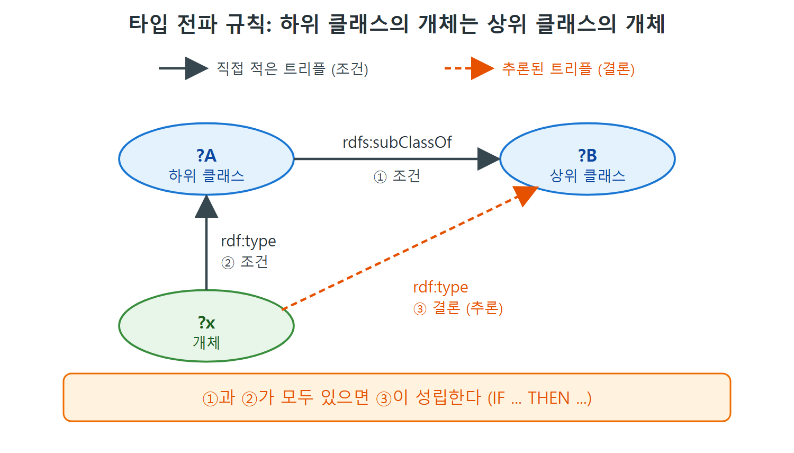

# 추론과 subClassOf

RDF만으로도 데이터를 그래프로 표현하고 URI로 웹 전체에 엮을 수 있다. 하지만 RDF는 "이 데이터가 무슨 뜻인지"까지는 말해 주지 않는다. 시맨틱 웹 표준은 RDF 위에 두 가지 능력을 얹는다. 하나는 이미 있는 데이터에서 새 사실을 끌어내는 추론(inference)이고, 다른 하나는 아직 보지 못한 데이터가 어떤 모습이어야 하는지 말하는 기대(expectation)다. 추론은 RDFS가, 기대는 SHACL이 맡는다.

이 문서는 그중 추론의 출발점을 다룬다. 쇼핑몰 검색 이야기로 시작해서 rdfs:subClassOf가 무슨 뜻인지, 그 뜻을 왜 "추론 규칙"으로 정의하는지, 객체지향의 상속과 어디가 같고 어디가 다른지 정리한다.

---

## 1. 두 가지 확장: 추론과 기대

| 확장 | 하는 일 | 쓰는 표준 | 쓰는 때 |
|---|---|---|---|
| 추론(inference) | 이미 본 데이터에서 결론을 끌어내 새 데이터를 만든다 | RDFS (이후 장에서 RDFS-Plus, OWL) | 데이터를 해석하고 통합할 때 |
| 기대(expectation) | 아직 보지 못한 데이터가 이래야 한다고 예측한다 | SHACL | 사용자에게 입력을 받거나 새 데이터 출처를 검증할 때 |

표를 보면 추론은 "있는 것에서 더 뽑아내기", 기대는 "들어올 것에 조건 걸기"라고 기억하면 된다. 원서는 SHACL을 RDFS의 확장이라고 소개한다. 이 장 앞부분은 추론, 뒷부분은 기대를 다룬다.

## 2. 셔츠 검색이 비는 이유

온라인 옷 가게에서 "Shirts" 카테고리로 "chamois"를 검색했는데 결과가 비었다고 하자. 종이 카탈로그에서 분명 chamois Henley를 봤다. 품번으로 다시 찾아보니 상품이 있고, 카탈로그에서 Henleys는 Shirts의 한 종류로 나와 있다. 이때 우리는 "Henleys에서 나오면 Shirts에서도 나와야 하는 것 아닌가" 하고 투덜댄다.

여기서 기대하는 것은 단순하다. "Shirts"를 건드리는 검색, 쿼리, 접근은 "Henleys"도 함께 봐야 한다. "Henleys는 Shirts의 한 종류다"라는 말이 바로 이 뜻이기 때문이다. 문제는 이 뜻을 일관되고 유지보수하기 좋은 방식으로 데이터에 적어 두는 방법이다.

RDFS는 RDF Schema의 줄임말이고, RDF용 스키마(schema) 언어다. Henleys와 Shirts 사이의 관계에는 RDFS에서 정해진 이름이 있다. RDFS의 자원은 별도의 네임스페이스(namespace)에 들어 있고, 이를 rdfs:로 줄여 쓴다. 이 관계의 이름이 rdfs:subClassOf다.

```turtle
:Henley rdfs:subClassOf :Shirt .
```

이 한 줄이 "Henley는 Shirt의 하위 클래스(subclass)"라는 선언이다.

## 3. 같은 관계, 여러 이름

"Henleys는 Shirts보다 좁은 범주"라는 관계는 정보 모델링을 하는 여러 분야에 이미 익숙하다. 다만 분야마다 부르는 이름이 다르고, 그 뜻을 정하는 방식도 다르다.

| 분야 | 부르는 말 | 쓰임새 |
|---|---|---|
| 시소러스(thesaurus) | 넓은 용어(broader term) | 넓은 용어로 검색하면 좁은 용어로 태그된 항목도 찾는다. 넓은 용어로 분류하면 좁은 용어 목록을 보여 줘 분류를 더 구체화하게 돕는다 |
| 객체지향 프로그래밍 | 하위 클래스, 클래스 확장 | Henleys 객체는 Shirts 객체가 받는 모든 메시지에 응답한다 |
| RDFS | rdfs:subClassOf | "Henleys rdfs:subClassOf Shirts" |
| SKOS (11장에서 설명) | broader term | "Henleys has broader term Shirts" |

읽는 법은 이렇다. 네 가지가 모두 같은 방향의 관계를 가리키지만, 시소러스는 그 의미를 비공식적으로 둔다. 반면 시맨틱 웹은 의미를 형식적으로 정의한다. 그래서 같은 말이라도 RDFS의 subClassOf는 기계가 그대로 따라 계산할 수 있다.

## 4. 객체지향과 닮았지만 다르다

객체지향(OOP)의 class, subclass와 시맨틱 웹의 용어는 역사적·기술적으로 가깝다. 하지만 미묘하고 중요한 차이가 있다. OOP는 클래스 관계를 프로그램 동작 중심으로 형식화한다. Henleys 객체는 Shirts에 정의된 모든 메시지에 응답하고, Henley에 더 구체적인 동작을 정의하지 않았다면 Shirts와 같은 동작을 한다. 시맨틱 웹도 형식적인 관점을 취하지만, 의미를 프로그램 동작이 아니라 추론으로 정의한다.

OOP에서 하위 클래스 객체가 상위 클래스 메서드에 같은 방식으로 응답하는 까닭은, 그 객체가 실제로 상위 클래스의 구성원이기도 하기 때문이다. 시맨틱 웹 관점에서 보면 Henleys의 개체는 Shirts의 개체이기도 하니까, Shirts의 구성원처럼 행동해야 한다.

추론으로 해결하려는 일은 셔츠 말고도 많다. 호텔 체인이 어떤 지역에 호텔을 두고 있으면 그 지역은 그 체인의 호텔이 서비스하는 곳이라고 적고 싶을 수 있고, 태양계 천체의 분류에서 행성 목록을 뽑고 싶을 수도 있다. 앞 장의 가족 관계 예제처럼, 자식·형제·어머니 같은 관계가 어느 쪽으로 적혔든 빠짐없이 채워 주는 일상적인 정합성 보완도 추론이 맡을 수 있다. 이런 보완이 없으면 데이터가 서로 어긋나고, 앞의 검색 같은 상황이 생긴다.

| 비교 항목 | OOP | 시맨틱 웹 |
|---|---|---|
| 의미를 정하는 방식 | 프로그램 동작(메시지 응답) | 추론 규칙 |
| 하위 클래스가 메서드를 재정의(override)하면 | 하위 클래스 정의가 우선하므로 상위 클래스처럼 행동하지 않아도 된다 | 여전히 상위 클래스의 구성원이므로 그에 맞게 행동해야 하고, 재정의는 허용되지 않는다 |
| 한 클래스가 두 상위 클래스를 가질 때 | 언어마다 다르게 해결한다 | 규칙을 두 번 적용하면 끝이다 |

이 표에서 가장 눈여겨볼 곳은 재정의 줄이다. 대부분의 OOP는 하위 클래스가 상위 동작을 덮어쓰게 해 주지만, 시맨틱 웹의 논리에서는 그런 예외를 만들 수 없다. 그래서 "상속"에 익숙한 개발자가 subClassOf를 볼 때 이 점만은 따로 기억해 둘 필요가 있다.

## 5. subClassOf의 뜻은 추론 규칙 하나다

원서는 앞으로 여러 장에 걸쳐 RDF 모델에 쓸 수 있는 용어를 소개하면서, 각 용어의 의미를 추론 패턴으로 제시한다. 추론 패턴은 "이런 정보가 있으면 이런 새 정보를 끌어낼 수 있다"는 꼴이다. RDFS(8장)와 웹 온톨로지 언어인 OWL(12장)이 이 방식으로 동작한다.

rdfs:subClassOf의 의미는 다음 추론 하나로 정의된다.

```text
IF
  ?A rdfs:subClassOf ?B .
  ?x rdf:type ?A .
THEN
  ?x rdf:type ?B .
```

말로 풀면, A가 B의 하위 클래스이고 x가 A의 개체이면 x는 B의 개체이기도 하다. 원서는 이것을 타입 전파 규칙(type propagation rule)이라 부른다. 프로그래밍 언어의 IF/THEN과 거의 같은 구조라서, "하위 클래스의 구성원이면 상위 클래스의 구성원"이라고 읽으면 된다.

| 구분 | 트리플 패턴 | 말로 풀면 |
|---|---|---|
| 조건 (IF) | ?A rdfs:subClassOf ?B | A는 B의 하위 클래스다 |
| 조건 (AND) | ?x rdf:type ?A | x는 A의 개체다 |
| 결론 (THEN) | ?x rdf:type ?B | x는 B의 개체이기도 하다 |



그림은 규칙의 조건 두 개(실선)와 결론(점선)을 그래프로 보여 준다. ?A가 ?B의 하위 클래스이고 ?x가 ?A의 개체이면, ?x가 ?B의 개체라는 트리플이 새로 성립한다.

이 단순한 해석이 RDFS 모델링의 일꾼이다. 뒤에 나올 OWL 모델링에서도 마찬가지다. subClassOf의 정의는 이 규칙이 전부다.

---

## 6. 정리

- RDF 위의 두 확장은 추론(RDFS)과 기대(SHACL)다.
- Henleys와 Shirts의 관계는 시소러스의 넓은 용어, OOP의 하위 클래스, SKOS의 broader와 같은 종류의 관계지만, 시맨틱 웹은 그 의미를 추론 규칙으로 못 박는다.
- rdfs:subClassOf의 의미는 타입 전파 규칙 하나로 끝난다.
- OOP의 재정의 같은 예외는 시맨틱 웹의 subClassOf에서는 허용되지 않는다.

<br>
<br>
<br>

[Semantic Web for the Working Ontologist](../)
