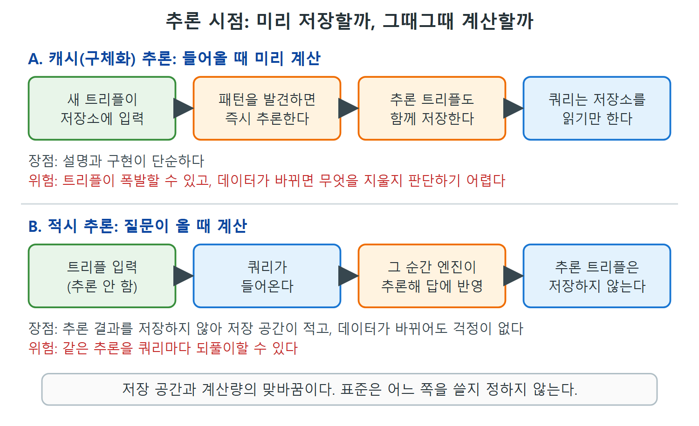

# 추론은 언제 일어나는가

RDFS와 OWL 표준은 "이런 트리플 패턴이 있으면 이런 추론이 유효하다"까지만 정한다. 추론을 언제 하는지, 아예 하긴 하는지, 추론된 트리플을 어디에 얼마나 저장하는지는 표준의 범위 밖이다. 그래서 구현마다 답이 다르다. 이 문서는 그 선택지들과 각각의 장단점, 그리고 추론을 전혀 하지 않는 구현에서도 모델이 왜 여전히 중요한지를 정리한다.

---

## 1. 두 가지 극단: 미리 저장하기와 그때그때 계산하기

가장 단순한 방법은 직접 적은 트리플과 추론된 트리플을 한 저장소에 모두 넣는 것이다. 패턴이 발견되는 즉시 추론된 트리플을 저장소에 넣는다. 원서는 이것을 캐시 추론(cached inferencing) 또는 구체화 추론(materialized inferencing)이라 부른다. 모든 추론 결과가 데이터와 함께 저장("캐시")되기 때문이다.

반대쪽 극단은 추론된 트리플을 어디에도 저장하지 않는 것이다. 쿼리가 들어올 때만 추론한다. 가능한 한 늦은 순간에 계산하므로 이를 적시 추론(just in time inferencing)이라 부른다. 쿼리 응답에는 모든 해당 추론이 반영되지만 추론된 트리플은 남지 않는다.

| 항목 | 캐시(구체화) 추론 | 적시 추론 |
|---|---|---|
| 추론하는 때 | 패턴이 발견되는 즉시 | 쿼리가 들어올 때 |
| 추론 결과 | 저장소에 함께 저장 | 저장하지 않음 |
| 장점 | 설명과 구현이 아주 단순하다 | 영구 저장 공간이 적게 든다 |
| 위험 | 트리플이 폭발적으로 늘 수 있다 | 같은 추론 작업을 되풀이할 수 있다 |
| 데이터가 바뀔 때 | 어떤 추론 트리플을 지울지 판단해야 한다 | 쿼리 때마다 다시 계산하므로 이 문제가 없다 |



그림은 두 방식에서 추론이 일어나는 단계(주황 상자)가 어디인지 보여 준다. 캐시 추론은 데이터가 들어올 때 계산해 저장하고, 적시 추론은 쿼리가 들어올 때 계산하고 저장하지 않는다.

표를 읽는 핵심은 저장 공간과 계산량 사이의 맞바꿈이다. 미리 저장하면 질의가 빠르지만 저장소가 커지고 갱신이 까다로워진다. 그때그때 계산하면 저장소는 가볍지만 반복 계산이 든다.

## 2. 데이터가 바뀌면 생기는 문제

데이터 출처가 바뀌어 트리플이 추가되거나 삭제되면 어떻게 될까. 추론 결과를 저장해 두는 전략은 어떤 추론된 트리플도 함께 지워야 하는지 정해야 한다. 이것은 어려운 문제다. 한 트리플이 도출될 수 있는 경로가 여러 가지일 수 있기 때문이다. 한 경로가 트리플 삭제로 무너졌다고 해서 그 추론 트리플까지 지워도 되는 것은 아니다. 다른 경로로 여전히 성립할 수 있다.

쿼리 때마다 추론을 다시 계산하는 방식은 이 문제를 겪지 않는다.

## 3. 추론을 하지 않는 변형

적시 추론의 중요한 변형이 하나 있다. 명시적인 추론을 전혀 하지 않는 것이다. 이 장 처음에 본 Shirts 하위 클래스 쿼리가 그 예다. 쿼리가 원하는 데이터를 모델의 추론 의미에 기대지 않고 직접 적었다. 원서는 이 경우에도 모델의 추론 해석이 시맨틱 애플리케이션을 조직하고 이해하는 데 여전히 중요하다고 말한다. 다음 절에서 그 이유를 본다.

| 구현 방식 | 추론 엔진 | 추론 트리플 저장 | 모델의 역할 |
|---|---|---|---|
| 캐시(구체화) 추론 | 있음 | 저장 | 엔진이 규칙으로 사용 |
| 적시 추론 | 있음 | 저장 안 함 | 엔진이 쿼리 때 규칙으로 사용 |
| 명시적 쿼리 | 없음 | 해당 없음 | 쿼리가 옳은지 판단하는 명세 |

## 4. 명세로서의 추론

처음에 본 쿼리를 다시 보자. 카탈로그의 모든 Shirts를 찾는데, rdfs:subClassOf 링크를 명시적으로 따라간다.

```sparql
SELECT ?item
WHERE {?class rdfs:subClassOf* :Shirts .
       ?item a ?class . }
```

이 쿼리는 추론을 전혀 언급하지 않는다. asserted와 inferred를 구분하지도 않고 직접 적힌 데이터만 처리한다. 그런데 이 쿼리가 돌려준 항목이 정말 Shirts라는 것은 어떻게 아는가.

Java, C++, SQL로 짠 프로그램도 같은 질문을 받는다. Shirts의 모든 하위 클래스(그리고 그 하위 클래스)의 구성원을 모았을 때, 모은 것이 전부 Shirts라는 보장이 있는가. 검색 결과로 돌려줘도 되는가. 여기서 의미 모델의 역할이 나온다. 모델이 쿼리가 맞는지 알려 준다. 이 예에서는 Henleys가 Shirts의 하위 클래스이므로 모든 Henley는 셔츠다. Oxfords와 그 하위 클래스도 같다. 모델과 그 형식적 의미가 이 쿼리의 모든 결과가 실제로 셔츠임을 보장한다.

이런 의미에서 모델은 명세(specification)다. 쿼리가 적절한지 논쟁이 생기면 모델에 판정을 구할 수 있다. 이 쿼리가 모델과 일관되는가. 모델이 RDFS, RDFS-Plus, OWL처럼 자동 추론이 가능한 언어로 쓰여 있으면 더 유용해진다. 이때 명세를 실행 가능하다(executable)고 한다. 프로그램을 돌려 모델이 정확히 무슨 뜻인지 알아낼 수 있다는 뜻이다. 앞 문서에서 asserted와 inferred를 보인 예가 바로 그런 실행의 결과이고, 어떤 종류든 모든 Shirts의 목록을 내 주었다.

| 구분 | 명세가 알려 주는 것 | 알려 주지 않는 것 |
|---|---|---|
| 모델(명세) | 프로그램이나 쿼리가 무엇을 해야 하는가 | 어떻게 구현해야 하는가 |
| 구현 선택 | 범용 추론 기능, 확장 쿼리, 다른 언어의 프로그램 중에서 고른다 | |

애플리케이션을 만들 때 범용 추론 기능을 쓸 수도, 위와 같은 확장 쿼리를 쓸 수도, 다른 언어로 프로그램을 쓸 수도 있다. 어느 쪽이든 모델이 쿼리나 프로그램을 정당화하는 중심 역할을 한다. 여러 사람이 서로 다른 기술로 시스템을 만들더라도 같은 모델에 비추어 정당화하면 결과가 일관된다.

---

## 5. 정리

- 표준은 어떤 추론이 유효한지만 정하고, 추론 시점과 저장은 구현이 정한다.
- 캐시(구체화) 추론은 단순하지만 트리플이 폭발할 수 있고 데이터 변경 시 삭제 판단이 어렵다. 적시 추론은 저장은 적지만 추론을 반복할 수 있다.
- 추론을 직접 하지 않는 쿼리도 모델이 옳음을 보증하는 명세 역할을 한다.
- 추론이 가능한 언어로 쓴 모델은 실행 가능한 명세가 된다.

<br>
<br>
<br>

[Semantic Web for the Working Ontologist](../)
