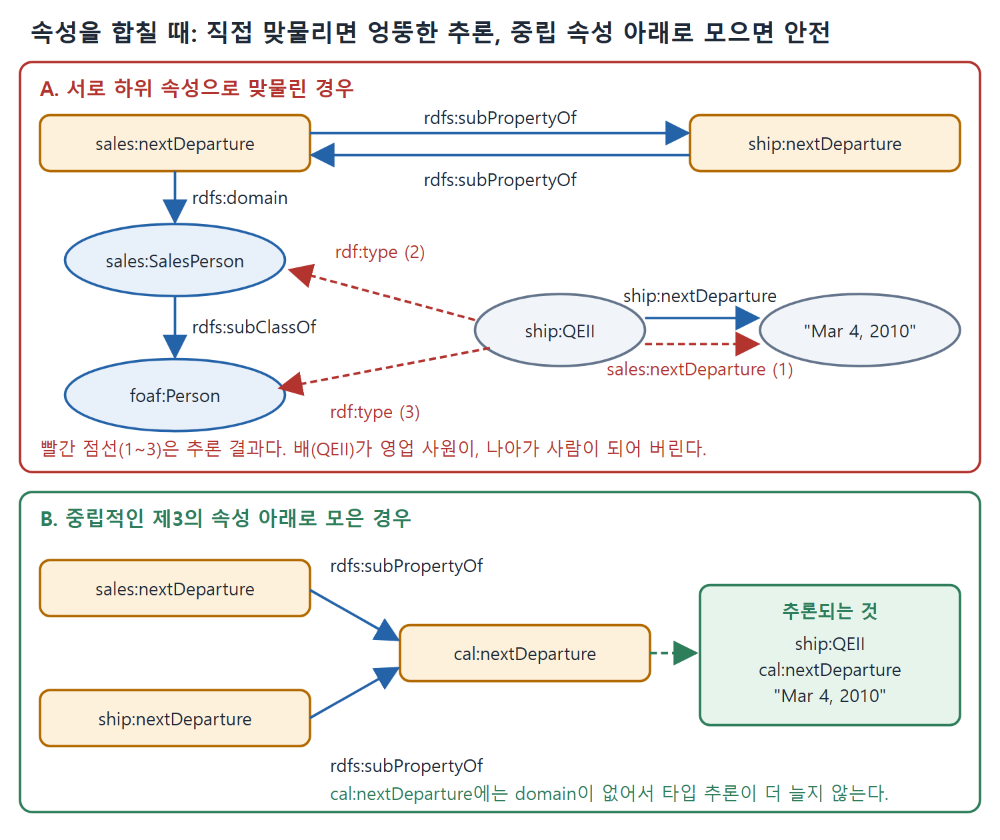

# domain과 range 모델링 함정

RDFS는 데이터를 합치는 데 쓸모가 크고, 공리가 몇 개 안 돼서 간결하고 구현하기도 쉽다. 그런데 아주 단순한 모델링 상황에서도 혼란이 생긴다. 이 문서는 한 속성에 domain을 두 번 선언하면 무슨 일이 생기는지, 서로 비슷해 보이는 두 속성을 섣불리 하나로 합쳤을 때 어떤 황당한 추론이 나오는지, 그리고 그 문제를 어떻게 피하는지 다룬다.

---

## 1. domain을 두 번 선언하면

앞의 선박 예에서 nextDeparture의 domain을 두 번 정의했다고 하자.

```turtle
ship:nextDeparture rdfs:domain DepartingVessel .
ship:nextDeparture rdfs:domain InServiceVessel .
```

이 두 문장은 nextDeparture의 domain이 DepartingVessel이라는 뜻일까, InServiceVessel이라는 뜻일까, 아니면 둘 다일까. RDFS에서 문장의 의미를 이해하는 올바른 방법은 거기서 어떤 추론이 나오는지 보는 것이다. QEII에 대해 이런 트리플이 있다고 하자.

```turtle
ship:QEII ship:maidenVoyage "May 2, 1969" .
ship:QEII ship:nextDeparture "Mar 4, 2010" .
ship:QEII ship:hasCommander Warwick .
```

domain 규칙은 선언마다 따로 적용되어 다음 두 결론을 낸다.

```turtle
ship:QEII rdf:type ship:DepartingVessel .
ship:QEII rdf:type ship:InServiceVessel .
```

이 동작은 "domain 문장이 여러 개면 어떻게 할까"를 따로 논의한 결과가 아니다. rdfs:domain의 정의를 각 선언에 적용했을 때 나오는 단순한 논리적 결론이다.

nextDeparture가 지정된 배는 DepartingVessel과 InServiceVessel 두 클래스 모두의 구성원으로 추론된다. 효과로 보면 domain 문장에 쓴 두 클래스의 교집합에 놓이는 셈이다. 많은 사람이 이 결과를 직관에 어긋난다고 느끼지만 RDFS에서는 "옳은" 결론이다.

## 2. OO 직관과 반대인 교집합 동작

OO 모델링에서 속성(필드, 변수, 슬롯)을 어떤 클래스와 연결하면, 직관은 "이제 이 클래스의 구성원을 기술하는 데 이 속성을 써도 된다"이다. 이런 문장이 두 개면 "두 클래스 중 어느 쪽 구성원에도 쓸 수 있다"로 해석한다. 곧 합집합이다. 이런 기대를 갖고 들어온 사람에게 RDFS의 교집합 동작은 놀라울 수 있다.

| 구분 | OO 직관 | RDFS 실제 동작 |
|---|---|---|
| domain 선언이 하는 말 | 이 속성을 이 클래스 구성원에 써도 된다 | 이 속성이 쓰이면 주어는 이 클래스의 구성원이다 |
| domain이 두 개일 때 | 두 클래스의 합집합에 쓸 수 있다 | 주어는 두 클래스 모두의 구성원이다(교집합) |
| 틀린 사용 | 오류 | 새 타입이 추론됨 |

표에서 두 번째 줄이 가장 큰 차이를 만든다. 합치려는 데이터가 있을 때 특히 조심해야 한다.

## 3. 합쳤더니 황당한 추론이 나온 사례

정보를 다른 정보와 합칠 예정이라면 조심해서 모델링해야 한다. 이번에는 출장이 잦은 영업 사원 팀을 관리하는 모델이 있다고 하자. 영업 사원마다 출장 일정이 있다.

```turtle
sales:SalesPerson rdfs:subClassOf foaf:Person .
sales:sells rdfs:domain sales:SalesPerson .
sales:sells rdfs:range sales:ProductLine .
sales:nextDeparture rdfs:domain sales:SalesPerson .
```

영업 조직은 특정 제품군(ProductLine)을 담당하고, 구성원은 정기적으로 출장을 다니며, 각 영업 사원의 다음 출발일을 추적하면 유용하다는 모델이다.

이 영업 인력 관리 정보를 원양 정기선 일정과 합쳤다고 하자. 한쪽 모델의 항목을 다른 모델에 대응시키면 합치는 일이 흥미로워진다. 눈에 띄는 대응 후보는 sales:nextDeparture와 ship:nextDeparture다. 둘 다 날짜를 가리키고, 무언가 또는 누군가의 다음 출발 날짜라는 직관이 같다. 그래서 두 모델을 잇는 가장 간단한 방법으로 서로를 하위 속성으로 선언한다.

```turtle
sales:nextDeparture rdfs:subPropertyOf ship:nextDeparture .
ship:nextDeparture rdfs:subPropertyOf sales:nextDeparture .
```

하지만 잠깐, 이 병합이 어떤 추론을 만드는지 보자. 영업 사원과 QEII 각각에 대해 트리플이 하나씩 있다고 하자.

```turtle
sales:Johannes sales:nextDeparture "May 31, 2008" .
ship:QEII ship:nextDeparture "Mar 4, 2010" .
```

subPropertyOf 추론을 먼저, 그다음 domain 추론, 마지막으로 foaf:Person과의 subClassOf 추론을 적용하면 다음 트리플이 나온다.

| 순서 | 추론된 트리플 | 느낌 |
|---|---|---|
| 1 | sales:Johannes ship:nextDeparture "May 31, 2008" | 무난하다 |
| 2 | ship:QEII sales:nextDeparture "Mar 4, 2010" | 무난하다 |
| 3 | sales:Johannes rdf:type ship:DepartingVessel | 영업 사원이 배가 된다 |
| 4 | ship:QEII rdf:type sales:SalesPerson | 배가 영업 사원이 된다 |
| 5 | ship:QEII rdf:type foaf:Person | 배가 사람이 된다 |

이 추론들은 무해하게 시작하지만 갈수록 직관에 어긋나고, QEII가 foaf:Person으로 분류되는 데 이르면 완전히 터무니없어진다. 원서는 여왕 본인이 foaf:Person일 수 있어서, 이름을 딴 배와 그 사람을 혼동하게 만드는 위험하고 오해를 부르는 추론이 될 수 있다고 덧붙인다. 원서 그림 8.6이 주장한 트리플과 추론된 트리플을 함께 보여 준다.

## 4. 탓은 domain이 아니라 섣부른 병합에 있다

이 불운한 동작의 책임을 rdfs:domain의 정의에 돌리기 쉽다. 그러나 그렇게 하면 빈대 잡으려다 초가삼간 태우는 격이다. 진짜 문제는 모델링 실수다. 두 속성을 서로 아주 가깝게 대응시키려는 지나친 열의에서 나온 실수다. subPropertyOf(그리고 다른 모든 RDFS 구성 요소)를 쓴 결과는 미묘하고 파급이 클 수 있다.

각 모델이 sales:nextDeparture, ship:nextDeparture에 domain과 range를 선언했을 때, 사실은 이런 강한 주장을 한 것이다. "어떤 개체가 sales:nextDeparture로 기술되어 있으면 그 개체는 sales:SalesPerson이다"(ship은 ship:DepartingVessel). 그렇게 구체적으로 정의된 두 속성을 합쳤을 때 극단적인 파급이 없다면 오히려 놀라운 일이다.

그러면 해법은 무엇일까. 속성 합치기를 아예 하지 말아야 할까. 그것은 시맨틱 웹의 정신에 맞지 않는다. 속성에 대해 강한 주장을 하지 말아야 할까. 그러면 쓸모 있는 모델을 만들 수 없다. RDFS 표준을 고쳐 이런 선언을 못 하게 해야 할까. 지나치다. OWL이 속성 정의를 더 세밀하게 할 수 있는 구성 요소를 주긴 한다. 그러나 근본 해법은 모델링 실수의 근원을 이해하는 데 있다. 의미에 중요한 차이가 있는 것들, 예컨대 두 가지 nextDeparture를 합치지 말아야 한다.

## 5. 합치되 강하게 묶지 않는 방법

이 장의 관용구를 쓰면 합치려는 동기에 따라 할 수 있는 일이 더 있다. 두 속성을 완전히 같다고 주장하지 않고도 합칠 수 있다.

영업 사원과 정기선의 출발 날짜를 모두 보여 주는 달력 응용을 만든다고 하자. 필요한 것은 우리가 원하는 정보를 한꺼번에 주는 단일 속성이고, 이는 속성 합집합 패턴이 해결한다. 한 도메인의 속성을 다른 도메인으로 직접 대응시키지 말고, 둘을 영역에 중립적인 제3의 속성에 대응시킨다.

```turtle
ship:nextDeparture rdfs:subPropertyOf cal:nextDeparture .
sales:nextDeparture rdfs:subPropertyOf cal:nextDeparture .
```

합쳐 주는 속성 cal:nextDeparture에는 domain 정보가 전혀 필요 없다. 그 속성이 기술하는 개체의 타입에 대해 더 추론할 일이 없기 때문이다. 이제 다음이 추론된다.

```turtle
sales:Johannes cal:nextDeparture "May 31, 2008" .
ship:QEII cal:nextDeparture "Mar 4, 2010" .
```

cal:nextDeparture로 정렬하는 달력 화면 하나로 두 날짜를 모두 보여 줄 수 있다. 다만 더 이상의 추론은 없다. QEII가 영업 사원 팀의 일원이라거나 Johannes가 범선이라는 결론은 나오지 않는다.

| 병합 방식 | 선언 | 결과 |
|---|---|---|
| 서로 하위 속성으로 직접 연결 | sales:nextDeparture와 ship:nextDeparture를 맞물림 | 두 속성의 domain이 모두 적용되어 배가 사람이 되는 등 터무니없는 추론 |
| 중립적인 제3의 속성 아래로 | 각각 cal:nextDeparture의 하위 속성 | 달력용 통합만 되고 타입 추론은 늘지 않음 |

표가 말하는 바는 같은 "합친다"라도 어디에 연결하느냐에 따라 결과가 완전히 달라진다는 점이다.



그림은 두 nextDeparture를 서로 하위 속성으로 맞물리면 QEII가 영업 사원과 사람으로 추론되는 반면, 중립 속성 cal:nextDeparture 아래로 모으면 날짜만 합쳐지는 차이를 비교한다.

## 6. 이 동작은 분산 메타데이터의 필연이다

이런 동작은 RDFS의 정의가 유별나서 생긴 것이 아니다. 시맨틱 웹에서는 데이터뿐 아니라 그 데이터를 설명하는 정보(메타데이터)도 여러 곳에 흩어져 있기 때문이다. 영업 쪽과 선박 쪽이 각자 자기 속성(sales:nextDeparture, ship:nextDeparture)에 대해 한마디씩 했고, 우리는 각 말을 자기 맥락 안에서 믿고 추론해야 한다. 그런데 두 속성을 서로 하위 속성이라고 이어 버리면 두 정의를 한꺼번에 받아들이게 된다. 모든 제공자의 진술을 똑같이 대접한 결과일 뿐 RDF 설계자가 임의로 정한 규칙이 아니다.

영업 영역의 말을 믿고 선박 영역의 말을 믿고 우리가 만든 대응도 믿는다면, domain은 각 영역이 선언한 domain의 교집합이어야 한다. 이 상황을 해결할 때(예를 들어 두 속성을 모두 아우르는 새 속성 cal:nextDeparture를 만들 때) 우리는 둘의 관계를 구체적으로 밝히는 것이다. 두 데이터 소스를 함께 쓰려면 이렇게 해야 한다.

시맨틱 웹 모델링의 기술은 둘 이상의 데이터셋(또는 메타데이터 집합)이 서로 어떻게 연관되는지를 구체적이고 충분히 상세하게 진술하는 데 있다. RDFS와 OWL 같은 언어의 추론 모델이 이런 모델을 만드는 데 필요한 정밀함을 준다.

## 7. 실수를 피하는 점검 목록

| 점검 질문 | 이유 |
|---|---|
| 합치려는 두 속성의 의미에 중요한 차이가 없는가 | 차이가 있으면 합치지 말아야 한다 |
| 두 속성에 domain이나 range가 선언되어 있는가 | 서로 하위 속성이면 선언들이 한꺼번에 적용되어 교집합이 된다 |
| 목적이 단지 한꺼번에 보여 주기인가 | 중립적인 상위 속성을 새로 만들고 domain은 두지 않는다 |
| 합친 뒤 어떤 타입이 추론되는지 따져 봤는가 | RDFS는 추론 결과를 따져 볼 수 있어서 위험한 병합을 미리 알아낼 수 있다 |

<br>
<br>
<br>

[Semantic Web for the Working Ontologist](../)
