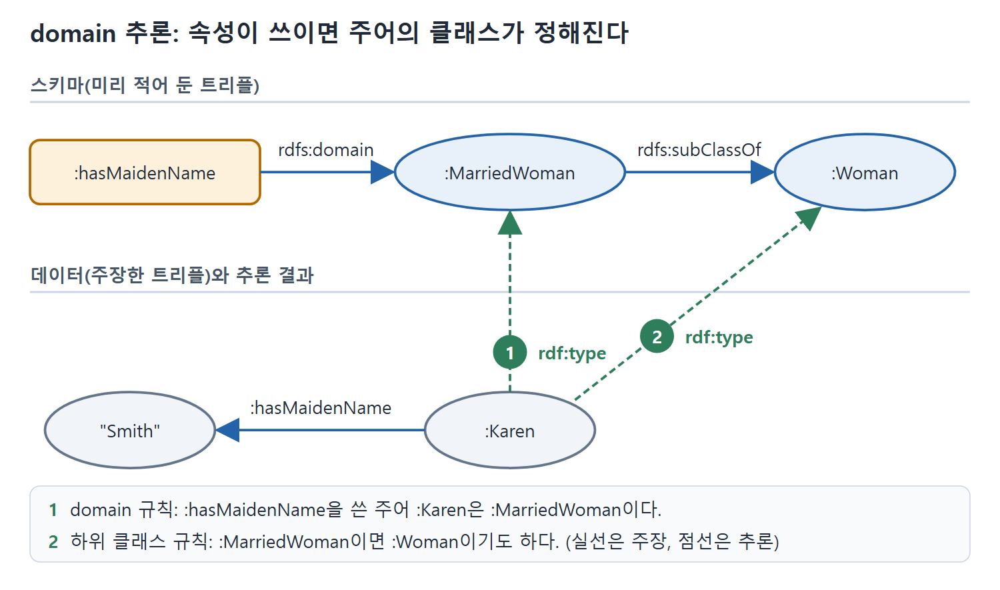

# domain과 range의 추론

rdfs:domain과 rdfs:range는 RDFS에서 가장 자주 오해받는 구성 요소다. 다른 모델링 방식의 "필드가 속한 클래스", "값의 타입 검사"와 비슷해 보이지만 실제로는 전혀 다르게 동작한다. 이 문서는 두 키워드가 어떤 추론 규칙으로 정의되는지, 하위 클래스와 만나면 어떤 일이 생기는지, 그리고 왜 객체지향의 상속과 다른지를 설명한다.

---

## 1. 속성이 쓰이는 모양으로 타입을 알아낸다

하위 속성은 속성끼리의 관계를 말해 준다. 하지만 속성이 정의된 클래스와 어떻게 연결되는지도 말하고 싶을 때가 있다. 이 속성을 쓸 때 트리플의 주어는 어떤 클래스(rdf:type)에서 오고, 목적어는 다른 어떤 클래스에서 온다는 식이다. 이 두 가지를 말하는 키워드가 각각 rdfs:domain과 rdfs:range다.

domain과 range라는 말은 수학에서 빌려 왔다. 함수의 정의역(domain)은 함수가 정의된 입력값의 집합이고, 치역(range)은 함수가 가질 수 있는 출력값의 집합이다. 실수 해석에서 제곱근 관계라면 정의역은 양수(음수는 실수 제곱근이 없으므로), 치역은 모든 실수(양의 제곱근과 음의 제곱근이 있으므로)가 된다.

RDFS에서는 속성 p에 domain과 range를 이렇게 선언한다.

```turtle
:p rdfs:domain :D .
:p rdfs:range :R .
```

느슨하게 풀면 "관계 p는 클래스 D의 값과 클래스 R의 값을 잇는다"는 뜻이다. D와 R이 서로 겹치지 않아야 하거나 달라야 한다는 조건은 없다.

## 2. 두 규칙의 정확한 모양

의미는 추론 규칙으로 정해진다. domain 규칙은 다음과 같다.

```sparql
CONSTRUCT { ?x rdf:type ?D . }
WHERE { ?P rdfs:domain ?D .
        ?x ?P ?y . }
```

range 규칙은 주어 자리와 목적어 자리만 바뀐다.

```sparql
CONSTRUCT { ?y rdf:type ?D . }
WHERE { ?P rdfs:range ?D .
        ?x ?P ?y . }
```

| 키워드 | 겨냥하는 자리 | 추론 결과 | 읽는 법 |
|---|---|---|---|
| rdfs:domain | P를 서술어로 쓴 트리플의 주어(?x) | ?x rdf:type D | P를 쓰는 순간 주어는 D의 구성원이다 |
| rdfs:range | P를 서술어로 쓴 트리플의 목적어(?y) | ?y rdf:type R | P를 쓰는 순간 목적어는 R의 구성원이다 |

원서가 쓴 range 규칙의 변수 이름은 ?D로 되어 있지만 의미상 range 클래스를 가리킨다. 결국 domain은 주어, range는 목적어에 타입을 붙여 주는 규칙이다.

## 3. 오류를 내지 않고 타입을 만들어 낸다

여기서 가장 중요한 성질이 나온다. 속성 P를 선언과 어긋나 보이게 썼을 때, RDFS는 오류를 알리지 않는다. 대신 선언에 맞도록 필요한 타입 정보를 추론해서 채워 넣는다.

RDFS에는 "이 개체는 이 클래스의 구성원이 아니다"라고 말할 방법이 없다(OWL은 13장에서 다룬다). 틀린 추론이나 모순된 추론이라는 개념 자체가 없다. 그래서 XML Schema나 SHACL의 shape과 달리, RDF 스키마는 입력을 무효라고 선언하지 않고 알맞은 타입 정보를 추론할 뿐이다. 원서는 이것이 데이터베이스 스키마와 닮았다고 말한다. DB 스키마는 어떤 조인이 가능한지를 알려 줄 뿐, 조인된 데이터가 올바른지에 대해서는 말하지 않는다.

| 방식 | 선언과 어긋나는 데이터를 만나면 |
|---|---|
| XML Schema, SHACL shape | 입력이 유효하지 않다고 판정한다 |
| 객체지향 타입 | 타입 오류를 낸다 |
| RDFS domain과 range | 오류 없이 필요한 rdf:type 트리플을 추가한다 |

비유하면 입국 심사관이 아니라 자동 이름표 인쇄기에 가깝다. 어떤 속성을 쓰는 순간 "아, 이 개체는 D에 속하는구나" 하고 이름표를 붙여 줄 뿐 돌려보내지 않는다.

## 4. domain과 하위 클래스가 만나면

지금까지 rdfs:domain, rdfs:range, rdfs:subPropertyOf, rdfs:subClassOf 네 가지 추론 패턴을 봤다. 이 패턴들은 서로 맞물려 흥미로운 결과를 낸다. 단순한 예로 domain과 subClassOf의 상호작용을 보자.

클래스가 둘 있다. Woman과 MarriedWoman이고 MarriedWoman이 하위 클래스다. 속성 hasMaidenName의 domain은 MarriedWoman이다.

```turtle
:MarriedWoman rdfs:subClassOf :Woman .
:hasMaidenName rdfs:domain :MarriedWoman .
```

별것 아닌 모델처럼 보이지만 속에 미묘함이 있다. 어떤 개체에든 hasMaidenName이 붙어 있으면(그것이 Woman인지 몰라도) domain 규칙에 따라 MarriedWoman으로 추론된다. 예를 들어 이렇게 주장하면

```turtle
:Karen :hasMaidenName "Smith" .
```

다음이 추론된다.

| 단계 | 추론된 트리플 | 근거 |
|---|---|---|
| 1 | :Karen rdf:type :MarriedWoman | hasMaidenName의 domain 규칙 |
| 2 | :Karen rdf:type :Woman | MarriedWoman이 Woman의 하위 클래스이므로 |



그림은 :Karen이 hasMaidenName을 쓴 것만으로 domain 규칙에 따라 MarriedWoman이 되고, 하위 클래스 규칙으로 Woman까지 올라가는 두 단계를 번호로 보여 준다.

Karen만의 이야기가 아니다. hasMaidenName을 가진 어떤 리소스든 Woman이라고 추론된다. 즉 모든 ?X에 대해 `?X :hasMaidenName ?Y`가 있으면 `?X rdf:type :Woman`이 나온다. 이것은 domain의 정의와 똑같다. 그래서 다음을 새로 추론할 수 있다.

```turtle
:hasMaidenName rdfs:domain :Woman .
```

지금까지는 rdfs:domain 트리플이 주장되었거나 추론되었을 때 추론 패턴을 적용해 왔다. 이번에는 반대로, 추론 패턴이 성립함을 증명할 수 있을 때 rdfs:domain 트리플을 추론한다. 즉 추론 패턴을 "rdfs:domain이 성립한다는 것이 무슨 뜻인가"의 정의로 본 것이다.

이를 일반화한 규칙이 아래다. 원서 코드에는 rdfs:subClassof로 소문자 o가 쓰여 있는데 오타로 보고 바로잡았다.

```sparql
CONSTRUCT { ?P rdfs:domain ?C . }
WHERE { ?P rdfs:domain ?D .
        ?D rdfs:subClassOf ?C . }
```

속성의 domain을 어떤 클래스로 정하면, 그 클래스의 모든 상위 클래스도 그 속성의 domain이 된다. 같은 논리가 range에도 똑같이 적용된다.

| 규칙 | 조건 | 추론 |
|---|---|---|
| domain 확장 | P의 domain이 D, D가 C의 하위 클래스 | P의 domain이 C |
| range 확장 | P의 range가 D, D가 C의 하위 클래스 | P의 range가 C |

domain과 range의 기본 정의는 사실 꽤 공격적이다. 속성의 domain이나 range 정보가 있으면 그 속성이 쓰인 트리플 단 하나만으로도 해당 자리 요소의 타입을 단정한다. 뒤에서 보듯 이 때문에 놀라운 추론이 나오기도 한다. 다른 데이터 모델링 방식을 쓰던 사람이 RDFS에서 가장 많이 걸려 넘어지는 부분이 바로 이 정의다. 아주 흔한 개념에 이렇게 강한 해석을 붙이는 경우가 드물기 때문이다.

## 5. 객체지향의 상속과 다르다

OOP에서 코드를 정리하는 기본 장치는 상속이다. 방식은 여러 가지지만 대개 클래스 트리의 위에서 아래로 정보를 전하는 식이다. 어떤 클래스에 정의된 메서드나 변수는 그 하위 클래스에서도 쓸 수 있다.

RDFS를 처음 쓰는 OO 프로그래머는 상속이 같은 식으로 동작하리라 기대하기 쉽다. "당연한" 대응이 머릿속에 있기 때문이다.

| OOP | RDFS(OO 프로그래머의 직관) |
|---|---|
| 클래스 | rdfs:Class |
| 변수(필드) | 속성 |
| 클래스 C에 변수 P를 정의 | `P rdfs:domain C` |

이 대응대로라면 domain도 상속처럼 아래로 흘러야 한다. 그런데 hasMaidenName 예에서는 MarriedWoman에서 정의한 변수가 더 높은 클래스인 Woman으로 올라갔다. OO 관점에서는 트리를 거슬러 올라가는 상속, 즉 평소 기대와 정반대다.

잘못은 rdfs:domain을 "클래스에 변수를 정의한다"로 본 대응에 있다. RDFS에는 상속이라는 개념이 따로 없고, 작동하는 장치는 추론뿐이다. OO 상속에 가장 가까운 RDFS 규칙은 하위 클래스 전파 규칙, 곧 하위 클래스의 구성원은 상위 클래스의 구성원이기도 하다는 규칙이다. 상위 클래스 구성원에 대해 말한 것은 하위 클래스의 모든 인스턴스에도 성립하므로 이 규칙은 일반적인 상속 개념과 맞는다.

반면 domain과 subClassOf의 상호작용은 문제가 된다. 시맨틱 웹에는 AAA 슬로건이 있어서 속성은 어디서든 쓸 수 있고 어떤 클래스에도 종속되지 않아야 한다. hasMaidenName은 설계상 우주의 모든 리소스(Woman의 구성원 포함)에 대해 항상 쓸 수 있는 속성이었다. domain을 주장하거나 추론한다고 이 점이 바뀌지는 않는다. 그러므로 시맨틱 웹에서 "속성이 어떤 클래스에 정의되어 있다"고 말하는 것은 어디서도 정확하지 않다. 속성은 어떤 클래스와도 별개로 정의되고, RDFS 관계들은 특정 맥락에서 그 속성에 대해 어떤 추론이 옳은지를 정해 줄 뿐이다.

| OOP의 사고 | RDFS의 사고 |
|---|---|
| 속성은 클래스에 소속된 필드다 | 속성은 클래스와 무관하게 존재한다 |
| domain은 사용 가능한 자리를 정한다 | domain은 쓰였을 때 주어의 타입을 추론하게 한다 |
| 상속은 위에서 아래로 내려간다 | 타입 추론은 하위 클래스에서 상위 클래스로 올라간다 |
| 틀린 사용은 오류다 | 틀려 보이는 사용은 새 타입 정보가 된다 |

이 표의 마지막 줄까지 몸에 익으면 domain과 range가 훨씬 덜 낯설어진다.

<br>
<br>
<br>

[Semantic Web for the Working Ontologist](../)
